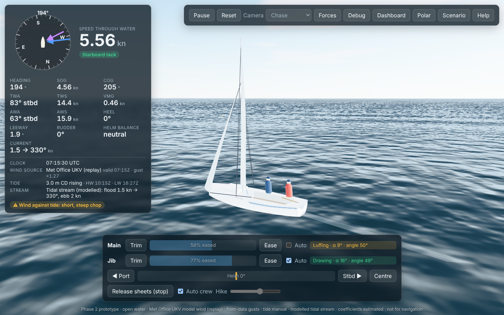

# Squib Sailing Simulator: Royal Dart / Dartmouth

A browser-based 3D sailing simulator for the National Squib one-design keelboat on the River Dart, based at the Royal Dart Yacht Club, Kingswear. It aims for:

- a sailing physics model that can be calibrated;
- geographically grounded scenery;
- authentic local courses, verified against official club documents.

## Status

| Phase | State |
|---|---|
| 0: research and feasibility | Done ([research report](docs/RESEARCH_REPORT.md)) |
| 1: a working boat in simple water | Done, 22 Oct 2026 ([phase report](docs/PHASE1_REPORT.md)) |
| **2: tested physics (dynamic roll, hinged boom, gusts, tide and stream, Met Office wind, dashboard, calibration workflow)** | **Done, 22 Oct 2026** ([phase report](docs/PHASE2_REPORT.md)) |
| 3: River Dart environment | Next |
| 4: courses · 5: racing and AI · 6: polish and deployment | Planned ([plan](docs/DEVELOPMENT_PLAN.md)) |

Physics coefficients are **estimates** awaiting Squib performance data ([calibration workflow](docs/CALIBRATION.md)). The tidal stream is a provisional model, and Met Office wind is forecast-model output. This is not for navigation or performance prediction.



## Quick start

Requires Node.js 22+.

```bash
npm install          # .npmrc sets legacy-peer-deps (works around an npm peer-resolution bug)
npm run dev          # open the printed URL; press H in the app for help
```

| Command | What it does |
|---|---|
| `npm run dev` | Development server with hot reload |
| `npm run build` | Typecheck everything, then build static files to `dist/` |
| `npm run preview` | Serve the production build on http://localhost:4173 |
| `npm test` | Physics, environment, calibration and golden-trace tests (Vitest, about 35 s) |
| `npm run test:e2e` | Build, serve and run the browser tests (Playwright). Uses `/opt/pw-browsers/chromium` or `$PW_CHROMIUM` |
| `npm run typecheck` / `npm run lint` | TypeScript (app, DOM-free sim, tests) and ESLint |
| `npm run scenario -- scenarios/beat-10kn.json` | Run a scenario headlessly and write a CSV trace to `out/` |
| `npm run polar` | Model-output speed table (not validated data) |
| `npm run params` | Regenerate [docs/PARAMETERS.md](docs/PARAMETERS.md) from the boat data |
| `npm run calibrate -- obs.csv [--fit knobs]` | Compare the model with observed sailing points; optionally fit coefficient multipliers ([how](docs/CALIBRATION.md)) |
| `npm run golden:update` | Regenerate the golden regression traces after an intended physics change |
| `npm run perf` | Physics cost per frame for 21 boats |

## Controls

| Key | Action |
|---|---|
| A / ← and D / → | Steer to port / starboard (hold; the helm self-centres; hold Shift to keep it) |
| W / ↑ and S / ↓ | Trim / ease the mainsheet |
| E / Q | Trim / ease the jib sheet |
| M / J | Auto-trim assist for main / jib |
| K | Auto crew weight |
| X | Release both sheets (stop) |
| Space | Centre the helm |
| P / R | Pause / reset |
| C | Cycle camera |
| F / G | Force arrows / physics panel |
| V | Validation dashboard (live charts, table, CSV export) |
| H | Help |

On-screen buttons provide the same controls. The toolbar also opens the **Polar** panel (model polar computed in a Web Worker) and the **Scenario** panel (start time, wind source, gusts, tide, current).

## Real-time conditions

| Input | Source | In this build |
|---|---|---|
| Wind | Met Office UKV 2 km model (AWS Open Data), spatially interpolated, with gust and shift statistics from the model and nearby observations | The app offers `live/latest.json` when it is published next to the app (scheduled ingest, Phase 6), and always offers a bundled, dated replay. Labelled as model output, with its age |
| Tide height | Manual HW/LW from tide tables; UKHO predictions plus the EA Dartmouth gauge via a snapshot file | Manual entry works. Live fetching needs the EA and UKHO hosts and a UKHO key kept server-side ([LIVE_TIDES.md](docs/LIVE_TIDES.md)) |
| Tidal stream | Provisional model driven by the tide timing | Labelled "modelled": not measured current data |

No API keys are in the client code.

## Project layout

```
src/sim/      physics core: pure TypeScript, no DOM/Three/React (lint and tsconfig enforced)
src/render/   Three.js scene, water, procedural Squib, wake, force arrows
src/ui/       React instruments, controls, dashboard, polar, debug, scenario and help panels
src/app/      game loop (fixed 100 Hz step with render interpolation), input, telemetry, polar worker
public/live/  weather files the app discovers (dated Met Office replay; live file when deployed)
data/boats/   class data and calibration coefficients, each with source and confidence tag
data/observations/  template for observed sailing points (calibration); no data yet
scenarios/    repeatable headless scenarios (JSON)
tests/        Vitest (sim) and Playwright (browser) suites, golden traces, fixtures (synthetic ones labelled)
tools/        scenario runner, polar, parameter table, golden traces, calibration, performance
research/     Phase 0 geodata and live-weather feasibility scripts (Python)
docs/         research, sources, architecture, plan, physics, parameters, reports
```

## Documentation

| Document | Contents |
|---|---|
| [docs/PHASE2_REPORT.md](docs/PHASE2_REPORT.md) | Phase 2: what works, test results, criteria, changes, known defects, manual test steps |
| [docs/PHASE1_REPORT.md](docs/PHASE1_REPORT.md) | Phase 1 report |
| [docs/PHYSICS.md](docs/PHYSICS.md) | Every force and environment model, its equations and conventions, plus model outputs |
| [docs/CALIBRATION.md](docs/CALIBRATION.md) | How to compare the model with observations and fit coefficients |
| [docs/PARAMETERS.md](docs/PARAMETERS.md) | Generated table of every boat parameter with value, unit, tag and source |
| [docs/RESEARCH_REPORT.md](docs/RESEARCH_REPORT.md) | Phase 0 findings with confidence tags |
| [docs/SOURCES.md](docs/SOURCES.md) | Source register |
| [docs/MISSING_INFORMATION.md](docs/MISSING_INFORMATION.md) | Documents, data and decisions still needed |
| [docs/ARCHITECTURE.md](docs/ARCHITECTURE.md) | Architecture and trade-offs |
| [docs/DEVELOPMENT_PLAN.md](docs/DEVELOPMENT_PLAN.md) | Phases and acceptance criteria |
| [docs/LIVE_WEATHER.md](docs/LIVE_WEATHER.md), [docs/LIVE_TIDES.md](docs/LIVE_TIDES.md) | Real-time wind and tide: sources and design |
| [docs/OUTSTANDING_ISSUES.md](docs/OUTSTANDING_ISSUES.md) | Open issues and risks |

## Research spikes (Python)

```bash
python3 -m venv .venv && .venv/bin/pip install -r research/geodata/requirements.txt -r research/weather/requirements.txt
.venv/bin/python -I research/geodata/extract_overture.py /tmp/dart-extract
.venv/bin/python -I research/geodata/feasibility_report.py /tmp/dart-extract research/geodata/output
.venv/bin/python -I research/geodata/probe_terrain.py
.venv/bin/python -I research/weather/live_conditions.py /tmp/live.json
```

## Data attribution

| Data | Attribution and licence |
|---|---|
| Map data (research) | © OpenStreetMap contributors, ODbL 1.0, via Overture Maps Foundation |
| Weather (app replay and research) | British Crown copyright, the Met Office, CC BY-SA 4.0 (UKV model and land observations, via AWS Open Data) |
| Tide gauges (planned) | Contains Environment Agency data, Open Government Licence v3; UKHO predictions © Crown copyright (terms to confirm) |
| Terrain (research) | © Environment Agency copyright and/or database right 2015. All rights reserved. Open Government Licence v3, via Tilezen terrain tiles |
