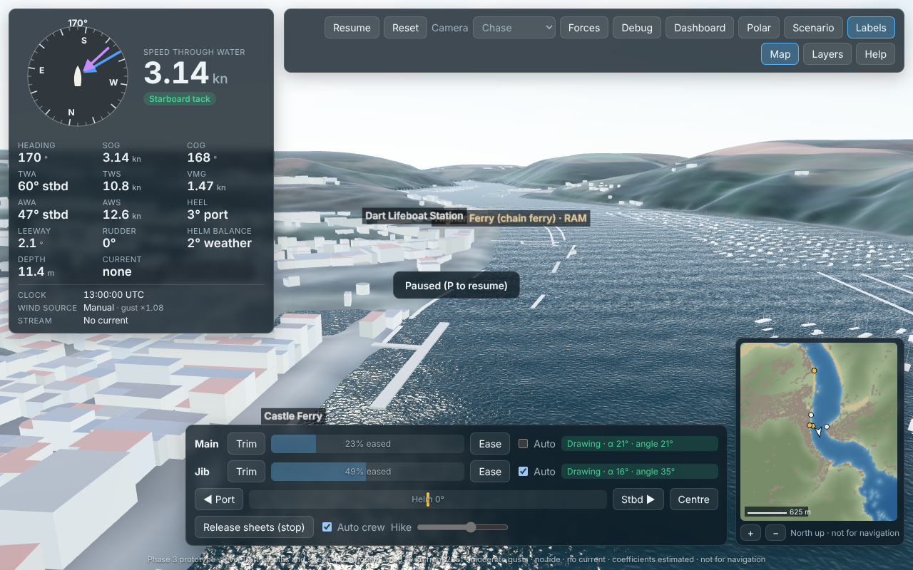

# Squib Sailing Simulator: Royal Dart / Dartmouth

A browser-based 3D sailing simulator for the National Squib one-design keelboat on the River Dart, based at the Royal Dart Yacht Club, Kingswear. It aims for:

- a sailing physics model that can be calibrated;
- geographically grounded scenery;
- authentic local courses, verified against official club documents.

## Status

| Phase | State |
|---|---|
| 0: research and feasibility | Done ([research report](docs/RESEARCH_REPORT.md)) |
| 1: a working boat in simple water | Done, 22 Oct 2026 ([phase report](docs/PHASE1_REPORT.md)) |
| 2: tested physics (dynamic roll, hinged boom, gusts, tide and stream, Met Office wind, dashboard, calibration workflow) | Done, 22 Oct 2026 ([phase report](docs/PHASE2_REPORT.md)) |
| 3: the River Dart from open data (terrain, buildings, piers, moorings, ferries, grounding, channel stream, minimap) | Done, 22 Oct 2026 ([phase report](docs/PHASE3_REPORT.md)) |
| 4: courses, course judge and editor (practice courses, validation, starts, roundings, finishes) | Done, 22 Oct 2026 ([phase report](docs/PHASE4_REPORT.md)). No RDYC club courses yet: the documents are needed |
| 5: race management and AI competitors (fleet physics and contact, race committee, rules subset, penalties, results, AI Squibs) | Done, 23 Oct 2026 ([phase report](docs/PHASE5_REPORT.md), [racing](docs/RACING.md)) |
| **6: deployment, live data, visual weather, replays, scenario library, performance** | **Done, 23 Oct 2026** ([phase report](docs/PHASE6_REPORT.md), [deployment](docs/DEPLOYMENT.md)). Deployed 24 Oct 2026 from [DrDK3/SailSim](https://github.com/DrDK3/SailSim) to GitHub Pages, with the live-data job running |
| UX review: watertight boat, crew and buildings, tutorial, phone layout | Done, 24 Oct 2026 ([review](docs/UX_REVIEW.md)) |
| Hi-fi: three Squib types with their physics, detailed Squib with the RDYC burgee and transom, wind over tide, river traffic, town roofs | Done, 25 Oct 2026 ([report](docs/HIFI_REPORT.md)) |
| Hi-fi, second pass: closed transom and boats riding the waves, sailors posed by inverse kinematics, remodelled river traffic, no flooded streets or buried floors, woodland and terrain detail | Done, 25 Oct 2026 ([report](docs/HIFI2_REPORT.md)) |
| Round 3: Lower Ferry units pass port to port and berth with the tide, marinas full of boats with traffic from every marina, Kingswear station and steam trains, a decluttered screen | Done, 27 Oct 2026 ([report](docs/HIFI3_REPORT.md)) |

**New here?** The app opens with a welcome and a five-minute **interactive tutorial** (steer, trim, tack, gybe, stop), which checks each step as you sail. It can be restarted from More → Tutorial or from Help. A usability review and the changes it led to are in [docs/UX_REVIEW.md](docs/UX_REVIEW.md).

**Choose your Squib** in Scenario → Boat: the Rondar (the modern standard, self-draining), a classic Hunter or Parker hull (keeps the water it ships until it is bailed), or the new Hyde B3 / Batt sail package. Waves follow the wind, the fetch and the tidal stream, so the harbour entrance is short and steep with wind against tide; the ferries and the marinas' boats move with the clock and the stream, and the steam trains come and go at Kingswear on the published timetable.

Physics coefficients are **estimates** awaiting Squib performance data ([calibration workflow](docs/CALIBRATION.md)). Mid-channel depths, individual moorings, ferry timetables and the tidal stream are provisional estimates (the in-app **Layers** panel lists them), and Met Office wind is forecast-model output. This is not for navigation or performance prediction.



## Quick start

Requires Node.js 22+.

```bash
npm install          # .npmrc sets legacy-peer-deps (works around an npm peer-resolution bug)
npm run dev          # open the printed URL; press H in the app for help
```

| Command | What it does |
|---|---|
| `npm run dev` | Development server with hot reload |
| `npm run build` | Typecheck everything, build static files to `dist/`, then check them for secrets (`npm run check:secrets`) |
| `npm run preview` | Serve the production build on http://localhost:4173 |
| `npm test` | Physics, environment, calibration and golden-trace tests (Vitest, about 35 s) |
| `npm run test:e2e` | Build, serve and run the browser tests (Playwright) on the production build, at the root and under a GitHub Pages sub-path. Uses `/opt/pw-browsers/chromium` or `$PW_CHROMIUM` |
| `.venv/bin/python -I -m unittest discover -s tools/ingest -p 'test_*.py'` | Live-data ingest tests (weather, tide, harmonics, index); `tools/ingest/requirements.txt` |
| `node tools/load-timing.mjs URL [Mbit/s] [runs]` | Loading time and bytes over a throttled connection ([how](docs/PERFORMANCE.md)) |
| `npm run typecheck` / `npm run lint` | TypeScript (app, DOM-free sim, tests) and ESLint |
| `npm run scenario -- scenarios/beat-10kn.json` | Run a scenario headlessly and write a CSV trace to `out/` |
| `npm run polar` | Model-output speed table (not validated data) |
| `npm run params` | Regenerate [docs/PARAMETERS.md](docs/PARAMETERS.md) from the boat data |
| `npm run calibrate -- obs.csv [--fit knobs]` | Compare the model with observed sailing points; optionally fit coefficient multipliers ([how](docs/CALIBRATION.md)) |
| `npm run golden:update` | Regenerate the golden regression traces after an intended physics change |
| `npm run perf` | Criterion 12: cost per frame for 21 boats on the River Dart (physics only) and for a full race with 20 AI boats |
| `npm run ai:trials [-- --runs 100 --boats 5 --first 1 --river]` | Phase 5 acceptance: seeded AI races in parallel processes, clean-run rate, every contact listed (`out/ai-trials.json`); `--first 101` runs seeds the AI was not tuned on |
| `npm run ai:polar` | Regenerate the AI target-speed table from the boat parameters (model output) |
| `.venv/bin/python -I tools/geodata/build.py EXTRACT` | Rebuild the River Dart data in `public/geo/` from open data ([how](docs/GEODATA.md)); not needed to run the app |

## Controls

| Key | Action |
|---|---|
| A / ← and D / → | Steer to port / starboard (hold; the helm self-centres; hold Shift to keep it) |
| W / ↑ and S / ↓ | Trim / ease the mainsheet |
| E / Q | Trim / ease the jib sheet |
| M / J | Auto-trim assist for main / jib |
| K | Auto crew weight |
| X | Release both sheets (the sails luff; head to wind as well to stop) |
| Space | Centre the helm |
| P / R | Pause / reset (in a race that has started, reset asks first) |
| Esc | Close the open panels and menus |
| C | Cycle camera: chase, helm (drag to look round), orbit, drone (drag, right-drag to pan, wheel to climb), top |
| B | Drone view: back to the boat |
| Z / Shift+Z | Flatten the sails to depower / power them up, a quarter at a time |
| F / G | Force arrows / physics panel |
| V | Validation dashboard (live charts, table, CSV export) |
| L / N | Place labels / minimap |
| H | Help |

On-screen buttons provide the same controls, with their keys shown on them. The sail status is one word when all is well and says what to do when not ("Luffing · trim in (W)"). The sailing controls can be put away (▾) when you sail by keyboard. On a phone the toolbar folds behind a Menu button.

The toolbar keeps to the essentials:
- **Pause** (or **Resume**), **Reset** and the **camera**;
- **Race**: a quick race in one step (0–20 AI boats, their level, Start Bay or the river, random, live or as-set conditions), with the **race coach** (briefing, tips, debrief);
- **Library** and **Scenario**;
- **More**: the **Tutorial** and the **course editor**; what is shown (labels, minimap, sailing controls, force arrows, layers and sources); the physics tools (validation dashboard, polar sweep, physics panel);
- **Help** (?).

The instruments show the essentials; **All instruments and conditions** opens the rest, and the choice is remembered.

The panels:
- the **Polar** panel: the model polar, computed in a Web Worker;
- the **Scenario** panel: start position and time, wind source, gusts, tide, current, course, start sequence, and the fleet (0–20 AI boats, their level, the preparatory flag: [docs/RACING.md](docs/RACING.md));
- the **Layers** panel: what is data and what is provisional, with sources and licences;
- the **Courses** editor: draw, check, import and export courses ([docs/COURSES.md](docs/COURSES.md));
- the **Library**: ready-made scenarios (light air, fresh and shifty, wind against tide, fog, rain, sunset, practice and river races, a Met Office forecast replay), your own saved scenarios, scenario export and import, and **replays**. Save a replay of the run as a file; opening it plays the run again, checks it matches bit for bit, at ×1 to ×8, and lets you take over at any point.

## Real-time conditions

| Input | Source | In this build |
|---|---|---|
| Wind | Met Office UKV 2 km model (AWS Open Data), spatially interpolated, following the forecast every 15 min, with gust and shift statistics from the model and nearby observations | A scheduled job publishes `live/latest.json` every 30 min on the deployed site; the app judges it fresh, stale or expired. Two dated replays are bundled. Labelled as model output, with its age |
| Sky | The same forecast: cloud, visibility, rain (hourly); or a preset | Visual only: cloud layer, fog, rain, and the sun for the run's time |
| Tide height | EA Dartmouth gauge; UKHO predictions (optional key, kept in CI only) or predictions derived from the gauge's own harmonic constants; or manual HW/LW | The tide job is built but tested on fixtures only: the EA and UKHO hosts are blocked here ([LIVE_TIDES.md](docs/LIVE_TIDES.md), [DEPLOYMENT.md](docs/DEPLOYMENT.md)) |
| Tidal stream | Provisional channel-following model on the River Dart, driven by the tide timing | Labelled "modelled": not measured current data |
| Water depth | LIDAR near the shore; provisional estimate mid-channel; level from the tide | The boat can run aground |

No API keys are in the client code; the build fails if one appears in `dist/`. **External services:** none at run time beyond static hosting. The scheduled jobs need GitHub Actions; the UKHO tide API is optional (free tier); costs are in [DEPLOYMENT.md](docs/DEPLOYMENT.md#6-costs) (£0 on a public GitHub repository).

## Project layout

```
src/sim/      physics core: pure TypeScript, no DOM/Three/React (lint and tsconfig enforced)
src/sim/race/ fleet and contact, race committee, rules subset, race session, trials
src/sim/ai/   AI skippers, AI sheet handling, AI target-speed polar
src/render/   Three.js scene, water (with per-boat deck masks), procedural Squib and crew, wake, force arrows, River Dart (terrain, buildings with roofs and windows, piers, moorings, ferries)
src/ui/       React instruments, controls, toolbar menus, welcome, tutorial card, dashboard, polar, debug, scenario, library and help panels
src/app/      game loop (fixed 100 Hz step with render interpolation), input, telemetry, polar worker, replays, scenario library, tutorial
public/live/  data files the app discovers through index.json (bundled Met Office replays; live weather and tide when deployed)
public/geo/   River Dart data (packed elevation and stream grids, drape, minimap, features, manifest with provenance)
.github/      CI, deploy to GitHub Pages, scheduled live data and tide harmonics
data/boats/   class data and calibration coefficients, each with source and confidence tag
data/observations/  template for observed sailing points (calibration); no data yet
data/courses/ simulated practice courses; club/ for RDYC courses entered from official documents (none yet)
scenarios/    repeatable headless scenarios (JSON)
tests/        Vitest (sim) and Playwright (browser) suites, golden traces, fixtures (synthetic ones labelled)
tools/        scenario runner, polar, parameter table, golden traces, calibration, performance, secret check, Pages-like server; geodata/ and ingest/ (Python); ci/ (publish scripts)
research/     Phase 0 geodata and live-weather feasibility scripts (Python)
docs/         research, sources, architecture, plan, physics, parameters, reports
```

## Documentation

| Document | Contents |
|---|---|
| [docs/HIFI_REPORT.md](docs/HIFI_REPORT.md) | Hi-fi pass: Squib types and their physics, the detailed Squib, burgee and transom, wind over tide, river traffic, town roofs; sources, estimates and gaps |
| [docs/HIFI2_REPORT.md](docs/HIFI2_REPORT.md) | Hi-fi, second pass: the stern, the sailors, the houses, the traffic and the overall look, with what was found and fixed |
| [docs/HIFI3_REPORT.md](docs/HIFI3_REPORT.md) | Round 3: the Lower Ferry's passing and berths, the marinas and their traffic, Kingswear station and the trains, the redesigned screen |
| [docs/REDTEAM_REPORT.md](docs/REDTEAM_REPORT.md) | Red-team round: overpowered and gusts (depowering), drone and first-person views, the quick race and the coach, random and live conditions, landmarks, streets and people |
| [docs/UX_REVIEW.md](docs/UX_REVIEW.md) | Usability review (heuristics, accessibility, phones): findings, severities, changes, what is not done |
| [docs/PHASE6_REPORT.md](docs/PHASE6_REPORT.md) | Phase 6: what works, test results, acceptance, decisions, known defects, manual test steps |
| [docs/DEPLOYMENT.md](docs/DEPLOYMENT.md) | Publishing to GitHub Pages, the scheduled live-data jobs, freshness rules, automatic checks, first-run checklist, costs |
| [docs/PERFORMANCE.md](docs/PERFORMANCE.md) | Simulation cost per frame, download size and load profile, how to measure |
| [docs/PHASE5_REPORT.md](docs/PHASE5_REPORT.md) | Phase 5 report |
| [docs/RACING.md](docs/RACING.md) | Fleet contact, race committee, the racing-rules subset, penalties, scoring and how the AI sails |
| [docs/PHASE4_REPORT.md](docs/PHASE4_REPORT.md) | Phase 4 report |
| [docs/COURSES.md](docs/COURSES.md) | Course format, validation rules, how the judge works, entering and verifying club courses |
| [docs/PHASE3_REPORT.md](docs/PHASE3_REPORT.md) | Phase 3 report |
| [docs/GEODATA.md](docs/GEODATA.md) | River Dart data: frame, datums, every layer with source and method, rebuild steps, checks |
| [docs/PHASE2_REPORT.md](docs/PHASE2_REPORT.md) | Phase 2 report |
| [docs/PHASE1_REPORT.md](docs/PHASE1_REPORT.md) | Phase 1 report |
| [docs/PHYSICS.md](docs/PHYSICS.md) | Every force and environment model, its equations and conventions, plus model outputs |
| [docs/CALIBRATION.md](docs/CALIBRATION.md) | How to compare the model with observations and fit coefficients |
| [docs/PARAMETERS.md](docs/PARAMETERS.md) | Generated table of every boat parameter with value, unit, tag and source |
| [docs/RESEARCH_REPORT.md](docs/RESEARCH_REPORT.md) | Phase 0 findings with confidence tags |
| [docs/SOURCES.md](docs/SOURCES.md) | Source register |
| [docs/MISSING_INFORMATION.md](docs/MISSING_INFORMATION.md) | Documents, data and decisions still needed |
| [docs/ARCHITECTURE.md](docs/ARCHITECTURE.md) | Architecture and trade-offs |
| [docs/DEVELOPMENT_PLAN.md](docs/DEVELOPMENT_PLAN.md) | Phases and acceptance criteria |
| [docs/LIVE_WEATHER.md](docs/LIVE_WEATHER.md), [docs/LIVE_TIDES.md](docs/LIVE_TIDES.md) | Real-time wind and tide: sources and design |
| [docs/OUTSTANDING_ISSUES.md](docs/OUTSTANDING_ISSUES.md) | Open issues and risks |

## Research spikes (Python)

```bash
python3 -m venv .venv && .venv/bin/pip install -r research/geodata/requirements.txt -r research/weather/requirements.txt
.venv/bin/python -I research/geodata/extract_overture.py /tmp/dart-extract
.venv/bin/python -I research/geodata/feasibility_report.py /tmp/dart-extract research/geodata/output
.venv/bin/python -I research/geodata/probe_terrain.py
.venv/bin/python -I research/weather/live_conditions.py /tmp/live.json
```

## Data attribution

| Data | Attribution and licence |
|---|---|
| Map data | © OpenStreetMap contributors, ODbL 1.0, via Overture Maps Foundation; Microsoft ML Building Footprints, ODbL |
| Satellite colour | Contains modified Copernicus Sentinel data 2025 |
| Weather (app replay and research) | British Crown copyright, the Met Office, CC BY-SA 4.0 (UKV model and land observations, via AWS Open Data) |
| Tide (when deployed) | Contains Environment Agency data, Open Government Licence v3; UKHO predictions © Crown copyright (terms to confirm before publishing them: OUTSTANDING_ISSUES 15) |
| Terrain | © Environment Agency copyright and/or database right 2015. All rights reserved. Open Government Licence v3, via Tilezen terrain tiles |
