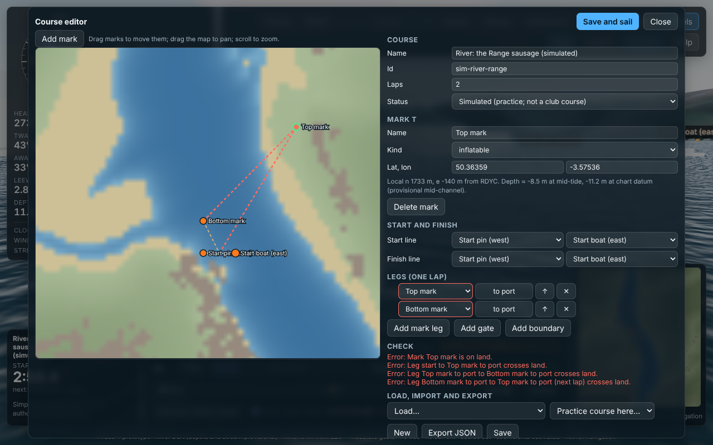

# Courses: format, validation, judging and club courses



## Kinds of course

| Kind | Where it comes from | Status | Shown as |
|---|---|---|---|
| **Practice** | Generated at the start position, relative to the wind: windward–leeward, triangle, tacking lane, gybing slalom, mark-rounding drill (`src/sim/course/practice.ts`) | `simulated` | "… (simulated)", amber "Simulated course" chip |
| **Simulated library** | Fixed practice courses shipped with the app (`data/courses/simulated/*.course.json`). One so far: *River: the Range sausage*, a windward–leeward up and down the Range between Sandquay and Noss. Its start lies in the wide part of the Range, clear of the Sandquay pontoons, the Hindostan and Dart Marina (moved 180 m upriver in the fix round, 29 Oct 2026) | `simulated` | as above |
| **User** | Drawn or imported in the course editor; saved in the viewer's browser only (export to keep or share) | `simulated` (or club statuses, see below) | "Mine: …" |
| **Club (RDYC)** | Entered from official club documents (`data/courses/club/`) | `pending-check` → `verified` | **None yet**: no RDYC documents have been made available |

No course is presented as an RDYC course unless it was entered from a named club document. A course becomes `verified` only when a named person has checked it against that document on a stated date.

## Course file format (`squib-course/1`)

```json
{
  "schema": "squib-course/1",
  "id": "sim-river-range",
  "name": "River: the Range sausage (simulated)",
  "status": "simulated",
  "provenance": { "kind": "simulated", "notes": "…" },
  "marks": [
    { "id": "S1", "name": "Start pin (west)", "kind": "pin", "position": { "n": 1560, "e": -430 } },
    { "id": "T", "name": "Top mark", "kind": "inflatable", "position": { "lat": 50.3646, "lon": -3.5799 } }
  ],
  "start": { "ends": ["S1", "S2"] },
  "legs": [
    { "type": "mark", "mark": "T", "rounding": "port" },
    { "type": "gate", "marks": ["G1", "G2"] }
  ],
  "laps": 2,
  "finish": { "ends": ["S1", "S2"] },
  "boundaries": [{ "ends": ["L1", "L2"], "label": "Lane left side" }]
}
```

| Field | Meaning |
|---|---|
| `marks[].position` | `{lat, lon}` (WGS84, as in club documents) or `{n, e}`: metres north and east of the RDYC origin, in the app's Transverse Mercator frame (`GEODATA.md`) |
| `marks[].kind` | `inflatable`, `pin`, `committee-boat`, `nav-buoy`, `fixed` or `virtual` (boundary ends: drawn as small posts) |
| `start`, `finish` | Lines between two marks. The course side of the start is the side the first mark is on. The finish is crossed from the side the last mark is on |
| `legs` | One lap: `mark` legs (leave the mark to `port` or `starboard`) or `gate` legs (sail between the two marks from the direction of the previous mark) |
| `laps` | 1–20; the legs are repeated, then the boat finishes |
| `boundaries` | Lines that must not be crossed (each crossing is reported) |
| `provenance` | `kind` (`simulated`, `user`, `club-document`), plus for club courses: `document`, `reference`, `enteredBy`, `enteredOn`, `checkedBy`, `checkedOn`, `notes` |

## Validation (`src/sim/course/validate.ts`)

Run on every course before it can be sailed, and live in the editor. **Errors** block a course; **warnings** are shown.

| Check | Severity |
|---|---|
| Schema: types, unique ids, every referenced mark exists, gates of two different marks, laps 1–20 | error |
| Status and provenance: club statuses need a club document; `verified` needs `checkedBy` and `checkedOn`; a club course cannot be `simulated` | error |
| Start or finish line shorter than 20 m; the first or last mark (nearly) on the line | error |
| A leg of zero length | error |
| A leg shorter than 40 m; a gate narrower than 15 m | warning |
| A rounding side that contradicts the turn (e.g. a mark to port where the course turns right: boats pass it rather than round it) | warning |
| **Mark on land** (ground above +2.3 m ODN ≈ MHWS) | error |
| Mark in less than the draft (0.99 m) at mid-tide | error |
| Mark with less than draft + 0.3 m at chart datum (low water springs) | warning |
| **Leg, start, finish or boundary line crossing land** | error |
| Leg or line crossing water shallower than the draft at mid-tide | warning |
| **Mark within a ferry corridor** (Lower 40 m, Higher 50 m, passenger 25 m, Castle 20 m either side of the OSM track, E) | error |
| **Start or finish line within a ferry corridor** | error |
| Leg crossing a ferry track (RAM ferries: keep clear) | warning |
| **Mark inside a mooring area** (Kingswear, Noss, Distins Trots; DHNA anchorage) | error |
| **Start or finish line through a mooring area** | error |
| Leg through a mooring area | warning |
| Mark outside the River Dart data | warning (land and depth not checked) |

- **Land and depth:** they use the River Dart elevation grid. Mid-channel depths there are provisional (`GEODATA.md`).
- **Not checked:** fairways under the harbour byelaws and regatta exclusion zones are not established (N).

## Judging (`src/sim/course/judge.ts`)

A simplified reading of the Racing Rules of Sailing (the definitions Start, Finish and Sail the Course; rules 28 and 29.1), **not an authoritative adjudication**. The 2025–2028 rulebook text could not be inspected here; the behaviour follows secondary summaries (`SOURCES.md`, RR1–RR4).

### Start

- **Signals:** the start signal falls exactly on a 10 ms physics step. Practice sequences are 1, 3 or 5 minutes; the 5-minute one has warning, preparatory and one-minute signals.
- **Hull reference points:** bow, stern, and both sides at the widest point. Crew and equipment, such as the boom over the side, are not modelled.
- **OCS:** a boat is OCS if any reference point is on the course side of the starting line *or its extension* at the signal. She must then return entirely to the pre-start side before she can start.
- **Starting:** a boat starts when, having been entirely on the pre-start side at or after the signal, any reference point crosses the line between its ends towards the first mark. Crossing the extension does not count.

### Marks: the taut-string idea

For each mark leg, the judge follows the angle W swept by the bearing from the mark to the boat. Leaving the mark to port means going anticlockwise round it, from the ray towards the previous point to the ray towards the next point; to starboard, clockwise.

| Situation | Verdict |
|---|---|
| Halfway round on the required side (for a windward mark: passing upwind of it) | **Rounded**. Credited there because a boat sailing straight on to the next mark may never cross the ray towards it |
| The course doubles back at the mark (windward–leeward) | Needs a full turn round the mark |
| Going round the wrong way (at least a quarter turn the other way) | **Wrong side** warning. The mark still has to be rounded; unwinding and going round correctly counts (rule 28 lets a boat correct errors) |
| Going back round after a rounding, before completing the next leg | **Rounding undone** |
| Extra full turns after a correct rounding | **Extra loop**: reported, but allowed (Case 90, as summarised: extra turns are not prohibited if the string lies on the required side) |
| Rounding a later mark of the lap first | **Out of order**: does not count; it must be rounded again in sequence |
| Crossing the finishing line before all legs are done | **Finish incomplete**: the boat is still racing |

**Gates:** a gate counts when the track crosses between the gate marks from the side of the previous mark.

**Boundaries:** each crossing, either way, is reported.

### Finish

A boat finishes when, having sailed the course, any reference point crosses the finishing line from the course side.

### Crossing times

Crossing times are interpolated linearly within the 10 ms step:
- **Straight-line crossings:** error below 10⁻¹⁰ ms.
- **Crossings on a 15 m-radius turn:** error about 4×10⁻⁷ ms.
- **Repeat runs:** 100 repeated simulated runs give bit-identical start and finish times.

### Acceptance tests (criteria 9 and 10)

Criterion 9 is tested in `tests/sim/course-judge.test.ts` on synthetic tracks:
- correct course;
- wrong side;
- skipped mark;
- wrong order;
- unwinding loop;
- extra loop;
- rounding undone;
- gates and boundaries;
- starboard mirror.

All give the expected verdicts.

Criterion 10 is tested in the same file:
- 100 straight-line crossings;
- a crossing on a curve;
- six OCS poses (bow, stern and beam over, behind by 1 cm, over the extension);
- an OCS boat returning to start;
- 100 repeated physics runs.

## Entering an RDYC club course (when documents are available)

1. **Open:** in the app, **Courses** → **New**. Set the status to *Club course: entered from a document, pending check*. Fill in *Document* (title, edition, date), *Reference* (course letter or page) and *Entered by*.
2. **Marks:** add the marks and enter their positions as given in the document. Use latitude and longitude for fixed marks and navigation buoys, in decimal degrees; convert degrees and minutes first. Set each mark's kind.
3. **Lines and legs:** set the start and finish lines. Add the legs in order with their rounding sides, and gates as specified. Set the laps.
4. **Check:** fix every error the check reports. Warnings that reflect the real course, such as a leg crossing a ferry track, can stay; explain them in the notes.
5. **Export** the JSON and add it to `data/courses/club/` (one file per course), with the document reference in the provenance.
6. **Verify:** a nominated checker opens the course, compares every mark, rounding, line and lap with the document, sets the status to *verified* and adds *Checked by* and *Checked on*. They export the file again and commit it.

If the document is ambiguous (for example a mark without a position), do not guess: leave the course `pending-check` and record the question in `provenance.notes`.

## Not yet supported

- **Starting areas, recall rules and penalties:** no starting-area boundaries, I, Z, U or black flags (rule 30), general recalls, or penalty turns.
- **Moving marks:** marks don't drag their anchors or drift. Course changes during a race are not supported.
- **Spinnaker:** not modelled (decision D2).
- **Collisions and other boats:** marks, other boats and ferries are not obstacles yet (Phase 5).
