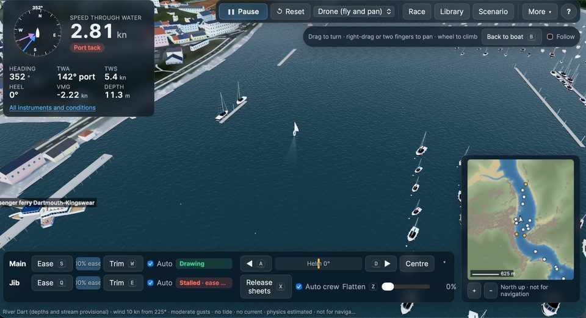
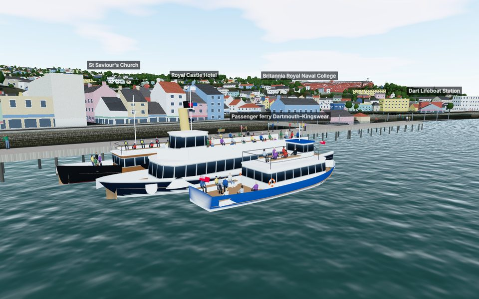
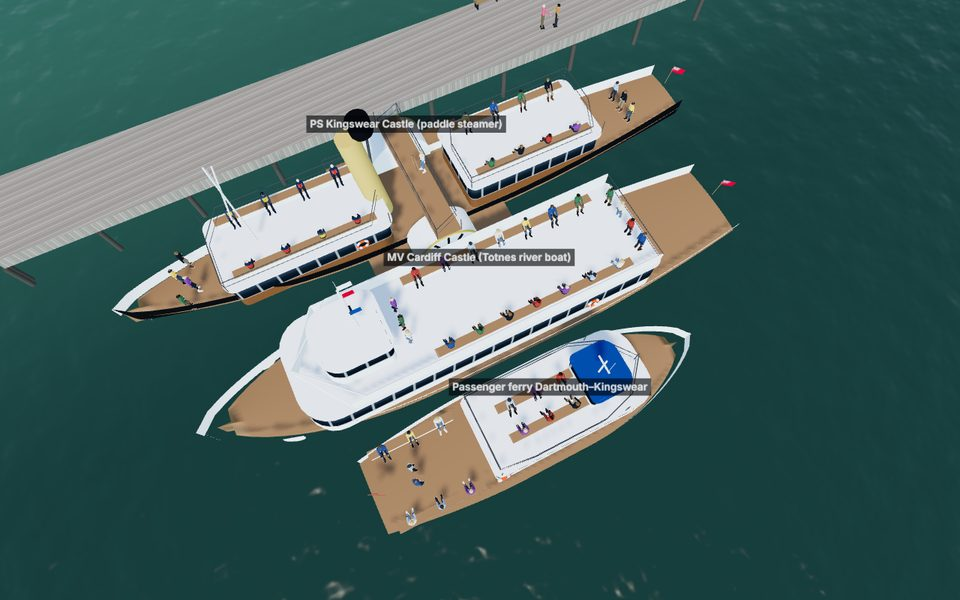
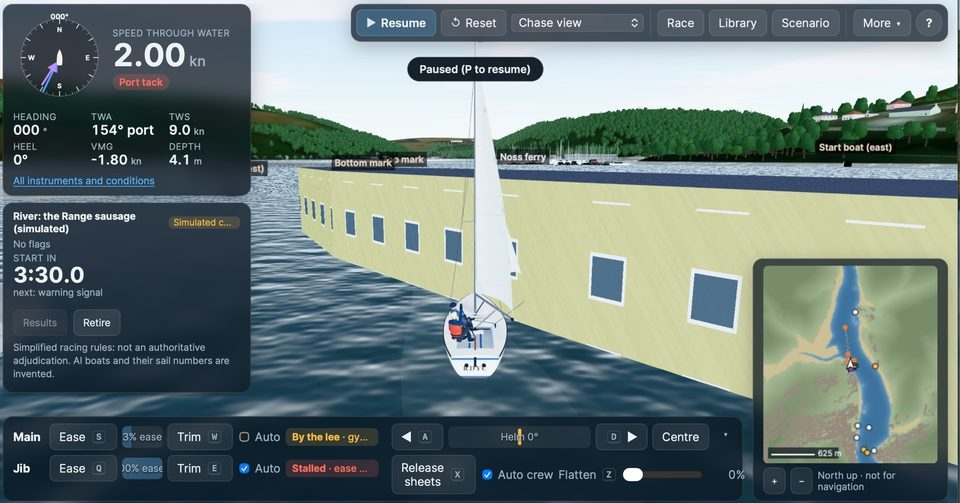
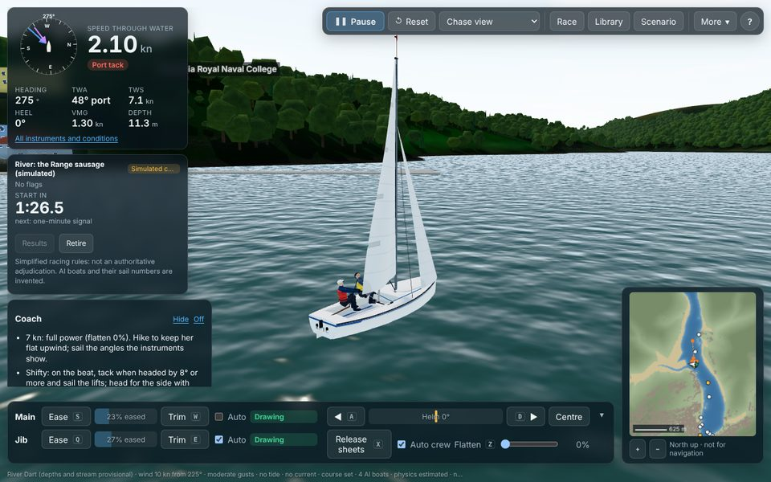
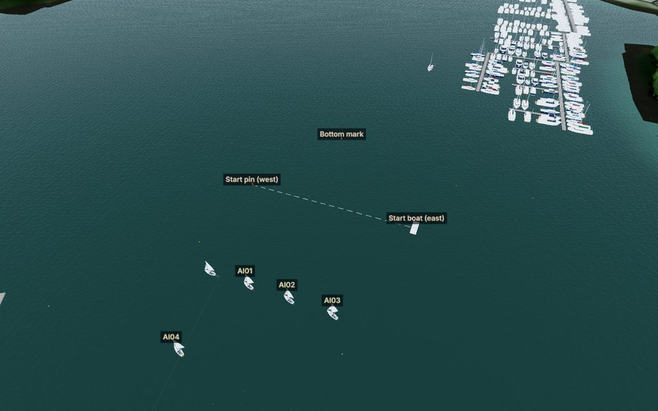
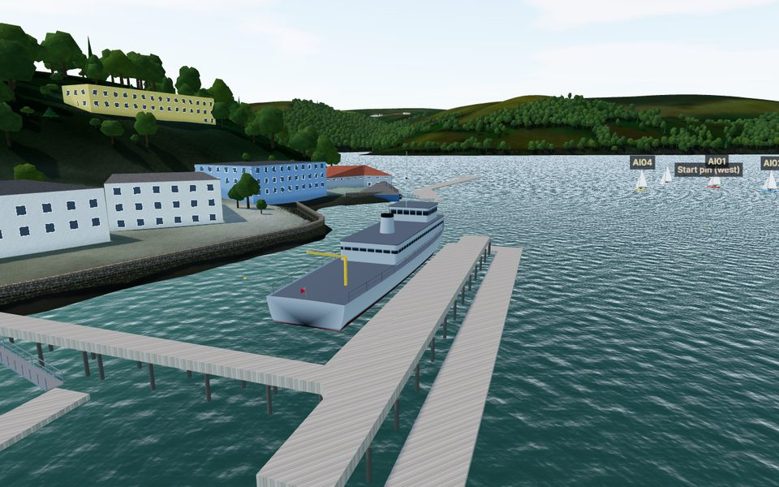

# Fix round: boats at their landings, the river start, the Cardiff Castle (29 Oct 2026)

The owner reported two faults, with screenshots, and supplied a photograph of MV Cardiff Castle:

1. **PS Kingswear Castle lay across the pontoon** at the South Embankment.
2. **At the start of a race on the river, the Squib was blocked by "some sort of building"** standing in the water.

Both are fixed. The Cardiff Castle is now drawn as the photograph shows her. **Nothing this round needs an external service or paid infrastructure.**

## 1. Boats lying across the pier

**Cause.** Each river boat's route is taken from OpenStreetMap (OSM). Most routes end on the edge of a pier, and the steamer's berth was a point on the Town Jetty. A boat at rest stopped *on* that point, heading along its last leg, so it lay half across the pier. The jetty is the end of five routes as well as the steamer's berth, so boats arriving there also lay on top of one another.

**Fix (`src/sim/env/landings.ts`, new).** Each end of a route and the steamer's berth are matched to the nearest pier edge. The edge must be within 15 m and face the way the boat comes in.

- **Placing the boats.** Boats sharing an edge lie along it in order, 2 m apart, parallel to it and fendered 0.6 m off.
- **When the edge is full.** A boat that does not fit lies alongside the boat nearest its place (rafted), as river boats do at the embankment.
- **Clearing other piers.** Each boat is then moved out, half a metre at a time, until it clears every pier, such as a jetty corner sticking out beside the landing.
- **Arriving and leaving.** Boats ease into this pose over their last 40 m and out of it over their first 40 m.

**Result.** At 11:05 local on 15 July, three boats lie at the Town Jetty: the Kingswear Castle alongside it, the Cardiff Castle outside her, and the passenger ferry outside that. Eleven landings are matched in all.

A check every ten minutes from 06:00 to 22:00 finds no boat at rest overlapping a pier or another boat by more than 5 cm (`tests/sim/landings.test.ts`).

## 2. The "building" at the river start

**What it was.** The "building" is the **Hindostan**, Britannia Royal Naval College's static training ship, moored off Sandquay. She is the former Sandown-class minehunter HMS Cromer (M103), 52.5 m long (N1 in SOURCES.md). OSM maps her as a building, so the app drew her as a house in the water. The race physics did not see her at all: boats could start beside her and sail through her.

The river course's start line lay just below her, among the Sandquay jetties. Start slots there could put a boat against her side.

**Fixes.**

| What | Change |
|---|---|
| **She is drawn as a ship** | A grey Sandown-class minehunter with a high flared bow, a long deckhouse with the bridge forward, a mast with a radar, a low funnel, a gun forward and a crane on the quarterdeck. She lies on OSM's outline, bow to its narrow north-west end, afloat with the tide (`minehunterModel`, `shipOnFootprint` in `src/render/traffic.ts`; `src/render/dart.ts`). Proportions are estimates (E) |
| **Buildings in the water are solid** | Any OSM building whose ground is under water is now a fixed outline in the race physics, as piers are. "Under water" means the bed at its centre, or at half its corners or more, is below 0.5 m ODN, about mean tide (E). Fourteen are found: the Hindostan, two boathouses, the ferry office and ten unnamed huts and offices on pontoons (`src/sim/env/structures.ts`) |
| **Start slots keep clear** | No start slot is placed within 12 m of a pier or any of these structures (`START_CLEARANCE.structureM`) |
| **The AI steers round them** | AI boats penalise tracks that pass within 6 m of a structure and treat one within 4 m as a hazard. After finishing, a boat parks in clear water it can reach in a straight line, at least 20 m from any structure and outside the moorings (`src/sim/ai/skipper.ts`) |
| **The river course moved upriver** | The Range sausage now starts 180 m further up, at the wide part of the Range, with the line from (1560 N, −430 E) to (1560 N, −340 E). The bottom mark is at 1620 N and the top mark at 1960 N. The start is clear of the Sandquay jetties, the Hindostan and Dart Marina (`data/courses/simulated/river-range-sausage.course.json`) |
| **The solo start and free sailing** | When the user sails alone, the starting position also avoids these structures and the quay walls. Free sailing meets them as obstacles too (`src/app/controller.ts`) |

**AI trials on the river.** There were 20 seeded races with 5 AI boats each (`npm run ai:trials -- --river --runs 20 --boats 5`), with the wind 6–14 kn from any direction and a 1.5 kn flood stream.

- **15 of 20 were clean.** 96% of boats finished.
- **No structure contacts and no groundings.** No boat touched the Hindostan or any other building.
- **The five runs that were not clean:**
  - two had boat-on-boat contacts (rules 10 and 13);
  - two had mark touches, one of which ended in a DNF;
  - one had a single contact with a pontoon.
- **The worst run (seed 17).** The wind was 7.3 kn from SSE, against the flood. One boat was over the line early (OCS) and could not beat back against the stream. It drifted into the lane behind the mid-river pontoons and lay pinned against them until the race ended. A second boat also touched those pontoons.

These remain open as issue 93. This is the first river trial the project has recorded (issue 40), so there is no earlier figure to compare with. The Start Bay trials and the physics are unchanged: the determinism hash is still `11824f89f479d0f4`.

## 3. MV Cardiff Castle from the owner's photograph (P3)

The photograph shows:

- a dark navy hull with a white crest on the bow and a white band at the gunwale;
- a long main saloon with large windows;
- an upper deck behind a solid white bulwark, lined with passengers;
- a raised wheelhouse forward;
- a tall white mast with a radar and flags;
- no funnel to be seen.

The model now follows it (`cruiserModel` in `src/render/traffic.ts`):

- **Removed:** the earlier estimate's buff funnel.
- **Added:** the white bulwark round the upper deck with passengers along it; the wheelhouse forward with the mast and its flags.
- **Bow crest:** drawn as a plain white shield; its device is not drawn.
- **Hull:** the navy darkened to the photograph's.

The photograph is a small one: sizes and the crest's shape are estimates (E19).

## Tests

**New tests:**

- **`tests/sim/landings.test.ts`, 7 tests:**
  - boats lie along an edge in order and the one that does not fit is rafted;
  - a claim with no pier edge within reach is left out;
  - no Dart river boat at rest overlaps a pier or another boat all day;
  - the steamer lies alongside the Town Jetty, parallel to it;
  - the Hindostan is found among the structures in the water;
  - start slots refuse a point beside her;
  - she is drawn about 52 m by 10 m with her bow to the north-west.
- **`tests/render/traffic.test.ts`:** the minehunter model builds at her size, bow forward, within the triangle budget.

**Results:**

| Check | Result |
|---|---|
| Unit and integration tests (Vitest) | All 336 pass |
| Typecheck, lint, build | Pass |
| Build secret check | Pass |
| Start Bay determinism hash | Unchanged (`11824f89f479d0f4`) |

## Still open

These are recorded in OUTSTANDING_ISSUES.md:

- **Issue 91.** The layout at a landing is a rule (E). Five OSM routes and the steamer end at the Town Jetty, so when several boats are in they raft outside one another, up to five deep, where in reality they use several pontoons along the embankment. Traffic is kinematic: a boat leaving from inside a raft passes through the boats outside it.
- **Issue 92.** The in-water threshold (0.5 m ODN) is an estimate. The Hindostan's proportions and details are estimates: no photograph or drawing of her was viewed.
- **Issue 93.** River AI: 15 of 20 trials were clean. An OCS boat in light wind against the stream can end up pinned against a pontoon.
