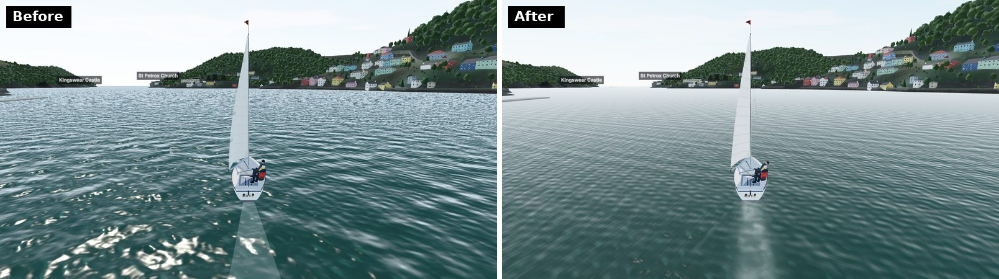
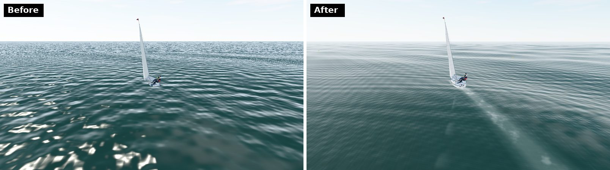
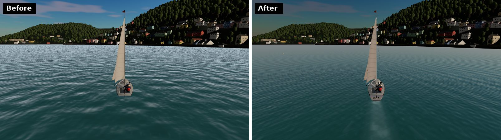
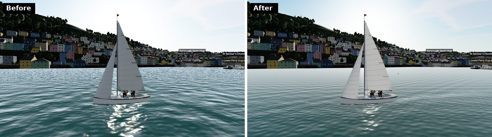
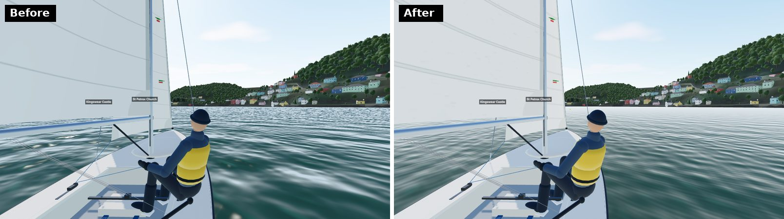
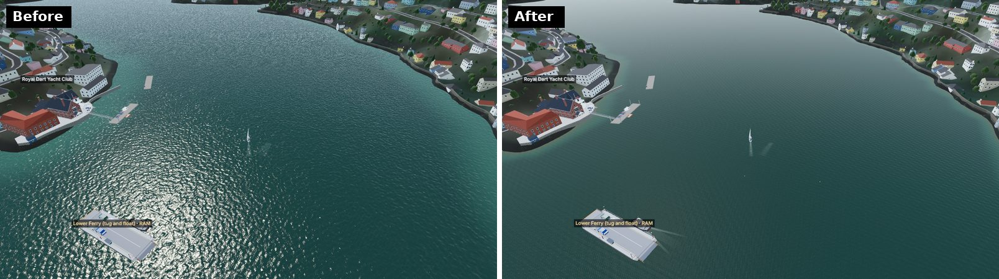
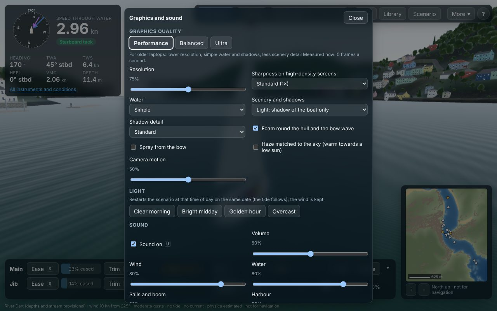
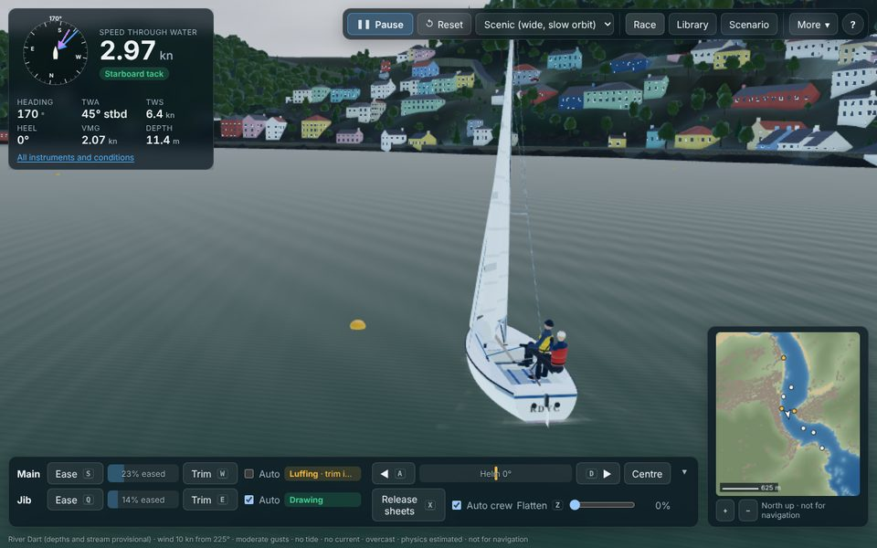

# Graphics round: water, sails, light, cameras and sound (29 Oct 2026)

The owner asked for "premium stylised photorealism" without rebuilding the engine. The physics, the controls and navigation had to stay as they were, every effect had to follow the simulation, and every improvement had to be measured and checked by eye.

**What changed, in short:**
- **Water:** short-crested wind ripples that never shimmer or tile, the sky's own colours reflected, a sun glint that spreads into a glitter path, shallows coloured by their depth, and a wash along the shore.
- **The boat in the water:** a wake with a churned centre and Kelvin arms that lies on the waves, foam round the hull and a bow wave that grow with speed, spray when the bow drops into a wave, and the same wake and foam for every AI boat.
- **Sails and hull:** sails glow with the sun behind them, their depth, draft and twist follow the flatten control, the sheets and the wind, and a luffing sail flogs faster and harder in more wind. The cloth has a weave and stitched seams, and the hull has a wet band at the waterline.
- **Light and air:** a lighter, bluer sky, haze taken from the sky's own colour toward the view (warm toward a low sun), warm clouds at sunset, and four lighting presets: clear morning, bright midday, golden hour and overcast.
- **Cameras:** a new scenic camera, wheel zoom on the chase camera, blended changes between cameras, and a camera-motion setting from a steady horizon to following the waves.
- **Sound:** wind, water, sails, the boom and halyards in the harbour, all made in the browser. Each has its own volume, and U mutes them all.
- **Settings:** Performance, Balanced and Ultra presets with a resolution scale and a switch for each effect. The preset is chosen from the graphics hardware, and you can override it.

**What did not change:** the physics, the controls and the race logic. The reference race hash is unchanged (`11824f89f479d0f4`) and all 349 unit tests pass (§7).

**External services and paid infrastructure: none.** Every texture is drawn in the browser, every shader is our own code, and every sound is synthesised. Nothing is downloaded, so nothing needs a licence (§4).

**Caveat on the measurements:** this container has no graphics card, so Chromium draws with SwiftShader, a software renderer. Its times measure relative load, not the frame rate on a real computer (§6).

## 1. Assessment of the engine and the pipeline

**Engine:** three.js r186 on WebGL2, written in TypeScript and built with Vite. React draws the interface over the canvas.

**Pipeline:** one forward pass straight to the screen. It has:
- ACES filmic tone mapping and sRGB output;
- exponential-squared fog;
- an environment map built from the sky;
- cascaded shadow maps on a real GPU, or one map round the boat under software rendering.

**Watertight hulls:** each hull marks its deck in the stencil buffer, so the water is never drawn inside a boat. This is why there is still no post-processing (ambient occlusion, SMAA): an off-screen pipeline would have to carry those stencil passes (issue 75).

What the audit found (baseline: commit `1bdc8b0`):

| Area | Before | Weakness |
|---|---|---|
| Wave detail | Eight Gerstner trains weighted by a 32 × 32 field of the modelled sea state (unchanged). Fine detail came from three octaves of value noise and faded with camera distance | The noise was isotropic and uniform. Short trains faded by distance, not by what a pixel can show, so they shimmered in the middle distance and vanished abruptly |
| Water reflection | A two-colour sky gradient; a Blinn–Phong sun highlight (exponent 220) | Sunset and grey skies did not show in the water. The glint was a point, with no glitter path |
| Shallows | Lighter in a 40 m band along every bank | Deep water off a quay looked as shallow as a mud bank |
| Wake | A flat white ribbon at a fixed height behind the stern; none for AI boats | It did not lie on the waves, had no Kelvin arms, no bow wave, no foam at the hull and no spray |
| Sails | Deformable meshes driven by the physics' angle, camber and twist; a fixed-rate flutter when luffing | Flatten and the sheets did not change the sails' shape. No light came through the cloth |
| Light | A three.js sky model with ACES; one fixed haze colour | The lower sky was bright enough to look washed out. The haze was the same grey-blue at sunset as at noon |
| Cameras | Chase (fixed 15 m, following the full heave), helm, orbit, drone, top | Every change of camera was a cut, the chase camera could not zoom, and the horizon bobbed with every wave |
| Sound | None | — |
| Settings | `?quality=high\|low` in the address only | No way for a user to trade quality for speed |

**Baseline cost** (SwiftShader, 1280 × 720, the eight views of §6; frame time is the time to submit and draw one frame):

| Measure | Light scenery | Detailed scenery |
|---|---|---|
| Frame time, harbour views | 3.1–5.7 s | 5.3–8.6 s |
| Frame time, open sea | 1.1 s | 1.2 s |
| Triangles, harbour views | 2.3–3.2 M | 9.0–11.0 M |
| Draw calls, harbour views | 266–594 | 854–1,316 |
| CPU time to submit a frame | 6.5–12 ms | 9–17.5 ms |

Submitting a frame takes milliseconds and drawing it seconds, so the harbour is limited by geometry and fill on this renderer, not by the CPU.

## 2. Prioritised plan

The plan ranked work by visible impact per unit of cost, judged on the views a sailor spends most time in: the chase and helm views on the river and at sea.

| Priority | Work | Impact | Cost | Done |
|---|---|---|---|---|
| 1 | Water: ripples by pixel footprint, sky reflection from the environment map, GGX glint | Very high: the water fills most of every view | One shader; ~free when ripples are below the pixel | Yes |
| 2 | Wake, hull foam, bow wave on the waves; AI boats too | High: the boat sits in the water | 2 draw calls a boat | Yes |
| 3 | Sky brightness, horizon-matched haze, warm clouds | High: removes the washed-out look | One tiny render when the sky changes | Yes |
| 4 | Sail shape from the controls, translucency, cloth detail | Medium: the boat is always in view | A few shader lines; CPU shape already computed | Yes |
| 5 | Graphics settings and presets | Needed to keep older machines usable | UI and storage | Yes |
| 6 | Cameras: scenic, zoom, blending, motion | Medium | CPU only | Yes |
| 7 | Sound | Medium (immersion) | Web Audio, CPU only | Yes |
| 8 | Bed-depth colour and shore wash | Medium near the banks | One texture lookup | Yes |
| 9 | Spray | Low–medium, in a seaway only | One draw call, ≤ 360 points | Yes |
| 10 | Lighting presets | Medium (choice of mood) | None at run time | Yes |
| — | Ambient occlusion, SMAA, screen-space reflections, volumetric light | High on a fast GPU | Needs an off-screen pipeline that keeps the stencil passes (issue 75) | **Not done** |
| — | Photographed or scanned assets (sail cloth, rock, recorded sound) | Medium | Licensing, download size | **Not done**: everything is procedural |

The work followed the master prompt's six phases:

1. audit and baseline;
2. water;
3. boat and sails;
4. light, atmosphere and coast;
5. cameras, effects and sound;
6. presets, benchmarks and this report.

## 3. What was built

### 3.1 Water (`src/render/water.ts`)

- **Detail by pixel footprint.** Each pixel measures how far it reaches across the water along each wave train's direction (the screen-space derivatives of its position on the water).
  - **Fine trains:** a train finer than that reach fades out, and its slope variance moves into the surface roughness. Distant water therefore looks rougher and duller instead of shimmering, and it costs less, since a train the pixel cannot show is skipped.
  - **Glancing views:** the filter is directional, as anisotropic texture filtering is. Trains running across the line of sight keep their detail while those running along it fade. A first version used the reach's overall size, which faded both and left the middle distance flat and streaky; it was changed after the screenshots showed it.
- **Wind ripples:** 13 short trains, from 12 cm up to about 3 m, running with the wind and spread within ±80° of it, so the crests are short. The speeds follow the capillary–gravity relation, and broad patches of stronger and weaker ripple drift downwind. The constants are computed on the CPU when the wind changes. Five trains are used with simple water.
- **The Gerstner swell trains** are spread wider than before (up to ±49°), so the long crests no longer read as stripes.
- **The sky in the water:** the reflection samples the sky's own light at the surface roughness (three.js's PMREM). A golden sky shows golden, tempered by the usual sky gradient so the ripples do not flash. Under cloud, the grey sky takes over.
- **Sun glint:** a GGX microfacet highlight with Fresnel. The roughness from unresolved ripples widens it into the glitter path a low sun lays across the water.
- **Depth:** where the bed is known (LIDAR near the shore, a provisional estimate mid-channel), the water's colour depends on its depth at the current tide. The bed shows through shallow water and fades over about 1.5 m of path through the Dart's green water (E), less at a glancing view. A broken line of foam laps at the water's edge when there are waves.
- **Light through steep crests** is stronger when looking toward the sun.
- **The surface displacement is shared** (`SEA_DISPLACE`): the wake and the foam lie on the same waves as the sea.
- **Distant water:** beyond the detailed mesh (1.8 km) a flat plane 4 m down fills to the horizon.
  - **The bug it fixes:** this plane used to be displaced only at its four corners, 20 km out, and sat at −0.25 m. Found this round: it cut up through any trough deeper than that, flattening the troughs and hiding the wake that lay in them.
  - **Its shading:** it is shaded like the rest of the sea, so the join does not show.

### 3.2 The boat in the water (`src/render/boatWater.ts`)

- **Wake** (`WakeTrail`): a ribbon of the stern's track, one point every 0.1 s for 22 s.
  - **Vertices across:** seven per point (the track, the edges of the core and slick, the arms, the edges), so each band lies on the waves rather than on a chord between the edges.
  - **Lift:** it is raised 2.5 cm above the surface, plus an eighth of the local wave height, so the sea's own facets do not cut across it in a seaway.
  - **Shape:** it widens at the Kelvin half-angle (19.47°) to at most 28 m each side.
    - **Core:** the churned centre, 0.55 m each side of the track at first, spreads and breaks up as it ages.
    - **Slick:** a wider, paler band of smoothed water outlasts the core.
    - **Arms:** two broken Kelvin arms run along the edges.
  - **Rudder stir:** helm angle adds turbulence to the centre.
  - **Speed:** strength follows the boat's speed when the water was laid.
  - **Discontinuities:** a reset or a jump of more than 30 m starts a new trail.
- **Hull foam and bow wave** (`HullFoam`): a ring of 22 stations round the waterline, displaced with the waves.
  - **Bow wave:** it widens and grows with speed, from 0.6 m/s to full at 3 m/s (about 6 kn).
  - **Heel:** it shifts toward the lee as the boat heels, so it shows beside the heeled hull rather than under it.
- **Spray** (`BowSpray`): drops thrown from the bow when it drops onto a wave faster than about 0.45 m/s and the boat is doing more than 1.6–3.2 m/s.
  - **Motion:** gravity and wind drag act on each drop.
  - **Budget:** at most 360 points, in one draw call.
- **AI boats** get the same wake and hull foam (`src/render/fleet.ts`), so a fleet leaves tracks.

### 3.3 Sails, hull and rigging (`src/render/squibModel.ts`, `materialFx.ts`, `squibTextures.ts`)

- **Sail shape follows the controls** (`sailTrim`). Every amount is an estimate (E), consistent with what the physics' flattening does to power.
  - **Flatten:** takes up to 35% of the depth out, moves the draft forward and opens the head.
  - **Easing a sheet:** lets the leech twist open (up to 10° more).
  - **Breeze:** stretches the cloth and moves the draft aft.
  - **Section:** the camber now follows a NACA mean line with its peak at that draft.
- **Luffing:** a flogging sail beats at 1.2 + 0.45 × apparent wind (m/s) cycles a second (capped at 16 m/s) with a larger amplitude in more wind. Before, the rate was fixed.
- **Translucency:** sailcloth passes about a quarter of the sunlight (E), so a sail with the sun behind it glows, darker where seams double the cloth. The sun's own light is used, cut off when the hills hide the sun from the boat (a ray over the terrain four times a second, eased over a second). The shadow map cannot be used for this: a thin double-sided sail shadows its own far face.
- **Cloth:** a fine weave mottle and double-stitched seams are drawn into the sail textures (canvas, in the browser).
- **Hull:** a wet band at the waterline, 14 cm high: the gelcoat is darker by up to 16% and glossier there. It is kept when the hull colour changes.
- **Rigging:** the existing wire rigging, spars and fittings already follow the boom and the heel and were left as they were.

### 3.4 Light, atmosphere and coast (`src/render/scene.ts`, `weather.ts`, `src/app/lighting.ts`)

- **Sky:** the sky model's brightness is scaled to 0.45 before tone mapping, so the lower sky reads light blue instead of white. The environment light is compensated, so the scene is lit as before.
  - **Turbidity** rises with haze (visibility) and cloud, so a clear day is a deeper blue and a murky day paler.
- **Haze matched to the sky:** with the atmosphere on, the fog colour is the sky's own colour 3° above the horizon, averaged ±30° about the way the camera looks.
  - **How it is read:** from a 16-pixel render each time the sky is rebuilt (when the sun has moved 3° or the cloud has changed).
  - **What it shows:** looking toward a low sun the distant hills fade into warm haze, and away from it into blue.
  - **Overcast and night:** still pull the haze toward grey and dark.
  - **Water and cloud dome:** both get the same colour.
- **Clouds** take the sun's colour, warm toward a low sun.
- **Lighting presets:** Settings → Light restarts the scenario at that time of day on the same date. The time comes from the sun's real position at Dartmouth (NOAA algorithm), so it suits any date. The tide follows the clock and the wind is kept.

  | Preset | Time | Sky |
  |---|---|---|
  | Clear morning | Sun 20° up, rising | Clear |
  | Bright midday | Solar noon | Clear |
  | Golden hour | Sun 6° up, setting | Clear |
  | Overcast | Solar noon | Overcast |

- **Coast:** the depth colour and the shore wash (§3.1) are the coastline's gain this round. The buildings, woods, quay walls and landmarks are the earlier rounds' work and are unchanged.

### 3.5 Cameras (`src/render/scene.ts`, `frames.ts`)

- **Scenic** (new, in the camera list after Chase): a slow circle round the boat, one turn in six minutes, 24–36 m off and 2.6–3.8 m above the water, with a narrower 38° lens. Over land it comes in until it is over the water, and it never goes below the ground.
- **Zoom:** the mouse wheel sets the chase camera's distance from 7 to 45 m, keeping the same view angle. In the scenic view it widens or tightens the circle in proportion.
- **Blending:** a change between the chase, scenic, helm and top views blends over 0.7 s instead of cutting. The orbit and drone views, which the user drives, still start at once.
- **Camera motion** (Settings, 0–100%, default 50%):
  - **Heave:** the chase and scenic cameras follow a 1.5 s average of the boat's heave, plus that share of each wave.
  - **Heel:** the chase view tilts with a little of the heel, and the helm view with its usual share of it (half at 50%, up to 80% at 100%).
  - **At 0 the horizon is level** in every view.

### 3.6 Sound (`src/render/audio.ts`)

Everything is synthesised with Web Audio from noise and oscillators. The sounds follow the simulation as the renderer sees it and never feed back into it.

| Sound | What drives it |
|---|---|
| Wind | Band-passed noise; level and pitch rise with the apparent wind, panned to the side it comes from. A thin whistle in the rigging above about 9 m/s |
| Water | A rush with the speed through the water, a hiss of bubbles at speed, a slap when the bow drops onto a wave |
| Sails | A flutter at the flogging rate when a sail luffs, louder and faster in more wind, each sail separately |
| Boom | A thump and a creak of the gooseneck when it crosses in a tack or gybe |
| Harbour | Halyards clinking on masts when moored boats are within about 180 m (River Dart) |

- **Volumes:** a master volume, a volume for each group, and mute (U, or the Settings panel), all remembered.
- **Starting:** browsers allow sound only after a click or a key press, so it starts then.
- **Pauses:** it stops when the simulation is paused or the tab is hidden, and muting suspends the audio context.
- **Levels:** set by ear (E).

### 3.7 Settings and presets (`src/render/graphics.ts`, `src/ui/SettingsPanel.tsx`)

More → **Graphics and sound** opens the panel. Each change applies at once, except scenery and shadow detail, which take effect on reload (the panel says so and offers a button). Choosing an option by hand makes the preset "Custom". Settings are kept in the browser (`localStorage`).

## 4. Shaders, materials and assets

| Item | Kind | File | Notes |
|---|---|---|---|
| Sea surface | ShaderMaterial (vertex: Gerstner, `seaDisplace`; fragment: footprint-filtered trains, ripples, GGX, sky PMREM, depth, foam, wash, fog) | `water.ts` | `WATER_HIGH` and `SKY_ENV` defines switch the detailed path |
| Wake | ShaderMaterial on a ribbon | `boatWater.ts` | Lies on `seaDisplace`; polygon offset over the sea |
| Hull foam and bow wave | ShaderMaterial on a ring | `boatWater.ts` | Same |
| Spray | ShaderMaterial on Points | `boatWater.ts` | Additive-free alpha blend; size in pixels from the viewport |
| Sail translucency | `onBeforeCompile` addition to `MeshStandardMaterial` | `materialFx.ts` | Chains with the shadow cascades' own hook, own program key |
| Wet band | `onBeforeCompile` addition to the hull's `MeshPhysicalMaterial` | `materialFx.ts` | |
| Sky gain | `onBeforeCompile` on three.js's `Sky` | `scene.ts` | |
| Horizon read | ShaderMaterial into a 16 × 1 float target | `scene.ts` | Manual ACES and sRGB, to match the screen |
| Cloud dome | ShaderMaterial (sun colour and warmth added) | `weather.ts` | |
| Sail cloth | Canvas texture (weave mottle, double-stitched seams) | `squibTextures.ts` | Drawn in the browser |
| Sounds | Web Audio graph (noise buffers, biquad filters, oscillators, gains, panners) | `audio.ts` | Synthesised in the browser |

**Assets and licensing.** No image, model or sound was downloaded or copied this round: all textures are drawn in the browser, all sounds are synthesised, and the shaders are this project's own code, built on three.js (MIT licence) chunks. The owner's watermarked photographs were not used this round. Nothing new needs attribution.

**What would need an outside source:**
- recorded sound;
- scanned sailcloth;
- photographed rock.

Each would need a licence (CC0 libraries such as Poly Haven, or paid ones) and would add to the download. They were judged not worth it against the procedural versions.

## 5. Implementation and its performance implications

| Feature | Cost | Where it is turned off |
|---|---|---|
| Ripples (13 trains) | Per water pixel, but a train finer than the pixel is skipped, so distant water is cheaper than nearby | Simple water: 5 trains |
| Sky reflection | One PMREM lookup per water pixel | Simple water: gradient only |
| GGX glint, depth colour, shore wash | A few dozen ALU operations and one texture lookup per water pixel | Always on (no measurable cost apart from the above) |
| Wake | 1 draw call and 440 vertices a boat | Always on |
| Hull foam and bow wave | 1 draw call a boat | Foam switch |
| Spray | 1 draw call, ≤ 360 points | Spray switch |
| Sail translucency, wet band | A few shader lines on two materials | Always on |
| Haze from the sky | A 16 × 1 render and a pixel read (a GPU sync) each time the sky is rebuilt, then a few CPU operations a frame | Atmosphere switch |
| Sun behind the hills | Up to 50 terrain samples on the CPU four times a second | Always on (River Dart only) |
| Cameras | CPU only | — |
| Sound | Web Audio runs on its own thread; a few parameter updates a frame | Mute (suspends the context) |
| Resolution scale | Pixel count ∝ scale² (75% = 56% of the pixels) | Performance preset |

**The Performance preset** draws at 75% resolution with simple water, no spray and no sky-matched haze, keeps the light scenery and standard shadows, and keeps hull foam. **A software renderer starts on Performance;** a real GPU on Balanced.

## 6. Benchmarks before and after

**How it was measured** (`tools/gfx-bench.mjs`):
- **Builds:** the old build (commit `1bdc8b0`) and the new one, each a production build served unchanged.
- **Browser:** Chromium at 1280 × 720 with SwiftShader.
- **Each of eight views:**
  1. The app sails a fixed scenario: place, time and a steady wind. The physics runs headless, then the last 8 s run through drawn frames.
  2. It points the camera and lets six frames settle.
  3. It times four frames, each followed by a one-pixel read so that the drawing is finished.
- **Counts:** draw calls, triangles, geometries, textures and shader programs come from three.js.
- **Settings compared:**
  - the old build with `?quality=low` and `?quality=high`;
  - the new build's **Balanced** preset with the same two scenery levels;
  - its **Performance** preset.

**What the numbers mean:** SwiftShader draws on the CPU, so these are measures of relative load, not frame rates. A repeat of the same new build differed from the first run by up to 15% in a view (−9% over all eight). Differences smaller than about ±10% are noise on this shared 4-core machine.

### Balanced, light scenery (against the old build at `?quality=low`)

| View | Before (ms) | After (ms) | Change | Draw calls | Triangles |
|---|---|---|---|---|---|
| Chase, river | 4,409 | 4,178 | −5% | 266 → 267 | 2.37 M, same |
| Helm, river | 4,484 | 4,464 | 0% | 277 → 278 | 2.59 M, same |
| Sails close up | 5,685 | 5,767 | +1% | 594 → 595 | 3.17 M → 3.18 M |
| Behind the stern, sea | 1,087 | 1,875 | +73% | 88 → 89 | 0.41 M, same |
| Chase, sea | 1,063 | 1,308 | +23% | 88 → 89 | 0.41 M → 0.42 M |
| Golden hour, river | 4,350 | 4,173 | −4% | 277 → 278 | 2.26 M, same |
| Sails against the sun | 4,778 | 4,930 | +3% | 337 → 338 | 2.93 M, same |
| Drone over the harbour | 3,135 | 3,185 | +2% | 316 → 317 | 2.70 M, same |
| **All eight** | **28,990** | **29,879** | **+3%** | | |

### Performance preset (against the old build at `?quality=low`)

| View | Before (ms) | After (ms) | Change |
|---|---|---|---|
| Chase, river | 4,409 | 3,087 | −30% |
| Helm, river | 4,484 | 3,331 | −26% |
| Sails close up | 5,685 | 4,439 | −22% |
| Behind the stern, sea | 1,087 | 716 | −34% |
| Chase, sea | 1,063 | 727 | −32% |
| Golden hour, river | 4,350 | 3,063 | −30% |
| Sails against the sun | 4,778 | 3,932 | −18% |
| Drone over the harbour | 3,135 | 2,403 | −23% |
| **All eight** | **28,990** | **21,698** | **−25%** |

### Balanced, detailed scenery (against the old build at `?quality=high`)

| View | Before (ms) | After (ms) | Change | Draw calls | Triangles |
|---|---|---|---|---|---|
| Chase, river | 6,372 | 6,757 | +6% | 854 → 855 | 8.95 M, same |
| Helm, river | 6,642 | 6,985 | +5% | 863 → 864 | 9.15 M, same |
| Sails close up | 8,600 | 8,893 | +3% | 1,316 → 1,317 | 10.22 M, same |
| Behind the stern, sea | 1,244 | 1,612 | +30% | 156 → 157 | 1.20 M, same |
| Chase, sea | 1,230 | 1,508 | +23% | 156 → 157 | 1.20 M, same |
| Golden hour, river | 7,136 | 6,866 | −4% | 874 → 875 | 9.24 M, same |
| Sails against the sun | 7,813 | 8,078 | +3% | 1,061 → 1,062 | 11.03 M, same |
| Drone over the harbour | 5,292 | 5,599 | +6% | 961 → 962 | 9.47 M, same |
| **All eight** | **44,329** | **46,298** | **+4%** | | |

**Reading the tables:**
- **Harbour views,** where most sailing happens: the new look costs about the same as the old, −5% to +6%, within the noise.
- **Open sea:** the detailed water costs 23–73% more, because there the water fills most of the picture and its per-pixel work has grown:
  - up to 13 ripple trains;
  - a sky lookup;
  - a GGX glint.

  On a graphics card that work is far cheaper relative to the scenery's geometry, but this could not be measured here (issue 94).
- **Performance preset:** faster than the old build in every view, by 18–34%.
- **Draw calls and triangles:** one more draw call per boat (the hull foam; the wake replaces the old trail), and spray adds one while it flies. The triangle count is unchanged.
- **CPU:** submitting a frame takes 6.5–17.5 ms before and after, the same within the noise.
- **Memory** (three.js's counts after the eight views, light scenery):
  - geometries 750 → 797;
  - textures 42 → 43 (the bed-depth texture);
  - shader programs 52 → 55.
- **Download:** the main script grows by 13.5 kB gzipped (200.7 → 214.2 kB), the settings panel adds 2 kB that load when it is first opened, and there are no new assets.

### Before and after

The screenshots are the same views at the same moments: the old build at `?quality=low`, and the new one on Balanced with light scenery. They come from SwiftShader without anti-aliasing beyond the browser's, so edges are rougher than on a graphics card.

*Chase view on the river.*
- **Water:** the speckled glints (aliasing) have gone, the water reflects the sky, and it is paler and calmer.
- **Wake:** the flat wedge becomes a churned trail lying on the waves.

*Behind the stern in Start Bay, 16 kn.* The wake now shows in a seaway: before, the flat trail was hidden by the waves. The speckle is gone and the swell's crests read as long, low ridges.

*Golden hour.* The haze takes the evening sky's colour and the water reflects it.

*Sails against the evening sun.* The sails glow with the light through them, and the glitter path under the sun is softer.

*Helm view.* The far water reflects the pale sky toward the horizon, as Fresnel reflection does, and the ripples stay distinct near the boat.

*Drone over the harbour.* The water no longer glitters with aliasing. The shallows by the banks are green over the bed, and the boat's wake and the ferry's wash show.

**An honest note on the water's look:** the old water's sparkle was partly aliasing, but it made the water look lively and deep teal. The new water is correct in that sense, but it reads paler and quieter in the midday views. If the owner prefers more colour and contrast, the sky reflection's share and the ripples' strength are single numbers to tune (`skyLight` and `uRipple` in `src/render/water.ts`). This is UAT check 11.1.

*More → Graphics and sound*, as a software renderer opens it, on Performance.

*The scenic camera* under the Overcast lighting preset.

## 7. Verification

### The physics, the controls and the race logic

- **Physics untouched:** the reference race hash is unchanged (`11824f89f479d0f4`, a 7-boat, 400 s race on the River Dart).
- **Unit tests:** all 349 pass (44 files), including 13 new ones for this round (`tests/render/graphics.test.ts`). They cover:
  - the presets and their storage, and the resolution they draw at;
  - the sound's levels against wind and speed;
  - the lighting presets' times on 15 July and in midwinter;
  - the cameras' follow rules;
  - the sails' set;
  - the wake's Kelvin spread and its vertices across.
- **Typecheck and lint:** clean.
- **Visual settings do not touch the sailing** (`tests/e2e/graphics.spec.ts`):
  - the settings panel's presets are applied and kept;
  - one changed option makes a custom mix;
  - U mutes and unmutes the sound;
  - the sailing input is the same before and after;
  - the scenic camera stays low and well off the boat;
  - the wheel zooms the chase camera out.
- **One change in the frame loop:** a frame's time step can no longer be negative. A frame's timestamp can fall a little behind a clock reading taken on resume. This only changes how many fixed 10 ms physics steps a frame runs, never the steps themselves, so the hash is unchanged.

### By eye

Each feature was checked in screenshots from this container's software renderer, at the views in §6 and in close-ups: from above, behind the stern, at the bow and against the sun.

Checking found and fixed five faults that the code alone did not show:

1. **The helm view went black after a change of camera** whenever a frame's time step was negative: the new camera blend extrapolated far off the scene. Fixed by clamping the frame time step and the blend.
2. **The wake was hidden in a seaway.** It showed from directly above but not from the chase camera. There were two causes:
   - the ribbon had vertices only at its edges, up to 28 m out, so its middle ran on a chord below the crests;
   - the distant-water plane cut up through deep troughs (§3.1).

   Fixed with vertices across the ribbon, a lift with the wave height, and a flat far plane 4 m down.
3. **The benchmark itself:** after its first view, every view had sailed its last 8 s paused, because a restart keeps the pause. So neither build showed a wake at sea. The harness was fixed and both builds re-measured (§6).
4. **The scenic camera's over-land test** compared heights above datum with heights above the water. It now uses the tide.
5. **The middle-distance water looked flat and streaky,** as if blurred: the wave filter faded every train by the pixel's longest reach. It now filters along each train's direction (§3.1). The after-change benchmarks were run again on the corrected build.

### Not verified here

- Frame rates on real graphics hardware (§6, issue 94).
- How the sound is heard: the audio graph starts, follows the boat and mutes (checked in the browser), but no one has listened to it in this container. Its levels are set by ear (E) and are for the owner to judge (UAT 11.10).

## 8. Final graphics configuration

| Setting | Performance | Balanced | Ultra |
|---|---|---|---|
| Resolution scale | 75% | 100% | 100% |
| Maximum pixel ratio (high-density screens) | 1× | 1.5× | 2× |
| Scenery and shadows (reload) | Light: shadow of the boat only | Detailed: shadows over the town and woods | Detailed |
| Shadow detail (reload) | Standard (2048) | Standard (2048) | Fine (4096) |
| Water | Simple (gradient sky, 5 ripple trains) | Detailed (sky reflection, 13 trains) | Detailed |
| Hull foam and bow wave | On | On | On |
| Spray | Off | On | On |
| Haze matched to the sky | Off | On | On |
| Camera motion | 50% | 50% | 50% |
| Chosen by default | Software renderer | A graphics card | — |

- **Shadows:** "Detailed" scenery draws the heavier scenery (road walls and kerbs, more distant detail) and uses the cascaded shadow maps over the town and woods. "Light" uses one shadow map that follows the boat.
- **URL override:** `?quality=high|low` still overrides the scenery and shadows setting for one visit.
- **Sound defaults:** on, master volume 50%; wind and water 80%, sails and boom 80%, harbour 60%.

## 9. What is not done, and open questions

- **Not measured on a real GPU:** every timing here is SwiftShader's. The owner's check on their own machine (UAT_PLAN 10.1–10.4) is the real test.
- **Ambient occlusion, anti-aliasing beyond the browser's MSAA, screen-space reflections, volumetric light:** they need an off-screen pipeline that keeps the hulls' stencil masks (issue 75).
- **Coastline geometry** (rocks at the waterline, weed, wet shingle) was not added: the depth colour and shore wash are this round's coast work.
- **Spray** is simple points with no splash on the deck. There are no flags or burgees beyond those already drawn, and no birds or other ambient life.
- **Sound** has no other boats, ferries, engines, gulls or race signals.
- **The bed under the water** mid-channel is the provisional estimate (issue 4), so the depth colour there is provisional too.

New issues are listed in [OUTSTANDING_ISSUES.md](OUTSTANDING_ISSUES.md) (94–100), and the owner's checks are in [UAT_PLAN.md](UAT_PLAN.md) §11.
