# Hi-fi, second pass: the stern, the sailors, the houses, the traffic, the look (25 Oct 2026)

This report answers the owner's review of the first hi-fi pass:

> The graphics are still lo-fi. I can see water through the stern of the boat. Sailor movements on the boat are not realistic. River and marine traffic is lo-fi block graphics, where fidelity needs to be dramatically improved. Some houses appear to be below the waterline on the bank of the river, where lower floors appear sunk into the land.

Each point was reproduced first, then fixed. Reproducing them also turned up a physics fault, fixed first. As before, anything not from a source is labelled as an estimate (E).

## Summary

| Reported | Cause found | Fix |
|---|---|---|
| Water through the stern | The transom was a fan of triangles from its centre to each side, which left the triangle between the two corners of the deck edge open: about 1.3 m by 0.4 m. From astern you saw into the hull and the water. Boats also followed only 70% of the wave height, so crests ran over the stern | The transom is closed up each side and across under the deck edge. Each boat now floats on the drawn sea: it takes the heave, pitch and part of the cross slope of the plane fitted to the surface over its waterplane |
| Sailor movements | The sailors were capsules switched between a few poses, mirrored from side to side | Jointed figures (one skinned mesh each) posed every frame by inverse kinematics from the physics. See below |
| Traffic was block graphics | Boxes and simple extrusions | A vessel kit: lofted hulls, superstructures with framed windows, rails, fendering, masts, cars and passengers. Every vessel remodelled; sourced sizes used |
| Houses below the waterline | The water surface was drawn wherever the ground is below the tide, connected to the river or not. At high water springs the low valley behind Dartmouth's town centre (1.3–1.9 m ODN) flooded in the picture, houses and all | The water is drawn only near tidal water, using the pipeline's outline of it. The valley stays dry |
| Lower floors sunk into the land | On steep sites a building's top came from the median ground, so from the uphill street a house could sink to its eaves; windows were laid out from its lowest ground, so the uphill walls' lower windows were cut by the slope | A building stands at least 70% of its height above the uphill ground (a rule, E; 669 raised). No window is drawn that would start below the ground along its wall |
| Still lo-fi overall | Bare, smooth hills (no trees; only the 10 m satellite colours), and lighting that counted the sky's light twice, washing hills and houses out to pastels | Woodland where the satellite image shows woods; ground detail, rock on cliffs, mud on the foreshore; slate courses on roofs; rebalanced light |
| Found while reproducing: a knockdown | In a strong wind with the main eased, the starting-heel solver could balance at 90° (outside the sail model's range) and start the boat on its side with the crew to leeward; a classic then filled with water | The solver now takes the first balance heeling over from upright; the usual case is unchanged to the bit (all results and hashes the same) |

## The stern

| Before: through the stern you see into the hull | After |
|---|---|
| 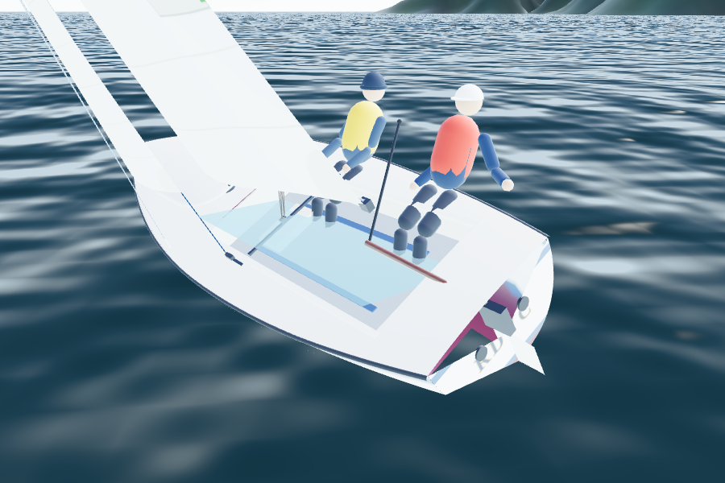 | 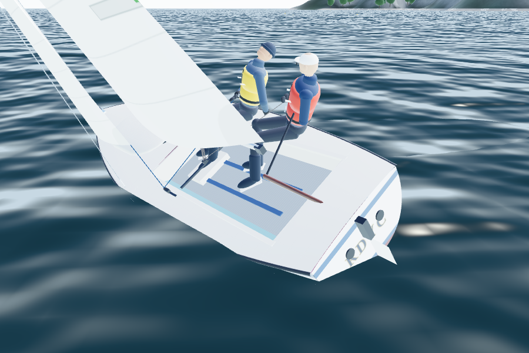 |

## The sailors

Each sailor is a jointed figure (one skinned mesh), posed every frame from where the physics puts the crew's weight (0.15 m sitting in … 0.8 m sitting out, calibration E) and how fast it is moving:
- **Sitting in.** On the side deck just outboard of the coaming, feet on the floor.
- **Hiking.** Out on the deck edge, feet hooked under the toe straps, leaning back over the water.
- **Crossing in a tack or gybe.** While the weight moves across (0.6 m/s in the physics, about 2.7 s side to side), they crouch on the floor and duck under the boom, then sit on the new side.
- **Hands on real things.** The helm's aft hand holds the tiller extension, which now swings from the tiller's end to it (raised when needed to stay in reach) and the forward hand the mainsheet tail. The crew holds the leeward jib sheet. The sheets run to their hands.
- **Eyes on the sails.** Both watch the jib's luff and glance up at the main and to windward. A little sway keeps them from looking frozen.

| Hiking in 10 kn | Crossing under the boom |
|---|---|
| 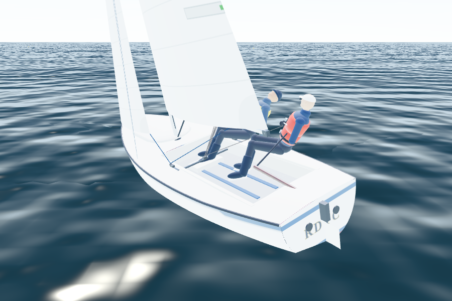 | 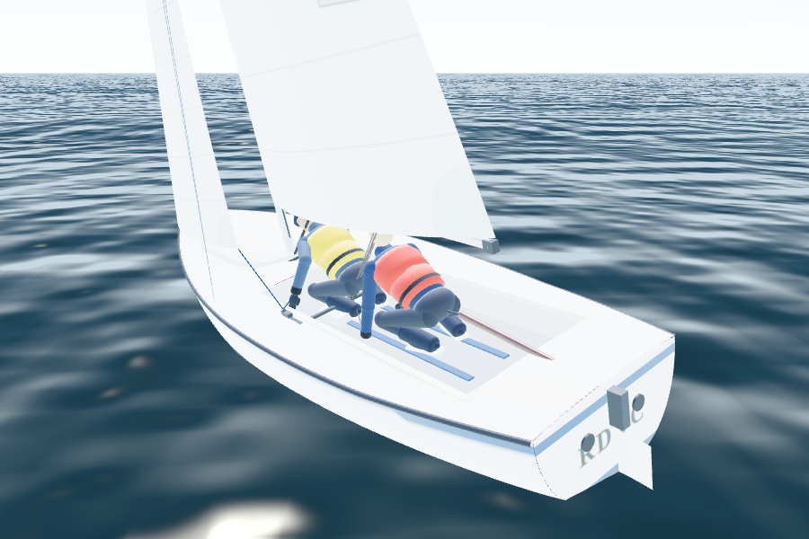 |

The poses are illustrative, not motion-captured (issue 48).

## The houses

| Before: high water springs floods the valley behind the town | After |
|---|---|
| 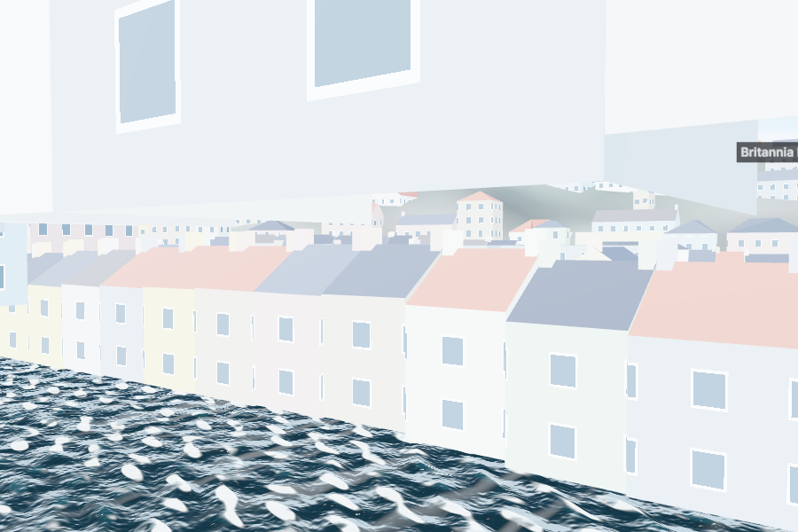 | 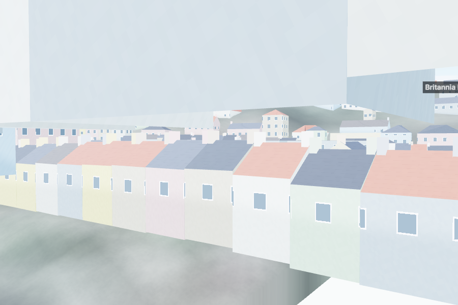 |

What changed:
- **The water mask.** The pipeline already had the tidal water's outline (OSM shoreline, used by the physics). It now also writes its signed distance (`watermask.png`, 47 kB). The water shader draws nothing more than 24 m inland of it (E).
- **Hillside buildings.** Of 5,404 buildings, 1,419 stand where the uphill ground is more than 3 m above their base. Their tops are now at least 70% of their height above the uphill ground (669 raised). Heights are not defined for slopes in the data, so this is a rule (E). The physics grids are byte-identical.

## The river traffic

All the vessels are rebuilt with the new vessel kit (`src/render/vessels.ts`):
- **Hulls:** lofted from stations (round bilge, hard chine or pontoon), with flare, a raked stem and transom, sheer, boot top, stripes, decks and bulwarks.
- **Superstructures:** lofted from rounded plans, with raked windscreens, tumblehome and framed window bands.
- **Fittings:** tubular rails on stanchions, rubber fendering, masts with radar, lifebuoys, outboards.
- **Cars and passengers:** cars built from side profiles; passengers are the sailor figure, posed once.

| Vessel | Drawn as | Sourced |
|---|---|---|
| Lower Ferry | Spoon-ended float with two lanes of up to 8 cars, walkways behind rails, hinged ramps striped yellow and black, a shelter, lamp posts; the tug lashed alongside, fendered, wheelhouse windowed all round, radar mast, stack, RAM lights | 8-car floats, the Hauley tugs (F1), lashed alongside (F3). Sizes and colours E |
| Higher Ferry | Cable ferry with three lanes, lounge and control cabin to starboard, cable sheaves, large ramps | 2009, Pendennis (F5); two cables (F6). Layout and colours E |
| Passenger ferry | The Dartmouth Princess: 18 m, blue hull, saloon with an upper deck and passengers | Length, passengers, blue hull (F7). Beam and layout E |
| Totnes cruise | The Cardiff Castle: 30 m by 6.4 m, three decks: saloon, promenade deck, wheelhouse, funnel | Length, beam, decks (F8). Colours E |
| Launches and smaller ferries | Open launches under a canopy; small ferries with a wheelhouse and a covered well | E |
| Dart Marina boats | Planing motor cruiser (deep vee, raked superstructure, radar arch, bow rail, bathing platform); sloop under engine (coachroof, sprayhood, furled genoa, sail cover, guard rails, ensign); RIB (tubes, console, A-frame, outboard) | E |

The physics now uses the sourced sizes (passenger ferry 18 m; Totnes cruise 30 m by 6.4 m). The reference race hash is unchanged.

| Lower Ferry | Higher Ferry |
|---|---|
| 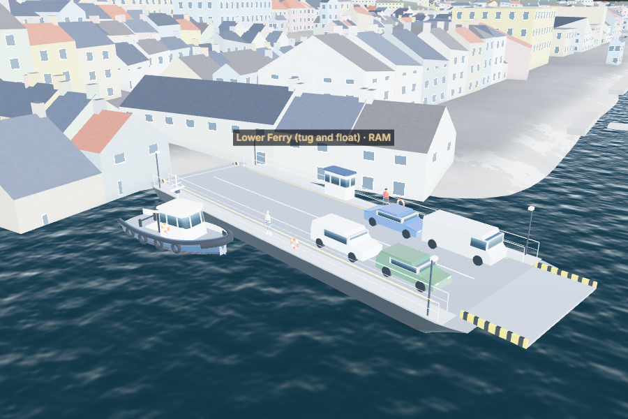 | 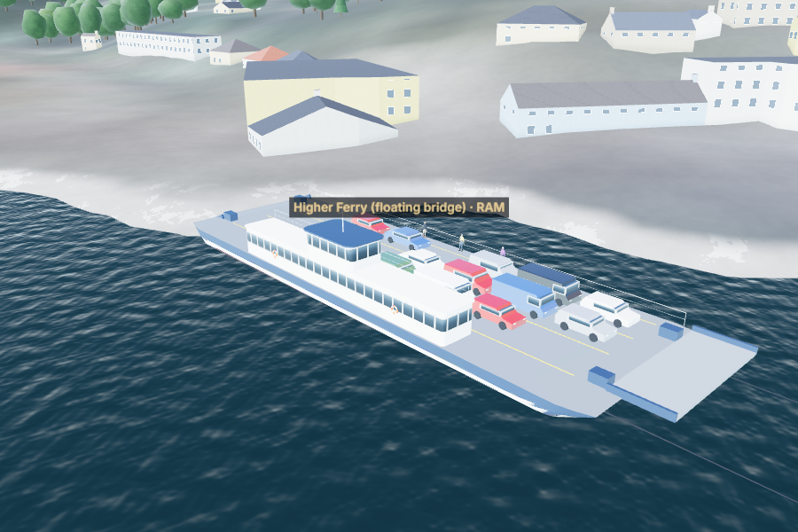 |
| **Passenger ferry** | **Totnes cruise** |
| 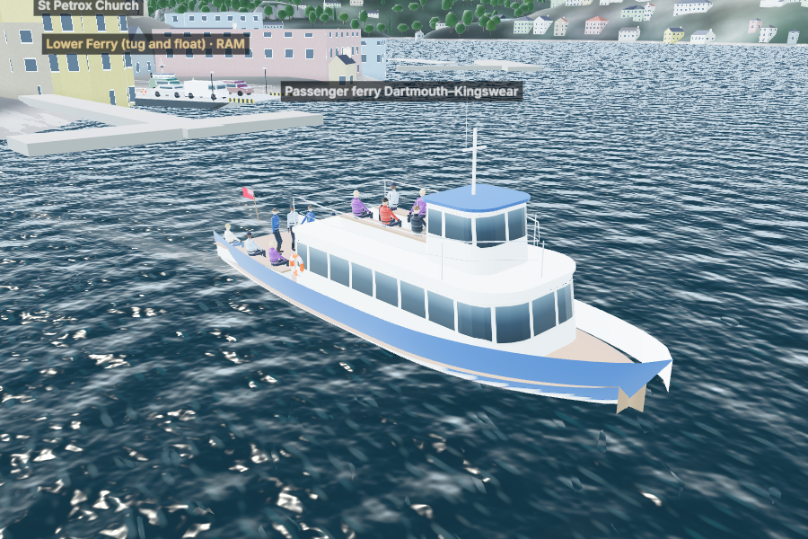 | 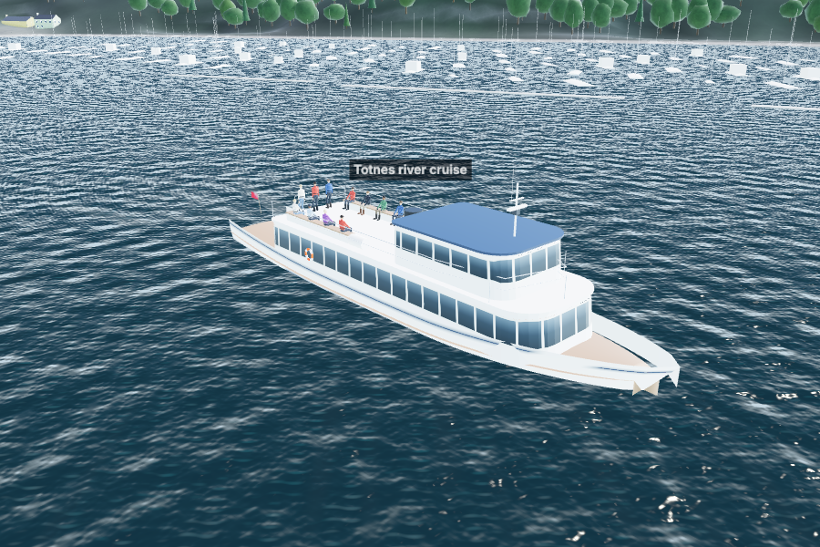 |
| **Motor cruiser and yacht** | **Launch** |
| 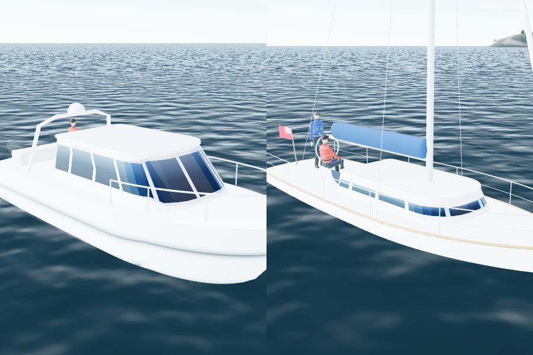 | 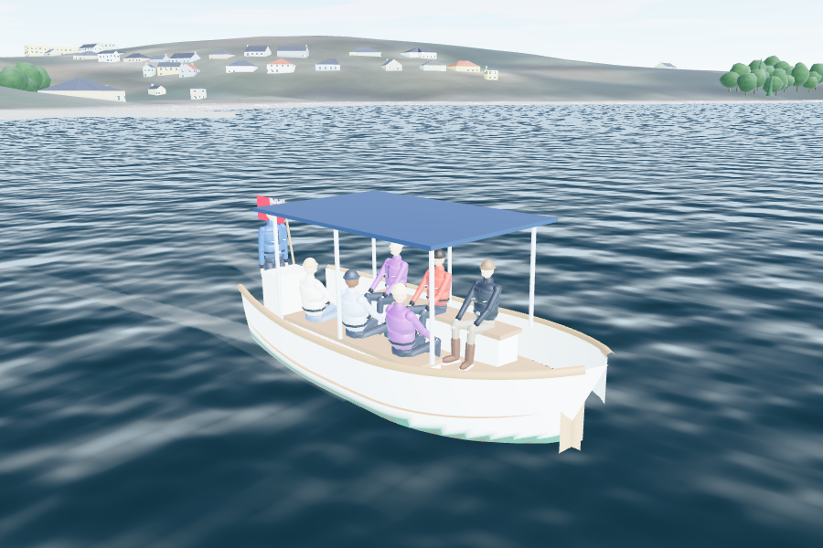 |

## The look

| Before | After |
|---|---|
| 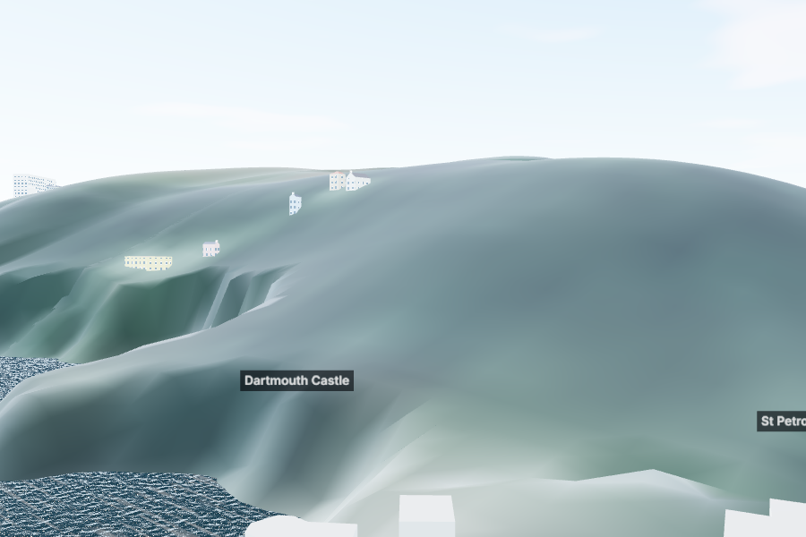 | 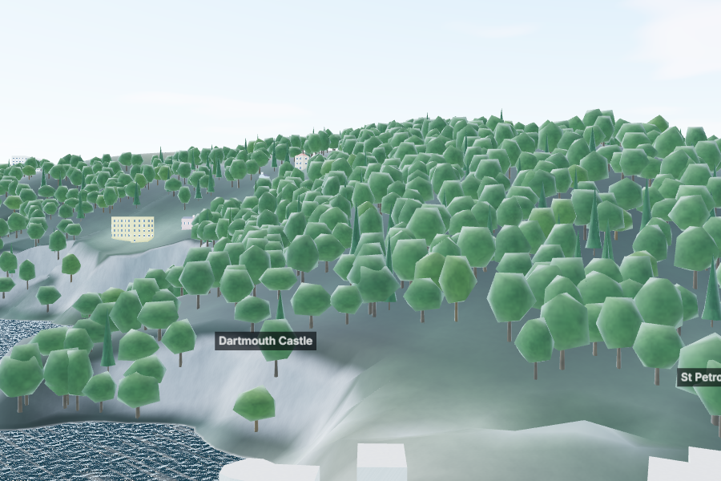 |

The changes:
- **Woodland** (`src/render/trees.ts`). Trees grow where the Sentinel-2 picture shows woods: dark, green-dominant pixels, the valley's hanging woods. A field gets an occasional hedgerow tree. None on the foreshore or in building footprints. About 21,000 within 2.3 km of the camera, built in chunks around it, nearest first, with coarser shapes beyond 850 m. Positions, sizes and kinds are seeded by place: illustrative (E, issue 57).
- **Ground detail.** Fine variation, slate-grey rock on steep slopes (the cliffs at the entrance), and mud and shingle on the tidal foreshore only.
- **Buildings.** Slate or tile courses on the roofs, a texture on the render, walls darker towards the ground.
- **Light.** The hemisphere light no longer doubles the sky light that the environment map already gives. The sun is stronger.

## Tests

| Suite | Result |
|---|---|
| Unit (Vitest) | 211 tests pass (200 before), including:<ul><li>the starting heel (`variants.test.ts`): fails on the old solver;</li><li>the water mask (`watermask.test.ts`);</li><li>the new render tests (`tests/render`): the sailors' reach, grip on the extension at any rudder angle, hiking feet at the straps, heads below the boom when crossing; every vessel builds within a triangle budget, ramps hinge, copies share geometry</li></ul> |
| Browser (Playwright) | The full suite, locally and on CI (see the commit's run) |
| Determinism | Unchanged: the reference race hash is still `5de2cc60d1e76458` and every golden trace matches |

## Cost

| Item | Change |
|---|---|
| Download | `watermask.png` adds 47 kB; the code grows by the vessel kit, the woodland and the figure |
| Rendering | About 200 draw calls and 1.1 million triangles in the default view (the trees about 380,000). Under software rendering here the frame rate is no worse than the live version's (0.47 against 0.33 frames a second; CPU-bound). Real-GPU frame times are not measured here (issue 43) |
| Vessels | 8,000–40,000 triangles each, built once per version (10–100 ms the first time) and then copied |

## Still open

- **Measured roofs and true building heights** need the Environment Agency's LIDAR surface model. `environment.data.gov.uk` is still blocked here (E1).
- **The vessels' exact shapes and colours** need photographs and dimensions (E5).
- **The waves still don't slow the boat** (issue 51).
