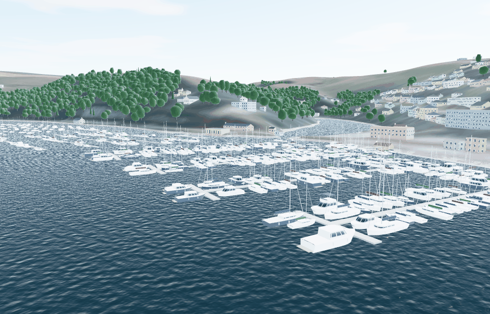
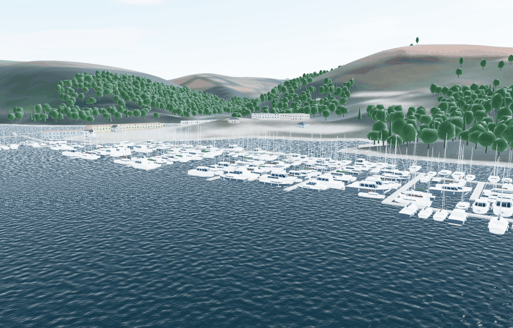
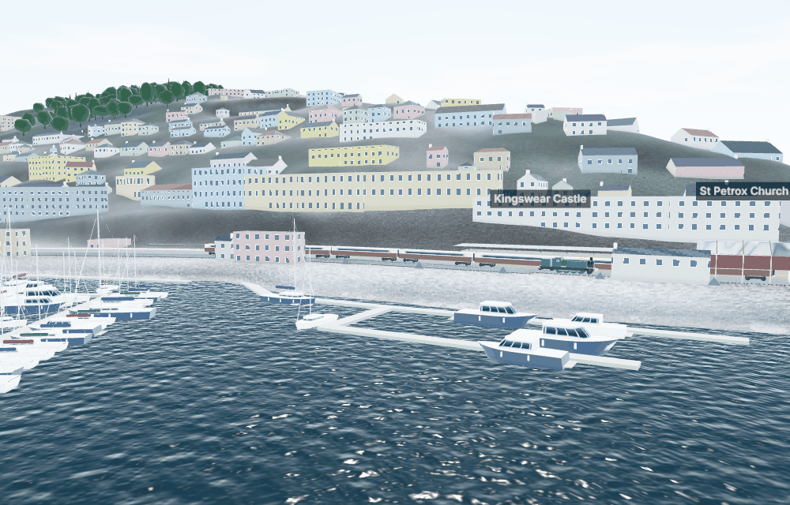
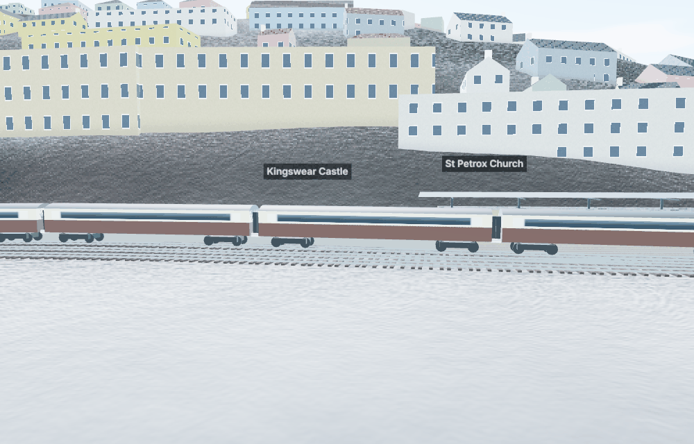
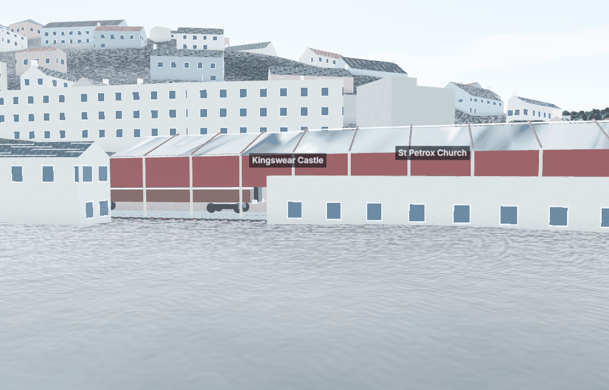

# Round 3: the Lower Ferry, the marinas, the railway, and a calmer screen (27 Oct 2026)

This report answers the owner's review:

> The lower ferries currently collide and pass through each other; this needs to be corrected so they take evasive action. The lower ferry tugboat is stuck in the land. The Kingswear train station is missing, as are the arriving and departing trains. The UI is too cluttered and needs to be redesigned using UI/UX best practices to improve the user experience. The marinas have not been populated with boats, or boat traffic.

Each point was reproduced first, then fixed. As before, anything not from a source is labelled as an estimate (E). Nothing here needs an external service or paid infrastructure: the new data comes from the same open OpenStreetMap/Overture extract, and the timetable and facts from public web pages (SOURCES.md F9–F14).

## Summary

| Reported | Cause found | Fix |
|---|---|---|
| Lower Ferries pass through each other | The second unit ran its crossing as the mirror of the first's, so the two met on the same track: their centres passed 0.3 m apart | **Each unit stands 20 m off to starboard mid-river and they pass port to port** (COLREGS rule 14 head-on), easing back onto the track before the far slip. Closest approach 40 m; a test checks the hull and tug outlines never touch, and that each sees the other on its port hand |
| The tug stuck in the land | The float berthed with its centre on the end of OSM's route line, which is the top of the slip (+2.6 m ODN at Kingswear), and the tug alongside swung over ground at +2.9 m | **The float lies as far up each slip as the water allows**, for the tide at that moment: its spoon end, middle and tug afloat (drafts E), and room for the tug to swing 12 m off. So it berths further down the slip at low water (Dartmouth 18–38 m, Kingswear 28–53 m from the top). The tug works one side of the float all day, the side that berths furthest up both slips. Over a test day the tug always has at least 1.3 m of water under it |
| Kingswear station missing | Not in the data the app read | The pipeline now exports OSM's **railway lines, the platforms and the station**. Drawn: track, the platforms, the listed **train shed** (timber trusses, boarded sides, glazed ridge) and its **canopy on lattice piers** (Historic England 1308783), and the Greenway tunnel's mouths |
| No trains | — | **Steam trains on the operator's published timetable** (Paignton 10:30, 12:00, 14:00, 15:30; back from Kingswear 11:10, 12:40, 14:40, 16:10; 30-minute journey). A GWR-style tank engine and seven chocolate-and-cream coaches arrive along the east bank, the engine runs round its train on the loop, and they leave. Smoke when working, steam when standing |
| UI too cluttered | 11 toolbar buttons, a big instrument panel open by default, a four-row control dock, all fighting the view | **Redesigned** (UX_REVIEW.md, "Redesign"): seven controls with one More menu, compact instruments, a two-row dock that can be put away, status that speaks only when needed, quiet notices |
| Marinas empty, no marina traffic | Only Dart Marina had traffic (boats appearing at its centre), and no boats lay in any marina | **853 berths laid out on OSM's pontoons** (Darthaven 246, Dart Marina 97, Noss on Dart 289, the river's pontoons about 220), filled by season. **Boats come and go from all three marinas:** astern out of the berth, along a way out found round the pontoons and boats, to sea or up-river, and back to the same berth. Berths stand empty while their boats are out |

## The Lower Ferry

| Two units meeting mid-river, passing port to port |
|---|
| See `tests/sim/traffic.test.ts` ("two units meeting mid-river…"); the closest approach in the app's run is 40.0 m |

What was done (`src/sim/env/traffic.ts`):
- **Berths with the tide.** For every distance of the float from the top of a slip, the lowest water level at which it works: the float's spoon end afloat (0.45 m draft, E), its middle (0.9 m, E), the tug alongside (1.3 m, E), and the tug's swing 12 m off, each with 0.3 m under it. The berth for a level is read off that curve, so the float creeps down the slip as the tide falls and back up as it rises. The bed is the provisional bathymetry near the slips (issue 64).
- **One side for the tug.** The tug is lashed to one side of the float for the day. The side chosen is the one that berths furthest up both slips over the tidal range.
- **Passing.** When two units run (08:00–20:00 outside the autumn refit, F2), each crossing stands off to starboard by 20 m·sin²(πs/L) (E), turning smoothly, so they pass port to port at 40 m.

## The marinas

| Darthaven, Kingswear | Noss on Dart |
|---|---|
|  |  |

- **Where the boats lie** (`src/sim/env/marinas.ts`). On every OSM pontoon in a marina: finger berths down both sides, bow-in, about a beam apart. On Dart Harbour's lettered pontoons (KQ–KU, DA, DB) and the visitors' pontoons: boats alongside. None on drying ground, across another pontoon, or overlapping another boat. None on the pontoons for dinghies, ferries, the lifeboat, fishing boats or hire boats. Sizes by marina: larger at Noss, which takes 9–25 m vessels (F12). Darthaven's 246 compares with "over 270" (F13); Noss's 289 is more than the 155–232 published (issue 62).
- **Noss on Dart Marina** is a named place in OSM rather than a marina area. The pipeline adds it, centred on its pontoons.
- **How full.** Marinas 88% let in summer and 72% in winter; visitors' pontoons 60% in summer down to 12% in winter (E).
- **Coming and going.** Each marina's day is seeded:
  - movements in proportion to its berths (E);
  - 80% are day trips that return to the same berth 1.5–7 hours later;
  - 10% leave for longer;
  - 10% are visitors arriving in an empty berth.

  A boat goes astern out of its berth into the lane, then follows a way out found on a 2 m grid round the pontoons and berthed boats (Dijkstra from the marina's entrance, straightened in clear water), dead slow (2.5 kn, E), then the deep-water route to sea or up-river as before. It holds for the chain ferries and turns corners rather than jumping.
- **Drawing them** (`src/render/berthed.ts`). Hundreds of boats, so a few reduced-detail models (sloops with covered mainsails, furled genoas and fenders; motor cruisers, some with flybridges; 800–1,100 triangles each), instanced and scaled to each boat. Plain hulls are drawn beyond 420 m. The trot moorings now use the same models instead of the old primitive shapes.

## Kingswear station and the trains

| The station from the river: the engine running round on the loop | The coaches at the platform |
|---|---|
|  |  |

| The train shed (boarded sides, trusses, glazed ridge) |
|---|
|  |

- **The line** (OSM, via the geodata): from the buffer stops at Kingswear along the east bank, past Britannia Crossing and through the Greenway tunnel (found from the ground rising over the line: 451 m against the published 495 yd = 453 m, F11), to the edge of the map. The loop beside the platform road is found from the track layout.
- **Track and station** (`src/render/railway.ts`). Ballast, sleepers and rails on every line at the LIDAR ground, smoothed. The platform is raised 0.92 m above the rails, with white coping. The shed over the first 46 m of the platform and the platform road (E: length); the canopy on lattice piers for 54 m beyond (E). The station building is OSM's footprint, as before.
- **The trains** (`src/sim/env/railway.ts`). Each train arrives 30 minutes after its Paignton departure (F9) and stops 20 m short of the buffers. A minute later the engine:
  1. uncouples and draws forward;
  2. crosses to the loop;
  3. runs back past its coaches;
  4. crosses over again and couples on at the far end.

  The train leaves at the published time. Line speed is 25 mph, slowing to 10 mph over the last 400 m (E). Each vehicle sits on the chord between its bogies, so the train follows curves without its ends overlapping (tested). Trains run on every day of the 2026 season (31 March – 29 October, F9); the formation, engine type and the moves are estimates (E8).

## The screen

| Before | After |
|---|---|
|  |  |

What changed and why: UX_REVIEW.md, "Redesign: less clutter". In short:
- **The app bar has seven controls.** Pause/Resume is accented. Tutorial, the course editor, the display options and the physics tools are in one More menu with sections.
- **The instruments start compact on every screen.** The choice is remembered.
- **The sailing dock has two rows,** sails left and boat right, beside the minimap. It can be put away; the keys still work.
- **Sail status is a word when all is well,** with advice and a key when not.
- **Notices sit out of the boat's way:** Paused is a pill, and the footer is one quiet line.

## Tests

- **Unit:** 26 files, 224 tests, all passing. New:
  - `tests/sim/railway.test.ts`: the line, the tunnel, the loop, the timetable, smooth motion, no vehicles overlapping;
  - `tests/render/railway.test.ts`: track, platform, shed, portals, a level train on the rails;
  - `tests/render/berthed.test.ts`: triangle budgets, near and far models, empty berths;
  - traffic tests: the two Lower Ferry units never touch and pass port to port; the berth follows the tide and the tug is always afloat; every marina's boats leave from and return to their berths.
- **Reference race hash:** unchanged (`5de2cc60d1e76458`): the physics is untouched.
- **Browser (Playwright):** updated for the More menu and the compact instruments, plus a new test for hiding and restoring the sailing controls. Results are in the commit's CI run.

## Still open

Issues 61–66 in OUTSTANDING_ISSUES.md:
- berthed boats are not physics obstacles;
- the berth layout and occupancy are estimates;
- the trains are visual only, on one day's timetable pattern;
- the Lower Ferry's berths rest on provisional bathymetry;
- the ferries give way to no one;
- an occasional brush as marina boats leave.

What would make them exact: MISSING_INFORMATION.md E7–E9, which covers berth plans, the railway's calendar and formations, and the Lower Ferry slips' levels.
