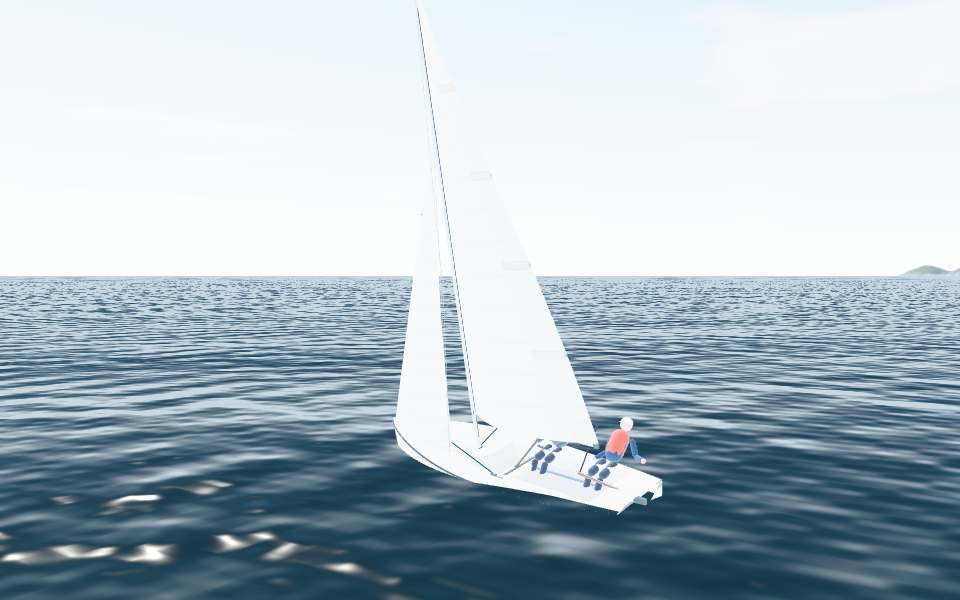
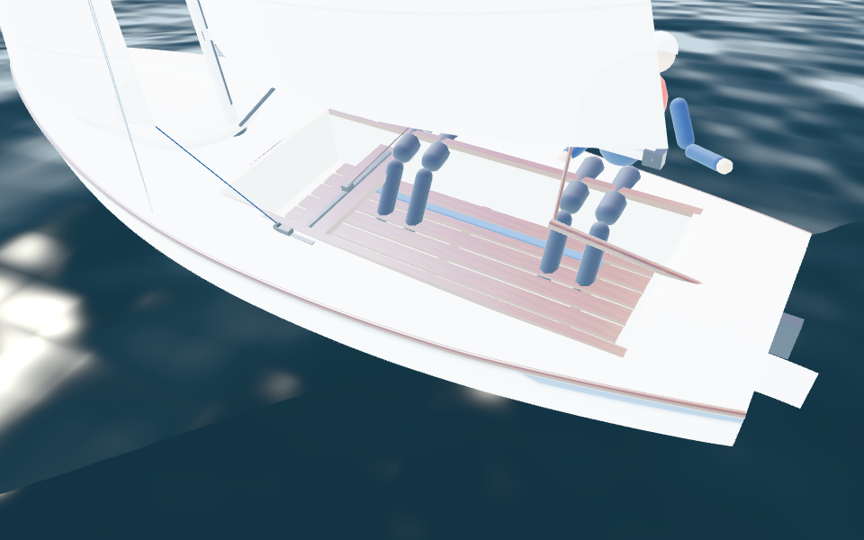
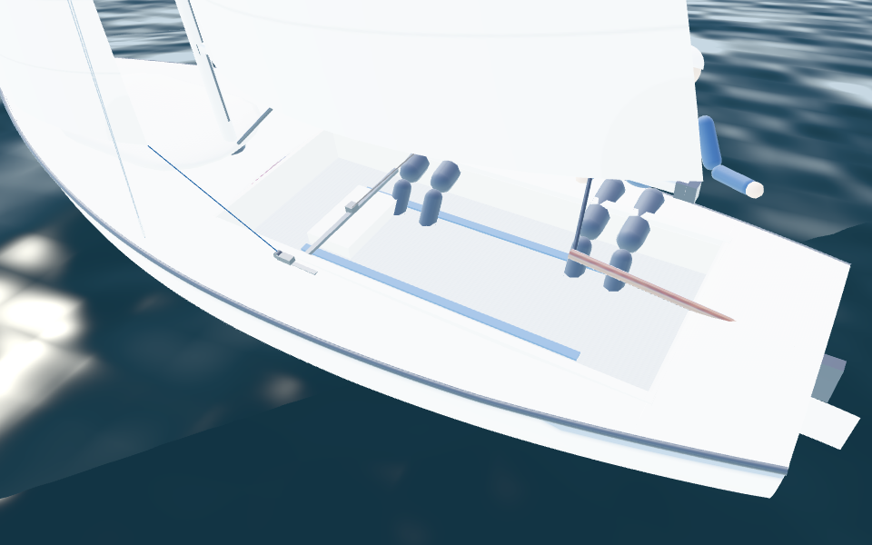
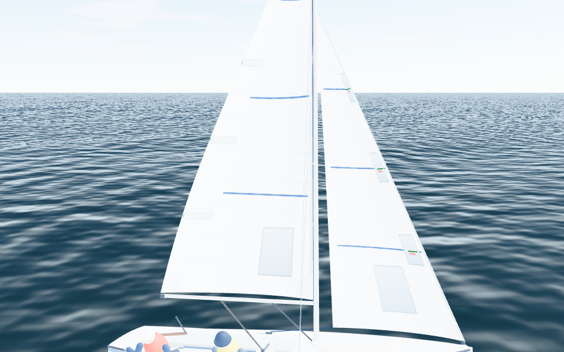
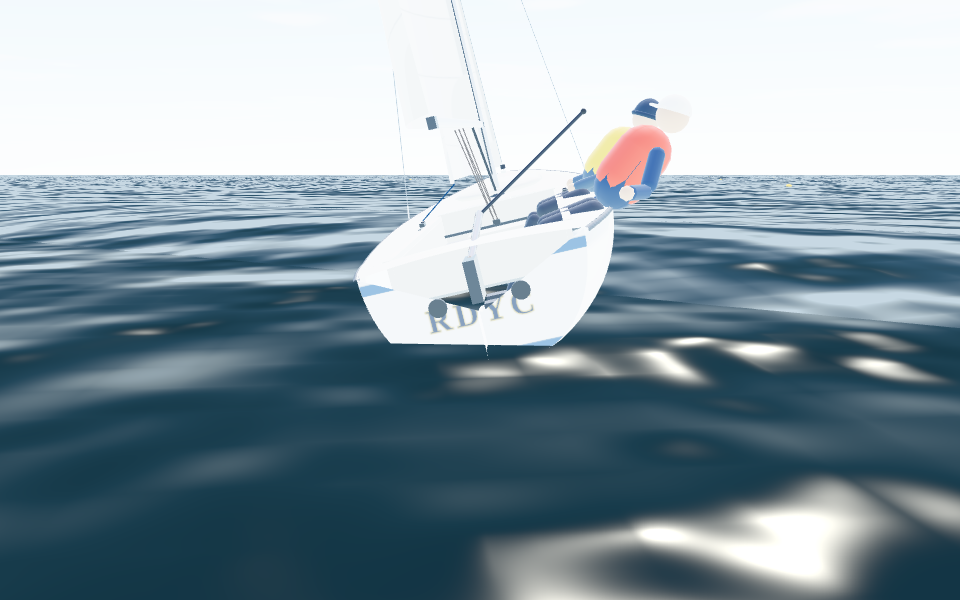
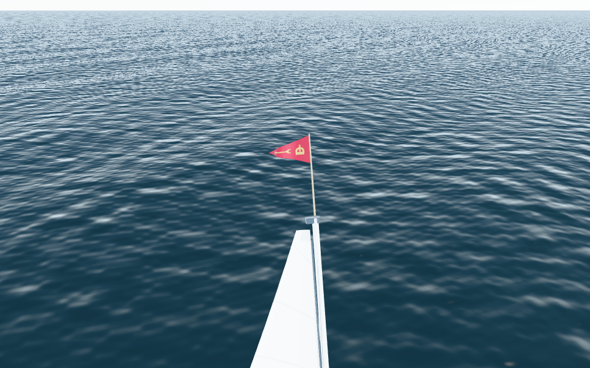
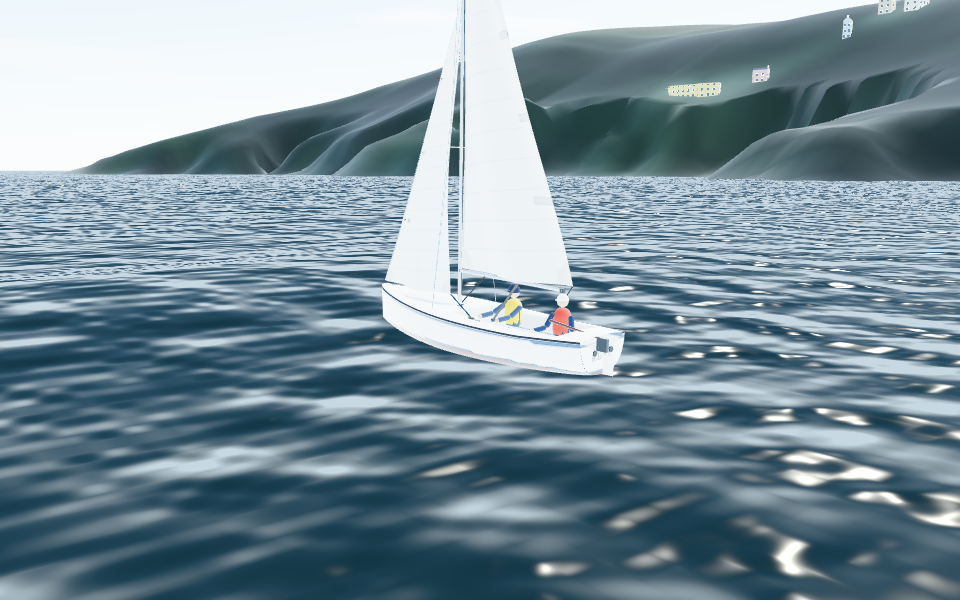
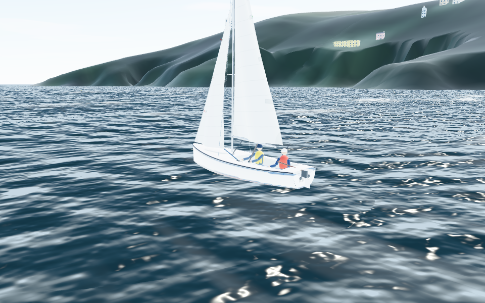
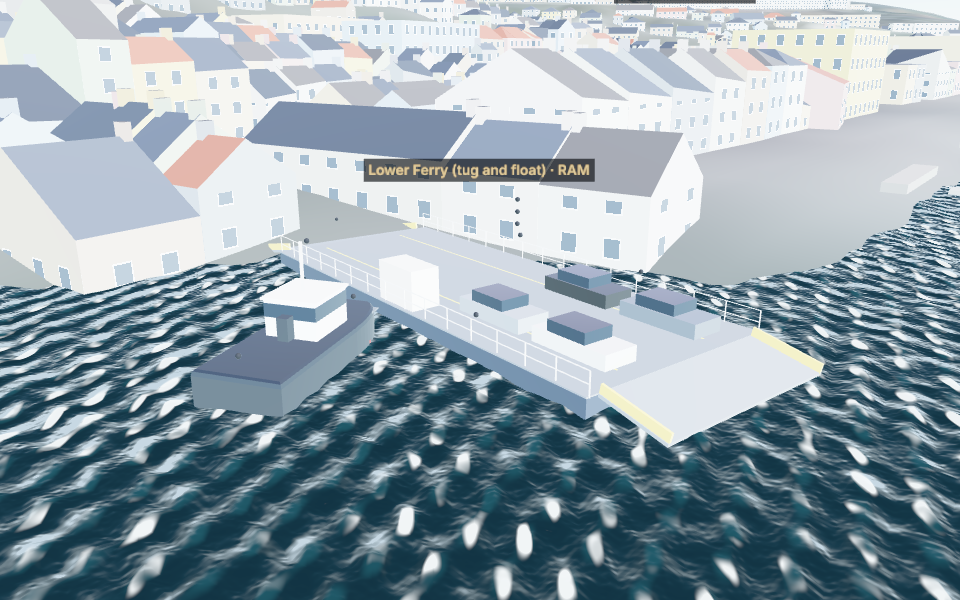
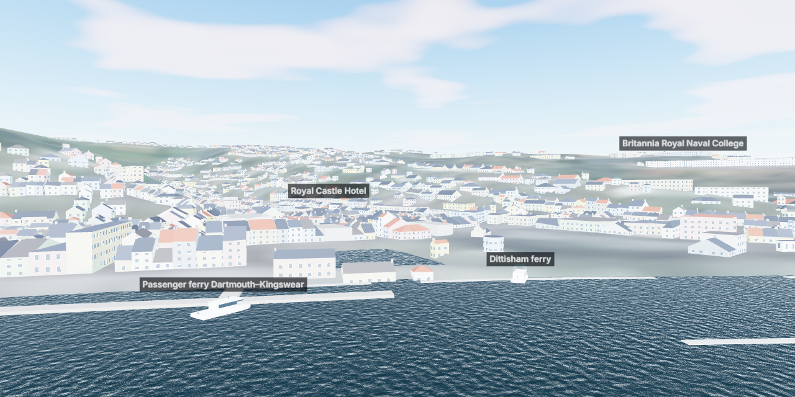

# Hi-fi pass: Squib types, detailed models, wind over tide, river traffic (25 Oct 2026)

This report covers the owner's request of 25 October 2026:

- move the graphics to hi-fi: buildings accurately represented and placed; the same for the Squib, the ferries and the traffic in and out of Dart Marina;
- fly the RDYC burgee and put RDYC on the stern;
- make the waves represent wind over tide;
- move the river traffic at dynamic speeds, with a more accurate Lower Ferry;
- offer three Squib types, each with its own physics.

What could be sourced is sourced; everything else is labelled as an estimate (E), as before. The work is on the `hifi` branch until it is merged.

## What was done

| Request | Done | What is real data, and what is not |
|---|---|---|
| Three Squib types with physics | **Rondar** (the modern standard, default), **classic Parker or Hunter**, **new sail package (Hyde B3 / Batt)**. Choose under Scenario → Boat; the panel lists every parameter a type changes, with its source | The builders and the self-draining cockpit are sourced (C9, C10); the class is a strict one-design, so the hulls differ only in the cockpit. The new sails' effects are the maker's claims (C11, C12); their size is estimated |
| Hi-fi Squib | Smoother hull with boot top and sheer stripe, foil-section keel and rudder, tapered mast, spreaders, wire rigging, kicker, mainsheet, deck fittings, sail cloth with seams, battens and telltales; a cockpit for each type; the water in the cockpit drawn level | Principal dimensions from the class (as before). Hull lines, keel and rudder shapes and the deck layout are still estimates: no lines plan or measured drawings are available (B2–B4) |
| RDYC burgee | At the masthead on a burgee stick, streaming in the apparent wind from the physics | Blazon from the club's rules (R8): red, with a gold royal crown and a gold dart side by side, the dart flying to the fly; proportions from the Commons drawing (R10). The crown and dart are drawn from the blazon |
| RDYC on the stern | Gilt-edged navy capitals on the transom | Lettering style is an estimate (E2) |
| Wind over tide | A sea-state model (PHYSICS.md §19) drives the water and brings spray aboard. In the entrance on the ebb with a southerly the waves are short, steep and breaking | Published wave formulas (WV1–WV3); limits and the open-sea fetch are estimates |
| River traffic at dynamic speeds | Speed profiles, the 6 kn harbour limit, crabbing into the stream, holding for ferries (PHYSICS.md §20) | The Lower Ferry's timetable, refit and manoeuvre are sourced (F2, F3). Sizes, speeds, loading times and the other timetables are estimates |
| Lower Ferry accuracy | Float with ramps and cars, tug alongside that goes astern off the slip and swings end for end on its head rope; two units passing mid-stream; one during the 29 Oct – 13 Dec 2026 refit | Float and tug dimensions were not found (E5) |
| Dart Marina traffic | Motor cruisers, yachts under engine and RIBs, on deep-water routes from the marina to the sea or up-river, waiting for the ferries | The marina's position is OSM's. Numbers, kinds and speeds are estimates (E6) |
| Accurate buildings | Roofs (gables along terraces, hips, flat), party walls without windows, chimney stacks, window storeys from floor counts, bases on the LIDAR ground, a 4 m town terrain | Footprints, placement, heights and the ground are data. Roof shapes are OSM's where tagged (14) and **inferred** elsewhere. Measured roofs need the EA LIDAR surface model, which this environment cannot reach (E1) |

## The Squib types

| | Rondar (default) | Classic Parker or Hunter | New sails (Hyde B3 / Batt) |
|---|---|---|---|
| Hull | Rondar, Mark 3 mould (2016–2024) | Hunter (sail numbers 158–724) or Parker (1997–2010) | Rondar |
| Cockpit | Self-draining: a raised, moulded floor; water runs out through the transom | Not self-draining: a deeper well with wooden floorboards; water stays until bailed | Self-draining |
| Weight | Class minimum | +15 kg (E) | Class minimum |
| Sails | Earlier designs (the calibrated default) | Earlier designs | Sheet closer to the centreline, wider groove, fuller downwind; windows and draft stripes |

**How the physics differs** (PHYSICS.md §18). Water comes into the cockpit when the rail is buried, and floods in once the cockpit's edge goes under. In waves, older boats also take spray aboard. A self-draining cockpit lets the water out through the transom; otherwise the crew bails it. The water makes the boat heavier and, because it runs to the low side above the centre of gravity, more tender.

In 16 kn close-hauled, with the crew sitting in and the sheets in:

| | Water aboard | Heel | Speed |
|---|---|---|---|
| Rondar | 7 kg | 36.6° | 5.07 kn |
| Classic | 356 kg | 36.8° | 4.89 kn |

With good hiking, neither boat ships much water.

The new sails change the speed at 10 kn by −0.3% to +0.7% at 42°, 90° and 150°: small, and in the directions the maker claims. The boat looks different too:

| Classic cockpit | Rondar cockpit | New sails |
|---|---|---|
|  |  |  |

| RDYC on the transom | The burgee |
|---|---|
|  |  |

## Wind over tide

The sea state is computed from:
- the wind over the water;
- the open water upwind, using the elevation grid and the tide;
- the tidal stream along the fetch and at the point.

Waves that run into an opposing stream keep their period, so they get shorter and, since wave action is conserved, higher. A strong enough stream stops them and they break. The water surface follows the field around the camera.

In 18 kn from the south at the castles:

| | Ebb (stream −1.6 kn against the waves) | Flood |
|---|---|---|
| Model | Hs 1.4 m, 27 m long, 5.2% steep, whitecaps 3% | Hs 0.8 m, 36 m long, 2.2% steep |
| Picture |  |  |

The instruments' **More** panel shows the waves (height, length, period, steepness against slack water, whitecaps), with the existing wind-against-tide chip.

The waves do not slow the boat yet (issue 51).

## River traffic

**The Lower Ferry** follows the operator's published first and last departures in UK local time (F2). Each crossing:
1. Loading, with the ramps down.
2. The tug goes astern to clear the float off the slip.
3. The tug swings end for end about its head rope.
4. Ramps up, a crossing at up to about 4 kn, crabbing into the stream.
5. The float lands at the far slip, ramps down.

A second unit runs opposite the first from 08:00 to 20:00, so they pass mid-stream. During the refit (29 Oct – 13 Dec 2026) only one runs.

**The Higher Ferry** is a floating bridge on two guide cables: no crabbing, and about a 3-minute crossing (F5).

**The other services** have estimated timetables:
- the passenger ferry;
- the Castle, Dittisham, Greenway and Noss ferries;
- the Totnes cruise.

**Dart Marina's boats** follow deep-water routes from the marina to the sea or up-river. They keep to 6 kn in the harbour and wait while a ferry crosses their track.

Every vessel is solid in the fleet physics, the Lower Ferry's tug included. The physics and the picture share one traffic model, built from the clock and the stream, so they always agree.

## Buildings

What the data gives:
- **Footprints** from OSM and Microsoft ML, with their positions.
- **Heights:** 2,041 from the data, 392 from floor counts, 2,971 estimated by building type (E).
- **Bases** on the Environment Agency LIDAR ground, at about 3 m resolution in the towns.
- **The town ground**, now drawn at 4 m.

What is inferred (E):
- **Roof shapes:**
  - footprints that share walls with their neighbours (1,050) are terraces, gabled with the ridge along the street;
  - detached houses are hipped, or gabled when long and narrow;
  - large, irregular and utility buildings are flat.
  - In total: 3,246 gabled, 1,532 hipped and 626 flat.
- **Party walls** have no windows.
- **Chimney stacks** stand at the party walls.

The physics grids are byte-identical to before.

**Not achieved: measured roofs.** OpenStreetMap tags roof shapes on only 14 of the area's 5,743 buildings and has no building parts. The measured source is the Environment Agency's LIDAR surface model (1 m, free under the Open Government Licence), but `environment.data.gov.uk` is refused by this environment's network policy. Allowing that host (E1) would let the pipeline fit each roof to the measured surface. That is the step from "plausible" to "accurate".

## Tests

| Suite | Result |
|---|---|
| Unit (Vitest) | 200 tests pass (165 before this pass), including:<ul><li>`variants.test.ts`: types, provenance, cockpit water, flooding, determinism</li><li>`seastate.test.ts`: JONSWAP, dispersion, blocking, whitecaps, wind over tide in the open and in the Dart entrance, cache independence</li><li>`traffic.test.ts`: UK clock changes, the Lower Ferry's timetable, manoeuvre, ramps, two units and the refit, crabbing, routes, the harbour limit, holding for ferries, determinism</li><li>town detail in `phase3.test.ts`</li></ul> |
| Browser (Playwright) | `hifi.spec.ts`:<ul><li>choosing a type in the panel rebuilds the boat with its physics;</li><li>the burgee streams with the apparent wind and the transom is lettered;</li><li>the ferries, the tug and the floating bridge are in the scene;</li><li>the conditions report steep waves with wind against tide in the entrance.</li></ul>Plus the existing suites |
| Determinism | Unchanged in kind. The reference race (7 boats, 400 s) has a new hash, `5de2cc60d1e76458`: the default boat now ships water when its rail goes under (one boat briefly heeled to 40° and took 10 kg). The AI's polar table was regenerated: one cell changed, at 25 kn and 38° |

## Download and cost

| Item | Change |
|---|---|
| Data download | `features.json` grew from 700 to 840 kB (about 220 kB gzipped). `town.i16z` adds 159 kB |
| Rendering | The water shader does more work: 8 wave trains, per-pixel normals, a 34,000-vertex mesh. Each boat's fixed parts are merged into about 15 meshes. Real-GPU frame times are not measured here (issue 43) |
| External services and paid infrastructure | None new. The EA host (E1) is free; it needs allowing in this environment's network settings |

## Requests

See MISSING_INFORMATION.md, section E:
- **E1:** allow `environment.data.gov.uk`.
- **E2:** a photo of an RDYC transom and of the burgee.
- **E3:** Squib weights and how a classic cockpit is bailed.
- **E4:** comparisons of the new sails with the old.
- **E5:** ferry dimensions and timings.
- **E6:** Dart Marina's movements.
