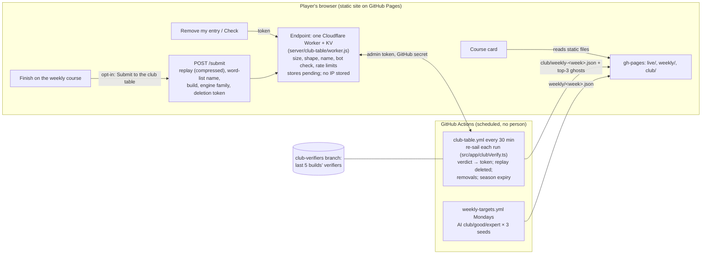

# Juniors round: feel, sailing cues and social goals

Round report, 17 Nov 2026. Branch `juniors-feel-social`, draft PR against `main`. Owner's brief: "SailSim: feel, sailing
cues and social goals for younger players". Evidence levels as in the review (L1–L5); "E" marks an estimate.

**Hardware caveat for this whole report.** The development machine has **no graphics card**: every frame time,
screenshot and stall below was measured with Chromium's software renderer (SwiftShader) on a 4-core Xeon at 2.3 GHz
with 16 GB of memory. The CPU-throttled runs are **stand-ins, not real devices**. Nothing here says how smooth the sim
is on any real device, or that the low preset "looks good": the device check exists so that people at the club can
find out ([DEVICE_CHECK.md](DEVICE_CHECK.md)), and the owner judges the look.

**Physics unchanged.** No file under `src/sim/` or `data/boats/` changed. `npm run envelope` gives byte-identical
`envelope.json`, `envelope.md` and console output before and after. `npm run golden:update` regenerates the four
golden traces identically: only their "generated" date differed, and those files were restored. `npm run perf`:
§2.5.

## Contents

1. [What changed and why](#1-what-changed-and-why)
2. [Device and performance evidence](#2-device-and-performance-evidence)
3. [Screenshot sheets and cue consistency](#3-screenshot-sheets-and-cue-consistency)
4. [The social design](#4-the-social-design)
5. [Remaining limitations, and what needs people](#5-remaining-limitations-and-what-needs-people)
6. [The next three improvements](#6-the-next-three-improvements)
7. [Tests and checks run](#7-tests-and-checks-run)

## 1. What changed and why

Presentation changes are listed apart from the simulation data they read. **No simulation value was added or
changed.** The renderer reads, read-only, what was already there: the snapshots, the wind model's puff list
(`WindField.puffs()`, already used by the water) and its gust factor at the boat (`WindField.sample`, which changes no
state).

### 1.1 Workstream 1: feel and frame rate

| Change | Why | Where |
|---|---|---|
| **Device check** (Settings → Display → Check this device): a 50 s fixed route on a fixed seed, driven through the app's own keyboard handler. Reports median, 95th and 99th percentile frame times, frames over 33 and 100 ms, the longest, main-thread work per frame, first frame, first sailable frame, start-up stalls labelled "shader compile" where the program count rose, key-to-screen delay, GPU string, screen, pixel ratio, cores, memory class, engine family, preset and automatic lowering. Plain verdict (Smooth / Mostly smooth / Struggling) with reasons; copy or save as JSON; no personal data | Nobody can measure juniors' devices from here (§4.1) | `src/app/deviceCheck.ts`, `deviceCheckRunner.ts`, `src/ui/SettingsPanel.tsx`, [DEVICE_CHECK.md](DEVICE_CHECK.md) |
| **Stand-ins and profiles**: `tools/device-standin.mjs` (CPU throttle ×1/×4/×6 by the DevTools protocol, small viewports, pixel ratio 1), `tools/frame-profile.mjs` (CPU and sampling heap profiles over driven frames) | Measure first | `tools/` |
| **Fix: a multi-second stall each time a river boat appeared.** The P/S label of a navigation light kept the light object in `userData`. three.js deep-copies `userData` through `JSON.stringify` when a vessel model is cloned, so every clone serialised a sprite, its material and its canvas texture, encoding the canvas as a PNG (`toDataURL`). Now the label keeps the light's index. This also fixes a latent bug: cloned vessels' labels pointed at a JSON copy, not their light | Profile: `toDataURL` was 667 ms a frame on average over 120 frames, with one frame of 80.7 s | `src/render/navLights.ts` |
| **Fix: a stall at every new scenario, and whenever the sun moves 3°.** The horizon reader built a new shader material for each read and deleted it afterwards, so it was compiled every time. It then read back synchronously, waiting for the sky's light map to be drawn. Now the material is kept, and the read is asynchronous (WebGL 2) | Profile of the device check's restart: 38.9 s (compile) then 44.8 s (read-back) → 4.4 s | `src/render/scene.ts` |
| Fix: the walkers' jetty lookups allocated in the frame loop (array destructuring per segment, no bounding box) | Largest allocator per frame in the profile | `src/render/dart.ts`, `landmarks.ts` |
| Same fix for the simple-materials fallback (a material kept in `userData`) | The same hazard | `src/render/scene.ts` |
| **Shader warm-up** (`renderer.compileAsync`) behind a "Preparing the 3D view…" notice, on loading and on restarts, **only where the browser compiles shaders in parallel** (`KHR_parallel_shader_compile`). Without it, compiling the whole scene up front was measured to be slower: the river became sailable at 19.4 s instead of 10.1 s at ×4 | Issue 43; the brief's "consider compileAsync" | `src/app/controller.ts`, `src/render/scene.ts` |
| **Dynamic resolution with hysteresis** before any preset step: 2-second windows; down a step after 2 windows with the 95th percentile over 33.4 ms; up only after 6 windows under 60% of that, and a 20 s cool-down that doubles when a step up does not hold (up to 4 min); at the floor (60%), after 3 more windows, the preset steps down. A notice says so, with **Keep full quality**; **Automatic quality** in Settings switches it off | Brief §4.2 | `src/render/dynamicResolution.ts` |
| **Game controllers** (Gamepad API, standard layout) through the existing controls: the stick sets a helm target that the helm follows at the keys' rate (as dragging the tiller does); the triggers set the mainsheet's rate in proportion; the buttons press the existing held actions and commands. Dead zone 15% and response curve exponent 1.6 (E). Inputs are logged like any others, so replays and challenges work | Brief §4.2 | `src/app/gamepad.ts`, `controller.ts` |
| **Vibration** (`vibrationActuator`, where supported) for a gust arriving, the boom crossing and contact, scaled by the event. Optional (Settings → Controls), off with reduced motion, and never the only channel | Brief §4.2 | `controller.ts` (`rumble`) |
| The lowest preset is shown as **Smooth** (the stored key stays `performance`, so saved settings load). It now has haze from the sky's colour and the bow spray: §2.3 | Brief §4.3 | `src/render/graphics.ts` |

### 1.2 Workstream 2: one cue pipeline

| Change | Where |
|---|---|
| **One cue state a frame** (`CueState`), from the interpolated snapshots: every live puff with the wind model's own life envelope; true and apparent wind; the gust at the boat; each sail's luff, stall and flog; heel and heel rate; speed through the water and over the ground; rudder angle and load; wave height; the bow's drop onto the water; spray rate; events (boom across, gust onset, contact, grounding); tack or gybe in progress. Water, sails, telltales, spray, sound, camera and vibration read it | `src/render/cues.ts`, `scene.ts`, `controller.ts` |
| **Fix: the water drew puffs with its own life envelope** (linear ramps) instead of the wind model's smoothstep, so a drawn puff's strength differed from the wind it added. Now the cue state carries the model's envelope, and the shader is given exactly the model's strength | `cues.ts` (`puffEnvelope`) |
| The 16 shader slots take the puffs **nearest the boat by edge**, so a puff the boat is in or about to enter is never left out for a far one (tested) | `selectPuffsForShader` |
| **Gust outlines**, a removable teaching aid: rings at each puff's position and radius, the nearest three labelled "gust +25%" in words. Off by default and off in races unless asked for (Settings → Help and accessibility). Removing them leaves the cat's paws on the water unchanged (tested) | `src/render/puffOutlines.ts` |
| **Telltales**: the windward ones lift and spin when the jib luffs; the leeward ones when the flow stalls (the physics' stall factor, unused by the picture before) | `src/render/squibModel.ts` |
| **Sound**: the wind's voice is now silent in a dead calm (it had a floor of 8%); a **gust arriving** makes a swell of the wind's band, scaled by the gust and the apparent wind. Wind, water, flutter and the boom already followed the simulation; they now read the cue state | `src/render/audio.ts` |
| **Feel**: the chase camera eases back up to 1.2 m as a gust arrives and dips up to 0.25 m as the boom crosses. Both are traced to cue events, scaled by the camera-motion setting, and none with reduced motion. Spray uses the same rule as the cue state (one definition) | `cues.ts` (`cameraFeel`), `boatWater.ts` |
| **Every cue at every preset**: an audit of the drawn scene (`controller.cueAudit()`) and an end-to-end test at Smooth, Balanced and Ultra | `src/render/cueAudit.ts`, `tests/e2e/juniorsCues.spec.ts` |

### 1.3 Workstream 3: social goals

Layer A works with no server at all. Layer B is written, tested against a local mock, and **off**.

| Change | Where |
|---|---|
| **Word-list names**: adjective + sea creature or shore bird + 1–99 ("Blue Heron 42"), chosen from menus or re-rolled. Never free text; the endpoint and verifier check the same lists | `src/app/safeNames.ts` |
| **Challenge a friend**: after a finish, a link carries the run, the name, the course, the time and the time at each mark. The friend's app shows a challenge card ("does not react"), races the run as a ghost, and then says "You beat Blue Heron 42 by 12 s" or "Blue Heron 42 was 8 s faster: watch how their ghost sails the leg to the windward mark: they gained 9 s there", with a split table. A link whose name is not a word-list name is refused | `src/app/challenge.ts`, `src/ui/Social.tsx` |
| **Like-for-like bests** for the weekly course and the daily challenge only, **independent** and **assisted** kept apart, with the last 20 attempts as a small chart (shapes as well as colours). The existing bests stay, still described as a record of what you did | `src/app/bests.ts` |
| **The assist record**, the training slice's shape and rule (auto-trim, the overlay or live help make a run assisted; auto-crew does not). The training slice has not merged, so this is a compatible minimal copy, to reconcile at merge | `src/app/assists.ts` |
| **The weekly course**: one per ISO week, Monday to Sunday in Europe/London time, chosen from a rotation of the eight RDYC courses (pending the club's check) and four practice courses. Conditions are seeded by the week (8–14 kn, moderate or shifty, a fixed Wednesday afternoon). Rondar Squib, damage as in every race, **no tidal stream** (parity with the AI, RA-2), sailed alone with targets and friends as ghosts. An optional `data/weekly/season.json` can set chosen weeks | `src/app/weekly.ts` |
| **Model-sailed targets**: a scheduled Action sails the week's course with the AI at club, good and expert over three seeds, and publishes bronze, silver and gold with a ghost track each (`weekly/<week>.json`, atomic, kept four weeks). The app checks the file is for this week and this scenario; otherwise "targets not available this week" | `src/app/targets.ts`, `weeklyTargets.ts`, `tools/weekly-targets.ts`, `.github/workflows/weekly-targets.yml` |
| **Club table** (layer B, flag `clubTable` = built with `VITE_CLUB_TABLE_URL`, off): opt-in submit, endpoint, automatic verifier, publish, removal, expiry: §4 | `server/club-table/`, `src/app/clubTable.ts`, `clubVerify.ts`, `src/ui/ClubTable.tsx`, `tools/club-verify.ts`, `.github/workflows/club-table.yml` |

Overlap with the training slice (PR #31), to resolve at merge:

- `src/app/controller.ts`: additive only: the frame hook, the gamepad poll, the social hub, the warm-up, the cue events, a `BUILD_ID` export and one line in `checkRaceBests`.
- `src/app/assists.ts`: duplicates the slice's assist record.
- Issues are numbered from 210.
- None of `sailStatus.ts`, `Controls.tsx`, `lessons.ts`, `DebriefPanel.tsx` or `wind.ts` was edited.

## 2. Device and performance evidence

### 2.1 The stand-ins (not real devices)

Machine: Intel Xeon @ 2.30 GHz, 4 cores, 16 GB, Linux; Chromium with SwiftShader. Each stand-in loads the page afresh
under its throttle and runs the device check for 50 s, with **automatic quality off** for a like-for-like comparison.
With SwiftShader the CPU draws every pixel, so the throttle slows the drawing too: a frame takes seconds. **Every
stand-in is "Struggling" before and after**, which says nothing about real devices with any graphics hardware. The runs
draw only 10–41 frames, so their statistics are rough.

STANDIN_TABLES

Read with care:

- The **start-up shader-compile stall** fell from 5.0–7.2 s to 1.7–3.9 s.
- New "unknown" stalls of 3.6–5.0 s appeared in the "after" runs. The likely cause is the GPU emulator's own drawing,
  now waited on in other places.
- Wall-clock frame times did not change measurably; they are dominated by software drawing.
- The **main-thread work per frame** (the part a slower processor changes) has a median of 21–23 ms at ×1,
  110–130 ms at ×4 and about 160 ms at ×6. Its 95th percentile still includes waits on the emulated GPU.
- With automatic quality on, the phone stand-in lowered its resolution once (75% → 68%) and did not step back up:
  hysteresis held.

### 2.2 What was fixed, from the frame profiles

`tools/frame-profile.mjs` drives 120 frames at a fixed 60 Hz clock from the river start (640 × 400, software rendering,
development build) under the DevTools profilers:

| | Before | After |
|---|---|---|
| Longest frame (main thread) | 80,660 ms (one vessel appearing: `toDataURL`) | 1,975 ms (a new vessel's model and shaders) |
| Median / 95th percentile main thread | 17.5 / 36.0 ms | 11.3 / 26.4 ms |
| The device check's restart (scenario change) | 38,956 ms (horizon shader compile), then 44,836 ms (synchronous read-back) | 4,401 ms (new geometry uploaded for Start Bay) |

PROFILE_THROTTLED

**Measured but not fixed** (issues 211–213):

- Materials shared between instanced and plain meshes make three.js re-derive their programs: about 110 kB allocated
  and 0.5 ms a frame.
- Vessel models are built and compiled when each vessel first appears.
- The warm-up cannot be measured here: SwiftShader has no parallel shader compile.

### 2.3 The low preset as an art-direction problem

**The target look, a rubric for the owner:**

- a clear horizon, and water whose colour reads as the Dart's green-teal;
- a crisp silhouette of boat and sails;
- the landmarks recognisable (Dartmouth Castle, the RDYC, the ferries, the harbour entrance);
- consistent light;
- no muddy textures and no shimmer.

**Evaluated and kept** (cost measured with `tools/gfx-bench.mjs`, eight fixed views, before and after):

- **haze from the sky's colour** (a few vector operations a frame on the CPU);
- **bow spray** (point sprites, only when the bow slams at speed).

GFX_SMOOTH

**Not evaluated this round** (left for a round with a GPU to measure on):

- impostor billboards or merged geometry for the far town and trees;
- baked vertex lighting;
- a cheaper water shader (Smooth already draws the gradient sky water with Fresnel and the cat's paws);
- a blob shadow (Smooth already has one shadow map that follows the boat);
- texture atlases;
- density by distance.

Under software rendering, the measured costs are triangles and fill, not these.

### 2.4 Budgets for each preset (software rendering; relative only)

GFX_BUDGETS

Texture memory is an estimate: width × height × 4 bytes, × 4/3 with mipmaps, over the textures on the scene's
materials. Render time is the time to submit and draw one frame and read a pixel back, under SwiftShader at 1280 × 720.
On a GPU it would be one or two orders of magnitude lower. Budgets proposed for real devices (E, to be checked with the
device check):

| Preset | Draw calls | Triangles | Texture memory | Render time |
|---|---|---|---|---|
| Smooth | ≤ 700 | ≤ 3.5 M | ≤ 64 MB | ≤ 25 ms on a school Chromebook (E) |
| Balanced | ≤ 1,400 | ≤ 12 M | ≤ 96 MB | ≤ 16 ms on a laptop with integrated graphics (E) |
| Ultra | ≤ 2,000 | ≤ 15 M | ≤ 128 MB | ≤ 16 ms on a graphics card (E) |

### 2.5 Physics budget

PERF_LINE

### 2.6 Not measured

- Any real device: Chromebooks, older laptops, iPads, Android tablets and phones.
- A real GPU (frame times, warm-up with parallel compile, the low preset's look).
- Firefox and Safari (WebKit): those engines are not installed here.
- A physical game controller and its vibration (the Gamepad API was mocked).
- Touch comfort on a real tablet (§7 gives the sizes measured).
- The load time over a real connection.
- Input-to-photon delay: the check measures to the end of the frame's drawing commands, not to the screen.

## 3. Screenshot sheets and cue consistency

All screenshots are SwiftShader renders at 1280 × 720. They show what the software renderer draws, and no claim is
made about a graphics card's picture.

SHOT_SHEETS

**Cue consistency** (`tests/render/cues.test.ts`, 14 tests; `tests/e2e/juniorsCues.spec.ts`):

- Each voice (wind, water, flutter, gust) rises with its simulation value and is **zero at zero**.
- Spray is zero in calm water and at low speed.
- In a dead calm the cue state has no wind, gust, puffs or spray.
- Apparent wind and rudder load follow the snapshot.
- A tack is told from a gybe.
- **Every puff drawn matches a wind-model puff**: position within 0.01 m, strength within 10⁻⁶ (32-bit floats). A
  lone puff's drawn strength equals the extra wind the model adds at its centre.
- With more puffs than slots, every puff left out is further away (by edge) than every one drawn.
- **Label, sound and picture agree**:
  - when the sail panel would say "Luffing" (luff < 0.5), the flutter's gain is over 0.3 and the leech moves more than
    5 cm;
  - when it says "Drawing" (luff ≥ 0.98), the gain is 0 and the leech moves less than 2 cm;
  - both grow as the luff factor falls.
- The telltales: a stalled jib upsets the leeward ones only; a luffing jib the windward ones.
- Nothing is carried by sound or vibration alone: every cue in `CUE_CHANNELS` has a picture.
- The camera feel is none with reduced motion.
- **The WebAudio settings** (a recording stand-in for `AudioContext`):
  - the wind, water and flutter gains rise with their values and are 0 at 0;
  - a gust's swell is larger for a larger gust and absent without one.
- **No listening test was done.**
- At **every preset**, the drawn scene has the sails, at least 6 telltales, a visible heel, the wake, the bow wave, the
  gusts on the water, the burgee, the marks and the other boats.
- The gust outlines switch off without changing the puffs drawn on the water, and are off in races unless chosen.

## 4. The social design

### 4.1 Layer B architecture

### 4.2 Provider comparison (free limits checked 17 Nov 2026)

| | Cloudflare Workers + KV (**recommended**, adapter written) | Supabase |
|---|---|---|
| Free allowance | Workers: 100,000 requests a day. KV: 100,000 reads, 1,000 writes, 1,000 deletes, 1,000 lists a day, 1 GB; reset 00:00 UTC (Cloudflare's KV pricing page) | 500 MB database a project, 2 active projects (Supabase pricing) |
| At a limit | That day's further writes fail until 00:00 UTC: submissions pause and the app says so; reading the table (a static file) is unaffected | — |
| Catch | 10 ms of CPU per request on the free plan, so the endpoint does not open replays (the verifier does) | **Paused after a week without activity**, restarted by hand: wrong for a weekly table that may be quiet in winter |
| Bot check | Turnstile, free (up to 20 widgets; its Privacy Addendum must be referred to in the privacy notice) | Needs another provider |

Expected cost: **£0 a month** within the free limits. Third-party summaries disagreed on some Turnstile limits; the
owner should read Cloudflare's current pages when setting it up. Set-up steps: [DEPLOYMENT.md §6c](DEPLOYMENT.md#6c-club-table-optional-off-by-default).

### 4.3 Replay sizes (measured)

Replays log the input on every step it changes. A key held, or a stick, changes the helm every step.

| Run | Rows | JSON | Compressed (deflate) | Link length |
|---|---|---|---|---|
| Keyboard sailor (a press every 2–6 s), 600 s | 12,188 (20 a second) | 670 kB | 74 kB | about 104,000 characters |
| AI on the helm (like a stick), practice week, 700 s | 67,874 | 4.2 MB | 824 kB | too long for a link |
| AI on the helm, RDYC C1, 3,270 s | 325,623 | 20.9 MB | — | too long |

So:

- the app sends the replay **compressed**, and the endpoint takes up to 2.2 MB;
- challenge links over 150,000 characters are not offered (the replay file does the same job);
- re-sailing took 2.6 s (practice) and 19 s (C1) in Node, bit for bit.

The RDYC courses take the "good" AI about 52 minutes: too long for a juniors' weekly course? That is an owner decision
(issue 215; `season.json` can limit the rotation to practice courses).

### 4.4 Verification and the cross-engine policy

The verifier (`src/app/clubVerify.ts`) checks, in order:

1. The build.
2. The word-list name.
3. That the run is the weekly course of the week it was received in: conditions, course, boat, start and sequence, and
   sailed alone.
4. The assist claim against the auto-trim flags in the inputs.
5. Re-sails it.

Chromium (the verifier's own engine, V8) must match bit for bit, and match the claimed time to 0.05 s. Other engines:

- a bit-exact match is accepted;
- a re-sailed finish within **2 s (E)** of the claim is accepted, with the re-sailed time;
- anything else is listed separately as "recorded on another browser engine, not verified";
- nothing is silently dropped.

Plausibility flags (perfectly periodic presses, over 12 presses a second sustained, identical timing across runs) put a
run in a separate list rather than reject it. **A low-stakes club table, not anti-cheat:** re-sailing proves a run was
possible, not that a person sailed it.

**Cross-engine results.** Firefox and WebKit are **not installed** in this environment, so whether their runs replay
exactly could not be measured. The policy's branches are tested with runs perturbed late in the race; one gave a finish
within the tolerance. Measured instead:

- a run **recorded in Chromium** in the end-to-end test re-sails in **Node** with every checkpoint matching (both V8);
- Node re-sails Node runs bit for bit.

Results the tests show:

- a genuine run is accepted;
- runs with a changed time, assists, conditions, boat or name are rejected, each with its reason;
- a run from an older build is "unverifiable" unless that build's verifier is kept.

### 4.5 Data protection and parents

Drafts for the owner to check, not claims of compliance:

- [club-table/DATA_PROTECTION.md](club-table/DATA_PROTECTION.md): what is processed, where, for how long, the provider's
  role, and how removal works;
- [club-table/PARENTS.md](club-table/PARENTS.md).

Under 18s:

- no free text;
- no accounts;
- no IP addresses stored by the app;
- replays deleted after checking;
- tables expire;
- no streaks, timers to come back, loot or notifications;
- nothing leaves the device without a labelled button.

## 5. Remaining limitations, and what needs people

- **Performance on real devices is unknown.** Run the device check
  ([procedure](DEVICE_CHECK.md); validation sheet §E1).
- **Whether Smooth "looks good"** is the owner's and juniors' call (§E2).
- **Whether the cues teach the right thing**: instructors' check for negative learning (§E3): gusts more obvious than
  on the river, reliance on vibration or overlays, tacks too forgiving.
- **The club table** is not deployed. Its endpoint, Turnstile and the Action were tested against the mock only (§E4
  covers a trial week).
- **Cross-engine replay** was not measured (no Firefox or WebKit here).
- **Thresholds are estimates (E)**, to be tuned with real devices:
  - the device verdict, dynamic resolution, gust onset (12% rise over a 6 s low), vibration strengths;
  - camera feel (1.2 m and 0.25 m);
  - the plausibility rules, and the 2 s cross-engine tolerance.
- The overlay and live-help parts of the assist record are as the app reports them; only auto-trim is verifiable from a
  replay.
- The three AI levels finish an empty course within about 1% of each other, so as stepping stones the targets are
  weak (issue 216).

## 6. The next three improvements (ranked by demonstrated impact)

1. **Build vessel models before they are needed** (issue 212). Now that the `toDataURL` stall is gone, a new vessel's
   build and first draw is the largest main-thread frame measured (about 2 s under software rendering).
2. **Give instanced meshes their own material variants** (issue 211): about 110 kB and 0.5 ms a frame of program
   re-derivation, every frame, on every device.
3. **A compact input encoding for replays** (issue 214): stick and AI steering make replays and links 10× larger than
   keyboard runs, which caps challenge links and club-table submissions.

## 7. Tests and checks run

E2E_SUMMARY
