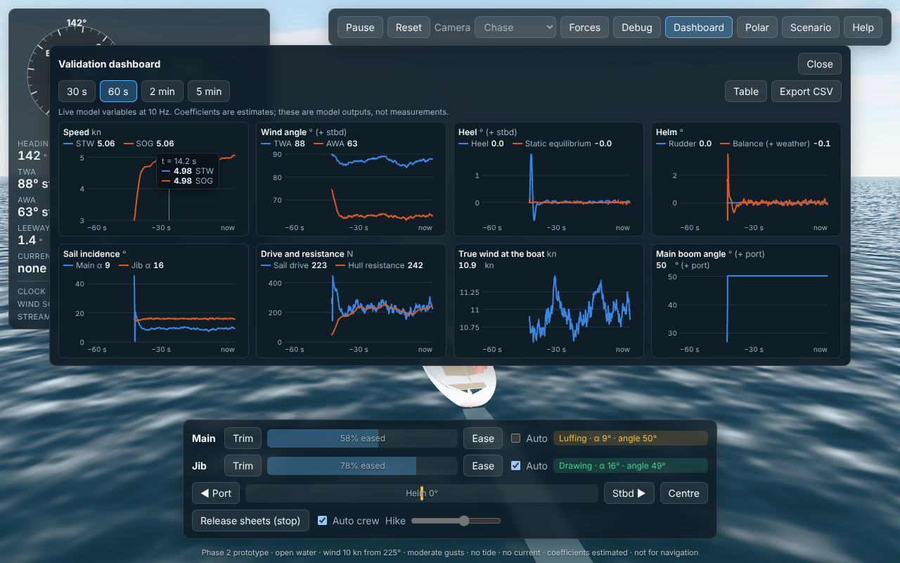
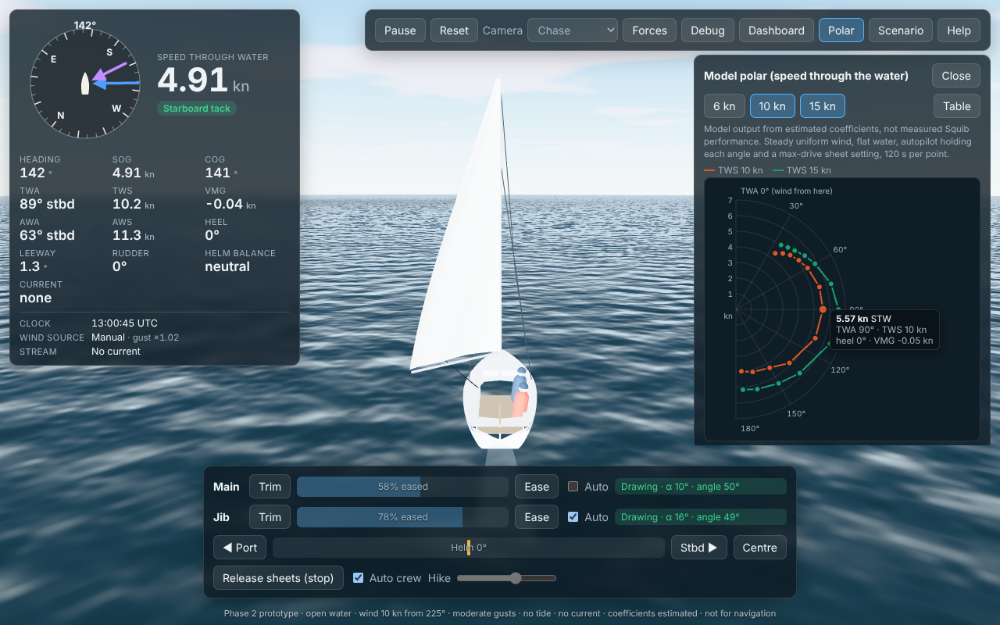

# Phase 2 report: tested sailing physics

**Date:** 22 Oct 2026  
**Status:** milestone M2 complete. Criteria 1–8 and 11 pass in full, with golden-trace regression tests. Real-time conditions are wired in as far as this container's network allows: the Met Office wind runs from a real, dated snapshot (replay), and tide heights are entered from tide tables. Live fetching needs the hosts listed under "External services".

| | |
|---|---|
|  |  |
| Validation dashboard (V): eight live charts, table view, CSV export | Model polar sweep at 10 and 15 kn (labelled model output) |


*Replay of the Met Office UKV forecast valid 07:15Z today, manual tide (HW 10:15Z) and the modelled tidal stream. The instruments show each source, the clock and the wind-against-tide flag.*

## What works

### Physics (`src/sim`, details in [PHYSICS.md](PHYSICS.md))

- **4-DOF dynamics:** surge, sway, yaw and **roll**, with added mass, integrated by RK4 at 100 Hz.
- **Stability:** an estimated righting-arm (GZ) curve: initial slope GM 0.8 m, maximum about 0.46 m at 50–60°, vanishing near 115°. Crew moment from a manual hike setting or the auto crew.
- **Roll damping emerges** from the airflow over the sails and the keel and rudder as the boat rolls. No tuned damping coefficient carries it.
  - Free roll period 2.10 s against 2.09 s theory.
  - Dynamic heel settles within 1° of the static equilibrium.
- **Helm balance** is a live diagnostic: 1.2° of weather helm close-hauled in 10 kn, 3.4° in 15 kn.
- **Hinged main boom:** aerodynamic torque, gravity when heeled, gooseneck damping, and a one-sided sheet constraint with a small bounce.
  - **Gybes emerge** when the sail flips by the lee. The boom crosses at about 11° by the lee when bearing away slowly.
  - A crash gybe with the sheet eased reaches 314°/s; with the sheet half in, 140°/s.
  - The boom weathervanes head to wind.
- **Wind field:** seeded Ornstein–Uhlenbeck shifts and speed fluctuations, plus puffs that drift downwind, over a uniform or gridded base wind. There are three presets (steady, moderate, shifty) and a "from data" heuristic.
- **Met Office UKV grid** interpolated in local coordinates (RDYC origin, WGS84 local projection).
- **Tide:** manual (HW time and heights) or snapshot (UKHO events plus gauge residual).
- **Provisional tidal stream:** slack at HW and LW, peak at mid-tide. It is labelled "modelled" everywhere.
- **Wind-against-tide flag:** drives steeper, shorter drawn waves and an instruments chip.
- **Calibration workflow** ([CALIBRATION.md](CALIBRATION.md)): residuals against observed steady-state points, fits of a few coefficient multipliers, and warnings for knobs that are unconstrained or at a bound. A self-consistency test recovers a known multiplier. **Nothing has been calibrated**: there is no Squib data.

### Application

- **Validation dashboard (V):** eight charts.
  - Speed STW/SOG, wind angles, heel and static equilibrium, helm (rudder and balance), sail incidence, drive and resistance, wind at the boat, boom angle.
  - Windows of 30 s to 5 min, a crosshair tooltip (pointer or arrow keys), a table view (now/min/max/mean) and CSV export with units.
  - One measure per chart, no dual axes, legends with latest values. Colours: a fixed categorical order checked for colour-vision deficiency against the chart surface.
- **Polar panel:** the model polar at 6, 10 and 15 kn, computed in a Web Worker so the sim keeps running.
  - Hover tooltips, a table view with best upwind and downwind VMG.
  - The panel says it is model output from estimated coefficients. The browser values match the Node model to 0.01 kn.
- **Instruments:**
  - helm balance, and current speed and direction;
  - a conditions block: scenario clock (UTC), wind source with valid time and gust factor, tide height, rising or falling, next HW and LW, the stream model label, and the wind-against-tide chip.
  - Hovering shows each source's notes and attribution.
- **Scenario panel:**
  - start time (UTC) with a Now button; wind source: manual, or the Met Office files the app finds (live `live/latest.json` when present, otherwise the bundled dated replay), with the data's age;
  - gust preset and seed;
  - manual tide from tide tables;
  - current: none, uniform, or the tidal stream (which needs a tide).
  - Invalid settings show an error and the current run continues.
- **Water:** puffs drawn as darker, rougher patches ("cat's paws") from the same puff list the physics uses.
- **Debug panel (G):** roll moment breakdown, boom rate and last impact, helm balance.

### Tooling

| Command | What it does |
|---|---|
| `npm run calibrate -- obs.csv [--fit knobs]` | Model vs observations; optional multiplier fit (prints only, never writes data) |
| `npm run perf [-- boats seconds]` | Physics cost per 60 fps frame for N boats sharing one environment |
| `npm run golden:update` | Regenerate golden traces (only for intended physics changes; say why in the commit) |
| `npm run polar`, `scenario`, `params` | As in Phase 1. Scenarios can now use full conditions (`scenarios/gusty-tidal-beat.json`) |

## Test results (22 Oct 2026)

| Suite | Result |
|---|---|
| `npm test` (Vitest): units and provenance, criteria 1–8 and 11, roll, boom, wind field, grid wind, projection, tide, tidal stream, Met Office snapshot parsing, calibration, golden traces (4 scenarios) | **57 / 57 pass** (about 35 s) |
| `npm run test:e2e` (Playwright, Chromium 141) | **8 / 8 pass** (about 70 s) |
| `npm run typecheck`, `npm run lint` | clean |
| `npm run build` | succeeds. Main chunk 902 kB (250 kB gzipped); the polar worker is a separate 45 kB chunk |
| `npm run perf` (21 boats, shifty gusts, tidal stream) | **0.88 ms mean, 2.43 ms p99** per 60 fps frame: within the draft criterion-12 budget (Phase 1: 0.87 / 2.4) |

The browser tests:
- load without errors;
- keyboard and buttons;
- pause, help and the scenario panel;
- reproducibility in the browser and against Node;
- the no-WebGL fallback;
- **dashboard:** eight charts, tooltip, table and CSV download;
- **scenario panel:** replay weather, manual tide and tidal stream appear, labelled, in the instruments and footer;
- **polar:** the worker sweep matches the Node model to 0.006 kn.

### Acceptance criteria

| # | Criterion | Result |
|---|---|---|
| 1 | Trimmed sail drives | Pass (TWA 50°, 90°, 135°) |
| 2 | Luffing reduces drive | Pass |
| 3 | Apparent wind consistent | Pass (10,000 random states, error < 1e-9) |
| 4 | Tack, in full | Pass at 6, 10 and 15 kn. At 10 kn: minimum 54% of entry speed, head to wind after 3.3 s, 90% of speed after 13.6 s. The sails cross because the apparent wind changes side |
| 5 | Gybe emerges | Pass: no command, boom bounded by the sheet, heading continuous. Bearing away at 1°/s from TWA 160° to 200° (the draft said 165° to 190°; the wider sweep makes sure the gybe happens inside the run) |
| 6 | Rudder response | Pass |
| 7 | Current affects ground motion only | Pass: uniform 1.5 kn in 8 directions (STW identical to 1e-6 kn, SOG exact to 1e-9, offset C·t to 0.01 m after 300 s), plus a sheared field |
| 8 | Cannot sail into the wind | Pass at 6–20 kn. Minimum heading-TWA with steady speed (model output): 22° from rest, 18° with way on (Phase 1: 21° / 17°) |
| 11 | Reproducibility | Pass with the full environment (moderate gusts, tidal stream): bit-identical within one engine; Node vs Chromium 2.8×10⁻¹⁴ (tolerance 1×10⁻⁶) |
| Golden traces | Pass: 4 scenarios, including gusts with tide |

## Changes to the plan

- **Criterion 5 sweep:** TWA 160° → 200° at 1°/s instead of 165° → 190° (see the table). Please review.
- **Live wind and tide:** the plan's "Live point mode" is implemented as a *source* the app discovers (`live/latest.json`). The scheduled ingest that writes that file is deployment work (Phase 6). Until then the app offers the bundled, dated replay. Live tide fetching is blocked here (see below), so tide is manual or from a snapshot file.
- **Spatial wind** from the UKV grid is already in Phase 2. The plan had it in Phase 3. It is only as detailed as the 2 km model.

## Calibration and model changes made during the phase (all tag E)

1. **Heel lag replaced by dynamic roll:** the Phase 1 `heelTau` and `maxHeelDeg` parameters are gone. New: GZ table, roll radius of gyration 0.85 m, added roll inertia 20%, linear roll damping 220 N·m·s, rudder depth 0.35 m.
2. **Boom:** inertia 22 kg·m², mass moment 18 kg·m, damping 8 N·m·s, restitution 0.15. The Phase 1 boom gain and rate limit now apply to the jib only.
3. **By-the-lee sail flip:** applies only when the plain aerodynamic torque pushes the boom outwards. Without that condition, the first version pinned the boom to windward on a run.
4. **Max-drive trim helper:** now evaluates sheet settings at a steady boom. Evaluating with the boom moving produced a limit cycle.
5. **New provenance tag C (calibrated)** for values that are fitted to named observations. None exist yet.

Polar values changed by at most 0.05 kn from Phase 1.

## Assumptions

- Everything listed in the Phase 1 report still holds: estimated hull, rig, stability and coefficients; two 80 kg crew; flat water.
- The GZ curve shape is typical of a ballasted keelboat; the Squib's own curve is unknown.
- **Gust statistics** for the presets are estimates. The "from data" heuristic maps the UKV gust/mean ratio and a station's 1-minute direction scatter to the model's parameters; the mapping is not validated.
- **Tidal stream:** flood towards 330°, peak 1.5 kn flood and 2.0 kn ebb, slack at HW and LW. These are estimates guided by the DHNA "seldom exceeds 2 knots" statement. Sources conflict on peak rates (issue 5).
- **Wind against tide** thresholds (> 120°, > 0.5 kn, > 8 kn) are estimates and only affect visuals.

## Known defects and limitations

| Item | Status |
|---|---|
| Upwind heel at 15 kn is high (about 28° with auto crew) and pointing is probably a few degrees optimistic | No depowering controls (traveller, kicker, twist). Needs Squib data (MISSING_INFORMATION B5) |
| The jib is kinematic, not a hinged body | Acceptable: it crosses quickly through the foretriangle |
| Tidal stream is uniform in space | Phase 3: channel-following field |
| Wind has no terrain sheltering or funnelling; the 2 km model cannot resolve the valley | Phase 3 (if feasible); labelled in the app |
| A Met Office snapshot is used at a single valid time; no interpolation between forecast steps | With the live ingest (Phase 6) |
| Under software rendering the dark puff patches are subtle next to the sun glint | Visual tuning in Phase 6 |
| Main bundle 902 kB | Code-split in Phase 6 |
| No GitHub remote: the repository exists only in this container | Needs you (MISSING_INFORMATION D3) |

## External services and paid infrastructure

| Feature | Needs | Cost |
|---|---|---|
| Live wind | A scheduled job that runs `research/weather/live_conditions.py` (Met Office data on AWS Open Data) and publishes `live/latest.json` next to the app | Free data. A small scheduled job (for example a GitHub Action, free tier) |
| Live tide | Network access to `environment.data.gov.uk` (EA gauge) and the UKHO Admiralty API (needs a free API key, **kept server-side**) | Free tiers. Check the UKHO display terms before a public deployment (issue 15) |
| Everything else | Nothing: the app is static files | — |

No API keys are in the client code.

## How to test it yourself

```bash
npm install
npm run dev                  # press H for help, V for the dashboard
npm test                     # 57 physics, environment and calibration tests
npm run test:e2e             # builds, serves on :4173, 8 browser tests
npm run scenario -- scenarios/gusty-tidal-beat.json   # writes out/gusty-tidal-beat.csv
npm run calibrate -- tests/fixtures/observations-SYNTHETIC-residuary1.4.csv --fit residuary --duration 60
npm run perf
```

### Manual checks

1. **Dynamic heel:** sail close-hauled with Auto crew off (Hike slider). In a puff the boat heels further, then recovers with a small overshoot. Open the dashboard (V): "Heel" oscillates about "Static equilibrium".
2. **Helm balance:** close-hauled, the Helm balance cell shows a few degrees of weather helm, more in stronger wind (Scenario → 15 kn).
3. **Crash gybe:** on a run, ease the main fully (S), then bear away (A) past dead downwind. At about 10–15° by the lee the boom slams across. The debug panel (G) shows the impact rate. Repeat with the sheet half in: the swing is gentler.
4. **Gusts:** Scenario → Gusts "Shifty". Dark patches drift down the water; when one reaches the boat, TWS and heel rise (dashboard "True wind at the boat").
5. **Real wind (replay):** Scenario → Wind source "Replay: Met Office UKV …". The start time jumps to the data's valid time. The instruments show "Met Office UKV (replay)" with the valid time; hover for the notes and attribution.
6. **Tide and stream:** Scenario → Tide "Manual", set HW 3 h after the start time, then Current "Tidal stream". The instruments show the height rising towards HW, and the current. With a westerly wind (the replay) the flood runs against the wind: the "Wind against tide" chip appears and the waves get shorter and steeper.
7. **Polar:** toolbar → Polar. The 10 kn curve fills in over 10–20 s; add 15 kn. Table shows best VMG angles.
8. **Export:** in the dashboard, Export CSV, then open the file. It has a header with units.
