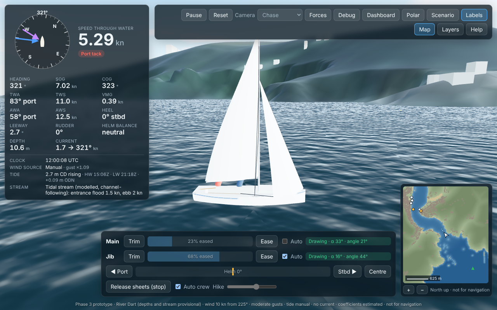
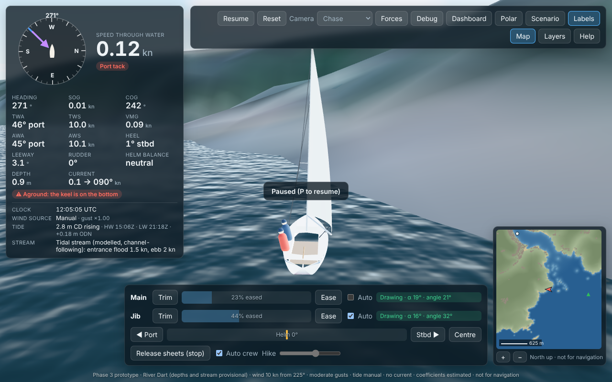

# Phase 3 report: a geographically grounded River Dart

**Date:** 22 Oct 2026  
**Status:** milestone M3 complete. The four Phase 3 acceptance criteria pass. The River Dart is built entirely from open data reachable from this environment; what could not be sourced is provisional and labelled in the app.


| | |
|---|---|
|  |  |
| Through the entrance between the castles on the flood: modelled channel stream 1.7 kn, tide 2.7 m CD rising | Sailed at the cliffs west of Start Bay: aground in 0.9 m with the keel on the bottom (minimap bottom right) |

## What works

### Data (details in [GEODATA.md](GEODATA.md))

`tools/geodata/build.py` builds `public/geo/` from open data on AWS. It reruns deterministically. Its sources:
- **Terrain:** Environment Agency LIDAR 2 m via Tilezen.
- **Map features:** OpenStreetMap and Microsoft footprints via Overture 2026-10-21.0.
- **Colour:** a cloud-free Sentinel-2 scene.

| Layer | Status |
|---|---|
| Terrain, drying areas (LIDAR), terrain colour, shoreline, 5,404 buildings, 12 landmarks, 92 piers and pontoons, 4 mooring areas, 9 ferry routes | Data (V/S) |
| Building heights | 2,433 from data or floor counts, 2,971 by building type (E) |
| Water depth below the low-water line | **Provisional** (E): no usable survey |
| 443 individual moorings with moored boats | **Provisional** (E): positions illustrative |
| Ferry timetables and vessel sizes | **Provisional** (E) |
| Tidal stream pattern | **Provisional** (E): tidal-prism model on the estimated depths |
| Navigation marks | Castle Ledge only (S); four others listed as "position not established" |

### Physics

- **Projection:** an exact Transverse Mercator about RDYC replaces the Phase 2 local projection. It agrees with PROJ to under 1 mm.
- **Seabed and water level:**
  - one 8 m elevation grid serves the terrain, the drying areas and the provisional bed, so what you see is what the keel feels;
  - the water level follows the tide in metres ODN (chart datum 2.62 m below ODN, S).
- **Grounding** (keel tip, forefoot and rudder heel):
  - the forces are friction, ploughing and a slope push;
  - a boat sailed at the shore stops with the keel in about its own draft of water and never reaches dry land;
  - rising water floats it off.
- **Channel-following tidal stream** (provisional):
  - with 2 kn at the entrance it gives about 2 kn off RDYC and up to about 4.3 kn in the narrowest reach;
  - the creeks are slack;
  - it drives the boats' drift and the moored boats' headings.

### Application

- **3D scene:**
  - terrain in chunks with two levels of detail and satellite colour;
  - extruded buildings with roof colours;
  - floating and fixed pontoons;
  - moored yachts and motorboats that lie to the stream (or the wind when slack);
  - ferries running on their routes to the provisional timetable, with "RAM" on the Lower and Higher Ferries;
  - Castle Ledge buoy flashing Fl G 5s;
  - place labels (L).
  - The land moves with the tide: drying areas appear at low water.
- **Instruments:**
  - depth at the keel and an "Aground" warning;
  - water level in m ODN next to the tide;
  - the stream model's label.
- **Minimap (N):**
  - north up, three zoom levels;
  - the boat and its course over ground;
  - ferries, with RAM in amber;
  - marks.
- **Layers panel:**
  - provisional elements;
  - the source, licence and tag of every layer;
  - attribution;
  - any load problems.
- **Scenario panel:**
  - four start positions (off RDYC, Dart Marina, the entrance, Start Bay);
  - the channel-following stream.
- **Graceful degradation:**
  - each data file is optional and a missing one is reported with its effect;
  - without the manifest or elevation the app sails on open water and says so.

## Test results (22 Oct 2026)

| Suite | Result |
|---|---|
| `npm test` (Vitest) | **77 / 77 pass** (about 35 s): Phase 1–2 suites unchanged, plus projection (3), River Dart data and grounding (8 shore approaches and more), channel stream (5) |
| `npm run test:e2e` (Playwright, Chromium 141) | **13 / 13 pass** (about 3 min), including 5 new Phase 3 tests |
| Golden traces (4 scenarios) | Unchanged: grounding and the Dart are off without a seabed |
| `npm run typecheck`, `npm run lint` | Clean |
| `npm run build` | Succeeds. JS 943 kB (263 kB gzipped). River Dart data 5.1 MB uncompressed |
| `npm run perf` (21 boats on the Dart, grounding, channel stream, shifty gusts) | **0.93 ms mean, 2.51 ms p99** per 60 fps frame: within the criterion-12 budget |
| Rendering (overview, headless Chromium) | 172 draw calls, 0.89 M triangles. Software rendering runs at a few frames per second; a real GPU is not measured here |

### Phase 3 acceptance criteria

| Criterion | Result |
|---|---|
| Projected distances between eight reference landmarks match the source data within 2 m | **Pass**: the worst of 28 pairs is 8 cm. The landmarks are RDYC, Dartmouth and Kingswear Castles, St Petrox, St Saviour's, Kingswear station, BRNC and the Mewstone. Distances are compared with WGS84 geodesics from the source coordinates |
| The boat cannot sail through land (it collides or grounds) | **Pass**: steering straight at eight shore landmarks, running in 12 kn, the boat grounds every time, stops (under 0.5 kn) and its hull centre never reaches ground above the water. The browser test confirms the "Aground" warning |
| All provisional layers are labelled in the UI | **Pass**: the browser test checks the Layers panel lists every provisional element, plus the stream label in the scenario panel and instruments and the footer |
| Load errors degrade gracefully and are reported | **Pass**: the browser tests remove the features and drape files (warning, details, app runs) and the manifest (open water, warning) |

## Changes to the plan

- **Live tide height:** the EA gauge is still blocked here, so the tide is manual or from a snapshot. The water level and depths follow whichever tide is set.
- **Spatial wind:** live spatial wind from the UKV grid was already delivered in Phase 2. Terrain sheltering of the wind is not attempted: no defensible method without local measurements.
- **Projection:** replaced (Phase 2's local projection differed from TM by up to 1.2 m at the domain edges). Phase 1–2 results are unaffected: their tests use uniform conditions.

## Assumptions

All tagged E in the data or code:
- the bed model;
- the chart-datum offset (S);
- mean level 2.7 m CD when no tide is set;
- the fixed jetty deck level (+3.0 m ODN);
- pontoon widths;
- building heights by type;
- the mooring layout;
- ferry timetables, sizes and operating hours (07:00–23:00 UTC);
- the contact parameters (friction 0.5, ploughing 8000 N·s/m, forefoot and rudder depths);
- the upstream tidal prism (2.5 km²).

## Known defects and limitations

| Item | Status |
|---|---|
| Mid-channel depths are estimates: groundings there are only indicative | Needs a usable survey (MISSING_INFORMATION C2) |
| Moorings, pontoons and ferries are not obstacles; you can sail through them | Phase 5 (collisions, AI, right of way) |
| Ferries use estimated timetables; the Lower Ferry's two floats can overlap at a berth | Needs the operators' timetables |
| Quay walls are 8 m ramps in the grid; boats ground a few metres off them | Accept, or add a finer near-shore grid later |
| No heave or pitch when aground | Simplification |
| Buildings are flat-roofed boxes; landmarks are not modelled in detail; the satellite colour is 10 m | Phase 6 visual polish, if aerial imagery becomes available (EA aerial photography host blocked) |
| Under software rendering the terrain near the camera looks pale | Visual tuning on real GPUs in Phase 6 |
| Data and JS size (5.1 MB + 943 kB) | Compress/quantise and code-split in Phase 6 |
| No GitHub remote: the repository exists only in this container | Needs you (MISSING_INFORMATION D3) |

## External services

| Feature | Needs |
|---|---|
| Rebuilding the geodata | Network access to three AWS open-data buckets (free). Not needed to run the app |
| Live tide height for depths | EA and UKHO hosts (see Phase 2 report) |

No API keys are in the client code.

## How to test it yourself

```bash
npm install
npm run dev                     # the app opens off RDYC on the River Dart
npm test                        # 77 tests, including the Phase 3 acceptance criteria
npm run test:e2e                # 13 browser tests
npm run perf                    # 21 boats on the Dart
```

### Manual checks

1. **Recognise the place:** press C for the orbit camera and drag to look around. Dartmouth is on the west bank, Kingswear and RDYC on the east, the castles at the entrance and BRNC on the hill. L toggles labels; N toggles the minimap.
2. **Run aground:** from the default start, steer to port (A) towards the Kingswear bank, about 130 m east. The depth reading falls, the boat stops, and "Aground" appears. Steer away and ease the sheets to sail off, if the slope lets you.
3. **Tide:** Scenario → Tide manual with HW at the start time, then again with HW about six hours before the start time (low water at the start). At low water the mud flats in Old Mill Creek and along the banks appear, and the depth reading drops.
4. **Channel stream:** set a tide, choose "Channel-following tidal stream", start at "Harbour entrance". The current reading shows the stream; moored boats in the trots lie to it.
5. **Ferries:** watch the Lower Ferry cross near Bayard's Cove and the Higher Ferry above Dart Marina. They are animation only.
6. **Sources:** open Layers. Every provisional element is listed, with sources and licences for the rest.
