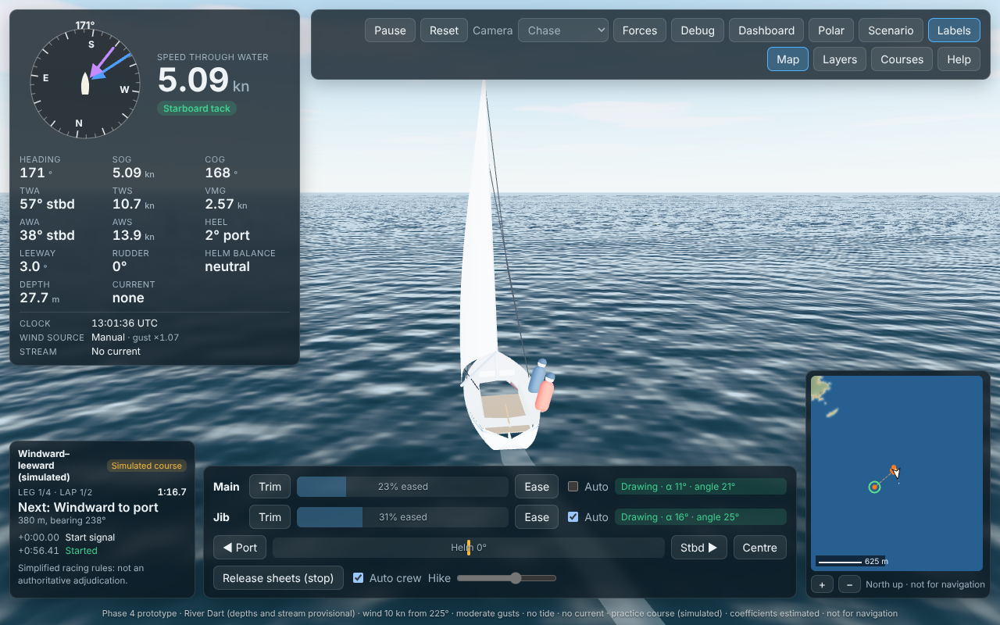
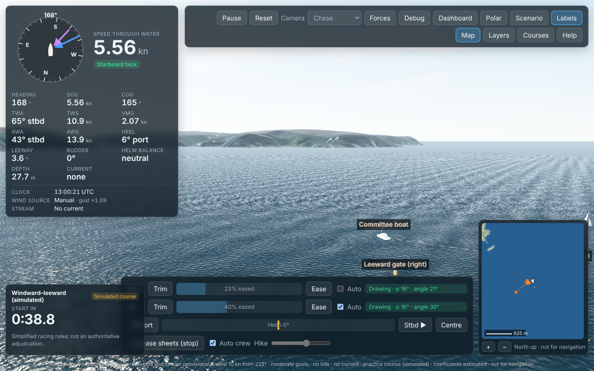

# Phase 4 report: editable courses and the course judge

**Date:** 22 Oct 2026  
**Status:** milestone M4 complete for everything that does not need club documents. Acceptance criteria 9 and 10 pass, and the validator rejects courses that cross land or the ferry and mooring restrictions. **No RDYC club course has been entered**: none of the club's course documents are available. The workflow for entering and verifying them is ready ([COURSES.md](COURSES.md)).



| | |
|---|---|
|  |  |
| Marks, the committee boat and the start line in 3D | Course editor with the live check: errors listed, offending legs in red |

## What works

### Course model and validation (`src/sim/course/`)

- **File format** (`squib-course/1`):
  - marks by latitude/longitude or local metres;
  - mark legs to port or starboard, gates, start and finish lines, laps, boundaries;
  - status with provenance.
- **Statuses:**
  - `simulated` (practice);
  - `pending-check` (entered from a named club document);
  - `verified` (checked by a named person on a date).
  - The validator enforces the provenance each status needs.
- **Validator:**
  - schema and references;
  - geometry, including a warning when a rounding side contradicts the turn;
  - land, and depth at mid-tide and at chart datum, on the River Dart data;
  - ferry corridors (no marks or lines inside; legs that cross are flagged);
  - mooring areas.

### Judge (`src/sim/course/judge.ts`)

- **Start:** 1-, 3- or 5-minute start sequences; OCS when any hull reference point is over the line or its extension at the signal, with the obligation to return.
- **Marks:** the start, then mark roundings by the taut-string idea, credited halfway round the mark on the required side. It reports:
  - wrong-way roundings;
  - unwinding;
  - rounding undone;
  - extra loops (allowed);
  - out-of-order roundings.
- **Gates, boundaries and finish:** gates passed from the right side; boundary crossings; the finish (refused while legs remain).
- **Timing:** crossing times are interpolated within the 10 ms step.
- **Labelling:** "simplified racing rules, not an authoritative adjudication".

### Practice courses (all `simulated`)

- **Generated relative to the wind at the start position:**
  - windward–leeward with a leeward gate;
  - triangle;
  - tacking lane (boundaries);
  - gybing slalom (sides from the turns);
  - mark-rounding drill.
- **Validity:** every kind is valid in the Start Bay practice area for any wind direction (tested at 8 directions).
- **River course:** *River: the Range sausage*, a fixed simulated course north of the Higher Ferry, validated with no issues.

### Application

- **Scenario panel:** a course (none, practice, library, or the editor's), laps, leg length for practice courses, start sequence and start time. Club courses are shown as "none entered yet". The boat is placed 100 m behind the start line.
- **Race panel:**
  - countdown and signals, the OCS warning;
  - leg and lap, the next mark and its rounding side, distance and bearing;
  - time since the start signal, finish time;
  - recent events, colour-coded with text;
  - the course status chip.
- **3D:**
  - inflatable marks, pin, committee boat with flag, lane posts;
  - dashed start, finish and boundary lines;
  - a ring on the next mark;
  - mark labels.
- **Minimap:** marks, lines, the lap's legs and the next mark ringed.
- **Course editor:**
  - add, drag and inspect marks (position, latitude/longitude, depth);
  - sequence legs (rounding toggles, gates, reorder, remove), lines and boundaries;
  - laps, status and provenance, including "verified" with checker and date;
  - live validation with highlights;
  - load from the library or generate a practice course where the map is centred;
  - import (paste or file), export JSON, save in the browser, "Save and sail".

## Test results (22 Oct 2026)

| Suite | Result |
|---|---|
| `npm test` (Vitest) | **101 / 101 pass** (about 46 s): 24 new, covering the judge (14) and the validator and practice courses (10) |
| `npm run test:e2e` (Playwright) | **15 / 15 pass** (about 4.5 min): 2 new. A practice course from the scenario panel (countdown, start signal, a real start, next mark). The editor (add a mark, an imported course with a mark on land is refused, load, export, save and sail) |
| `npm run typecheck`, `npm run lint` | clean |
| `npm run build` | succeeds. JS 994 kB (279 kB gzipped) |
| Golden traces, criteria 1–8 and 11, Phase 3 acceptance | unchanged, all pass |

### Acceptance criteria

| # | Criterion | Result |
|---|---|---|
| 9 | Rounding order and direction: synthetic tracks (correct, wrong side, skipped, wrong order, unwinding loop, extra loop) | **Pass, 100% expected verdicts**. Also tested: rounding undone, gates (right and wrong way), boundaries, starboard mirror |
| 10 | Start and finish repeatable; interpolation error ≤ 1 ms; OCS when any hull reference point is on the course side at the signal | **Pass**. 100 repeated physics runs give bit-identical start (20.1732 s) and finish (122.9440 s) times. Interpolation error is under 10⁻¹⁰ ms over 100 straight-line crossings and 4×10⁻⁷ ms on a 15 m-radius turn. OCS is caught for bow, stern or side over, including over the line's extension, and not caught 1 cm behind. An OCS boat's start counts only after she returns completely |
| Phase 4 | The validator rejects courses that cross land or restrictions | **Pass**: marks on land or in water too shallow; legs and lines across land; marks in ferry corridors or mooring areas; start or finish lines in them. Tested in `tests/sim/course-validate.test.ts` and in the editor's browser test |

## Decisions and changes

- **Rounding credited halfway round, not at the next leg's ray.** Crediting at the ray towards the next mark fails on windward–leeward courses: a boat sailing straight to the next mark runs down that ray and may never cross it. Halfway crediting is paired with "rounding undone" if the boat goes back round.
- **Near-collinear marks need a full turn.** When the previous and next points are almost in line with the mark (within 6°), the rounding needs a full turn. Rounding coordinates to 0.1 m otherwise made the drill course's roundings trivially "complete".
- **Wrong-side warning only for a real wrong-way rounding.** A boat that merely cuts inside a mark, or tacks across the rhumb line, gets no warning. The mark simply stays to be rounded.
- **Pre-start position.** The boat starts 100 m behind the line and 160 m towards the committee-boat end, heading along the line. Turning up to close-hauled then crosses near the middle of the line. A position straight behind the middle missed short lines.
- **Ferry corridor widths are estimates.** They are E; long river passenger routes are not treated as corridors.

## Assumptions

- **Rules:** the racing-rules behaviour follows secondary summaries of the rules and cases (SOURCES RR1–RR4); the 2025–2028 text was not inspected.
- **Hull only:** hull reference points only; no crew or equipment overhang.
- **Levels:** land above +2.3 m ODN (≈ MHWS, E), mid-tide +0.1 m ODN, low water at chart datum.
- **Practice courses:** practice course geometry (leg lengths, gate width 40 m, lane width 60 m, slalom spacing) is invented for practice.

## Known defects and limitations

| Item | Status |
|---|---|
| **No RDYC club courses** | Needs the 2026 programme, sailing instructions and mark positions (MISSING_INFORMATION A1–A3) |
| No starting-area rules, flags I/Z/U/black, general recalls or penalty turns | Phase 5 (race management) |
| Marks, ferries and moorings are not obstacles; no other boats yet | Phase 5 |
| Marks are fixed (no swinging on their moorings, no drift) | Later, if needed |
| Practice courses near the river may be refused for land in some winds | By design: the validator says why; use the Start Bay practice area |
| The editor's map uses the 16 m minimap image (pixelated close up) | Phase 6 (vector shoreline) |
| User courses are kept in the browser only | By design; export JSON to keep or share |
| Main bundle 994 kB | Phase 6 code-splitting |
| No GitHub remote | Needs you (D3) |

## How to test it yourself

```bash
npm run dev
npm test                 # 101 tests, including criteria 9 and 10
npm run test:e2e         # 15 browser tests
```

### Manual checks

1. **Race:** Scenario → Course "Windward–leeward"; the start position switches to the Start Bay practice area. Set "Start signal after" to 60 s and Apply.
   - Watch the countdown.
   - Steer up (D) to cross the line after the signal: the race panel shows "Started" and "Next: Windward to port".
   - Round the windward mark leaving it to port, then go through the leeward gate.
2. **OCS:** start again and cross the line early. At the signal the panel says OCS. Sail back below the line, then cross again.
3. **Wrong way round:** round the windward mark clockwise. You get a "wrong way" warning and the mark is not counted. Unwind and go round anticlockwise.
4. **Editor:** Courses → load "River: the Range sausage". Drag the top mark onto the east bank: the check lists the errors and "Save and sail" is disabled. Drag it back.
5. **Import and export:** Export JSON, change a rounding to starboard in the file, and import it (paste or file).
6. **Club course workflow:** in the editor, set the status to "pending check" without a document: the check refuses it until a document is named. Set it to "verified": it needs a checker and a date.
