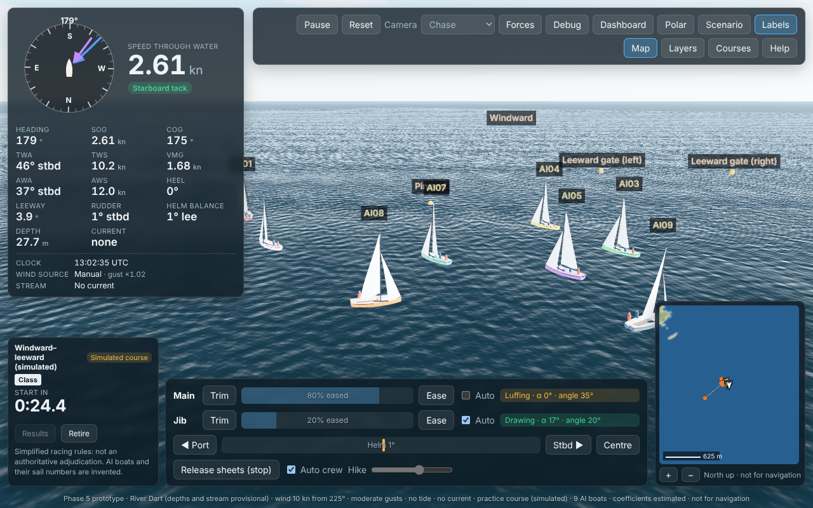
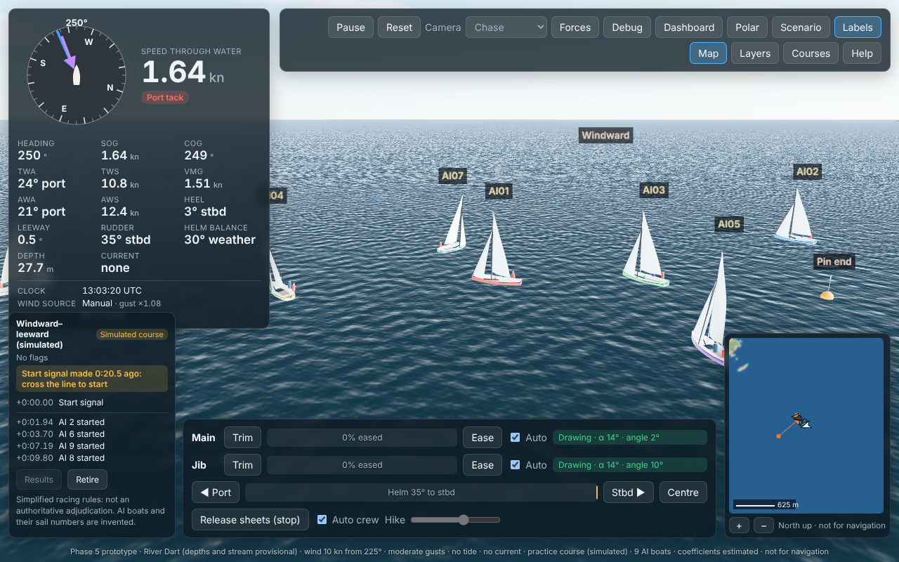
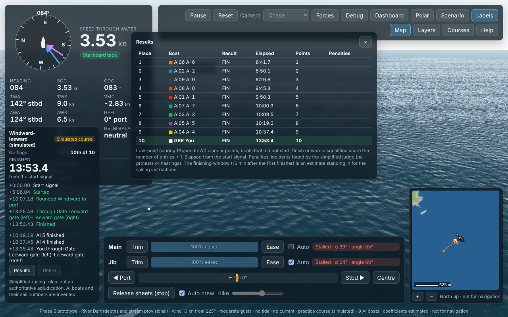

# Phase 5 report: race management and AI competitors

**Date:** 23 Oct 2026  
**Status:** milestone M5 complete. You can race a fleet of up to 20 AI Squibs on any practice course. Behind the race are:
- a race committee: flags, sounds, recalls and results;
- a simplified subset of the Racing Rules of Sailing 2025–2028 Part 2, with penalty turns;
- a contact model for boats, marks, moored boats and ferries.

All boats sail with the same physics as yours.

- **Clean-run criterion: pass.** AI boats complete a practice course without grounding or collisions in 97 of 100 seeded runs (target ≥ 95). On 100 further seeds that were never used for tuning, also 97 of 100.
- **Criterion 12 (performance): pass for the physics.** 1 + 20 boats, headless: 0.80 ms mean and 1.98 ms p99 per 1/60 s frame (budget 1.5 ms and 3 ms). With the 20 AI skippers and all race logic added, the mean is 1.7 ms and the p99 is 4.7–5.1 ms. The draft criterion sets no budget for the AI, but that p99 is above the physics budget.
- **Rules logic:** simplified and **not an authoritative rules adjudication**. The 2025–2028 rule text was checked against secondary copies only, and the club's sailing instructions are not available.



| | |
|---|---|
|  |  |
| The start, 20 s after the signal | Results table at the end of the race |

In these pictures your boat was sailed by an AI skipper (a screenshot script), so that the camera stays with the fleet.

## What works

### Fleet and contact (`src/sim/race/fleet.ts`, `hull.ts`)

- **Shared environment:** every boat is a `Simulation` on one shared environment, stepped once per 10 ms tick. The order of the boats does not matter, and runs are bit-identical for a seed.
- **Contact:** a penalty-force model on convex hull outlines (separating-axis test) against:
  - other boats;
  - marks and the committee boat (circles; inflatables softer);
  - moored boats (boxes lying to the stream);
  - ferries (moving boxes on their timetabled tracks).
- **Forces:** they act in the horizontal plane through a new `Simulation.external` force and are held over the step.
- **Coefficients:** in [RACING.md](RACING.md) §1, all estimates.

### Race committee (`src/sim/race/committee.ts`)

- **Starting sequence:** rule 26 (5-4-1-0) with class flag, P, U or black flag and sounds; also 3- and 1-minute practice sequences.
- **Recalls:** individual recall (X, rule 29.1) and general recall (First Substitute, rule 29.2), with a new sequence one minute after it comes down.
- **U and black flag:** UFD and BFD (rules 30.3, 30.4) in the triangle formed by the line ends and the first mark.
- **Finishing:** finishing window and time limit.
- **Results:** low-point results (Appendix A) with FIN, OCS, DNS, DNF, RET, UFD and BFD.
- **SI-dependent choices:** each is a labelled estimate (window 15 min, limit 90 min, recall policy, U flag after a recall).

### Rules subset (`src/sim/race/rules.ts`)

- **Definitions:** tack, overlap, clear astern and ahead, leeward and windward.
- **Right of way:** rules 13 > 10 > 11 > 12, judged continuously from the preparatory signal.
- **Contact between two racing boats:** the boat that had to keep clear owes a Two-Turns Penalty (rule 44.1). Notes, not judgements, for rules 14, 15 and 16.
- **Touching a mark:** a One-Turn Penalty (rule 31).
- **Penalty turns:** counted as in rule 44.2 (360°, one tack and one gybe each).
- **Not implemented:** mark-room, obstructions, exoneration, protests and hearings ([RACING.md](RACING.md) §3).

### AI skippers (`src/sim/ai/`)

- **Controls:** the AI sails through the same controls as you (helm, auto-trim and crew assists, main eased to depower). It never sets the boat's state.
- **Target speeds:** a polar generated from the model itself (`npm run ai:polar`; a test fails when it is stale).
- **Tactics, 5 times a second:**
  - best-VMG angles; lay lines with leeway and current; shifts with hysteresis; a cone to the mark;
  - hazards: shallow water, boundaries, moorings, the line before the gun;
  - mark approach on the tack that leaves the mark on the required side, then a circle round it;
  - timed starts: hold at the boat's slot, approach point, close-hauled run with speed control; return when over early;
  - penalty turns when well clear; keeping out of the way after finishing.
- **Collision avoidance:** candidate headings (and "slow down") simulated for 12 s against two predictions of each nearby boat, marks, ferries, depth, moorings, boundaries and the line.
  - **Who keeps clear:** decided by the same simplified rules as the judge.
  - **Collision reflex:** 20 times a second, for the last 2.5 s.
  - **Pinned by a boat:** a boat held well off its course for 30 s eases its sails and lets the other boat go ahead.
- **Skill:** three levels (club, good, expert), with per-boat seeded variation. Skill never changes the physics.

### Application

- **Scenario panel:** 0–20 AI boats, their level, and the preparatory flag (P, U or black). Practice start lines scale with the fleet (2.5 boat lengths per boat, at least 100 m).
- **Race panel:**
  - flags shown as text chips; recent signals;
  - your place;
  - penalty turns owed;
  - fleet events (starts, roundings, incidents, penalties);
  - Results and Retire buttons.
- **Results table:** low points; opens by itself when the race ends.
- **Contact banner:** shown when your boat touches something.
- **3D view and minimap:** AI boats in hull colours, with invented sail numbers ("AI01"…).
- **Free sailing (no course):** moored boats and ferries are now obstacles too.

### Performance work (results bit-identical)

- **Tide:** memoised per time.
- **Wind:** gust envelopes cached per step; a focus box limits the puffs checked to those near the fleet.
- **Ferries:** a bounding-box skip.
- **Contact:** hull outlines reused.
- **Rules trackers:** run at 20 Hz.
- **Allocation-free physics step:**
  - The force functions can write into reusable records, so a step allocates 5.5 kB per boat instead of 26 kB.
  - Wind, current and the auto-trim's forces are computed once per step and reused.
  - `hypot2` replaces `Math.hypot`, which allocates on every call. It is a port of V8's own algorithm, bit-identical to `Math.hypot` on 3×10⁷ test inputs and in a unit test.
  - Garbage collection was what pushed the p99 over budget.
- **Input log off for AI boats:** an AI's helm changes every step, so its input log grew by one entry per step, about 400 kB/s for a 20-boat fleet. AI races are reproduced from their seed instead.

Every one of these keeps the results bit-identical: the golden traces and a 7-boat race hash are unchanged.

## Test results (23 Oct 2026)

| Suite | Result |
|---|---|
| `npm test` (Vitest) | **123 / 123 pass** (about 45 s). 22 new: fleet contact, committee (sequences, X, general recall, U and black flag, results, flags at once), rules, penalty turns, polar staleness, a short AI race (deterministic), `hypot2` |
| `npm run test:e2e` (Playwright) | **16 / 16 pass** (about 5.5 min). New: a race against 3 AI boats (flags, the fleet in 3D, results with low points) |
| `npm run typecheck`, `npm run lint` | clean |
| `npm run build` | succeeds. Main JS 1,060 kB (303 kB gzipped), polar worker 55 kB |
| Golden traces, criteria 1–11, Phase 3 and 4 acceptance | unchanged, all pass |

### Acceptance

| # | Criterion | Result |
|---|---|---|
| Phase 5 | AI boats complete a practice course without grounding or collisions in ≥ 95% of 100 seeded runs | **Pass: 97 / 100** (seeds 1–100). **Hold-out: 97 / 100** (seeds 101–200, never used for tuning) |
| 12 | 1 + 20 boats, headless: physics ≤ 1.5 ms mean and ≤ 3 ms p99 per 1/60 s frame | **Pass: 0.80 ms mean, 1.98 ms p99**. With the AI and race logic: 1.7 ms mean, 4.7–5.1 ms p99 (not budgeted by the criterion; see below). Rendering ≥ 55 fps on reference hardware: not measured (no reference hardware agreed) |

**The trials** (`npm run ai:trials`):
- **Setup:** each seed draws a windward–leeward or triangle course in the Start Bay practice area, wind 6–16 kn from any direction, and moderate or shifty gusts. 5 AI boats ("good"), a 5-minute sequence, one lap.
- **Clean run:** every boat finishes; no boat touches another boat, a mark, the committee boat, a moored boat or a ferry; no grounding and no boundary crossing. Touching a mark counts as a failure, a stricter reading than "collision".

| | Seeds 1–100 | Seeds 101–200 (hold-out) |
|---|---|---|
| Clean runs | 97 | 97 |
| Boats finished | 100% | 100% |
| Groundings, boundary crossings | 0, 0 | 0, 0 |
| Contacts (in the unclean runs) | 3: a windward-mark touch; the committee boat touched 0.5 s before the start; a windward boat touching a leeward boat 26 s before the start | 5 in 3 runs: two windward-mark touches; three port–starboard contacts in the last 30 s before the start or just after |
| Boats OCS (all returned) / general recalls | 6 / 0 | 10 / 0 |
| Median start, after the signal | 13.9 s | 13.2 s |

- **How the AI was tuned:** on seeds 1–100, over five batches: 89%, 92%, 93%, 94% and 97% clean. The hold-out seeds check that the result is not tuned to those seeds.
- **Larger fleets:** the trials use 5 boats. ⟨BIGFLEET⟩

**Criterion 12** (`npm run perf`, Node 22 on this 4-core container, after a warm-up):

| Run | Mean per frame | p99 | Max |
|---|---|---|---|
| 21 boats, physics only. River Dart: grounding, channel stream, shifty gusts | 0.80 ms | 1.98 ms | 3.7 ms |
| 1 + 20 AI boats, full race: pre-start and start | 1.69 ms | 4.67 ms | 11.7 ms |
| 1 + 20 AI boats, full race: racing | 1.74 ms | 5.11 ms | 13.9 ms |
| Before this phase's optimisation: physics only, then full race | 1.37 / 2.82 ms | 3.58 / 7.79 ms | |

- **Production bundle:** the same tool bundled with esbuild, as the app is built (no `tsx` overhead), gives:
  - physics 0.62 ms mean and 1.75 ms p99;
  - full race 1.23–1.37 ms mean and 3.9–4.6 ms p99.
  - Command: `npx esbuild tools/perf.ts --bundle --platform=node --format=esm --outfile=out/perf.bundle.mjs && node out/perf.bundle.mjs`.
- **Where the AI's p99 comes from:** the AI decides 5 times a second per boat, spread one boat per step. A crowded decision (up to 40 candidate headings simulated for 12 s against every nearby boat) can take 2–3 ms.
- **What this means:** at 60 fps it leaves 11–12 ms of a 16.7 ms frame for rendering in the worst 1% of frames.
- **To bring it under 3 ms:** cap the candidates per step, or run the AI in a worker (Phase 6).

## Decisions and changes

- **A boat pinned by another lets it go ahead.** One trial boat sailed side by side to windward of another for 400 s: it needed to bear away behind her, and she held course for it. Neither manoeuvre scored better over the 12 s look-ahead. Now a boat held more than 60° off its course for 30 s slows down for up to 25 s and lets the other draw ahead.
- **Rejected: sheeting in for every tack.** It fixed a committee-boat touch in one seed but caused a pre-start contact in another. Not adopted without a full batch.
- **The avoidance turn model stays brisk.** The measured turn rate made clean runs fall from 88% to 30%: every escape looked equally late. The reflex, in the last 2.5 s, uses the measured rate ([RACING.md](RACING.md) §6).
- **Recall policy (E).** The committee recalls the fleet when at least 3 boats and 30% of the fleet are OCS. The rule leaves this to a committee that cannot identify the OCS boats; here every boat is identified.
- **Flags at once.** The committee now makes any signal due at the moment the race is created. A 1-minute sequence started with "Start signal after 60 s" shows the class flag before the first step. The browser test found this.
- **Rule text.** sailing.org is blocked here, so the 2025–2028 wording was checked against secondary copies (SOURCES RR5–RR9).
  - **Rule 13, "both tacking":** used (the boat on the other's port side keeps clear), but its 2025–2028 wording was not verified.
  - **Flags I and Z:** not verified and not modelled.

## Assumptions

- **Rule wording:** the 2025–2028 rule wording comes from secondary copies (SOURCES RR5–RR9). sailing.org is blocked by this environment's network policy.
- **SI choices:** every sailing-instruction choice is a labelled default, because the RDYC 2026 SIs are not available (MISSING_INFORMATION A2).
- **Estimates (E):** the contact coefficients, the hull outline used for contact (the 3D deck plan) and the AI's skill parameters.
- **AI target speeds:** model output, not Squib data.

## Known defects and limitations

| Item | Status |
|---|---|
| AI boats are not perfectly safe | 3 runs in 100 have a contact: mostly near the start (port–starboard, the committee boat) or a windward-mark touch. ⟨BIGFLEET_SHORT⟩ Issue 35 |
| The AI's decisions push the full-race p99 to about 5 ms per frame (physics alone 2 ms) | Phase 6: AI in a worker, or a cap on candidates per step |
| Rules subset only: no mark-room, obstructions, exoneration, protests or hearings | Issue 36; always labelled non-authoritative |
| Flags I and Z, postponement, abandonment, shortened course, multiple classes | Issue 33 |
| Committee choices that belong to the SIs are estimates | Issue 39; needs the 2026 SIs |
| Contact has no roll, damage or capsize; coefficients are estimates | Issue 38 |
| AI tactics were tuned in the Start Bay practice area; river racing (tide, moorings, ferries) is less tested | Issue 40 |
| Strong-wind reaching speeds probably too high (residuary table) | Issue 37 |
| Pontoons and piers are not obstacles | Issue 26 |
| Main bundle 1,060 kB (303 kB gzipped) | Phase 6 code-splitting |
| Rendering speed with 20 AI boats (≥ 55 fps) not measured | Needs agreed reference hardware |
| No RDYC club courses; no GitHub remote | Need documents (A1–A3) and you (D3) |

## How to test it yourself

```bash
npm run dev
npm test                          # 123 tests, including the fleet, committee, rules and a short AI race
npm run test:e2e                  # 16 browser tests, including a race against 3 AI boats
npm run perf                      # criterion 12
npm run ai:trials                 # 100 seeded AI races (about 15 min on 4 cores); writes out/ai-trials.json
npm run ai:trials -- --first 101  # 100 further seeds the AI was not tuned on
```

### Manual checks

1. **Race against the AI:**
   - Scenario → Course "Windward–leeward".
   - Leg length 300 m, Laps 1.
   - Start sequence "5 minutes", Start signal after 330 s.
   - Fleet: AI boats 5, AI level "good", Preparatory flag "P".
   - Apply and restart.
   - The race panel shows the flags as chips (Class, then P, then P down at one minute) and the countdown. The AI boats hold in rows behind the line, then make timed runs and start near the signal.
2. **The fleet:**
   - The AI boats carry labels AI01…AI05 in 3D (Labels on) and show as coloured triangles on the minimap.
   - The fleet's events (starts, roundings, finishes) appear in the race panel.
3. **Over early (flag X):** cross the line in the last seconds before the signal.
   - At the signal flag X goes up and the panel says OCS.
   - Go back below the line, then start again. Flag X comes down when every OCS boat has returned, or after 4 minutes.
4. **U or black flag:** set Preparatory flag "U" (or "Black").
   - Sail into the triangle formed by the line ends and the windward mark during the last minute.
   - At the start the panel says UFD (BFD), and the results show it.
5. **Rules and penalties:** on port tack, sail into a starboard-tack AI boat.
   - The contact banner appears, and the log says you did not keep clear (rule 10).
   - The panel asks for a Two-Turns Penalty. Get clear and make two 360° turns in one direction, each with a tack and a gybe: the panel clears.
   - Touching a mark gives a One-Turn Penalty (rule 31).
6. **Results:** finish, or press Retire.
   - The Results table opens by itself when the committee closes the race: when all have finished, 15 minutes after the first finisher, or at the 90-minute limit.
   - It shows low points, untaken penalties, and DNS, DNF, OCS, RET, UFD or BFD codes.
7. **Free sailing:** with Course "None" and a start location in the river, moored boats and ferries are obstacles. Sail into a mooring trot to see the contact banner.
