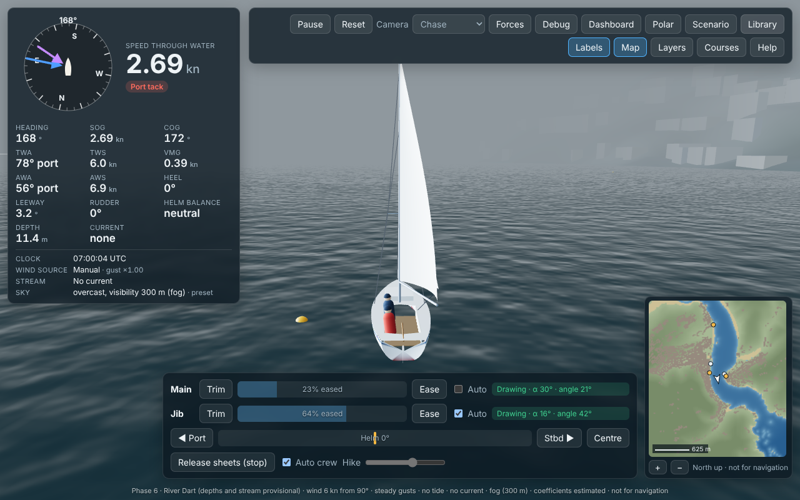
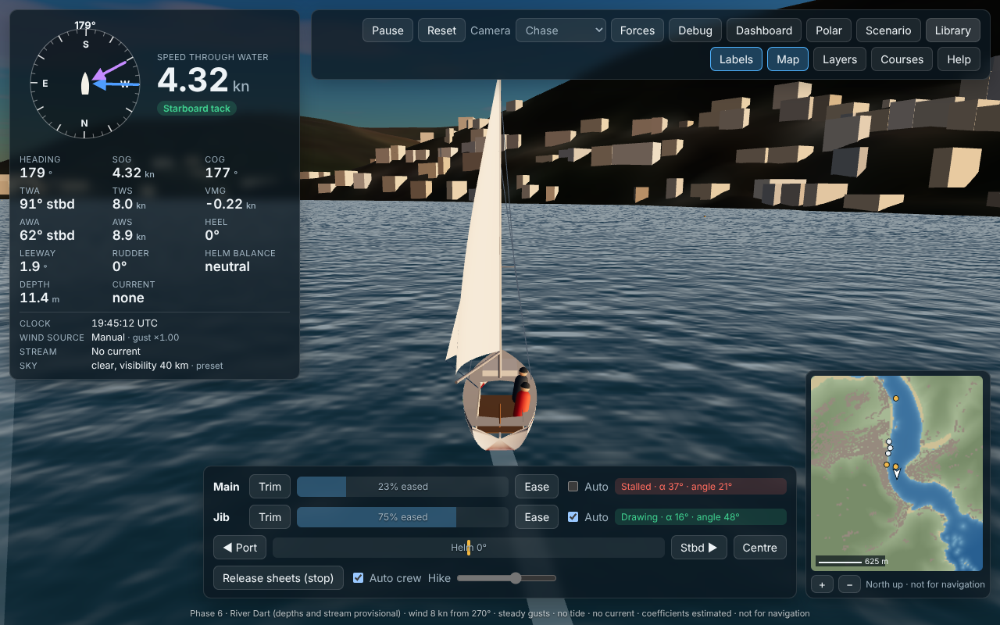
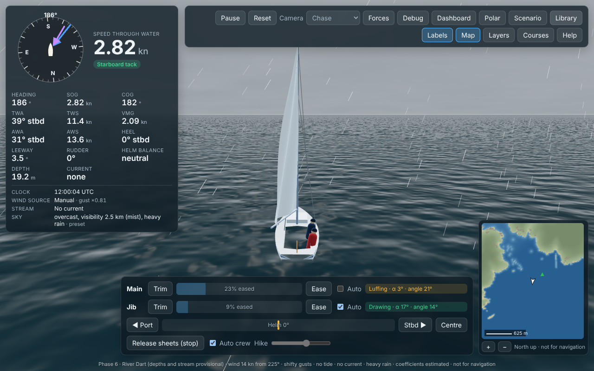
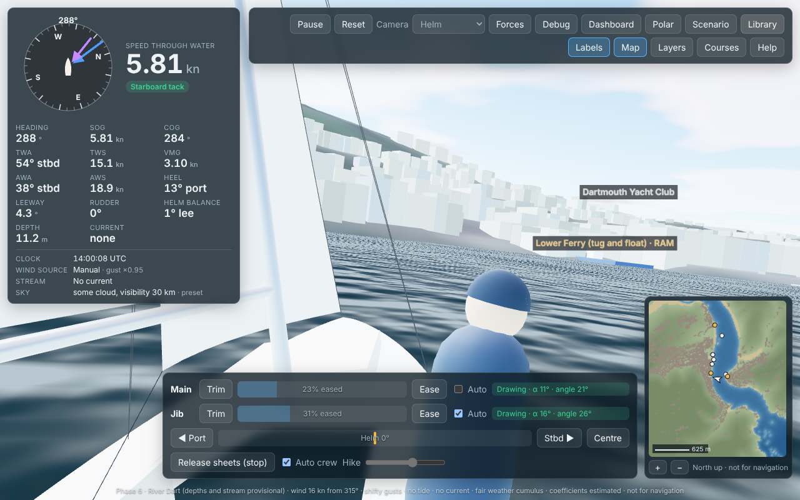
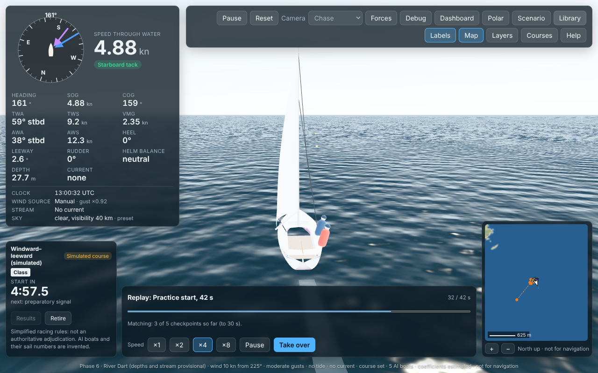
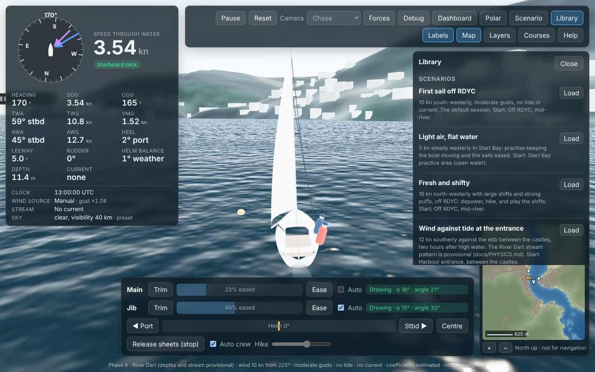

# Phase 6 report: deployment, live data, visual weather, replays and performance

**Date:** 23 Oct 2026  
**Status:** milestone M6 complete **as far as it can be from this environment**. Everything is built and tested here, and the deployment was rehearsed against a stand-in repository. **The site is not deployed, and the scheduled jobs have never run on GitHub,** because no GitHub account is connected (decision D3).

**Acceptance:**
- **The production build passes the end-to-end tests:** 26 browser tests run on the production build, served both at the root and as GitHub Pages serves a project site, under `/squib-dart-sim/`.
- **Controls work:** keyboard, on-screen buttons, and the replay and library controls.
- **Missing data is handled gracefully:** live data that is missing, corrupt, stale or expired; River Dart files that are missing; replay and scenario files that are bad.
- **No secrets in the bundle:** an automated check runs at the end of every `npm run build`. It is a structured scan, more than a grep: known credential formats, API-key headers, secret-named assignments, and the exact values of the secret environment variables present at build time.

| | |
|---|---|
|  |  |
| Fog off RDYC (built-in scenario "Fog in the harbour"): visibility 300 m | Evening light: the sun 4° up in the west-north-west (its real position on 15 July at 19:45 UTC) |
|  |  |
| Squally rain over Start Bay | Helm view close-hauled in 15 kn, heeled 13°: the horizon tilts with half the heel |
|  |  |
| A recorded practice start played back at ×4; every checkpoint so far matches | The Library: built-in and saved scenarios, export and import, replays |

## What works

### Deployment and the secret check (part 1)

- **Static site, relative paths:** `npm run build` produces `dist/`, which works at a domain root or under a GitHub Pages project path. A Pages-like server (`tools/pages-server.mjs`: sub-path, 301 redirect, 404, no fallback routing) serves it for the browser tests.
- **Secret check:** `tools/check-secrets.ts` runs at the end of `npm run build`. It fails the build on any of these, found in a file in `dist/`, source maps included:
  - credential formats;
  - API-key headers with a value;
  - credential-looking values assigned to secret names;
  - the exact value of any secret-named environment variable present during the build.

  It also refuses `VITE_*KEY/TOKEN/SECRET*` variables, which Vite would inline. It is unit-tested.
- **GitHub Actions** (`.github/workflows/`):
  - `ci.yml`: lint, build, unit tests, ingest tests and browser tests.
  - `deploy.yml`: deploys to `gh-pages`, keeping the live data.
  - `live-data.yml`: every 30 min by day, hourly at night.
  - `tide-harmonics.yml`: weekly.
  - Their scripts pass `actionlint` and `shellcheck`. They were rehearsed against a local bare repository (DEPLOYMENT.md §7).
- **Costs:** £0 on a public GitHub repository. A private repository needs a paid plan for the schedule. The UKHO API is optional (free Discovery tier). See DEPLOYMENT.md §6.

### Live weather and tide (part 1)

- **Weather:** `tools/ingest/weather.py` writes `squib-weather/2`:
  - 10 m wind on the UKV grid over the area, every 15 min for 2 h;
  - hourly cloud, visibility, rain, fog, temperature and pressure;
  - regional observations.

  It was tested against the real Met Office feed (the bundled `metoffice-replay-2026-10-23T1400Z.json` is its output). The app's wind follows the forecast steps, interpolated in time.
- **Tide:**
  - `tools/ingest/tide.py`: the EA Dartmouth gauge (mAOD, converted to chart datum), and UKHO HW/LW predictions with the key as a CI secret.
  - `tools/ingest/harmonics.py`: harmonic constants derived from the gauge history with UTide, validated on 7 held-back days, and a year of predicted HW/LW events.
  - These are **tested on synthetic fixtures only**: the EA and UKHO hosts are blocked here.
- **Freshness:** `live/index.json` lists the files present, so the app never requests a missing file. Each file is judged fresh, stale (offered with a warning) or expired (offered only as a recording). Corrupt or missing files are listed in the Scenario panel, and the bundled replays still work.

### Visual weather and the sun (part 2)

- **Sun:** the sun's position for the run's time at Dartmouth (`src/sim/env/sun.ts`, NOAA algorithm). It is within 0.015° of NREL's SPA (pvlib) above 3° elevation. It drives daylight, twilight and night lighting, and fixes the old fixed sun's mirrored azimuth.
- **Sky:**
  - **Cloud:** a procedural cloud dome that drifts with the wind.
  - **Fog:** density from the visibility (Koschmieder's law); sky and water greyed by cloud.
  - **Rain:** streaks by rain rate.
  - **Source:** a preset (clear, fair, hazy, overcast, mist, fog, rain, heavy rain) or the forecast's sky fields.
  - **Visual only:** the physics never reads them.

### Replays and the scenario library (part 3)

- **Replays** (`src/app/replay.ts`, `squib-replay/1`). A recording holds:
  - the scenario, with its course inline and any live-data snapshot;
  - the boat's starting input;
  - your input log (one row per changed step);
  - a state hash every 10 s of simulated time and at the end.
- **Playing a replay:**
  - The run is rebuilt and your inputs are fed step by step through the same hook as the keyboard; AI boats are reproduced from the seed.
  - Every checkpoint is compared. The bar says either "Verified: all N checkpoints matched, bit for bit" or "Diverged at T s".
  - Speed ×1 to ×8. **Take over** stops the replay at that moment and gives you the boat; the controls are locked until then.
  - A replay from another build plays with a warning.
- **Library** (toolbar → Library):
  - **Built-in practice set-ups:** first sail, light air, fresh and shifty, wind against tide at the entrance, fog, squally rain, evening sail, a practice race against 5 AI boats, a river race, and the bundled Met Office forecast replay.
  - **Your own scenarios:** saved in this browser, with export and import (`squib-scenario/1`, validated on import).
  - **When data is missing:** a scenario that needs the River Dart data or a data file that is absent says why and cannot be loaded.

### Performance (part 4)

Details in [PERFORMANCE.md](PERFORMANCE.md).
- **Packed grids:** the River Dart grids are packed losslessly (gradient prediction, zigzag, byte planes, gzip). Together they go from 4.1 MB to 0.68 MB.
  - **Same values:** the unpacked bytes match the original grids' SHA-256.
  - **Same physics:** the race determinism hash is unchanged.
- **Code split:**
  - **Panels:** the nine panels that open on demand are loaded when first opened.
  - **Vendor chunks:** three.js and React are separate chunks, so they stay cached across deploys.
- **Earlier download:** the River Dart download starts before the 3D view compiles its shaders.
- **Result:** the first load transfers **1.43 MB instead of 4.92 MB** (−71 %, measured, gzip as on GitHub Pages).
- **Load time:** in this container it is about 8–9 s either way. Software WebGL dominates it: shader compilation, and a one-off stall at the first 2D-canvas draw while the GPU process catches up. The saving on a real device is computed (about 2.8 s at 10 Mbit/s), not measured.

### Smaller changes

- **Helm view:** the horizon now tilts with half the boat's heel, as it does on board. The fraction is a visual choice (E).
- **Wake:** no longer allocates objects every frame.
- **Side panels:**
  - They now sit above the minimap, which had been intercepting clicks on their lower part (found by a browser test).
  - They now open just below the toolbar. With the new Library button the toolbar wraps to two rows at 1280 px, and the panels had covered its second row (found in the screenshots).
- **Build ID:** CI passes the commit id as `VITE_BUILD_ID`, which names the build in replays (not a secret).

## Test results (23 Oct 2026)

| Suite | Result |
|---|---|
| `npm test` (Vitest) | **153 / 153 pass**. New in Phase 6: secret check, live data and freshness, sun position, replays (format, free-sailing and race round trips, a changed input detected, take over), scenario library, packed grids |
| `npm run test:e2e` (Playwright, production build) | **26 / 26 pass** on the final build (about 7.5 min with 2 workers, software WebGL). New in Phase 6: 7 deployment tests under a GitHub Pages sub-path (live data fresh, stale, expired, corrupt and missing; live tide; no fallback routing), and 3 for replays and the library. Earlier runs this phase failed on test problems, now fixed: an assertion written before the second bundled replay existed, and tests that load the app twice and ran out of time under load |
| Ingest tests (Python, `tools/ingest`) | **11 / 11 pass** |
| `npm run typecheck`, `npm run lint` | clean |
| `npm run build` | succeeds, then the secret check passes: 33 files (7.1 MB) in `dist/`, source maps included, no secrets found |
| Race determinism hash (7 boats, 400 s, River Dart) | `20b52c2d4d6450b6`, unchanged since Phase 5 |
| `npm run perf` (criterion 12) | Physics, 21 boats: **0.43 ms mean, 1.07 ms p99** per 1/60 s frame (pass; budget 1.5 and 3 ms). Full race with 20 AI boats: 0.96–1.01 ms mean, 2.83–3.02 ms p99. Phase 6 changed neither the physics nor the AI. These figures are lower than Phase 5 (0.80 / 1.98 ms; 4.7–5.1 ms p99) because this shared machine varies from run to run, so issue 41 stays open |

### Acceptance

| Criterion | Result |
|---|---|
| The production build is served and passes the end-to-end tests | **Pass.** `npm run test:e2e` builds once and serves `dist/` twice: with `vite preview` at the root, and with the Pages-like server under `/squib-dart-sim/`. Every request stays inside the sub-path. On GitHub Pages itself: **not yet run** (no account) |
| Controls work | **Pass.** Keyboard and on-screen helm and sheets (smoke tests, and the deployment test on the production build). Replay speed, take over, and library load, save, export and import (Phase 6 tests) |
| Missing data is handled gracefully | **Pass.** Live index missing or corrupt; live forecast stale or expired; a River Dart file missing (each one); no River Dart at all; no WebGL; bad replay and scenario files. Each is reported, and the app keeps running |
| No secrets in the bundle (automated check) | **Pass.** It runs in every `npm run build`, in CI and in Deploy, and is unit-tested with planted secrets |

## Decisions and changes

- **No key proxy.** The UKHO key stays in the scheduled job. The job publishes predictions as a file, so the browser never needs the key and no serverless proxy is required. This replaces the earlier plan in ARCHITECTURE.md §10.
- **`live/index.json` instead of probing.** Static hosts answer a missing file with a 404 that the browser logs as an error. The index lists what exists.
- **Replays verify, not just replay.** Every 10 s of simulated time the state hash is compared. A replay that does not match says so and gives the time, rather than silently showing a different race.
- **Lossless, not quantised, grids.** The grids were already integers (cm, mm/s). Packing them losslessly keeps the physics bit-identical, so no golden trace or acceptance result needed re-baselining.
- **Rejected:** deferring the text labels to avoid the 2D-canvas stall. The stall moved to the minimap instead. It belongs to software WebGL, and it is recorded in PERFORMANCE.md and OUTSTANDING_ISSUES 43.

## Assumptions

- **Tide APIs:** the response shapes of the EA and UKHO APIs follow their documentation and third-party listings, not real responses (hosts blocked).
- **UKHO times:** UKHO times are assumed to be UTC. The first-run checklist checks this (DEPLOYMENT.md §5).
- **Chart datum:** the chart-datum offset at Dartmouth is 2.62 m below ODN, from a secondary source (C8).
- **Estimates (E):** the freshness thresholds (grace 15 min, job late 90 min, stale limit 6 h, gauge 60 min), the cloud, fog and rain visuals, and the helm-view heel fraction.
- **GitHub Pages compression:** Pages gzips text files but not the binary grids. This was not checked here, which is why the grids are packed in the app's own format.

## Known defects and limitations

| Item | Status |
|---|---|
| Not deployed; workflows never run on GitHub | Needs a GitHub connection (issue 8) |
| Tide ingest tested on fixtures only | First run on GitHub, checks in DEPLOYMENT.md §5 (issue 13) |
| UKHO terms for publishing predictions unconfirmed | Check before adding the key to a public repository (issue 15) |
| Replays match bit for bit only on the same browser engine and build | Reported when they diverge (issues 17, 46) |
| Load time on real devices not measured | Issue 43 |
| Visual weather is indicative (procedural clouds, rain and fog visuals estimated) | Issue 44 |
| AI p99 about 5 ms per frame with 20 AI boats; big AI fleets less safe | Not addressed in Phase 6 (issues 41, 42) |
| No RDYC club courses; racing-rules logic is a simplified subset, **not an authoritative rules adjudication** | Needs the documents (A1–A3) and the SIs (A2) |

## How to test it yourself

```bash
npm install
npm run build                     # typecheck, build, secret check
npm test                          # unit tests
npm run test:e2e                  # browser tests on the production build (root and /squib-dart-sim/)
.venv/bin/python -I -m unittest discover -s tools/ingest -p 'test_*.py'
npm run perf                      # criterion 12
GZIP=1 node tools/pages-server.mjs 4175 squib-dart-sim dist &
node tools/load-timing.mjs http://localhost:4175/squib-dart-sim/ 10 5
```

### Manual checks

1. **Deployed layout:** `npm run build`, then `node tools/pages-server.mjs 4174 squib-dart-sim dist`. Open http://localhost:4174/squib-dart-sim/.
   - The app and the River Dart load.
   - http://localhost:4174/squib-dart-sim/nothing.html is a 404.
2. **Library:** toolbar → Library → Load "Fog in the harbour".
   - The sky closes in, and the instruments' Sky row says fog.
   - Try "Squally rain" and "Evening sail into the sunset".
3. **Your own scenario:**
   - Set something up in the Scenario panel. Library → type a title → Save current. It is listed, and it survives a reload.
   - Export saves a `.scenario.json`. Import it again.
4. **Replay:**
   - Sail for a minute (a race from the Library makes it interesting). Library → Save replay of this run: a `.replay.json` downloads.
   - Library → Open replay… → the file. The sailing controls are replaced by the replay bar. Try ×8.
   - At the end it says "Verified: all N checkpoints matched, bit for bit". Press Take over to sail on.
5. **A changed replay:** edit one helm value in the file's `inputs` (the second number in a row), then open it. The bar says "Diverged at … s".
6. **Live data (needs network access to the Met Office bucket):**
   - Run `.venv/bin/python -I tools/ingest/weather.py dist/live/latest.json` and `.venv/bin/python -I tools/ingest/index.py dist/live`, then serve `dist/`.
   - The Scenario panel offers "Live: Met Office UKV …" as fresh.
7. **Helm view:** Camera → Helm, in "Fresh and shifty". The horizon tilts as the boat heels.

## What you need to provide to finish deployment

1. **A GitHub repository:** connect GitHub (claude.ai/connect-github) and tell me the owner/repo. I will push, and the first run follows DEPLOYMENT.md §2 and §5.
2. **Optional: a UKHO Discovery key,** added by you as the Actions secret `UKHO_API_KEY`. Check the UKHO terms first (issue 15).
3. **Network access to the tide hosts** (`environment.data.gov.uk`, `admiraltyapi.azure-api.net`), if the tide ingest should be tested from here.
4. **RDYC documents** (sailing instructions, courses, marks: MISSING_INFORMATION A1–A3). They are still needed for club courses and SI-dependent race settings.
