# Photo round: the harbour as the owner's photographs show it (28 Oct 2026)

The owner supplied 40 photographs of the harbour and asked for the graphics and the simulation to be brought closer to the real place. They show:

- Dartmouth Castle and St Petrox, from the air and from the water;
- the Kingswear waterfront, its shore and moorings, and Darthaven Marina;
- the Lower Ferry's float and tug at both slips;
- PS Kingswear Castle alongside;
- the Dartmouth embankment, Bayard's Cove, South Town and the Boatfloat with the Royal Castle Hotel;
- Britannia Royal Naval College (BRNC) from the river;
- a cruise ship at anchor.

## How the photographs were used

- **All 40 were reviewed.** The app was rendered from 14 matching viewpoints, and the two were compared side by side.
- **The largest differences were fixed first.** They were general ones (water, light, woods, house colours, quays), each seen across many pictures. Landmarks and vessels came after.
- **Colours were sampled from the photographs.** Water, woods, fields, rock, roofs and walls were averaged over patches, and the app's colours were set to match by eye. No colour is measured; all are estimates (E).
- **The photographs are reference only.** Many carry stock-photo watermarks (Alamy, Adobe Stock, Dreamstime, Westend61, dartmouthphotographs.com), so nothing from them was copied into the app.
- **Source and gaps.** The photographs are source P2 in SOURCES.md; the remaining gaps are E19 and E23 in MISSING_INFORMATION.md.

**Nothing this round needs an external service or paid infrastructure.**

## Summary

| # | What the photographs show | What the app showed | Change |
|---|---|---|---|
| 1 | **Water** green-teal in the estuary, lighter and greener over the shallows | Dark navy-blue everywhere | Green-teal water; lighter shallows within 40 m of the banks (`water.ts`) |
| 2 | **Whites are white, slate is grey** in sunlight | White render read blue-grey and every slate roof navy: most of the fill light came from the blue sky dome | Fill light rebalanced: a near-neutral hemisphere light (olive from below, as light thrown back by the woods), less of the sky map, a little more sun (`scene.ts`). Slate set to the photographs' mid grey |
| 3 | **Woods to the water's edge** on the steep valley sides, olive-green, over dark slate rocks with ochre lichen | Pale grey-white slopes at the castle and the harbour mouth, and a white "surf" band at every shore. The satellite picture's 10 m pixels there are surf, sunlit rock or roofs, stretched down the bank | Pale pixels on steep ground are treated as the woods' floor and planted with trees. Rock is dark slate with lichen, only at the water and on the steepest faces. The foreshore is dark, weedy rock and mud (`dart.ts` terrain shader, `trees.ts`) |
| 4 | **Gardens and trees between the houses** on both hillsides | Bare grey-green ground between the houses | Garden trees and shrubs on open plots near houses, kept off roads, the club's terrace and the houses themselves (`trees.ts`) |
| 5 | **Strongly painted fronts**: whites and creams, and cornflower, navy, teal, sage, pink, ochre and brick red | Mostly pale pastels | A wider palette, weighted to whites and creams with strong colours among them, under grey slate and some clay tile (`dart.ts`) |
| 6 | **Houses on vertical stone quay walls** straight out of the water (Dartmouth embankment, Bayard's Cove, South Town, Kingswear) | Grey ramps about 8 m wide (the LIDAR grids smooth every wall into a slope; issue 29) | **Quay walls put back.** Where houses stand on the waterfront, 21 walls (2.3 km) run along the 1 m ODN contour, with the ground behind filled level to their tops. They are drawn in rubble stone, weedy below high water, with coping on top, and are **solid to boats** (`src/sim/env/quays.ts`, `src/render/quays.ts`) |
| 7 | **Dartmouth Castle** has a square tower behind the round gun tower; **St Petrox** is limewashed; the castle's tea room is stone | A yellow tea room, a grey-blue church, no square tower | Square tower added; St Petrox limewashed; the tea room in stone under slate; rubble lightened to the photographs' grey-buff (`landmarks.ts`) |
| 8 | **BRNC** from the river: a tall central clock tower, and towers with cupolas at both ends of the front | One shorter central tower | The central tower raised; towers with cupolas on both end pavilions (`landmarks.ts`) |
| 9 | **Lower Ferry tug**: black hull, cream-yellow wheelhouse, tyre fenders. **Float**: orange lips on the ramps, white "Do not board" boards on the gates | A navy tug with a cream cabin; yellow ramp edges; no boards | Tug and float repainted as photographed; the boards added (`traffic.ts`) |
| 10 | **PS Kingswear Castle**: black hull with a gold line, varnished saloons, white rails, buff funnel with a black top | White saloons (an estimate: no photograph had been available) | Saloons varnished, roofs white (`traffic.ts`) |
| 11 | **River boats** with navy hulls under white upperworks | White hulls with a navy boot top | Navy hulls (`traffic.ts`) |

## Before and after

All "before" views are from the commit before this round (c902765), with the same camera, time (15 July 2026, 11:00 UTC) and detail level (high).

| Dartmouth Castle from the air: before | After |
|---|---|
| 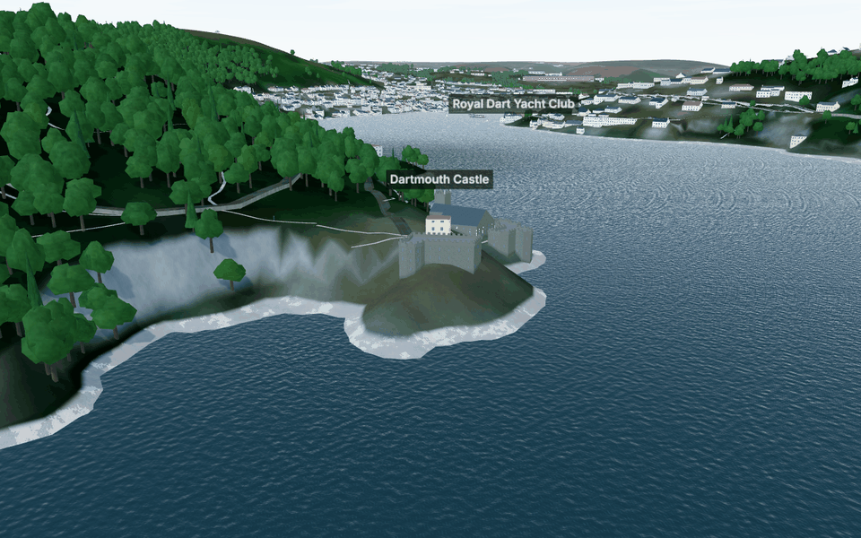 | 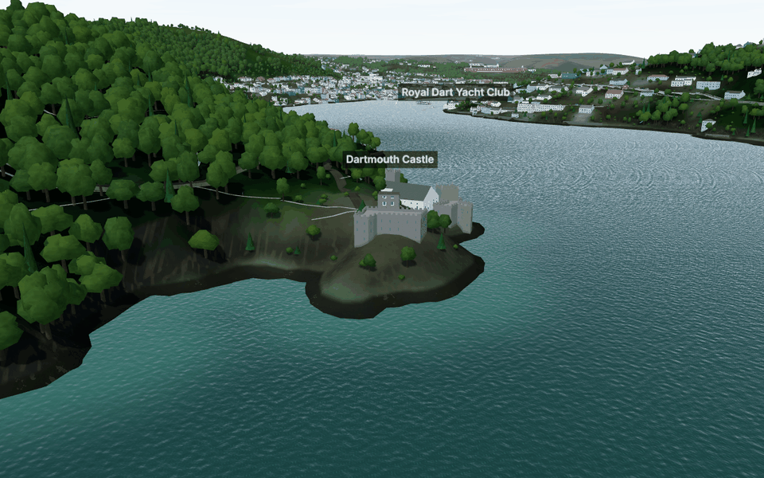 |

| The harbour mouth below Kingswear: before | After |
|---|---|
| 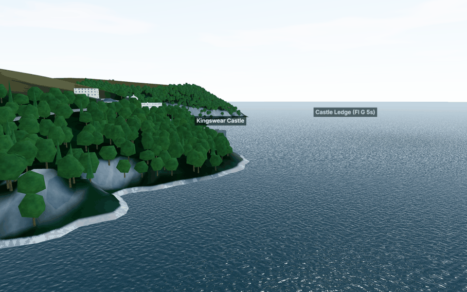 | 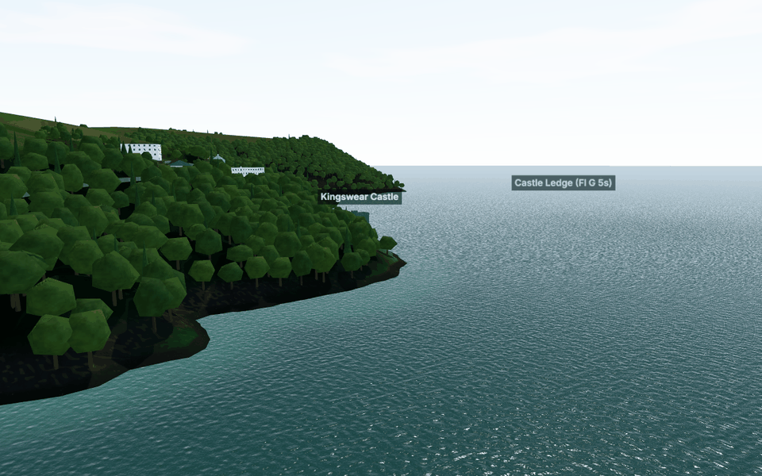 |

| South Town, Dartmouth, from the water: before | After (quay wall, gardens, colours) |
|---|---|
| 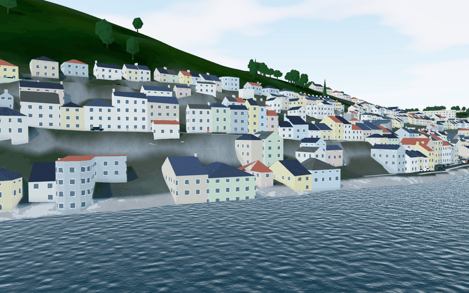 | 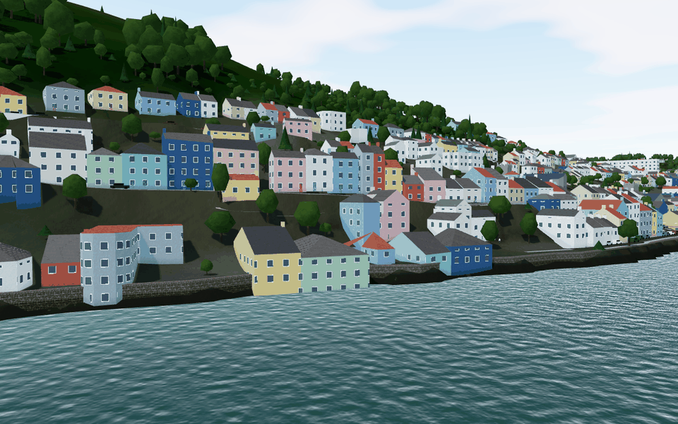 |

| The Kingswear waterfront: before | After |
|---|---|
| 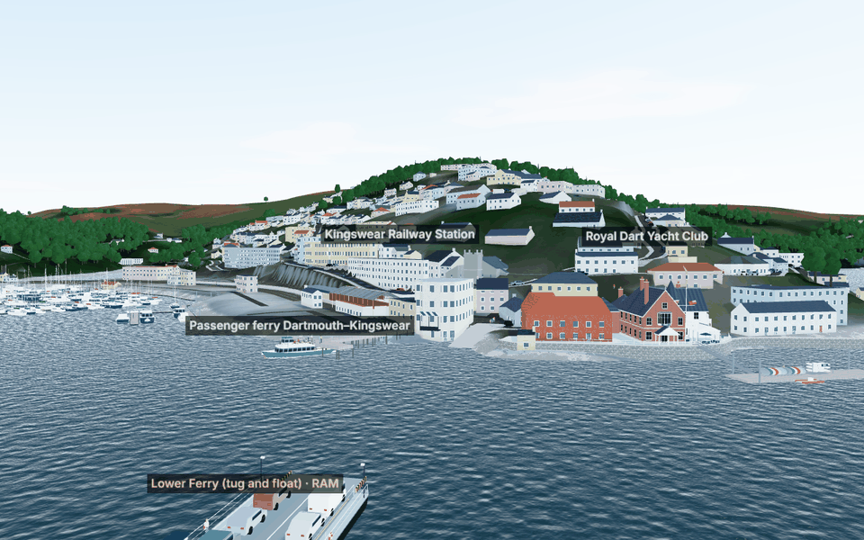 | 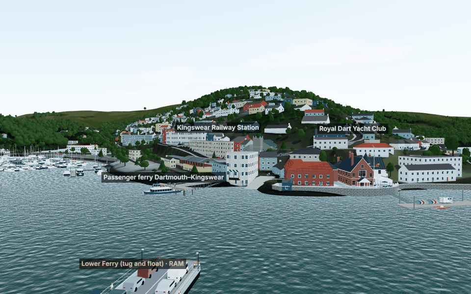 |

| Darthaven Marina and Kingswear from the air: before | After |
|---|---|
| 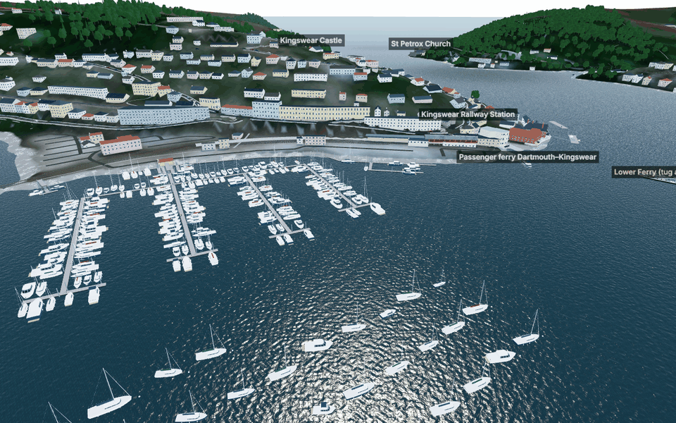 | 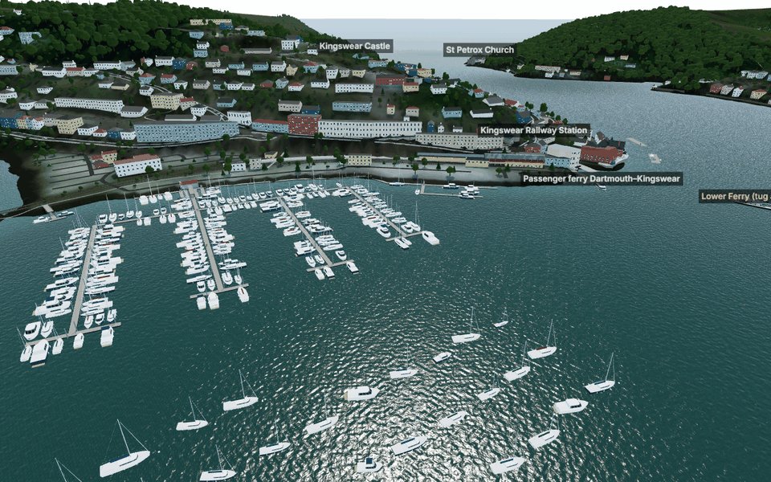 |

| The castle and St Petrox from the water (after) | BRNC from the river (after) |
|---|---|
| 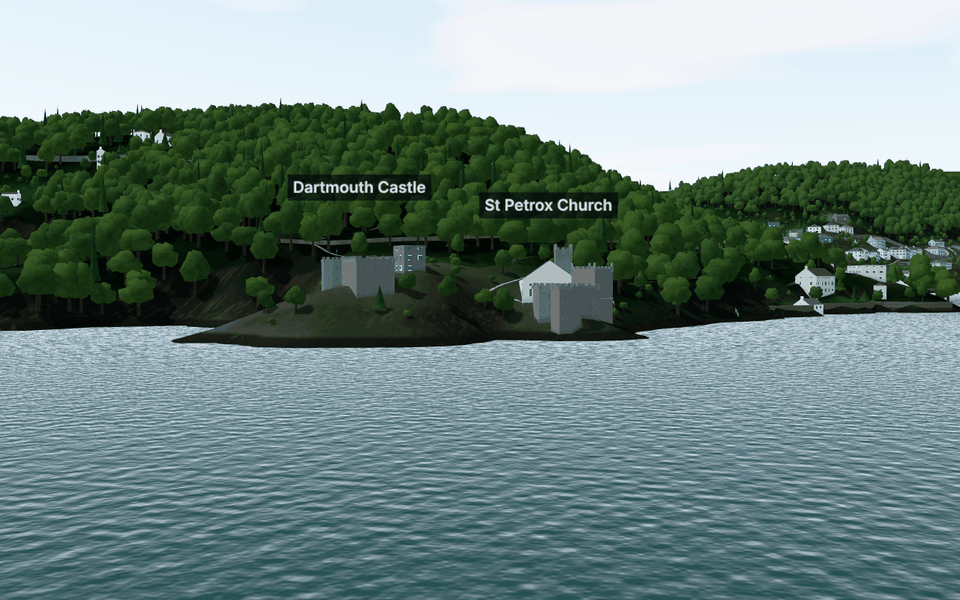 | 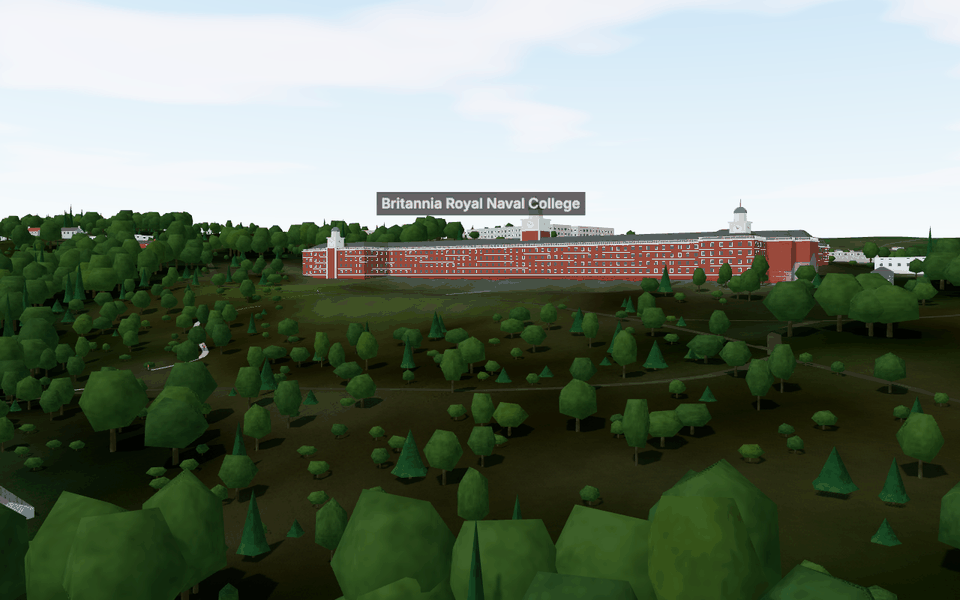 |

| The Lower Ferry's tug and float (after) | PS Kingswear Castle (after) |
|---|---|
| 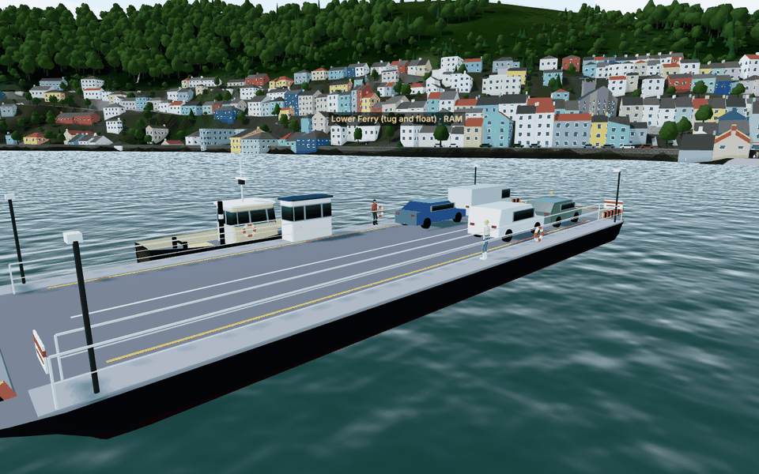 | 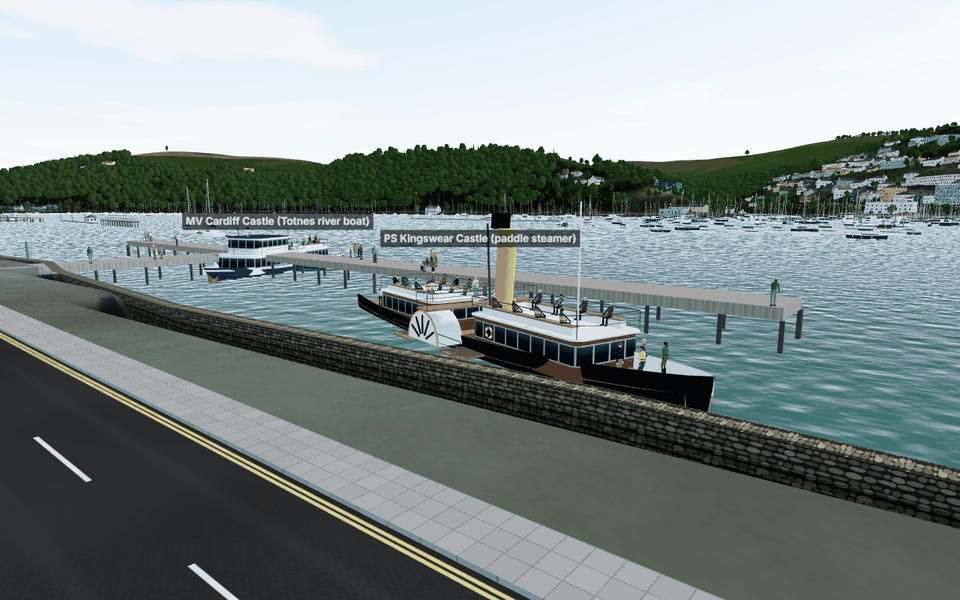 |

## The quay walls in more detail

`quayWalls()` reads the 4 m town ground and the building footprints. The rule:

1. **Find the waterline.** Trace the 1 m ODN contour (about mid-way between mean tide and high water), but only within 18 m of a house.
2. **Keep the quays.** Keep stretches where the ground 6 m inland stands more than 1.2 m above the contour, rising like a quay rather than a beach.
3. **Skip what is not a quay wall:** the vehicle ferries' slipways (18 m round each end), the yacht club's own sea wall, and the castles' rocks (70 m round Dartmouth and Kingswear castles and St Petrox), which the photographs show bare.
4. **Set the height.** Each wall's top is the median of the ground behind it, clamped to 2.8–5.0 m ODN. Its face stands 1 m into the water from the contour.
5. **Fill the quay.** The ground is filled level to the top for 7 m behind the face, before the roads are cut into it.

The result is 21 walls, 2.33 km in all, computed once when the data loads (about 0.27 s).

**Physics.** The fleet meets each wall as a fixed pier 1.2 m thick behind its face, in free sailing and in races.

**Check.** Every built-in start position is at least 100 m from a wall.

**Determinism.** The reference race hash is unchanged (`11824f89f479d0f4`); the race sails in Start Bay.

## Lighting at other times

The fill light was rebalanced for all times of day, so dusk and night were checked again. At dusk the windows light and the hills go dark against the afterglow. At night only lit windows and navigation lights remain.

| Kingswear at dusk (20:15 UTC, after) |
|---|
| 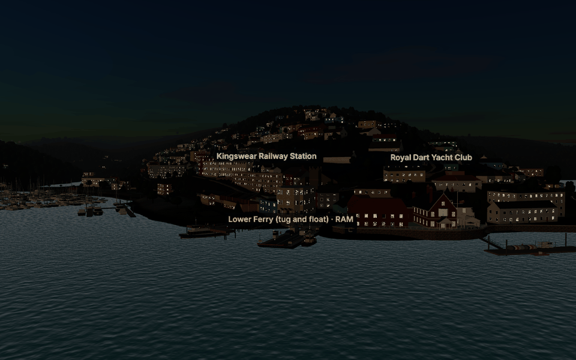 |

## Tests

- `tests/sim/quays.test.ts` (5 tests):
  - the walls line the waterfronts the photographs show, about 2 km in all;
  - they leave the ferry slipways, the yacht club and the castles alone;
  - the land is on their left, the quay behind is filled level to the top, and the water in front is untouched;
  - they are solid to boats, with open water 5 m in front;
  - no houses means no walls.
- All 328 unit tests pass, and the typecheck and lint are clean. The browser tests run in CI.

## Still open

- **Colours are judged by eye** against photographs taken in different light and seasons (issue 88). The owner's UAT is the real check.
- **The walls' lines and heights follow a rule** (E23). Quays without houses near them, such as open quaysides and slipways, are still ramps (issue 29).
- **Tide.** The Boatfloat and the foreshore dry at low water, as they really do; several photographs were taken nearer high water (issue 89).
- **Watermarks.** Most of the photographs are watermarked stock images. They were used only as reference (issue 90).
- **The Cardiff Castle's livery** is still an estimate (E19).
