# Pre-UAT red team (28 Oct 2026)

This round answers the owner's request of 28 Oct 2026: a red team of the whole build before user acceptance testing (UAT), plus four changes:

- robotic racing marks carrying random sponsors (RDYC, Ancaster, Salcombe Gin, Henri Lloyd);
- roads that look like roads;
- the Royal Dart Yacht Club corrected to the owner's four photographs;
- the Cardiff Castle paddle steamer.

As before, every change was reproduced or measured first, then fixed. Anything not taken from a source is labelled as an estimate (E). This round's sources are P1, F15–F18 and M1 in SOURCES.md, and the missing data is E17 and E19–E22 in MISSING_INFORMATION.md.

**Nothing this round needs an external service or paid infrastructure.** Everything runs in the browser from the bundled data. The only external services remain the ones listed in README.md and DEPLOYMENT.md: static hosting, and the optional scheduled live-data job on GitHub Actions.

**The build is ready for UAT.** The step-by-step script for the owner is [UAT_PLAN.md](UAT_PLAN.md). Two things need the owner's decision before the site is made public:

- **Permission to show the three commercial sponsors' names** (issue 83, E20);
- the 2026 timetable of the paddle steamer, if her days matter (E19).

## Summary

| # | Asked or found | Cause found | Fix |
|---|---|---|---|
| 1 | **RDYC still not correct** (the owner's photographs) | The clubhouse was drawn from written descriptions on top of the data's flat footprint height (8.1 m ODN at the top, far below the real building). There was no turret, no brick gable, no bay and no sea wall. OSM had drawn the pontoon and its 20 m gangway as one solid jetty | **Modelled as itself from the photographs** (`src/render/rdyc.ts`, about 6,100 triangles), on OSM's cross-shaped footprint: the red-brick gable to the river with its canted bay over a gabled white-post porch, the navy RDYC sign and the club's name; the round brick turret with its conical slate roof; the white first-floor balcony round the south side and the turret; the white-rendered south wing; tall chimneys; the flagstaff with the ensign; a terrace at +3.3 m ODN on a rubble-stone sea wall with a white rail. **The pontoon** is now a head with a separate open-railed gangway (both solid to boats), dinghies on edge, a stacked rack with the club's sign, a safety RIB. **The neighbours** have the brick and white render the photographs show. Proportions are read from the photographs (E) |
| 2 | **Radio-controlled race marks with random sponsors** | — | **Turning marks and the pin are robotic marks** (`src/render/robotMark.ts`): a high-visibility inflatable on twin pontoons, a thruster pod, a GPS mast and light. They lie head to wind and ride the chop (M1). **Each mark carries one sponsor's name on a white band**, repeated round it. The four names are dealt in a random order seeded by the course, so every sponsor appears once before any repeats, and a course always shows the same names. The text is plain type; no logo or brand colour is reproduced. **Boats meet them as a 0.9 m circle** (was 0.75 m for an inflatable, 0.4 m for the pin; E) |
| 3 | **Roads look terrible** | Roads were flat ribbons draped on the 4 m and 8 m ground grids: they tilted with the hillside, sank into banks, and had no kerbs, pavements or markings. **The scene was also washed out**: the sky's sun disc was baked into the environment lighting, so the sun lit everything a second time. Asphalt read pale blue and red read salmon | **Roads rebuilt** (`src/render/roads.ts`): smoothed profiles, level across; the town ground cut down to the carriageway along each road; granite kerbs and raised paving-flag pavements in the towns, broken at junction mouths; banks and rubble retaining walls; a shader for asphalt grain, patching, wheel tracks, centre dashes, edge lines and double yellows on the main streets. **Lighting fixed**: the environment is built without the sun disc and follows daylight and cloud. 419,000 vertices in one mesh became 179,000 in 126 tiles that are culled off screen |
| 4 | **The Cardiff Castle paddle steamer** | The Dart has two boats behind this name. The **MV Cardiff Castle** is a 1964 motor vessel on the Totnes service (F15). The paddle steamer is **PS Kingswear Castle** (1924, the last coal-fired paddle steamer in service in the UK; F16) | **Both are in.** The Totnes river boat is now named as the Cardiff Castle (100 ft by 21 ft, 400 passengers). **PS Kingswear Castle** (34.7 m, 8.5 m over the paddle boxes) runs her published river cruises from the South Embankment: 11:15, 12:30, 13:45 and 15:30, mid-May to mid-September, not on Fridays (the 2025 leaflet, F17; 2026 assumed the same, E). On 8 September 2026 she goes to Totnes (F18). She follows a deep-water route at the harbour's 6 kn, with coal smoke from her funnel, and is solid to the boats. **Her livery is an estimate**: no photograph could be viewed |
| 5 | Red team: white and yellow speckles along kerbs (found this round) | Not the ground, as first thought. The road shader read its marking flags from an interpolated value: a road with no lines (flags 8) arrived on some pixels as 7.99999, which reads as "every line on". An earlier carving change (fe087f5) did not cure it; a probe hiding the roads, then the terrain, found the cause | **The flags are rounded before they are read.** Checked close up at both detail levels. Real GPUs interpolate differently, so a check on one is in the UAT plan (issue 85) |
| 6 | Red team: on a phone the sail's status read "Luffing · trim i…" and the sheet bar "% ease" | A later, unconditional CSS rule overrode the phone rule | The phone rule comes last; the sheet bar keeps room for its text |
| 7 | Red team: a stale contact description (RACING.md) | It still said contact gives "no roll … no damage", which the realism round changed | Corrected, and the robotic marks, gangway and steamer added to its table |
| 8 | Red team: ARCHITECTURE.md opened "proposal … nothing below is implemented yet" | Never updated after Phase 1 | Marked as implemented; this round's modules described |
| 9 | Red team: could the steamer be a ghost to the fleet? | The fleet only checks traffic inside a box built from the ferry and marina routes, and her route was not in that list. **With today's data her whole track already lies inside the box**, so this was latent, not a live fault | Her track is now part of the box, with a test that every point of it is inside and that the fleet meets her under way and alongside |

## 1. The Royal Dart Yacht Club

| Before (realism round, from descriptions) | Now (from the owner's photographs) |
|---|---|
| 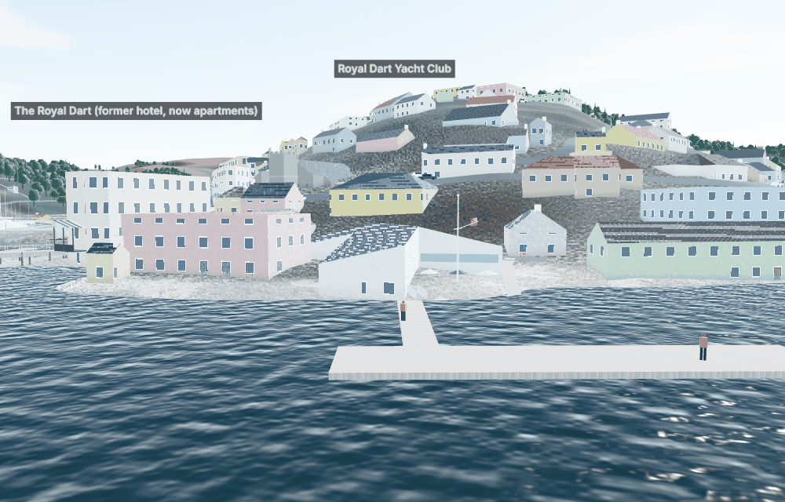 | 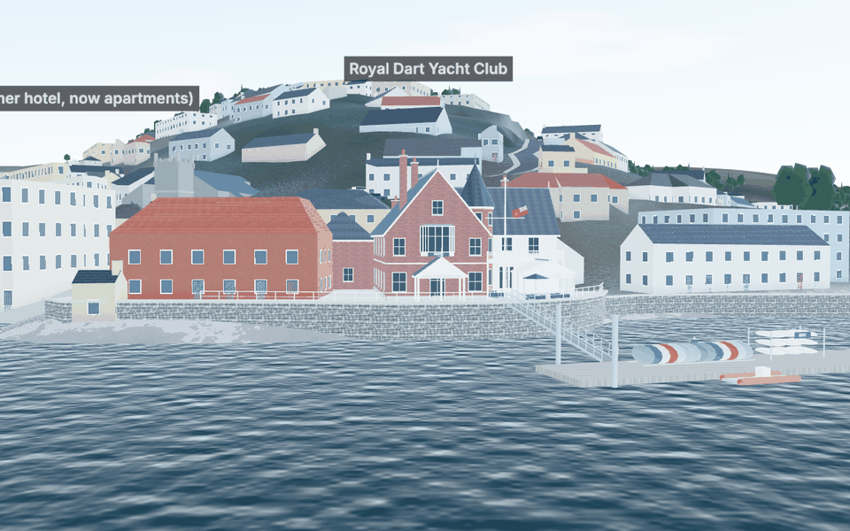 |

| Close up from the pontoon: porch, sign, bay, turret, balcony, sea wall, gangway, dinghy racks |
|---|
| 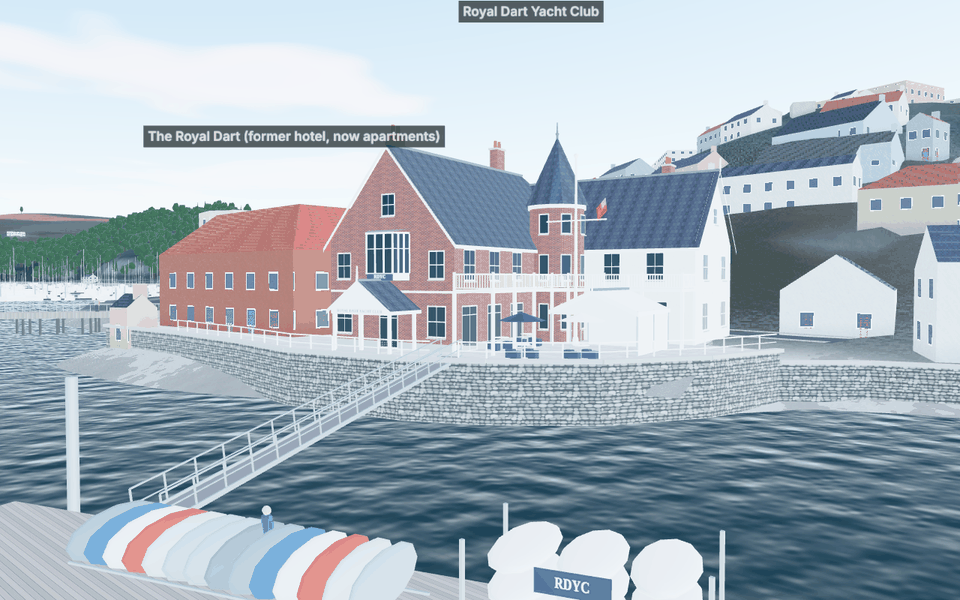 |

How it is built:

- **A frame of its own.** The model is drawn in a frame aligned with OSM's footprint (origin −3.2, −4.5 m from the reference point, turned 9.07°), so walls follow the outline the data gives. The data's height for the footprint is not used.
- **Parts by material.** Brick, slate, render, white trim, lead, glass, stone, steel, navy and canvas, each one mesh, with canvas textures (red brick in stretcher bond, slate courses, rubble stone) built in the browser. The glass glows warm after dark.
- **The terrace.** It is a flat platform at +3.3 m ODN. The ground, the roads and the people use it (`rdycPlatformAt`), so nothing sinks into it or floats above it.
- **The pontoon.** The pipeline (`tools/geodata/build.py`) now splits OSM's single outline into a head and a named gangway, and both are solid in the physics.

What the photographs do not show is estimated: the land side, the roof plan and every height. The UAT plan asks the owner to compare the views with the real building (issue 80, E17).

## 2. Robotic marks and sponsors

| Two marks: sponsors dealt at random, seeded by the course |
|---|
| 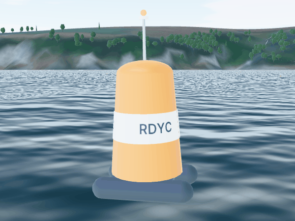 |
| 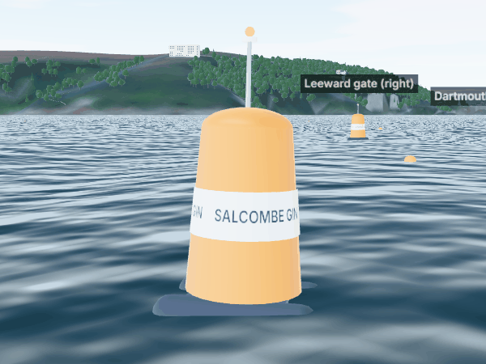 |

- **Sources.** Published descriptions of MarkSetBot-type marks (M1) give an inflatable on twin pontoons with a thruster pod and GPS station-keeping. Their published sizes disagree (a footprint of 6–8 ft by 4 ft; an inflatable 1.3 m tall), so this one is compact: pontoons 1.5 m long, the inflatable 1.1 m across and 1.5 m tall (E).
- **Contact radius.** It is 0.9 m, so the whole unit is inside the circle. The AI rounds marks by that radius. This changed the reference race's hash deliberately, from `93d1b0dea2bfcf14` to `11824f89f479d0f4`, with no incidents either way.
- **The sponsors.** Their names are a scenery choice only: they do not affect the race. Whether the three commercial names may be shown publicly is for the owner to confirm (issue 83).

## 3. Roads and lighting

| Before | Now |
|---|---|
| 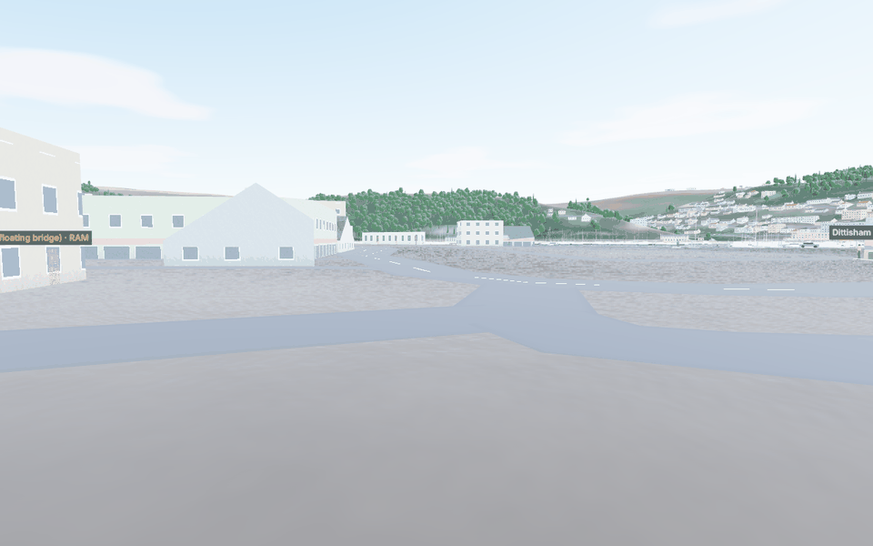 | 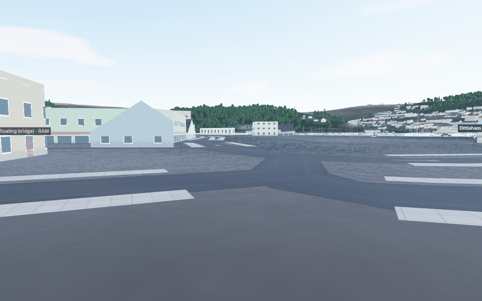 |
| 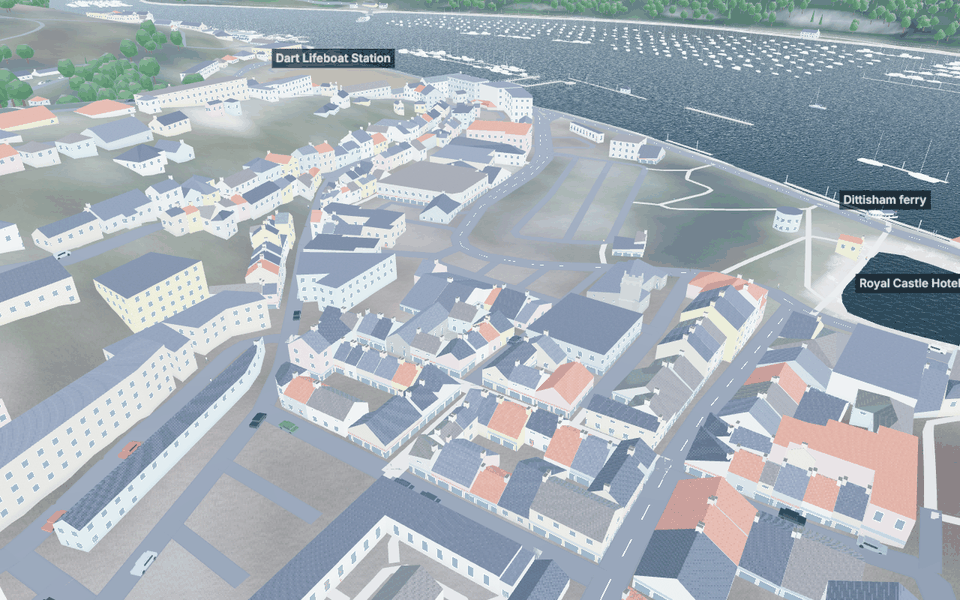 | 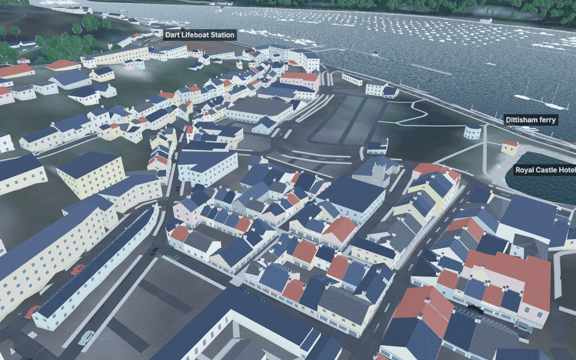 |

| Kerb speckles before the flag fix (crop) | After |
|---|---|
| 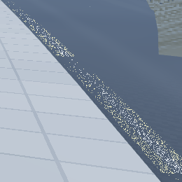 | 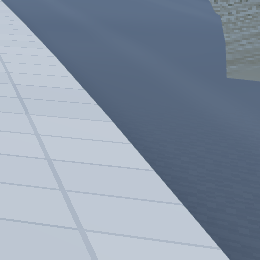 |

**Roads.** Each OSM road is resampled (every 3 m in town and 6 m outside) and its long profile smoothed. Roads are lifted a few millimetres by class, so where two overlap the more important one wins cleanly. In the towns the 4 m ground grid is cut to just below the carriageway across each road's corridor, so hillside streets have a cut bank above and a bank below. Before, a ribbon tilted with the slope. Widths come from the OSM class; where pavements go and which streets get double yellows follow rules. All of these are estimates (E22).

**Detail levels.** On a software renderer (this container, CI) the kerb faces, walls and banks are left out to save vertices. On a real graphics card they are drawn, as checked here with `?quality=high`.

| Kerbs and pavements at high detail |
|---|
| 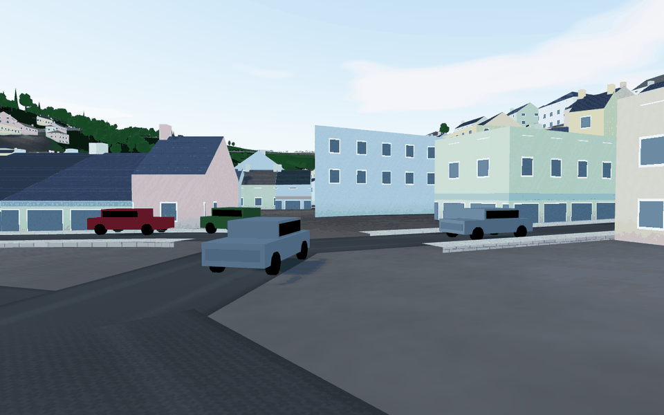 |

**Lighting.** three.js ignores a material's own environment strength once the environment is set on the scene, which is why earlier tuning had no effect. The environment map is now built with the sky's sun disc hidden (`showSunDisc`). Its strength is (0.04 + 0.4 × daylight) × (1 − 0.3 × cloud) (E). Dark colours read dark again.

## 4. The paddle steamer and the Cardiff Castle

| PS Kingswear Castle under way off Dartmouth Castle (her smoke built up in the page as at 60 frames a second: this container's software renderer draws a frame every few seconds, too slowly for the plume to form) | Alongside the South Embankment |
|---|---|
| 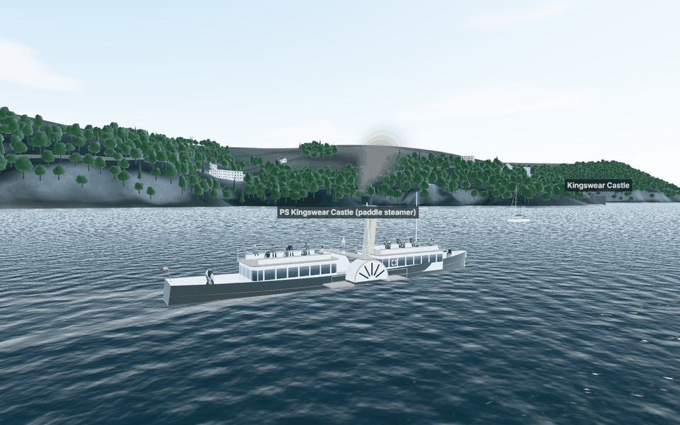 | 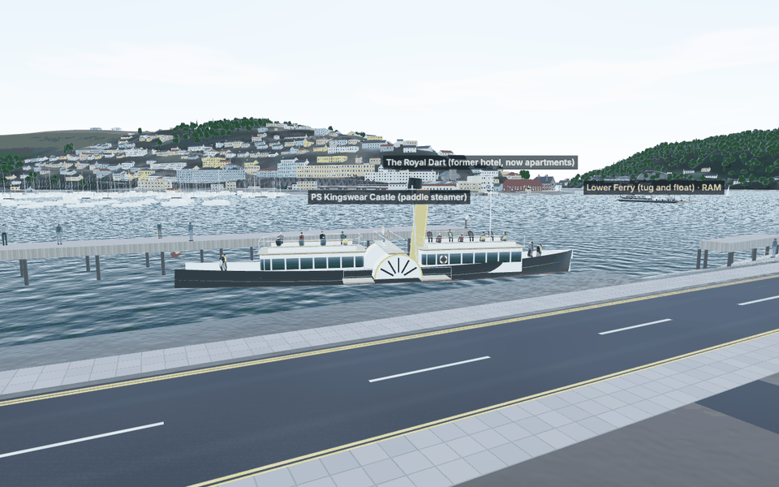 |

- **Schedule.** `steamerSailings(date)` gives the day's sailings.
- **Position.** `RiverTraffic` places her: berthed between cruises from 10:00 to 17:00 on sailing days, or on an A* route through water at least 1.5 m deep at the route level, clear of the moorings, down to the castle and up towards Greenway.
- **The Totnes trip.** She follows the Totnes ferry's track and is "away" beyond the map until she returns.
- **Speed and drawing.** She is timed with the stream and the harbour's 6 kn limit. Her paddle boxes are closed, with vents and a gold rim (the wheels inside are not drawn), and her funnel smokes with the same `Exhaust` the steam trains use: thickly under way, a wisp alongside.
- **Estimated.** Her berth, turning points, season dates and livery are estimates (issue 84, E19).

## 5. Red team of the whole build

The red team went back over every round of the project: the original brief, phases 1–6, the UX review, the hi-fi rounds, round 3, the red-team round and the realism round. It looked for broken promises, stale documents and things that only look right in screenshots.

| Area | Check | Result |
|---|---|---|
| **Credentials** (brief) | Searched the source, public assets and the git index for keys, tokens, `.env` files and secret-named variables; read the workflows | **Clean.** The only secret, `UKHO_API_KEY`, is used by the scheduled job only. The production build's own secret check passed: 36 files (9.2 MB), 6 secret environment values checked |
| **External services** (brief) | README and DEPLOYMENT.md against what the code calls | **Accurate.** Static hosting, plus the optional GitHub Actions live-data job and UKHO tide API (free tier). This round adds no service |
| **Racing rules** (brief) | Every place the judge is shown | **The disclaimer is present** in Help, Quick race, Results, Scenario and RACING.md: "a simplified subset … not an authoritative adjudication" |
| **Club scenarios only after verification** (brief) | Club courses and SIs | **Still none**, correctly: the club's sailing instructions and course plans have not been inspected (issue 1, A1–A3). Practice courses are labelled as such |
| **Determinism** | The reference race hash | `11824f89f479d0f4`. It changed once this round, deliberately (the mark radius; PHYSICS.md §22). The RDYC, roads, steamer and box changes left it unchanged |
| **Estimates labelled** | New numbers in code and docs | Each carries (E) or a source ID. New missing data is E19–E22 |
| **Traffic and the AI** | Does the AI see the new steamer? | **Yes.** It reads the same `RiverTraffic` states as the physics. Finding 9 was fixed |
| **Visual sweep** | Night, dusk, overcast, rain, town streets, phone layout | Findings 5 and 6, fixed. The clubhouse windows now light at night like the other buildings' |
| **Performance** | The road mesh against the previous build | 179,000 vertices in culled tiles (was 419,000 in one mesh). The local browser tests time out in this container because its software renderer draws about 0.4 frames a second. The previous commit times out the same way here, and **CI passes them all** (issue 86) |
| **Documentation** | Stale statements | Findings 7 and 8; the outstanding-issues register updated (38, 60, 72, 73, 80; new 82–87) |

## Determinism

The reference race hash is now `11824f89f479d0f4`. It changed once this round, in 2527abb (the robotic marks' contact radius: 0.75 m and 0.4 m became 0.9 m). The RDYC model, the roads, the steamer, the flag fix and the traffic box did not change it.

## Tests

New or rewritten this round:

- `tests/render/rdyc.test.ts` (9; 3 replace the old terrace test): the club modelled as itself (brick gable wing, white south wing, slate roofs, turret, bay, signs, sea wall, terrace); standing on its terrace, with the flagstaff in front of the turret; the gangway from the terrace to the pontoon, solid to the boats. The colours, pontoon and naming tests were kept.
- `tests/render/robotMark.test.ts` (3): all four sponsors dealt before any repeats, the same each time for a course; the band carries the sponsor and the pin a flag; the unit fits inside its contact circle and stands about 2 m out of the water.
- `tests/render/roads.test.ts` (3): in the country, level across and never buried at either edge (and low detail no heavier than high); in town, cut and filled into the ground with kerbs and raised pavements; markings stopping short of a junction.
- `tests/sim/steamer.test.ts` (5): her sailing days and the Totnes trip; alongside between cruises; deep water and the speed limit; back from Totnes at 19:30; her whole track inside the fleet's traffic box, and met by the fleet under way and alongside.
- `tests/e2e/smoke.spec.ts` checks the new scene objects by name.

All 323 unit tests pass, and the typecheck, lint and production build (with its secret check) are clean. The browser tests run in CI (issue 86).

## Still open

- The owner's check of the clubhouse against the real building (UAT_PLAN.md, step 2).
- Permission for the sponsors' names (E20).
- The steamer's 2026 timetable and photographs of both vessels (E19).
- Road widths from a survey (E22).
- A close look at a town street on a real GPU (issue 85).
- Older items: the club's sailing instructions and course plans (A1–A3), Squib performance data (B5), and the EA LIDAR surface model (E1, blocked by the network policy).
