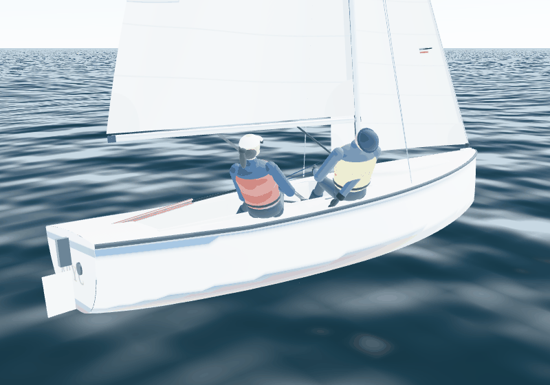
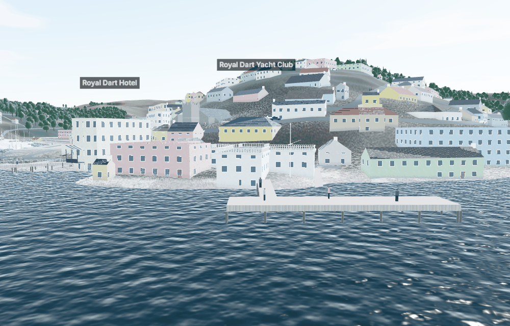
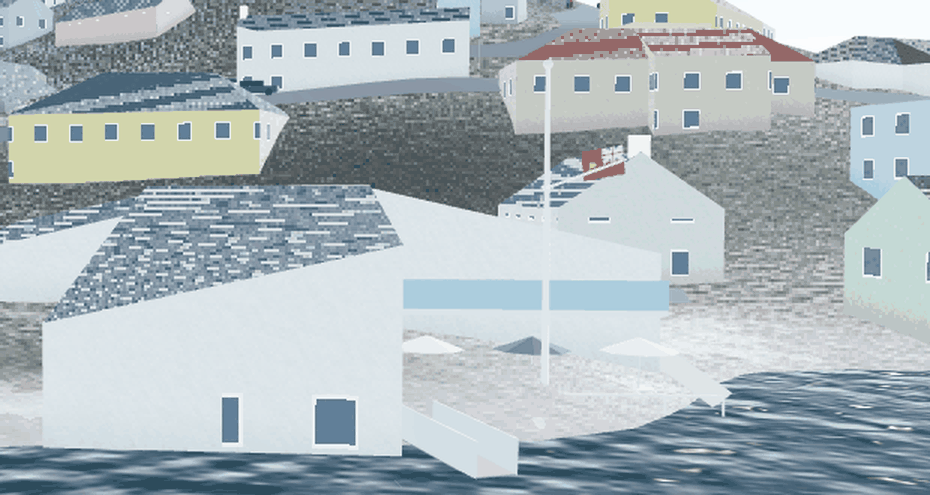
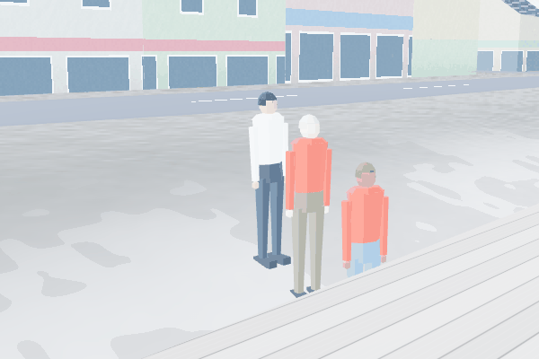
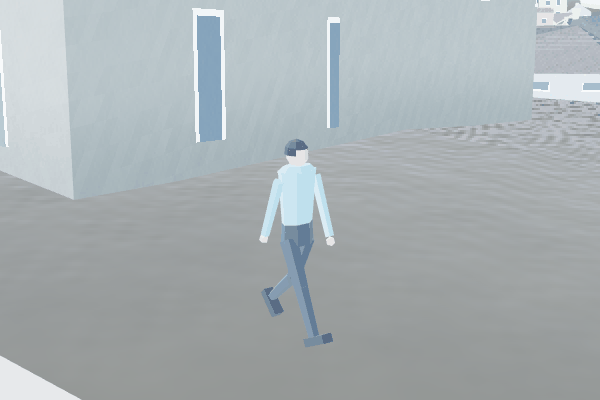
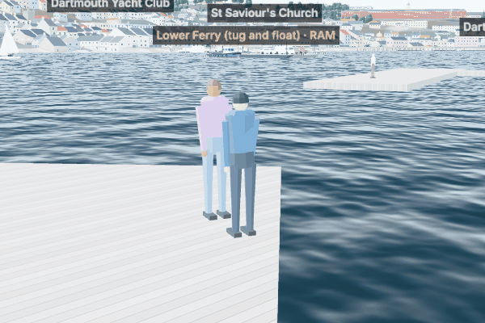
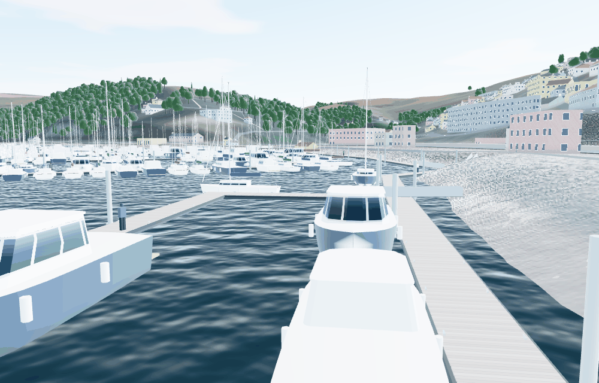
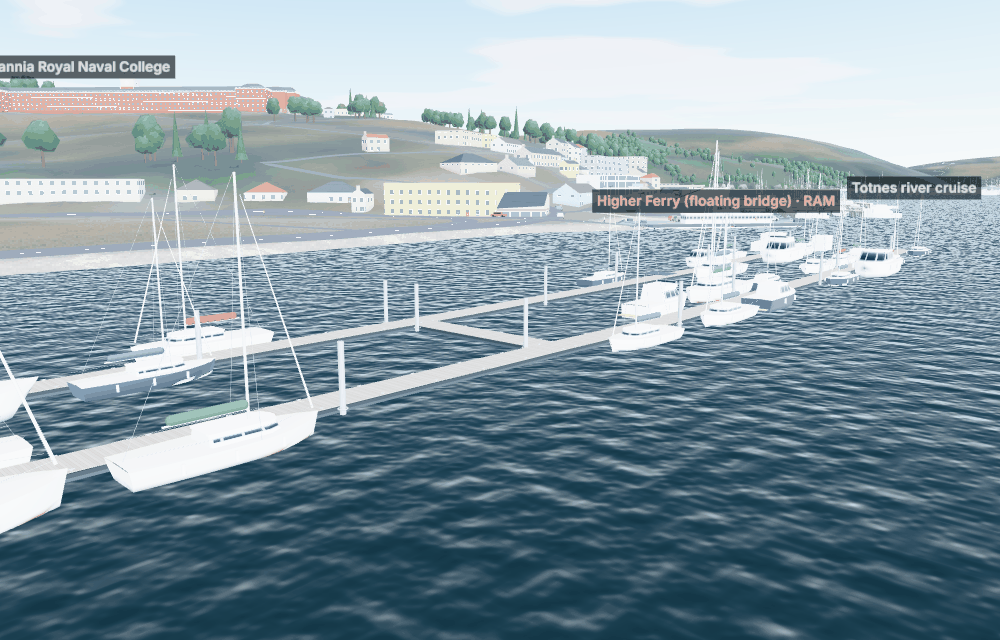

# Realism round: crew, sails, damage, the land's wind, RDYC, people (28 Oct 2026)

This report answers the owner's review of 27 Oct 2026: twelve points, from the crew's movement to the people ashore.

As before, each point was reproduced or measured first, then fixed. Anything not taken from a source is labelled as an estimate (E). Sources R1–R9 are in SOURCES.md and the missing data in MISSING_INFORMATION.md E14–E18. **Nothing this round needs an external service or paid infrastructure.** Everything runs in the browser from the bundled data, and the research was done through public web pages.

## Summary

| # | Reported | Cause found | Fix |
|---|---|---|---|
| 1 | Crew movement not fluid or realistic | Each sailor jumped to the physics' crew position. Hands snapped between the tiller, the extension and the sheets. In a tack a joint moved up to 0.33 m in one frame, and drifting across the middle in light air up to 1.02 m | **Each sailor follows a critically damped spring**, with the helm a moment behind. A sailor crouches and steps across only when going to the other side: the physics now reports where the weight is bound. The crew lean further in a gust without crouching, pull the sheets in strokes, and reach for the extension before changing hands. Every target is eased and rate-limited. **Largest joint jump per frame: 0.33 → 0.06 m in a tack, 1.02 → 0.08 m in light air** |
| 2 | Sails powered the wrong way with the wind on the quarter | The *drawn* belly side came from the incidence and flipped past 90°, which is the normal state of an eased sail on a broad reach or run. So the sails were drawn bellied into the wind. The physics' sail force was already right | **Each sail fills on the side its own apparent wind pushes it**: tanh(6 sin(awa − sail angle)). A sweep test compares the drawn side with the physics' force normal to each sail at every true wind angle, on both tacks |
| 3 | Landmarks out of date (Royal Dart Hotel) | The hotel closed and was converted | **Labelled "The Royal Dart (former hotel, now apartments)"**, with its zinc-clad roof (R8). The Royal Castle Hotel was checked: it is still trading (R9) |
| 4 | Male or female helm | — | **Scenario → Helm: a man or a woman** (appearance only). Figures are built to measured mean statures: men 1.75 m, women 1.61 m (R1). The previous figures were 1.88 m. A woman's build is narrower in the shoulder and wider in the hip, with a ponytail. AI crews mix both |
| 5 | Damage and collision response | Contacts pushed the boats apart and did nothing else | **Impacts can do the following damage** (E18): crack or hole the hull (a leak into the bilge, which the crew pump); damage the rudder at the stern (less grip, and a bent blade pulls); damage the rig at the bow (less drive, and the sails come down if it fails). Hard groundings damage the keel. A contact also heels the boat, through the force at deck height. Damage shows in the instruments and the contact message |
| 6 | Vanes should show the wind | Traffic ensigns were fixed astern, and berthed yachts had no vane | **Ensigns fly with the wind each boat feels** (the true wind less the boat's own way through the air), and hang limp in a calm. **Berthed and moored sloops carry a masthead vane** of Windex 15 size (R2) pointing into the wind |
| 7 | Wind and stream should vary with the land | The wind was the same everywhere. The stream followed the channel at one rate across it | **The land shelters and steers the wind:** cross-river winds in the harbour blow at 60–70% of open-water strength, and winds along the river at 80–100% (R4, E). The land's effect on the wind can be turned off in the scenario. **The stream runs faster over deep water.** **Start Bay's coastal stream turns with the tide, and strong northerlies add to the ebb** (DHNA H1, E) |
| 8 | RDYC building, neighbours, pontoon, ensign | The clubhouse was a flat-topped block with a balustrade. The pontoon was an unnamed fixed jetty. There was no ensign | **Rebuilt from the club's described facilities** (R5): a slate roof, the riverside terrace (rail, tables, parasols), the first-floor balcony, and the flagstaff at the terrace edge. **The ensign** (a red ensign with a crown over a golden arrow, R6) **flies at colours**: 0800 from 25 March to 20 September and 0900 otherwise, local time, lowered at sunset (R7). **The main pontoon and the Moody Island dinghy pontoon** are named and float, with a gangway that follows the tide |
| 9 | River sausage start stuck in the bank | The owner's start slot was on drying mud (the bed at +1.06 m above Ordnance Datum Newlyn, ODN), heading for the bank. Slots were laid out behind the line without checking the water | **Start slots need the draft plus 1 m of water and 40 m of room ahead, with no mooring area.** If there is no such slot, a wider grid of clear spots is used. The solo pre-start position is checked too. **Every start location, built-in race and quick-race venue was checked for 1–21 boats from chart datum to high water.** None start aground now |
| 10 | Pontoons lack detail; boats sail through them | Piers were scenery only | **Piers, jetties and pontoons are solid.** Floating pontoons are a little softer on their fenders (E). **They are drawn with** floats, a planked deck, fenders, cleats, guide piles with hoops, jetty piles and rails, and gangways that steepen as the tide falls |
| 11 | Repeated capsizes in a turn | With the sheets cleated in a blow, a turn knocked the boat flat on one side, then the other, and it lay pinned at 70–84°. Two real mechanisms were missing | **Past 45° of heel the rudder ventilates and loses grip**, so the boat rounds up as keelboats do (R3, E). **The crew let the sheets run past 50°** until the boat is back under 35° (E). Across all three Squib types: **time past 55° is down 86%**. In the 32 kn cleated case the boat now comes up in seconds |
| 12 | People are statues, too tall, doing nothing | Street people were 1.70 m blocks with 0.42 m shoulders that never moved | **Jointed figures built to the mean adult stature** (1.68 m, scaled 1.55–1.80 m per person; R1). Animated on the GPU: **they walk with a stride, chat in twos and threes, lean on the rail watching the river, sit on benches facing it, and queue at the ferry landings** |

## 1. The crew

| A woman at the helm, a man crewing (Scenario → Helm) |
|---|
|  |

`src/render/squibModel.ts` (`poseCrew`) and `src/render/crew.ts`:
- **Movement.** The helm follows a critically damped spring at ω = 8 rad/s and the crew at 11 rad/s. A sailor steps across only when the physics' crew target changes side (`crewTo` in the snapshot, display only). A latch keeps them committed until they arrive.
- **Hands.** The helm changes hand on the tiller extension with hysteresis. Hands move at no more than 2 m/s, so a hand reaches for the extension instead of jumping to it. The crew's sheet hand is chosen by which side the jib is on, and sheets come in with visible strokes when trimming.
- **Measured** (`tests/render/crew.test.ts`): in a tack, no joint moves more than 6 cm in a frame (3.6 m/s), hands included. Drifting across the middle in light air is just as smooth. In a gust the crew lean further out on the same side, without crouching.

## 2. Sails against the wind

`sailFill` in `src/render/squibModel.ts`. The old rule inverted a sail's belly whenever the air met its chord at more than 90°. That is ordinary for an eased main on a broad reach or run, so with the wind on the quarter the sails were drawn bellied towards the wind.

The physics was checked separately. The sail forces were already on the correct side at every angle; only the drawing was wrong. `tests/render/sails.test.ts` sails the boat at every true wind angle from −175° to 175° in 10° steps. At each angle it checks that the drawn belly is on the side of the physics' force normal to the chord, for both sails.

## 3 and 8. Landmarks and the Royal Dart Yacht Club

| Before: flat balustraded block, fixed jetty on piles, "Royal Dart Hotel" | After: slate roof, terrace and balcony, flagstaff, floating pontoon with its gangway |
|---|---|
|  |  |

| The ensign at the flagstaff on the terrace edge, streaming downwind |
|---|
|  |

- **What the sources say** (R5, search excerpts: the club's site and Wikipedia cannot be reached from this environment).
  - The 1881 clubhouse on Priory Street has a ground-floor bar and dining area opening onto a riverside terrace.
  - Upstairs are a formal dining room, the Quarter Deck function room and a large balcony.
  - The club has a Main Pontoon (yachts on its outside only) and a dinghy pontoon called Moody Island.
- **What is drawn** (`src/render/landmarks.ts`).
  - OSM's footprint under a slate roof.
  - A 6 m terrace on the river side with a rail, tables and parasols.
  - The balcony at first-floor level, 2.4 m deep.
  - An 11 m flagstaff with a gaff at the terrace edge.
  - The proportions are estimates (E17).
  - The neighbouring buildings are OSM's footprints with LIDAR heights, as before.
- **Colours** (`src/render/colours.ts`, `src/render/clubEnsign.ts`).
  - Hoisted at 0800 local time from 25 March to 20 September and 0900 otherwise, aware of British Summer Time, and lowered at sunset, taken as the sun's upper limb on the horizon (R7).
  - This is general yacht-club practice; RDYC's own practice is not published (E17).
  - The ensign streams with the wind and droops in a calm.
- **The pontoons** (`tools/geodata/build.py`, `PIER_CORRECTIONS`). OSM's unnamed jetty in front of the clubhouse is named "Royal Dart Yacht Club pontoon", and the dinghy pontoon "Moody Island (RDYC dinghy pontoon)". Both float. The main pontoon's position is OSM's, and its floating is assumed (issue 80).
- **The Royal Dart** (R8). The former hotel was refurbished for Darthaven Marina as five apartments and a commercial unit, and is now labelled that way. Its roof is zinc-grey. The Royal Castle Hotel was checked as well: it is still trading (R9).

## 4 and 12. People

| Ashore: a group chatting by the water | Walking |
|---|---|
|  |  |

| On a pontoon, watching the river |
|---|
|  |

`src/render/people.ts` and `src/render/population.ts`:
- **The figure.**
  - 385 triangles: head and hair, neck, torso and hips, arms with hands, thighs, shins and shoes.
  - Skin, hair and trouser colours vary; the shirt takes the instance colour.
  - Height 1.68 m at scale 1 (the mean of R1's men and women), scaled 0.92–1.07 per person, so 1.55–1.80 m.
  - Shoulders about 0.4 m across.
- **Posed on the GPU.** Each vertex belongs to a body part, and the vertex shader turns the hips, knees and shoulders from each person's activity, phase and pace. Posing costs no per-frame work in JavaScript, and each look is one draw call; only the walkers' positions are updated each frame.
- **What they do** (seeded, E):
  - walk the pavements at their own pace;
  - chat in twos and threes facing each other, with gestures;
  - lean on the rail at the water's edge;
  - sit on benches facing the river;
  - stand shifting their weight and looking about;
  - queue at the ferry landings facing the boat.

  People on floating pontoons rise and fall with them. Walkers are drawn to 450 m.
- **The sailors** use the same statures: men 1.75 m and women 1.61 m (R1). The previous figure was 1.88 m.

## 5. Damage

`src/sim/boat/damage.ts`, `src/sim/race/fleet.ts`, `src/sim/simulation.ts`; full rules in PHYSICS.md §21.
- **Energy.** An impact's energy is ½mv² of the closing speed along the contact normal. Two boats use their reduced mass. Inflatable marks do no harm.
- **Where it strikes.** The front or back quarter of the hull, or the side.
- **Thresholds** (all E18):

  | Damage | Threshold |
  |---|---|
  | A scrape | below 300 J |
  | Hull cracks or holes, leaking up to 3 kg/s | beyond 800 J |
  | Rudder (at the stern) | beyond 400 J |
  | Rig (at the bow) | beyond 2.5 kJ |
  | Keel (grounding) | over 0.8 m/s over the ground |

- **Bilge.** The crew pump 0.4 kg/s, and buoyancy caps the bilge at 300 kg.
- **Effects on sailing.**
  - Bilge water adds weight and so resistance.
  - A damaged rudder keeps as little as 25% of its grip, and a bent blade adds up to 6° of rudder.
  - A damaged rig drives less; if it fails, the sails come down.
- **Contacts heel the boat.** The contact force acts at deck height (boats 0.55 m, pontoons 0.35 m, jetties 0.25 m, marks 0.3 m: E), so a knock on the topsides heels her away from it.
- **Display.** Damage shows in the instruments ("Damage") and the contact message (for example "Contact with a jetty at 2.4 m/s: hull cracked: leaking"). It is part of the deterministic state, and only a restart repairs it.

## 6. Vanes and ensigns

`src/render/vane.ts`, `src/render/traffic.ts`, `src/render/berthed.ts`.
- A traffic boat's ensign points along the wind the boat feels: the true wind less its own velocity. It flies aft under way in a calm and streams downwind of a boat lying still.
- The flag droops as 1.35·exp(−aws/2.2), so it hangs limp below about 1 m/s.
- The berthed and moored sloops near the camera carry a 0.38 m masthead vane pointing into the true wind, turned in 3° steps.

## 7. Wind and stream shaped by the land

Full method in PHYSICS.md §22.

- **Shelter** (`src/sim/env/terrainWind.ts`). Looking upwind from each 50 m cell over the water, a rise h metres above the sails, x metres away, shelters the cell by an amount depending on x/h:

  | Distance downwind of the rise (x/h) | Shelter |
  |---|---|
  | Immediate lee | 30% |
  | 2 to 6 | 40% (the most) |
  | 30 and beyond | none |

  This shape is measured behind windbreaks (R4). Its size for rounded valley sides is an estimate (E14).
- **Steering.** Where the valley shelters the water, an oblique wind turns towards the river's line, up to 30°. A wind square across the valley is not turned.
- **Results.**

  | Where | Wind |
  |---|---|
  | Cross-river winds in the harbour | 60–70% of open-water strength, turned up to about 15° |
  | Along the river | 80–100% |
  | Start Bay | unchanged, except offshore winds near the coast at 75–85% |

  Where no land lies upwind the wind is returned bit for bit, so open-water physics is untouched. The conditions panel shows "Land effect" at the boat. Scenario → "The land shapes the wind (shelter, valley)" turns it off.
- **Stream** (`src/sim/env/streamAnomalies.ts`; DHNA sailing directions H1, sizes E15). These apply whenever the River Dart's channel-following stream is chosen:
  - **Depth.** Deeper water runs faster than the shallows beside it: velocity × (depth / mean depth nearby)^(2/3), the Manning relation.
  - **Start Bay.** The coastal stream runs north-east from HW−2 to HW+4 and south-west from LW−2 to LW+4, at up to 0.7 kn (E), outside the entrance only.
  - **Northerlies.** Strong northerlies add up to 1 kn to the river's outflow (DHNA: the entrance ebb can reach 3.5 kn).

## 9. Starts on the mud

`startPositions` and `startClearWater` in `src/sim/race/setup.ts`.
- **Clear water.** A slot is clear water if:
  - the bed is at least the draft plus 1 m below the water level at that moment;
  - it is outside the mooring areas;
  - the 40 m ahead of it on its heading are the same.
- **Spacing.** Slots are laid out 15 m apart behind the line. If there is not enough clear water, a wider grid of clear spots up to about 480 m behind the line and 150 m beyond its ends is used.
- **Check.** `tests/sim/starts.test.ts` covers:
  - every free-sailing start location;
  - every built-in race;
  - both quick-race venues, with practice courses at five wind directions.

  Each is checked at chart datum, mid-tide and high water, sailing alone and for 4, 8, 12 and 21 boats. Every boat starts in clear water with 40 m of room ahead.
- **Limit.** A user's own course on a narrow creek could still find no clear water and fall back to the mud (issue 81).

## 10. Pontoons

| A marina pontoon: planked deck, fenders, cleats, guide piles with hoops | Dart Marina's pontoons from the river |
|---|---|
|  |  |

- **Physics** (`src/sim/race/piers.ts`).
  - Every pier, jetty and pontoon in the data becomes solid pieces: a rectangle per segment of a line, and an outline cut into triangles.
  - The fleet's contact model treats each piece like any other obstacle, using a 25 m lookup grid.
  - Fixed structures are stiff (2×10⁵ N/m). Floating pontoons are softer on their fenders (8×10⁴ N/m) (E).
  - A fixed jetty is solid at every tide: at low tide its deck is high above the water, but its piles are still underneath.
- **Contacts.** These are reported with the pier's name where it has one ("Contact with Royal Dart Yacht Club pontoon…") and can cause damage (§5).
- **Drawing** (`src/render/pontoons.ts`).
  - Floating pontoons: floats under a planked deck 0.42 m above the water, fender strips, cleats every 4 m, and guide piles with hoops that ride up and down.
  - Fixed jetties: a deck on timber piles with beams and rails.
  - Gangways run from the end nearest the bank and steepen as the tide falls.

## 11. Knockdowns

PHYSICS.md §21.
- **The sweep.** Held turns with all three Squib types, in 18–32 kn, steady and gusty, from four starting angles, turning both ways, with three ways of handling the sheets: 497 runs.
- **Results.**

  | Measure | Before | After |
  |---|---|---|
  | Time past 55° of heel, all runs | 2,784 s | 385 s (−86%) |
  | Runs reaching 70° | 69 | 13 |
  | Time past 55° with the app's default sheet settings | 313 s | 13 s |

- **What changed.**
  - The rudder's force fades smoothly from 45° to 80° of heel, down to 15% (calibration `hydro.rudderVent*`).
  - The crew-assist sheet release acts past 50° and recovers below 35°.
- **Limits.**
  - Neither acts below 45°, so the golden traces are unchanged.
  - With the crew assist off and the sheets cleated, a boat can still lie pinned, as a real one would.

## Determinism

**Reference race hash: `df0d92d410cf27e9` → `93d1b0dea2bfcf14`, a deliberate change.** The reference race sails in Start Bay, where the coastal stream and the depth weighting now act. Every other change this round leaves it unchanged, which was checked after each commit:

- knockdowns act only past 45°;
- damage needs an impact;
- piers are far from the course;
- the terrain wind is exact over open water.

The race takes about 20% longer to compute (13 s for 400 s of seven boats), mostly in the AI's planning, which samples the wind and stream at many points. It is still about thirty times faster than real time. The AI polar's values are unchanged; its fingerprint was regenerated.

## Tests

- **Unit:** 38 files, 311 tests, all passing. New:
  - `tests/render/sails.test.ts`: drawn fill against physics force at every wind angle.
  - `tests/render/vanes.test.ts`: ensigns and masthead vanes.
  - `tests/render/rdyc.test.ts`: colours times with British Summer Time and sunset; the ensign; the terrace, balcony and flagstaff; the pontoons named and floating; the Royal Dart relabelled.
  - `tests/render/people.test.ts`: stature, shoulders, the height range, stride, groups, watchers, sitters and queues.
  - `tests/sim/starts.test.ts`: every start in clear water at every tide and fleet size.
  - `tests/sim/piers.test.ts`: every pier solid; a boat stopped by a floating pontoon and by a fixed jetty.
  - `tests/sim/damage.test.ts`: thresholds, leak and pump, collisions, heel from a knock, groundings, a bent rudder.
  - `tests/sim/terrain.test.ts`: shelter shape, the lee of a ridge, valley steering, the Dart, the stream's depth weighting, Start Bay's coastal stream, northerlies.
  - Extended: crew smoothness and builds (`crew.test.ts`); knockdown recovery and rudder grip (`heavyweather.test.ts`).
- **Browser (Playwright):** the River Dart smoke test now also checks for the club ensign, the berthed boats' vanes and the walkers.
- **Typecheck and lint:** clean.

## Still open

These are issues 76–81 in OUTSTANDING_ISSUES.md:
- **Damage.** Its thresholds are estimates, and the AI does not change how it sails when damaged.
- **The land's effect on the wind.** It comes from the terrain alone: there are no buildings, trees or thermals, and no acceleration over ridges.
- **The knockdown fixes.** Their angles are estimates.
- **The stream's local departures.** These are estimates around DHNA's statements.
- **The RDYC clubhouse.** It follows written descriptions, not photographs.
- **Starts on a user's own course.** A course in a narrow creek could still fall back to the mud.

**What would make them exact** (MISSING_INFORMATION.md E14–E18):
- anemometer records inside the harbour;
- current measurements across the channel and in Start Bay;
- England's measured mean heights;
- photographs of the RDYC clubhouse and pontoons, and the club's colours practice;
- impact strengths for a Squib's hull, rudder and rig.

**Hosts to allow.** `royaldart.co.uk` and `en.wikipedia.org` could not be reached from this environment, so the club's facts came from search excerpts. Allowing these hosts in the environment's network policy would let the pages be read directly.
