# Red team: real Squib racing, the views, the coach and the picture (27 Oct 2026)

This report answers the owner's red-team brief:

> Red Team the build and code. Consider real-world Squib-racing conditions:
> - What happens if the Squib gets overpowered? What about gusts?
> - What about panning and a drone function for other views, and a first-person view from inside the boat?
> - What about the option to race, and against how many competitors?
> - What about race tips that depend on the conditions, and feedback on your decisions in a race?
> - What about real-time or random conditions?
> - What can make the river more real (population, design, how faithfully it is shown) with free tools only?
> - The lo-fi block graphics hurt the experience. Research images of the local landmarks (BRNC, RDYC, the Lower, Higher and foot ferries, the ferry landings) and improve how they are shown. What about Noss and Dart Marina?

Each question was first tested against the build as it stood (merged PR 3). The answers below are in the same order: what the red team found, what changed, and the evidence.

Anything not from a source is labelled as an estimate (E). Nothing added in this round needs a paid service:
- the roads come from the same OpenStreetMap/Overture extract;
- the landmark descriptions come from public listing texts read through web search;
- "Live now" uses the existing free Met Office feed, which needs the deployed site's scheduled job (DEPLOYMENT.md §6, running cost £0 on a public repository).

## Summary

| Question | Red-team finding | Now |
|---|---|---|
| Overpowered | **Critical.** The auto main sheeted for full drive in any wind. Close-hauled in 20 kn the boat heeled 47° on average (58° at worst) and filled (600 kg of water). On a reach in 25 kn it broached: rudder hard over all the time, 64° off course, 2.5 kn. There were no depowering controls, so the user had no answer. The AI eased its main; the user's boat did not | **The auto main eases in gusts and against weather helm**, as a helm dumps the main. **A Flatten control** (Z / Shift+Z, or a slider) stands for cunningham, outhaul, kicker and twist. AI crews flatten as the breeze builds. Close-hauled in 20 kn the boat now heels 25° at 5.5 kn and stays dry; reaching in 25 kn it holds course at 7.8 kn. Only in 30 kn gusts without flattening does it still take water. A sailor who flattens stays on her feet |
| Gusts | Gusts existed (seeded puffs), but the strongest preset gave 95th-percentile gusts of 1.3× the mean, and they were faint on the water | A **Gusty (off the hills)** preset: 95th-percentile gusts about 1.4× the mean, cores to about 1.7× (E), arriving quickly and veering or backing up to 14°. Gust patches on the water are **darker, with a darker leading edge** |
| Panning, drone | Orbit followed the boat and could not pan; nothing flew higher than 400 m | **Drone view**: drag to turn, right-drag or two fingers to pan across the map, wheel to climb to 6 km. Kept above the hills and the water. **Back to boat** (B) and **Follow** |
| First person | The helm view existed but looked only ahead | **The helm view looks around**: drag over either shoulder (±150°) or up at the sails. Double-click looks ahead again; the wheel zooms like binoculars. The horizon still tilts with half the heel |
| Race, how many | Racing was in the Scenario panel among 30 other settings; AI boats 0–20 | A **Race** button: competitors 0–20 on a slider, their level, Start Bay or the river, the conditions and the start sequence. **Start race** is one click |
| Race tips | None | **The coach.** A briefing before the start, from the wind, gusts, line bias, stream and fleet size. Live tips: one minute and twenty seconds to go, over early, overpowered, weather helm, power up, luffing or stalled main, headed by 8° or more, on the layline, gust on the run, penalty owed |
| Feedback on decisions | None | **A debrief** when you finish, retire or the race ends: your start (distance and speed at the gun, favoured end), upwind and downwind VMG against the model polar, time on headers, tacks and gybes with their speed loss, time overpowered and whether you flattened, rules incidents. It ends with the one thing to work on first |
| Real-time or random | Live and replay Met Office data existed but sat in the Scenario panel; there was no random option | In the quick race: **Random** (seeded, with a wind band: any, light, medium, strong), **Live now** (Met Office, when the site's job runs), or **As set**. **Same conditions again** replays a random draw |
| River population | No people and no cars. Roads were only colours in the 10 m satellite image | **Roads and footways from OSM** (1,729 segments) are drawn on the ground, with centre lines on the main roads. **About 130 cars drive on the left** and turn at junctions; **about 600 are parked** in the town streets. **About 320 people walk** the footways and pavements, and more stand on the quays and pontoons. Fewer of both at night. All illustrative (E) |
| Design, lo-fi blocks | Every building was a box with the same windows. Landmarks were flat boxes: BRNC a white slab, the castles white blocks. The "landmark" stone was too bright, and churches had no towers | **Landmarks drawn as themselves**, from listed-building descriptions (below). Every building has **doors**. **Shopfronts** with fascias line the town streets. Churches have **tall windows and west towers**; castles have **slit windows and battlements**. **Trees are clusters of foliage**, not balls. The satellite colours are **graded** |
| BRNC | A white 18 m slab with a flat roof | **Red brick with Portland stone bands and a balustraded cornice**, a **hipped slate roof** round the ranges, and the **central clock tower with clock faces and a lead dome** on the river front |
| RDYC | A plain block | Painted walls, a cornice and balustrade, and a **flagstaff** on the river front. People on the club pontoon |
| Ferries and landings | The ferries were already detailed (round 2: the Lower Ferry's floats and tugs with cars aboard, the Higher Ferry's cables, the passenger ferries). The landings were bare ground | **Concrete slipways** at both ends of the Lower and Higher Ferry crossings. **People** on the passenger-ferry pontoons and quays. The Royal Dart Hotel's **listed cast-iron balcony** overlooks the Kingswear landing |
| Noss, Dart Marina | Boxes like any others | **Noss on Dart Marina**: the marina buildings are drawn modern (timber-clad, large glazing; E: their materials were not described in the sources found). **Dart Marina Hotel** is found from its Overture place and drawn with white walls, glazing and balconies on the river front |

## 1. Overpowered, and gusts

### What a sailor does, and what the simulation now lets you do

The sources found give no Squib-specific heavy-weather settings (MISSING_INFORMATION E10). General keelboat and dinghy guidance (SOURCES L9) is consistent:
- ease the kicker and the mainsheet as a broach starts;
- flatten the sails (cunningham, outhaul, backstay or kicker);
- hike hard;
- move the jib lead aft;
- bear away in a gust downwind.

Three of these are modelled; the others are not.

| Depowering | In the simulation |
|---|---|
| Ease the main in a gust | **Auto main** (src/sim/simulation.ts, `OVERPOWERED`). Beyond 24° of heel the assist eases the main in proportion: fully 14° further, at 0.6 of the sheet's travel a second. It also eases with the rudder above 70% of its travel bearing away while heeled more than 10°. While eased it does not sheet in against the luffing main, then it trims back. With a manual main, you ease it (S) |
| Flatten the sails | **Flatten** (src/sim/boat/flatten.ts), 0–100%, a quarter at a time with Z / Shift+Z. Fully flat: maximum lift −30%, profile drag −20%, centre of effort 10% lower (all E). The crew takes about 4 s to go from full to flat |
| Hike | Auto crew, or the Hike slider, as before |
| Bear away in a gust downwind | Your helm; the coach says so on a run in a gust |
| Reef, backstay, jib leads, spinnaker | Not modelled (a Squib races with a spinnaker, decision D2: not yet) |

AI crews flatten from 0% at 12 kn to 100% at 20 kn of true wind where they are (E), and the auto main eases them in gusts as it does yours. The AI's polar table was regenerated.

### Before and after

180-second runs on an autopilot holding the true wind angle, shifty gusts. The figures are the last 150 s: mean speed, mean and highest heel, share of time with the rudder hard over, largest course error, and water shipped. The "before" runs are the old code with the same starting tack.

| Wind, angle | Before (auto main) | After (auto main) | After (auto main, flattened) |
|---|---|---|---|
| 16 kn, 40° | 5.1 kn; heel 29°/41°; 29 kg of water | 5.3 kn; 24°/25°; dry | 5.3 kn; 21°/25°; dry |
| 20 kn, 40° | 4.5 kn; **47°/58°; swamped (600 kg)** | 5.5 kn; 25°/26°; dry | 5.5 kn; 24°/26°; dry |
| 20 kn, 90° | 7.2 kn; 21°/68°; 38° off course; swamped | 7.3 kn; 19°/26°; dry | 7.0 kn; 5°/15°; dry |
| 25 kn, 40° | 3.2 kn; **58°/71°; swamped** | 5.6 kn; 25°/27°; dry | 5.7 kn; 26°/29°; dry |
| 25 kn, 90° | 2.5 kn; **broached: rudder hard over 100%, 64° off course; swamped** | 7.8 kn; 26°/28°; dry | 8.1 kn; 14°/26°; dry |
| 30 kn, 40° | 2.0 kn; broached (83%); swamped | 5.6 kn; 28°/50°; 124 kg | 5.6 kn; 27°/43°; 9 kg |
| 30 kn, 90° | 1.9 kn; broached (100%, 147° off course); swamped | 8.3 kn; 27°/28°; dry | 9.1 kn; 24°/27°; dry |

In the new **gusty** preset the picture is the same, except one case: close-hauled in 30 kn without flattening the boat ships 351 kg in the gusts (9 kg flattened).

Still open:
- **Downwind speeds in 30 kn gusts look high.** Broad reaches peak at 14–17 kn and average 10–11 kn. The hull resistance is an estimate beyond hull speed (issue 37), and no Squib speed data was found. A published model prediction gives 7.1 kn at 110–120° in 20 kn; the simulation gives 7.0–7.3 kn at 90° in 20 kn.
- **The AI is a little less clean.** The 100-race acceptance trial (6–16 kn) is 95% clean, against 97% before; 4 of the 5 incidents were mark touches. A new 20-race trial in 18–25 kn is 19/20 clean, and all 100 boats finished.

### Determinism

This physics change is deliberate:
- The reference race (7 boats, 400 s, 12 kn shifty) now hashes to `df0d92d410cf27e9`, the same on every run (it was `5de2cc60d1e76458`).
- The golden traces are unchanged: they never reach 24° of heel.
- Replays carry the flatten control as an optional seventh column, so older replays still load.

## 2. Views

| Helm view: looking over the shoulder | Drone: 500 m over the harbour |
|---|---|
| 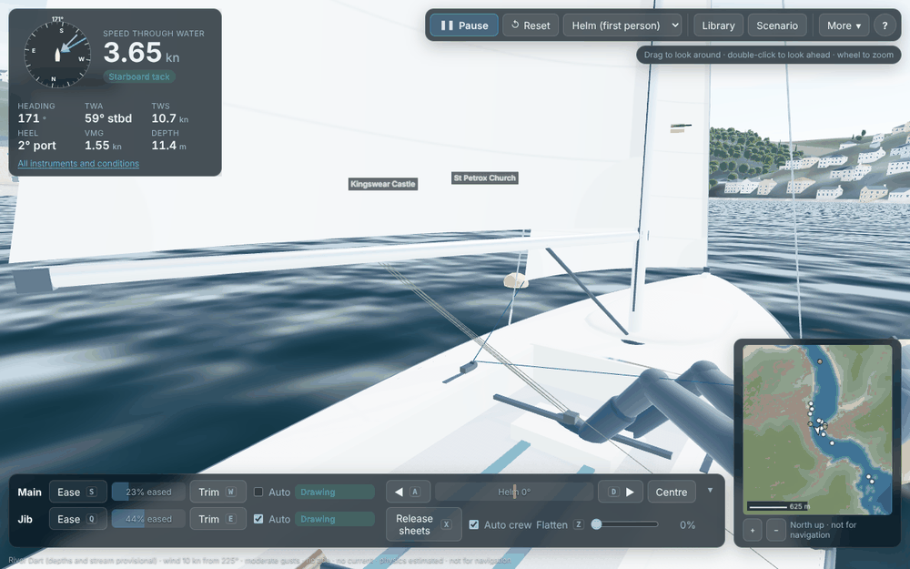 | 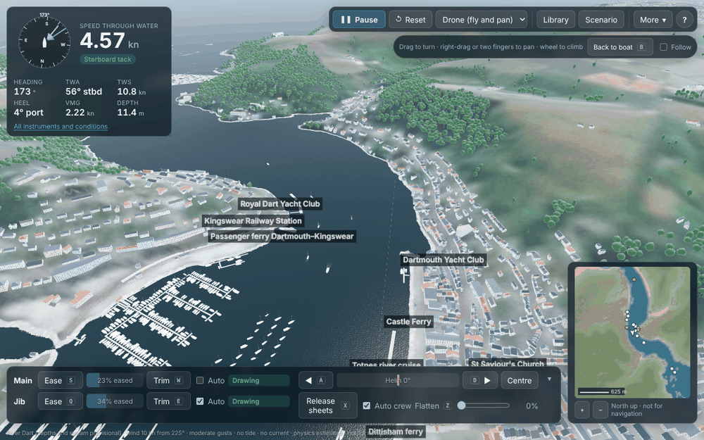 |

- **Drone** (src/render/scene.ts):
  - It takes off 140 m behind and 95 m above the boat.
  - OrbitControls with panning across the map (not the screen), from 10 m to 6 km away.
  - Never lower than 6 m above the ground or the water.
  - **Follow** carries it along with the boat; **Back to boat** (B) brings it back at the same height and angle.
- **Helm**: drag to turn the head, up to 150° either way and from 50° down to 60° up (src/render/frames.ts `HELM_LOOK`, a choice). Double-click to look ahead again. The wheel zooms from 68° to 20° of view.
- A quiet strip under the app bar says how to use each view.

## 3. Racing: competitors, conditions, the coach

| Quick race | The coach's briefing before a 16 kn start |
|---|---|
| 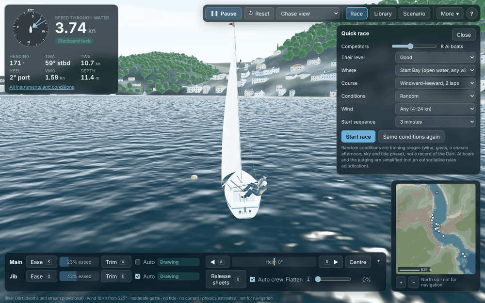 | 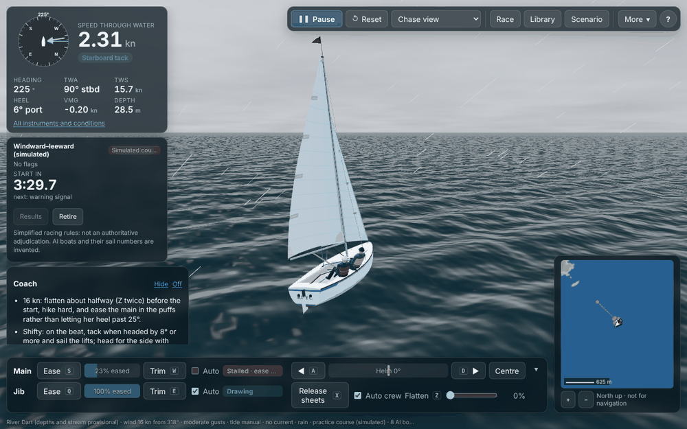 |

- **Quick race** (src/app/quickRace.ts, src/ui/QuickRacePanel.tsx):
  - 0–20 AI boats, at club, good or expert level.
  - In Start Bay (a windward–leeward or a triangle laid to the wind) or on the river (the Range course).
  - A 1-, 3- or 5-minute sequence. The last choices are remembered.
- **Random conditions** are seeded and reproducible:
  - wind speed in the chosen band, from any direction in Start Bay, or up or down the river within 25° for the river course;
  - gusts (stronger winds are more often gusty);
  - an April–September afternoon, the sky (never fog or mist), the tide's phase and its stream.

  They are **training ranges chosen for the app (E), not a climatology of the Dart**. The tide heights are the app's usual 4.6/1.2 m (E; Dartmouth's tables were not available, MISSING_INFORMATION E12).
- **Live now** uses the latest Met Office model run from the site's scheduled job. Here in development there is no live file, so the panel says so and uses random conditions.
- **The coach** (src/app/coach.ts, src/ui/Coach.tsx) runs alongside the race. It reads your boat twice a second and never changes the physics.
  - Its thresholds are **rules of thumb (E)**: overpowered past 30° of heel, a header 8° from a 90-second mean wind, a slow tack losing more than 35% of speed. They are not measured Squib data.
  - VMG is judged against the app's model polar, itself an estimate.
  - The coach never judges a rules question. Rules incidents come from the simplified judge, which is not an authoritative adjudication (RACING.md).
  - The coach can be turned off (Off, or More → Race coach).

Example debrief: the actual output for the unit test's scenario (a late start at the wrong end, a slow beat, one slow tack, a minute heeled past 30°, one incident):

> **Next time, work on** Start: At the gun you were 40 m behind the line at 2.0 kn. Aim to be within a length (6 m) at full speed.
> - ! **Start.** At the gun you were 40 m behind the line at 2.0 kn. Aim to be within a length (6 m) at full speed.
> - ! **Start.** The pin end was favoured by about 17 m; you started near the committee boat.
> - ! **Upwind.** Upwind you made 62% of the target VMG (model polar, E). Keep the boat flat, sail the target angle and avoid pinching.
> - ! **Boat handling.** 1 tack and 0 gybes, losing 60% of your speed on average. Turn more gently and build speed before pointing again.
> - • **Heavy air.** 59 s heeled past 30°, mostly with the sails not flattened: flatten (Z) before the breeze builds.
> - ! **Rules.** 1 rules incident (simplified judging, not an adjudication): keep a lookout and give room early.

Writing this example out showed two faults, both fixed and now tested:
- the heel threshold was printed as "29.999999999999996°";
- the coach praised "playing the shifts" in a race with no shifts.

## 4. Landmarks and the town

Sources (SOURCES.md L1–L8) were read through web search. The image hosts (Wikimedia Commons, Geograph, Historic England, britishlistedbuildings) and the clubs' and hotels' sites cannot be reached from the build environment, so no photographs were viewed directly. Where a description names a feature but not its size, the size is an estimate.

| | Before | After |
|---|---|---|
| **BRNC** | 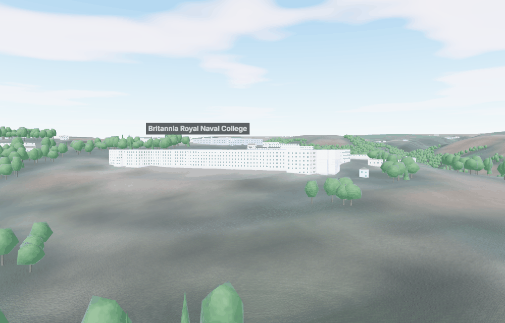 | 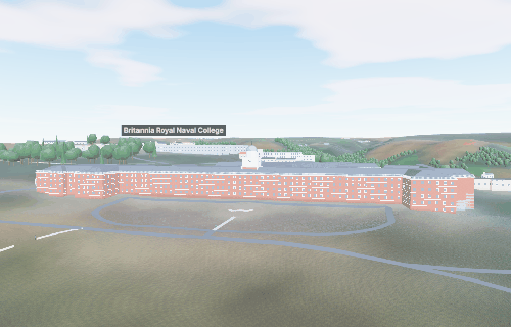 |
| **Dartmouth Castle and St Petrox** | 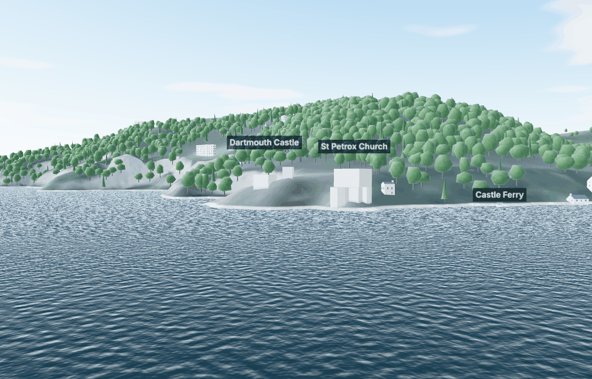 | 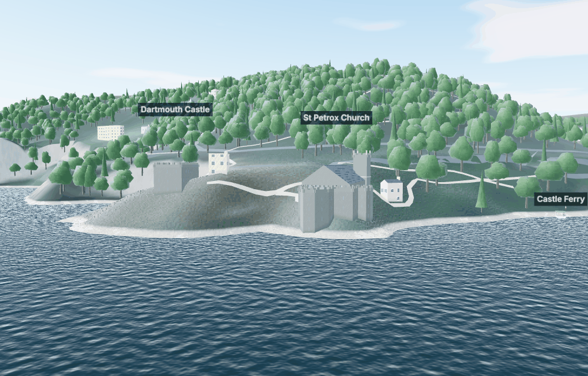 |
| **Kingswear: RDYC, the Royal Dart Hotel** | 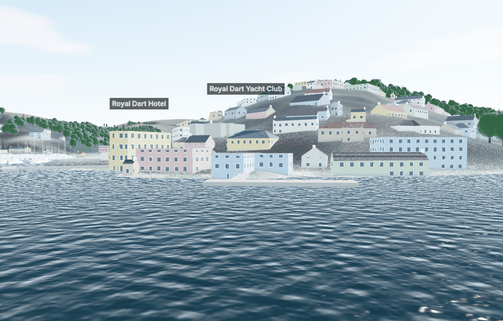 | 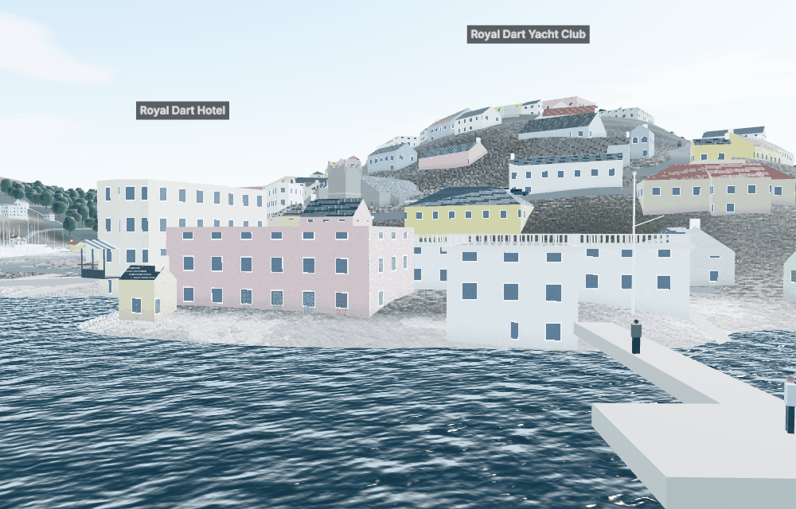 |

| Kingswear Castle | Dart Marina Hotel |
|---|---|
| 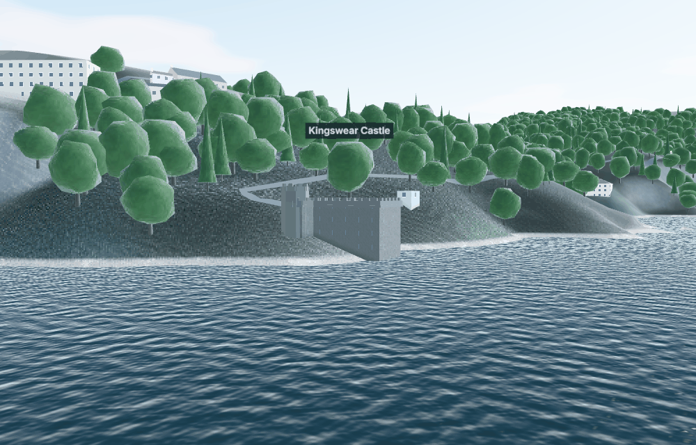 | 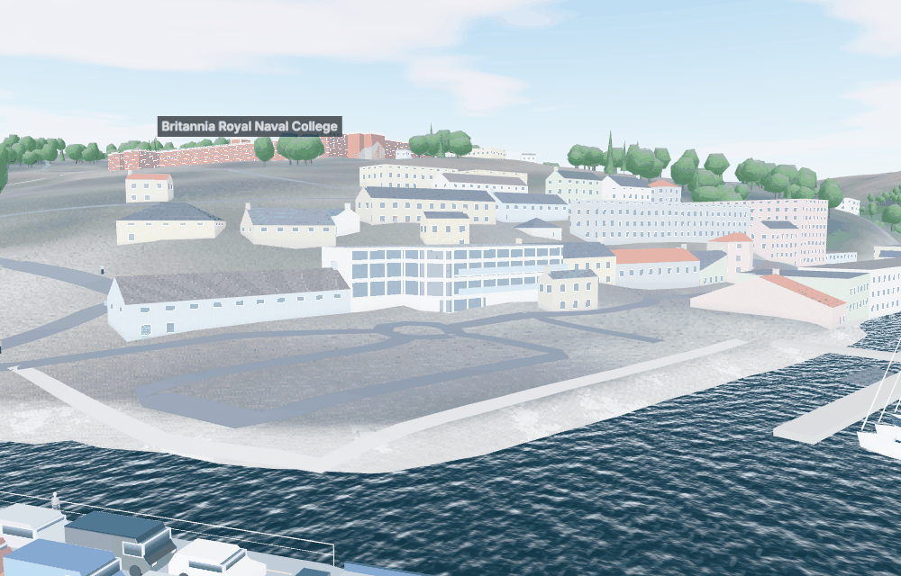 |

| Landmark | Source says | Drawn (src/render/landmarks.ts) |
|---|---|---|
| **Britannia Royal Naval College** (Aston Webb, 1899–1905) | Flemish-bond brick with Portland stone dressings, slate roofs; a central entrance block with a deep hipped roof and a balustraded parapet; long wings ending in pavilions with towers (Historic England 1208626, L1); a central clock tower (photographs, L2) | Brick walls with stone string courses, stone window surrounds, a stone cornice and balustrade. A slate roof sloping up round the ranges to a flat top at the data's height (the inset eases off at the narrow notches). The clock tower at the middle of the 150 m river front: brick with stone quoins, a stone clock stage with four faces, an octagonal lantern and a lead dome (proportions E). The pavilions' towers are not drawn (their positions are not established) |
| **Dartmouth Castle**, gun tower 1481 | A stone artillery tower; the church within its walls (L3) | Dark stone, slit windows, battlements |
| **St Petrox** (1641) | Two-stage west tower, round-arched windows (L3) | Stone; tall windows; a steep gabled nave; an embattled west tower with pinnacles and a string course between the stages, up to the data's height |
| **Kingswear Castle** (1491–1502) | Square on plan; corbelled, embattled parapet; octagonal stair turret on the north-west corner; slate rubble with red sandstone dressings (Historic England 1108543, L4) | Square tower, corbelled battlements, an octagonal turret rising 3 m above the roof on the round part of the footprint |
| **Royal Dart Yacht Club** (clubhouse 1881) | Purpose-built in 1881 (club history, L5) | Painted walls, cornice and balustrade, a flagstaff with a yard on the river front (from photographs' descriptions; size E) |
| **Royal Dart Hotel** (c. 1850, Italianate, Grade II) | River front with a wide splayed two-storey bay and a cast-iron balcony with a tented roof on thin iron columns (Historic England 1146644, L6) | Cream walls; a first-floor balcony on thin columns along the west front under a striped tented canopy |
| **Parish churches** (St Saviour's, St Clement's, St Thomas of Canterbury, St Peter's, St George's) | — | Stone, tall windows, a gable along the long axis, and a west tower (as most parish churches have; E) |
| **Dart Marina Hotel** | At Sandquay; rooms with river views, some with balconies (L7) | Its building found from the Overture place; white walls, glazing, balconies with glass fronts on the river (east) side |
| **Noss on Dart Marina** | Redeveloped by Premier Marinas (2016 on): marina, boatyard, café, commercial units (L8) | The buildings within 110 m of the marina are drawn modern: timber-coloured cladding, dark roofs, large glazing (E) |

**Generic buildings** get, from the shader (no extra geometry):
- **front doors** on some ground-floor bays where the ground is level, painted blue, green, red or black (E);
- **shopfronts** with a large window and a coloured fascia on the named buildings of the town streets;
- **tall church windows**, **castle slits**, and **BRNC's brick and stone**.

The previous "landmark stone" was bright enough to read as white; the stones are now darker.

**The ferry landings**: concrete slipways down the last 50 m at each end of the Lower Ferry (9 m wide) and Higher Ferry (12 m) crossings (widths E). People stand on the quays and the passenger-ferry and visitors' pontoons.

**Trees**: near trees have a crown of six overlapping lobes (a cloud of foliage) with soft shading, at the same triangle count as the old single ball.

**Satellite colours**: the 10 m summer image is hazy, so the hills read grey. A saturation and depth grade (×1.4 saturation, ×0.9 brightness) is applied to it. This is a visual choice, not data.

### Streets: roads, cars and people

| Dartmouth from above: roads, parked cars | The embankment: people on the jetty |
|---|---|
| 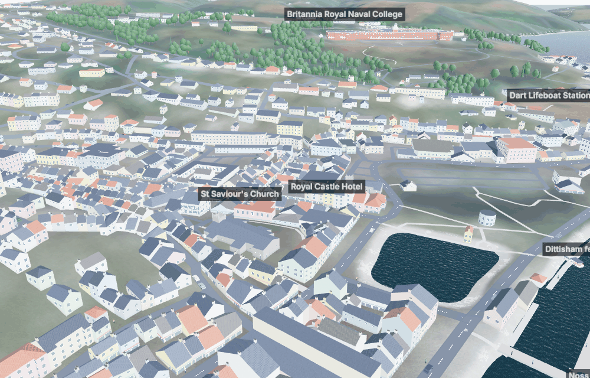 | 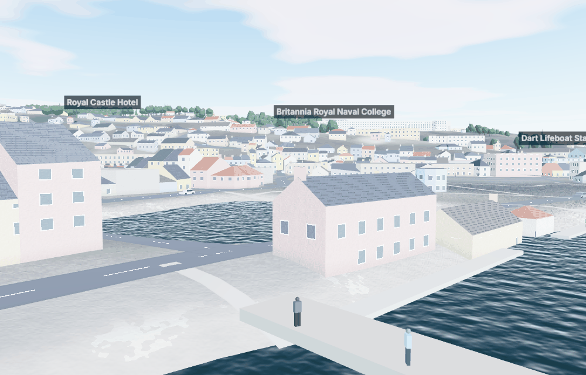 |

- **Roads** (tools/geodata/roads.py, public/geo/roads.json, 190 kB): OSM highways via Overture, simplified to 0.8 m. Drawn as ribbons on the ground (src/render/population.ts) in tarmac (main roads with dashed centre lines) or paving and gravel (paths). Widths by class (E).
- **Cars**: about 130 drive (50 on a software renderer), more on the main roads and in the towns, at 20–30 mph (E). They **keep left** and take a random road at each junction. About 600 are parked along the town streets, about one space in two (E).
- **People**: about 320 walk on footways, pedestrian streets, steps and town pavements; others stand on the quays (with the land) and on the pontoons (with the tide).
- At night only a quarter of the cars and 15% of the walkers are out (E).

### The whole harbour

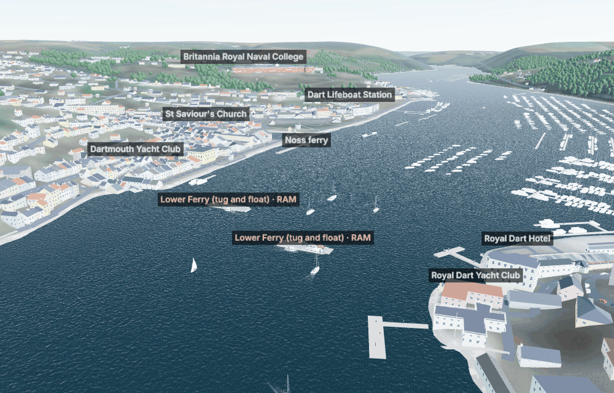

## 5. What else could make the river more real, free of charge

These would add measured detail rather than estimates. All are free, but they need access or work this build environment cannot provide.

| Option | Gives | Licence and cost | Blocker |
|---|---|---|---|
| **Environment Agency LIDAR, 1 m surface model (DSM)** | Measured roof shapes and heights, tree canopy, quays | Open Government Licence, free | `environment.data.gov.uk` is not reachable from the build environment (issue 67) |
| **Photographs of the landmarks**: Wikimedia Commons, Geograph (CC BY-SA) | Facade proportions, tower heights, colours; textures with attribution | Free with attribution | The image hosts are blocked here; allow `commons.wikimedia.org`, `upload.wikimedia.org`, `geograph.org.uk` |
| **Historic England list entries** (full text) | Exact descriptions: BRNC's towers and pavilions, Dartmouth Castle | Free | `historicengland.org.uk` is blocked here (search excerpts used) |
| **OS OpenMap Local / OS Open Roads** | Road widths and footpaths beyond OSM | OGL, free | Not checked against OSM yet |
| **Photogrammetry** (e.g. Meshroom, free) of the landmarks from the water | glTF models of BRNC, the castles and RDYC | Free software; needs photographs taken on the river | Needs photographs |
| **OSM contributions**: `building:levels`, `roof:shape`, `height` | Better heights and roofs everywhere, upstream | ODbL | Local survey |
| **Ambient occlusion and better anti-aliasing** (three.js GTAO/SMAA) | Contact shadows that make blocks read as buildings | Free (three.js) | Changes the render pipeline (the boats' stencil masking); on a fast GPU only. Not done (task 65) |

## 6. Tests

- **Unit tests:** 30 files, 258 tests, all passing. New:
  - `tests/sim/heavyweather.test.ts`:
    - flattening lowers lift and the centre of effort, cached by 1% steps;
    - it follows the control at the crew's pace and cuts heel on a reach at a small cost;
    - the auto main's ease and when it acts;
    - close-hauled in 20 kn, below 30° and dry;
    - no broach on a reach in 25 kn gusts;
    - AI flattening; the gusty preset is gustier than shifty; replays carry flatten.
  - `tests/sim/coach.test.ts`:
    - line bias and the briefing by wind, gusts, line, stream and fleet;
    - tips (overpowered once per repeat time, header, start calls, OCS);
    - the debrief's verdicts;
    - random conditions reproducible and in band (river winds along the river);
    - the quick race's scenario, including the live-data fallback.
  - `tests/render/cameras.test.ts`: the helm look direction and its limits, and the drone's floor.
  - `tests/render/landmarks.test.ts`:
    - every landmark matched to exactly one footprint, the named one where OSM names it;
    - BRNC's tower in its footprint;
    - the inset, simplify, long-axis and facing helpers;
    - every kind of addition built;
    - roads data and provenance; road surfaces;
    - cars keep left and face their way; model budgets.
- **Browser (Playwright):** 41 tests. New (`tests/e2e/redteam.spec.ts`):
  - a quick race with 3 competitors and the coach (off and on again);
  - the drone climbs, pans and comes back; the helm view looks round and back;
  - Z and Shift+Z flatten.

  The toolbar test now expects the Race button (7 buttons).
- **AI trials:** 95/100 clean (6–16 kn); a strong-wind trial was 19/20 clean (18–25 kn), every boat finishing.
- **Reference race hash:** `df0d92d410cf27e9`, deliberately changed (§1); deterministic.

## 7. Still open

New and updated issues are in OUTSTANDING_ISSUES.md (21, 35, 37, and 67–75). What would make them exact is in MISSING_INFORMATION.md:
- E10: Squib heavy-weather data;
- E11: landmark photographs and dimensions;
- E12: Dartmouth's tidal levels;
- E13: the coach's thresholds from coaches.
