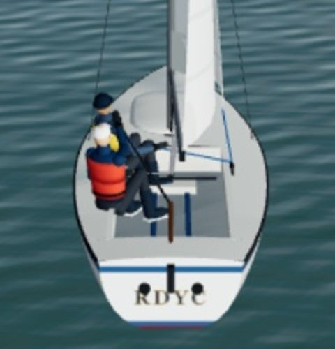
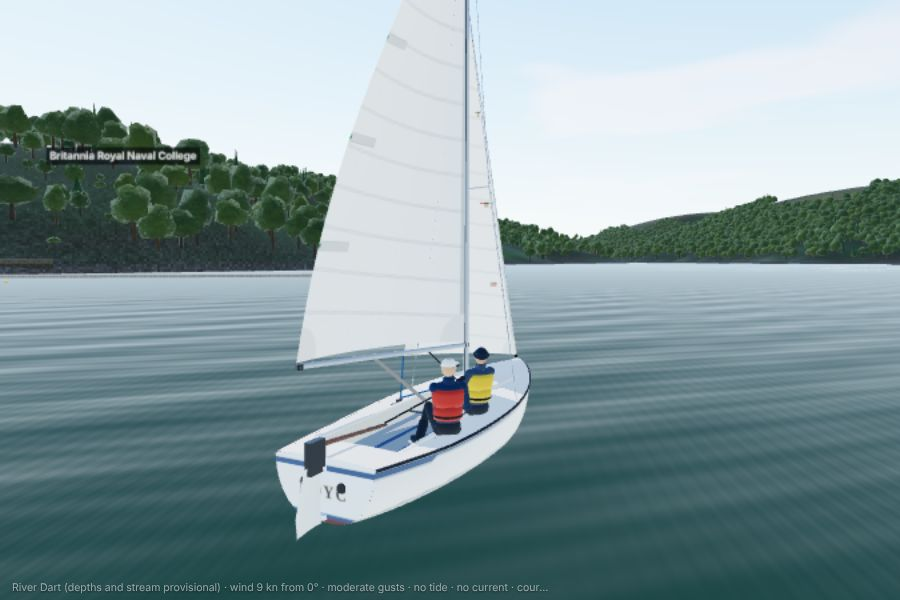
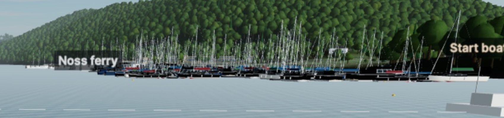
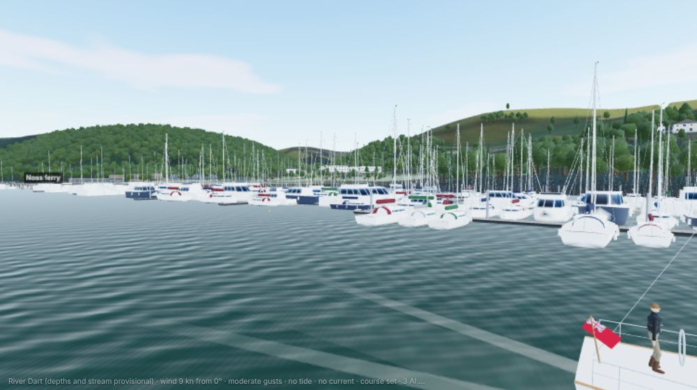
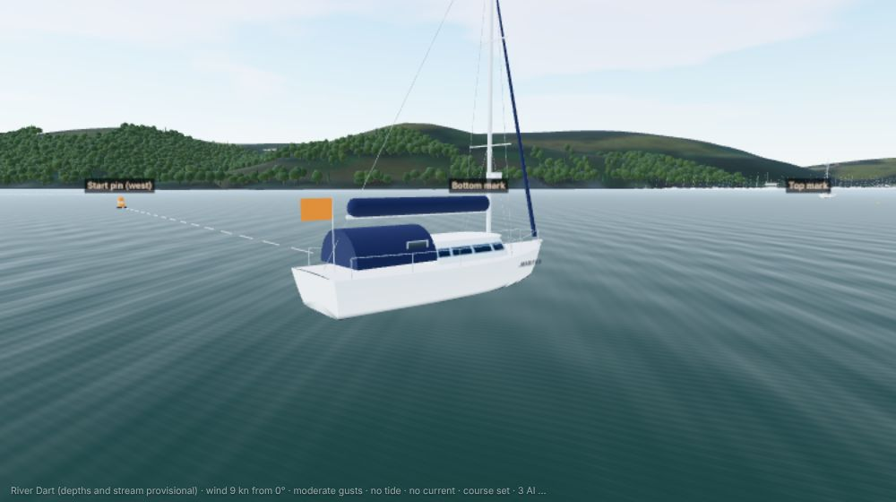
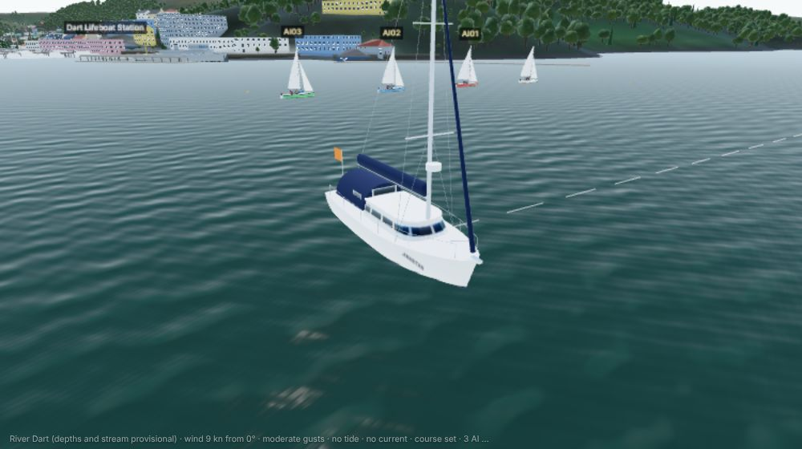
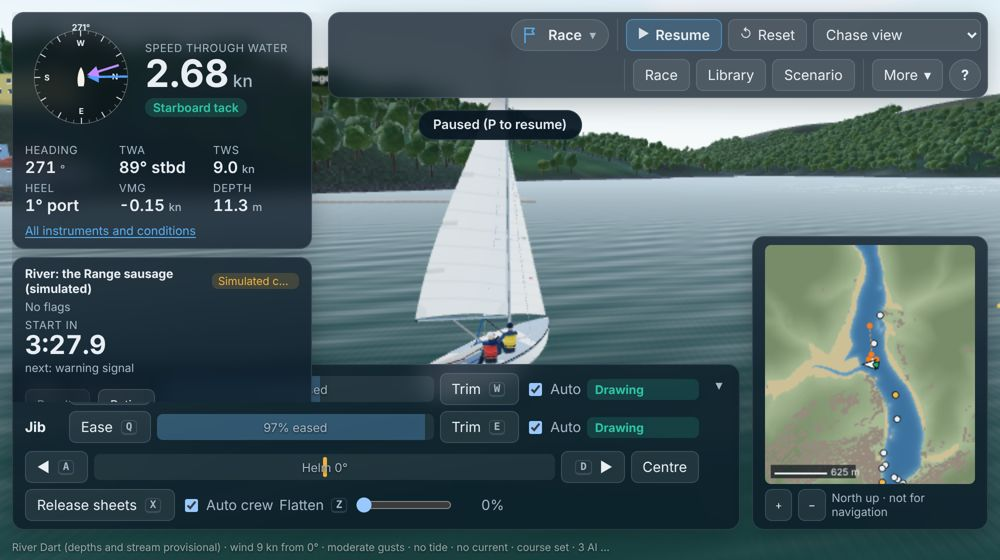

# Owner review of the river race (1–3 Nov 2026)

The owner asked for a thorough review, with a screenshot of the river race and a photograph of the club's committee boat:

1. The river race graphics are not correct, for example the Squib's rudder.
2. The boats in the marinas are black; they need to look like the real ones.
3. The committee (start) boat should be a Southerly named **SAMARITAN**, as the yacht with the blue canopy in the photograph.
4. Squib physics have stopped working in the river race.
5. The sim needs to deliver real-time weather and lighting.

**External services:** nothing new. Live weather is still the Met Office's public data on AWS (no key), fetched by the site's scheduled GitHub job (free tier). The job now publishes more of each forecast run.

## 1. The rudder (fixed)

**Fault:** from astern the Squib showed only a small dark stub on the transom. The model placed the rudder at the physics' rudder position, 2.75 m aft of the centre. That is 9 cm *inside* the hull (the transom is at 2.84 m), and the head's top was below the transom's top. So the hull hid the stock and head above the water, and the water hid most of the blade.

**Fix (`src/render/squibModel.ts`):** the Squib's rudder is transom-hung (sources R10). It is now drawn that way:
- **Blade:** hung on pintles and gudgeons 3.5 cm aft of the transom, widest around the waterline, its lower aft corner rounded, reaching 0.8 m below the waterline (the physics' rudder-heel contact point).
- **Head:** stands 0.2 m above the transom's top.
- **Tiller:** slopes down from the head over the aft deck to where the helm has always held it, so the helm's hand pose is unchanged (tested).
- **Physics:** only the drawing changed; the rudder's force still acts where it did.

| Before (owner's screenshot) | After |
|---|---|
|  |  |

## 2. Marina boats drawn black (fixed as far as could be tested here)

**Fault:** on the owner's graphics card the detailed berthed boats' painted hulls drew pitch black, while their sail covers (another material) and the plain far-off boats drew normally. On this machine's software renderer they draw white in every light tried: the owner's date, time and graphics preset, with the shadow cascades forced on. So the exact cause could not be reproduced. What separated the black boats from the white ones on the owner's screen was that they **received shadows**.

**Fix (`src/render/berthed.ts`, `src/render/vessels.ts`):**
- The berthed boats no longer take shadows, as the far-off ones never did. At marina distances the shadows added little.
- Every vessel built by the model kit now has its zero-length normals replaced (degenerate triangles at a stem; normalising them gives NaN on some graphics cards).
- **Realism:** most hulls are now white with coloured canvas: navy, burgundy, grey, green or blue. The odd navy or cream hull appears about one boat in six, as in the owner's photographs. Cruisers have a sprayhood in their canvas colour.

| Before (owner's screenshot) | After (this machine) |
|---|---|
|  |  |

Open: issue 113. Please check UAT 6.11 on the owner's own machine.

## 3. SAMARITAN, the committee boat (done)

The grey box at the line's end is now **SAMARITAN** (`src/render/samaritan.ts`), drawn from the owner's photograph:
- white hull with a navy boot top and sheer stripe;
- the deck saloon's long band of windows;
- the navy sprayhood and cockpit canopy, with its clear windows;
- a navy sail cover (stack pack) on the boom and a navy UV strip on the furled genoa;
- aluminium mast with two spreaders and a radome, solar panel on the coachroof;
- pulpit, pushpit and guard wires, bow roller with anchor;
- her name on both bows;
- the orange committee flag on a staff at the stern.

She lies at anchor head to wind (tested), and the "Start boat" label now sits above her mast.

**Size:** the photograph does not show her model. The Southerly 110's figures are used (10.82 m overall, 3.57 m beam, about 14 m air draft; sources R11), as an estimate (E). No public record of a Southerly named Samaritan was found. If you know her model, I'll set her size to it.

**Not changed:** the race physics still treat the committee boat as a 2.5 m circle at the line's end, so in the picture a boat could pass through her bow or stern (issue 111). Giving her a hull-shaped contact is a protected-engine change, proposed for a later round.

## 4. "Squib physics have stopped working" (investigated; no fault found in the physics)

These were checked, with evidence:

- **No change to the physics since 28 Oct**, and the determinism hash is unchanged.
- **The app runs the same physics as the test harness:**
  - with the same wind, course and auto-trim, the app's Squib sails at 3.19 kn and the harness's at 3.21 kn (4.3 kn of wind, 60° off the wind);
  - the force breakdowns match: main 37 N, jib 21 N, hull resistance −57 N against −58 N.
  - (My first comparison seemed to show half speed; it was a units slip in my probe, metres per second read as knots, and is corrected here.)
- **The physics is cheap:** about 0.3–0.4 ms per step in a river race (0.23 in free sailing), about 4% of one processor core in real time. The river race draws about the same as free sailing (about 345 draw calls). So it cannot slow the boat on a real computer.
- **The river race froze before 1 Nov.** The AI's traffic crash froze every river race within a few minutes (FIX_REPORT §1). The fix went live with PR 8 at 09:17 UTC on 1 Nov; a screenshot taken before then shows the old build.
- **Your screenshot was the live river race in very light, stale wind:**
  - the site's live forecast then was from 05:45–07:45 UTC (5.7 kn from 332° at the club), because GitHub ran the job only every 4–6 hours (see 5);
  - at 09:30 the race used the 07:45 values, and the land effect in the Range left about 3.7–4.3 kn at the boat;
  - in that wind the Squib reaches at about 2.5–2.7 kn, as the model polar predicts; close-hauled, at 38°, 1.26 kn is reasonable for a boat still gathering way.
- **In irons:** a Squib that stops head to wind slides astern and stays head to wind. With the helm held over she swings by sternway onto the other tack and lies there, nearly hove-to, until the helm is changed. In light air that can look as if the boat has stopped working. Real crews back the jib, which the simulator cannot do yet (issue 114, a proposal).

**What did you see?** If it was something else (the boat not moving at all, not answering the helm, or jumping), tell me what and when, and I'll reproduce it.

## 5. Real-time weather and lighting (done; the weather part needs the job to run)

**Live forecast:** the site's job is scheduled every 30 minutes, but GitHub has run it only every 4–6 hours. Each file held 2 hours of forecast, so for most of the day "live" weather was hours out of date.
- The job now publishes **8 hours**: 15-minute steps for the first 2 hours, then hourly (`tools/ingest/weather.py`; job time limit 15 minutes). About 117 files per run instead of 51.
- The app counts a forecast fresh while it covers now and the job ran within 8 hours (was 90 minutes, which made it "stale" between GitHub's runs).

**The app delivers it:**
- **At startup:** when the site's live forecast covers now and you have not started anything, the default free sail switches to it at this minute. The wind, gusts and sky (cloud, visibility, rain) are today's, and the sun stands where it really is: dark after sunset.
- **Quick race:** defaults to "Live now" when the site has it.
- **Settings → Light → Real time:** restarts now, in the live weather where the site has it, or the set wind at this minute where it has not.
- **Tide:** still none live (issue 110); the live river race says so.
- **Opting out:** the tutorial and library scenarios keep their own conditions; `?conditions=set` keeps the defaults (for tests).

**Needs:** the deployed site and its scheduled job. In development there is no live data, so the defaults stay.

## 6. Smaller faults seen in the screenshot (fixed)

- **"Paused (P to resume)" pill:** it sat under the toolbar when the toolbar wrapped to two rows. It now goes below the toolbar's measured edge, and below a camera strip if one shows.
- **Sheet readouts:** they read ")% easec" on a narrow dock. A narrow bar now shows the figure alone ("0%").
- **Mark labels:** the top mark's label printed over the bottom mark's when the two were in line. Each label now sits 0, 1 or 2 label heights up on the screen.

Seen here but not in the owner's screenshot: with this machine's fonts, at 1000 × 560 the dock wraps to three rows and covers the bottom of the race panel (issue 116, for Stage B).

## Tests and checks

| Check | Result |
|---|---|
| `tests/render/committee.test.ts` (4, new) | The rudder hangs outside the transom, its head above it, the blade 0.8 m deep; the tiller runs forward over the deck; SAMARITAN's size, mast and navy canvas; she replaces the box and lies head to wind |
| `tests/render/berthed.test.ts` (1 new) | No zero-length normals; no berthed boat takes shadows |
| `tests/sim/live-now.test.ts` (4, new) | Live conditions start this minute with the forecast's gusts and sky; an untouched session goes live; a started one never switches; a stale forecast is not used; "Real time" light |
| `tests/sim/live.test.ts` (updated) | A forecast that covers now is fresh 105 minutes after the job ran; silent for over 8 hours, it is stale |
| `tools/ingest/test_ingest.py` (1 new) | Forecast times: every 15 minutes for 2 hours, then hourly to 8 hours |
| The ingest against the Met Office's live data (run here) | UKV run 06:00 UTC on 3 Nov: 15 wind steps 10:00–18:00 UTC, 9 sky steps, 104 s; read by the app and fresh for its 8 hours |
| Unit and integration tests (Vitest) | All 372 pass |
| Lint, typecheck, build, secret check | Pass |
| Determinism hash | Unchanged (`11824f89f479d0f4`) |
| Screenshots | Rudder, SAMARITAN, the marinas and the river race at 1000 × 560 (×2), no page errors |

**Not tested:**
- **Real GPU:** nothing was checked on a real graphics card; the marina fix in particular needs the owner's machine (UAT 6.11).
- **Weather job on GitHub:** the new ingest was run here against the Met Office's live data (3 Nov 2026), but not yet as the scheduled job. Locally it fetched the 06:00 UTC run: 15 wind steps from 10:00 to 18:00 UTC and 9 sky steps, in 104 s. The app read the file and counted it fresh for all 8 hours, then stale an hour after its end. The first scheduled run after merging will show it on the site.
- **Browser tests:** CI runs them.
