# Training slice: a bounded improvement pass for two exercises

**Status: implemented; awaiting CI and the owner's review (draft PR).** The delta audit (§1–§3) was committed before any fix; §4–§10 record what was built and checked. Conventions follow [COMPREHENSIVE_REVIEW.md](COMPREHENSIVE_REVIEW.md) §0: claim types O (observed here), C (code), R (reference), H (hypothesis), P (preference); evidence levels L1–L6; severity S1–S4; confidence High/Medium/Low. New findings are numbered issues in [OUTSTANDING_ISSUES.md](OUTSTANDING_ISSUES.md) (198 onwards). Every new threshold in this pass is **provisional (E), awaiting instructor review**. Nothing in this pass establishes calibration, validation, instructional effectiveness or any accreditation.

Branch `training-slice`, from `hifi` at `d51c325` (which carries the unmerged rounds of 17 Nov 2026 on top of `main` at `8f86fb7`). Draft PR only; nothing is merged to `main` or published.

---

## 1. Baseline (17 Nov 2026)

### 1.1 Environment

| Item | Value |
|---|---|
| Machine | Cloud container, 4 vCPU Intel Xeon @ 2.10 GHz, 15 GB RAM, Linux 6.18 |
| Node / npm | v22.22.0 / 10.9.4 (the brief's baseline: Node 22.23) |
| Browser for tests | Chromium 141.0.7390.37 (Playwright 1.64.0), **SwiftShader software WebGL**; no real GPU, no physical device |
| CI | GitHub Actions, ubuntu-24.04 runners, no GPU (software rendering); browser tests split over four jobs |

### 1.2 Commands, on `main` at `8f86fb7` (a worktree) and on the branch base `d51c325`

| Check | `main` 8f86fb7 (here) | Branch base d51c325 (here) | The brief's baseline |
|---|---|---|---|
| `npm run typecheck` | Pass (15 s) | Pass | Pass (21 s) |
| `npm run lint` | Pass (7 s) | Pass | Pass |
| `npm test` | **89 files, 588 tests, all pass** (67 s on 4 CPUs) | 96 files, 632 tests, all pass (65 s) | 89 files, 588 tests (3 min 32 s on 2 CPUs) |
| `npm run envelope` | Written (5 s) | Written; **identical to main's** (diffed) | — |
| `npm run perf` (1 + 20 AI boats, full race, per 1/60 s frame) | 0.93 ms mean, 2.86 ms p99, 32.2 ms max (one frame, the start) | 0.91 ms mean, 2.59 ms p99, 24.4 ms max | Budget 3 ms |
| Golden traces | Pass (in `npm test`) | Pass | — |

### 1.3 Browser tests: from CI, as the owner asked ("rely on GitHub's test runs")

The local software renderer runs at 1–5% of real time, so the e2e suite (85 tests) is judged from CI, where each job has one browser.

| Run | Result |
|---|---|
| `main` 8f86fb7, push run [43744050970](https://github.com/DrDK3/SailSim/actions/runs/43744050970) (15 Nov) | **83 passed, 1 flaky, 1 failed.** Failed: `daylight.spec.ts:9` ("dark in real time…": the Settings menu item does not turn the daylight view off within 120 s, twice). Flaky: `roundB.spec.ts:51` (interface levels; passed on retry) |
| `hifi` 40692e5, push run 44083808740 | All passed (daylight.spec.ts passed) |
| `hifi` 40692e5, pull-request run 44083819534 | `daylight.spec.ts:9` failed twice again; a re-run was cancelled by a newer push |
| The brief's local failure: `a11y.spec.ts:16` (the Help dialog did not appear in 15 s at 1% of real time) | **Passed in CI** on `main` (37 s): a slow-renderer timing artefact, not a defect (O) |

`daylight.spec.ts:9` failing in some CI runs and passing in others on the same code is recorded as issue 202 (not established whether a defect or a timing artefact; outside both exercises).

---

## 2. Physics-trust checks

New tests in [`tests/sim/trustChecks.test.ts`](../tests/sim/trustChecks.test.ts) and a new tool, [`tools/exploit-search.ts`](../tools/exploit-search.ts) (`npm run exploits`). What each establishes is stated; **none establishes calibration**.

| # | Check | Result | Establishes |
|---|---|---|---|
| 2.1 | **Frame-rate independence.** The app's own frame loop (`SimController.frame`) at 60 fps, at 24 fps, and with irregular frames including 0.25 s and 1 s frames, topped up to the same step (3000) with the same held helm | **Bit-identical state** in all three (tolerance 0, same engine). Long frames are clamped to 0.1 s: simulated time is dropped (the "running slow" indicator, PH-5), the physics is unchanged | Numerical correctness of the fixed 0.01 s step and the accumulator |
| 2.2 | **Reproducibility.** Same scenario, gust seed and inputs, twice; then another seed | Same hash; another seed gives another hash. Cross-engine: within ~1e-13, not bit-exact (issue 17; replays detect and report divergence) | Numerical determinism on one engine |
| 2.3 | **Reference frames.** A boat in a 1 kn current with true wind W, against a boat in still water with wind W − current | Through the water the two are the same boat to 1e-6 (STW, heading, heel, AWA); over the ground they are 60 s × 1 kn apart; velocity over the ground = velocity through the water + current to 1e-9; heading ≠ COG | Numerical consistency of the frames: apparent wind over the ground, hydrodynamics through the water |
| 2.4 | **Through a tack.** Same helm at 1 kn and 4 kn; rudder hard over against centred at 4 kn; a tack from close-hauled in 10 kn | Turn in 2 s at 4 kn is more than 1.5× that at 1 kn (and between 5° and 120°); hard rudder for 6 s ends over 0.3 kn slower; the tack's minimum speed is between 25% and 90% of the speed going in, and the speed recovers to over 80% | Physical plausibility of direction and order of size only |
| 2.5 | **AI parity.** An AI boat's inputs recorded through the race, replayed into a plain `Simulation` from the same pose with the same environment | Same track to 1e-6 m; same `squibParams()` | AI acts only through the controls (the realism contract), with the player's parameters. RA-2 stands: the AI's *planning* knows the current along its track (information, not physics) |
| 2.6 | **Exploit search** (`npm run exploits`): helm oscillation ±0.3/±0.6/±1 at 0.1–2 Hz; sheet pumping ±0.15 every 0.5–2 s; auto-trim switched off and on every 1–5 s; upwind (made good to windward in 180 s) and on a beam reach, 10 kn steady | **No pattern beats steady sailing** (best steady upwind angle in the sweep: 38° TWA, 312.5 m in 180 s). Oscillation costs 1–28%; pumping 13–18% upwind; switching auto-trim off and on every few seconds costs **20–24% upwind**, which exposed issue 201 below | Absence of the tried exploits in the model (not in real boats) |

The table of 2.6 is written to `out/exploit-search.md` by the tool.

---

## 3. Delta audit (only what the two exercises touch)

### 3.1 The earlier observations O1–O9

| # | Observation | Status now | Evidence |
|---|---|---|---|
| O1 | Options' wind source disagrees with the instruments after a restart | **Confirmed (C).** `src/ui/ScenarioPanel.tsx:82` deep-copies the scenario; `:86` finds the source by object identity (`s.json === w.snapshot`), which never matches the copy, so it falls back to `manual`; `:87` does the same for tide. Issue 198 | Code; the brief's browser reproduction |
| O2 | Auto-trim on, sheet fully eased, status "Stalled" and Ease highlighted | **Confirmed (O, C).** `src/ui/Controls.tsx:135–136` calls `sailAdvice(state, keys)` without the sheet position or the auto-trim state; `src/app/sailStatus.ts:14–25` therefore asks for impossible actions. Reproduced headless: running at TWA 169° in 10 kn with auto-trim on, the main is 100% eased and shows "Stalled: ease out"; the jib shows "By the lee: gybe risk: head up" (advice about gybing for a sail that does not gybe the boat). It never says why a fully eased sail stalls (on a run a sail works by drag: eased right out it cannot draw). Issue 199 | Headless probe; code |
| O3 | Main "By the lee" at TWA 137° with the main sheeted 23% | **Confirmed (O, C).** `sailStatus.ts:7` calls any \|incidence\| > 90° by the lee. Reproduced: TWA 136°, AWA 115°, boom 21°, sheet 23% → incidence −94° → "By the lee: gybe risk: head up". The wind is not from the boom's side: the main is over-sheeted (stalled) and needs easing. `byTheLeeAngle` in `src/sim/boat/dynamics.ts:419` already tells the two apart. Negative-learning risk. Issue 200 | Headless probe; code |
| O4 | No live tide file; the published app starts with no tide or stream | **Explained, by design** (unchanged). The in-app text may say why (§7 of this report, if done) | — |
| O5 | No spinnaker controls | Tracked (PH-3, D2/D3, issue 67, Package 5). Out of scope; not added | — |
| O6 | One "Flat" control combines several adjustments | Tracked (issues 21, 67). **Its tooltip already says what it combines** (`Controls.tsx:222`: "cunningham, outhaul and kicker on, leech twisted open, to depower"); the label stays "Flat" (the console's fixed width) | Code |
| O7 | Coefficients labelled as estimates | Intended (L5). Kept | — |
| O8 | WebGL failed in one remote browser | Not established as a general defect. WebGL works here (SwiftShader) and in CI; context loss is handled (Package 1). No compatibility claim made | — |
| O9 | Earlier reviewers missed features | Noted: nothing removed or rebuilt for that reason | — |

### 3.2 Confirmed defects

| Issue | Finding | Where | Reproduce | Effect on the exercises | Sev | Conf | Type / Ev. |
|---|---|---|---|---|---|---|---|
| 198 | O1: wind (and tide) source shown wrongly in Options | `ScenarioPanel.tsx:86–87` | Restart with a Met Office replay; open Options: Source says Manual | Both: the instruments and the settings disagree on the active state | S2 | High | C (and O in the brief) |
| 199 | O2: advice asks for impossible actions, and to adjust a sheet auto-trim controls | `Controls.tsx:135–136`, `sailStatus.ts:14–25` | Run at TWA 169° with auto-trim on | Beginner: "ease" glows when nothing can be eased; teaches pressing keys that do nothing | S2 | High | O, C |
| 200 | O3: an over-sheeted main is called "by the lee: head up" | `sailStatus.ts:7` | TWA 136°, main sheeted 23% | Beginner: wrong cause and wrong action (negative learning) | S2 | High | O, C |
| 201 | **New.** Switching auto-trim off (M, J or the Auto box) drops the sheet to the last manual setting: the sheet jumps (e.g. from fully eased on a run to 30%) | `controller.ts:2394–2395`, `Controls.tsx` Auto checkbox; `Simulation.currentSheet` uses `input.mainSheet` once auto is off | Sail with auto-trim on, change course, press M | Beginner, "repeat with reduced assistance": taking the sheet over stalls or overpowers the boat at once; the exploit search shows the cost (20–24% upwind when toggled every few seconds). The sheet keys already take over smoothly (`controller.ts:2061–2066`) | S2 | High | O (headless), C |
| 202 | `daylight.spec.ts:9` fails in some CI runs (main 8f86fb7; PR run of 40692e5) and passes in others on the same code | `tests/e2e/daylight.spec.ts:46` | CI | None directly; CI on `main` is red | S3 | Medium | O (CI). Not established whether a defect or a timing artefact |

### 3.3 Existing features that need improvement

| Area | What exists | What the exercises need | Ref. |
|---|---|---|---|
| Lessons | Nine lessons (`src/app/lessons.ts`); a step engine with goals, hold times and one static `hint` per step (`src/app/tutorial.ts:59–81`); lesson 4 ("turns") times two tacks against the model's reference tack | Graduated help (attend → explain → suggest → explain the result), each level logged; an assistance record per attempt; a result card that separates assisted completion from independent performance; variation (tack and heading from a seed); a short control familiarisation step not scored as sailing | U9, issue 47 |
| Thresholds | Embedded in each step's goal (e.g. close-hauled TWA 38–55° at ≥ 2.5 kn; `lessons.ts:105–112`) | One configurable, labelled table (provisional, E) | Issue 47 |
| Assistance | Auto-trim main and jib, auto crew, flatten (`ControlInput`); the interface level (`src/app/level.ts`) changes **only defaults of the interface** (overlay, coach, dock), not assistance; lessons set `AUTO` inputs | The realism contract's "Learn" assistance level is approximated by the lessons' inputs; record what was on and for how long | Contract §1; D2 |
| Sail status | Four states (`sailStatus.ts`) | Actionable advice: aware of sheet limits, auto-trim and which side the wind is on | 199, 200 |
| Debrief | Track map coloured by speed, tacks and gybes costed in seconds (`src/app/sailLog.ts`, `src/ui/DebriefPanel.tsx`); a race coach with rules of thumb (issue 68) | A few observations kept apart from inferred cause, one next practice action, the assistance used, and for the tactical exercise a counterfactual | Issue 68 |
| Replay and ghost | Bit-exact replays with take-over; ghost racing from a replay (`src/app/ghost.ts`); share links (`src/app/shareLink.ts`) | Re-run from a decision point with the other choice, both tracks shown | RA-4 |
| Telltales and luffing | Jib telltales drawn (`src/render/squibModel.ts:407–413`) from the simulation's flow; sail luffing drawn and heard (`src/render/audio.ts:109–111`, flutter from `luff`) | Readable at the default camera; the same state as the instruments (to be checked) | — |
| Sound | Water rush from STW (`audio.ts:105`), sail flutter from luff | Assertions that the settings track the simulation values | GR-6 |

### 3.4 Missing capabilities

| Missing | Where it would go | Note |
|---|---|---|
| A scripted, deterministic wind shift (the wind has seeded Ornstein–Uhlenbeck shifts and a persistent trend only, `src/sim/env/wind.ts:150–160, 220`) | An isolated environment input; `timeSteppedBase` (`wind.ts:245`) already blends base winds in time | Must not change any boat physics |
| A counterfactual re-run from a decision point | Built on replays (bit-exact, same engine) | — |
| Exercise attempt records (assists, hint levels) that export and import | Browser storage with try/catch, as `shareLink.ts` and the lessons' progress | No server (contract) |
| Key remapping | `controller.ts` KEYMAP is static | Gap, unless cheap |
| axe-core | Accessibility has been checked with custom Playwright probes (review §0: cdnjs was blocked) | `@axe-core/playwright` as a dev dependency if justified |

### 3.5 Unverified hypotheses

| # | Hypothesis | How to test |
|---|---|---|
| H1 | The model points high (issue 16; the brief's PH-10). The exploit search's sweep put the best steady made-good angle at 38° TWA in 10 kn with the autopilot holding TWA (this sweep includes leeway: TWA is measured from the heading) | Sailors' tacking angles (validation B1.5); the tactical exercise's sensitivity check (§8 of this report) |
| H2 | `daylight.spec.ts:9`: a timing artefact of dispatched clicks under a fixed page clock (issue 202) | Investigate in CI with traces |
| H3 | Telltales, luffing and sound are readable and consistent at the default camera on real devices | Real GPU and device checks (none here) |
| H4 | Beginners can tell the jib's telltales from the sail-state pills | The validation protocol (§12) |

### 3.6 Questions for sailors and instructors

1. Do instructors teach "recognise luff → bear away or trim" before or after the first tack? What order for this exercise?
2. What speed recovery after a tack would an instructor accept from a beginner in a keelboat, and in what time?
3. When the wind heads by a few degrees on a short beat, what do instructors teach beginners to do, and from what size of shift?
4. Is a shift overlay a help or a crutch? Should it fade out with progress?
5. Does "Stalled" mean anything to beginners, or should the console speak of "sheeted too hard" and "eased too far"?

---

## 4. Fixes (five §6 repairs, each with a test that failed before it)

| # | Issue | Kind | Commit | What changed | Regression test (failed before, passes after) |
|---|---|---|---|---|---|
| 1 | 198 (O1) | Presentation | `4cbb4ba` | Options finds the weather and tide files by their contents (`src/app/sourceMatch.ts`), not object identity | `tests/sim/sourceMatch.test.ts` (2 of 3 failed before); `tests/e2e/training.spec.ts` "issue 198" (showed "manual" before) |
| 2 | 199 (O2) | Presentation | `70cca2b` | The advice knows the sheet's position and auto-trim, and names its action (`trim`, `ease`, `helm`, `none`); Trim and Ease glow only for that action; the race coach's trim tips and the debrief's poor-trim time skip a main already eased right out or hard in | `tests/sim/sailAdvice.test.ts`: probe states and a seeded property sweep (120 states × 2 sails) of the three rules (never past an end stop; never a sheet auto-trim is setting; never contradicting the state shown). All 8 failed before |
| 3 | 200 (O3) | Presentation | `70cca2b` | "By the lee" only when the wind comes from the sail's own side (the boom dynamics' test); otherwise an airflow beyond 90° is a stalled, over-sheeted sail: "ease out" | Same file: TWA 136°, main 23% → "Stalled: ease out (S)" (was "By the lee: gybe risk"); real by-the-lee still reported (a guard, not a regression) |
| 4 | 201 | Control input (app layer) | `4e0da08` | Turning auto-trim off (M, J, the Auto box, a lesson step) hands the sheet over at auto-trim's setting, as the sheet keys did | `tests/sim/handOver.test.ts` (3 of 4 failed before; the 4th is a guard). Exploit search: toggling auto-trim now costs **0.0%** (was 20–24% upwind) |
| 5 | 203 (new) | Presentation | `653e288` | Sound that cannot start (no AudioContext can be made) leaves the app silent instead of throwing on every key press | `tests/sim/soundCues.test.ts`: a failing AudioContext, and a key press that still steers (both failed before) |

Not a §6 repair, but recorded: **issue 204** (dock buttons' accessible names did not contain their visible text) was fixed as part of §9's accessibility work when axe-core flagged it. Strictly it is a sixth change to existing behaviour; the names are unchanged and it is easy to drop if the owner prefers. **Issue 202** (`daylight.spec.ts` flaky in CI) was not investigated further: it does not touch the exercises.

## 5. Beginner exercise: trim, tack and recover

Built on a new exercise engine (`src/app/exercises/engine.ts`) and the lessons' step model; the exercise is `src/app/exercises/tackRecover.ts`, listed with the lessons and in Settings, and opened directly by `?exercise=tack-recover`.

| Requirement (§7) | As built |
|---|---|
| Steady preset, no stream, fixed seed, manual wind, Learn assistance | Start Bay open water, 10 kn from 225°, gusts "steady" seed 1, no current; attempts 1–2 with auto-trim, overlay and help that comes by itself |
| Close-hauled → cues → tack → course and speed → repeat with less assistance | Four phases per attempt: close-hauled (TWA 38–55° at ≥ 2.5 kn, sails drawing, 5 s); the cue (head up until a sail luffs, back to drawing, 2 s); the tack (as lesson 4 times it); recover (course and 80% of the speed going in, 3 s). Four attempts: full assistance ×2, main sheet in hand, then both sheets with no overlay and help only on request |
| Alternate port and starboard, seed-varied heading | Starboard, port, starboard, port; each from a close reach at 70° ± 12° TWA from the seed (`tackRecoverPlans`) |
| Graduated help, every level logged | Look (attention: the part of the screen is outlined) → Why (explain) → Try (suggest an action) after 10 / 20 / 30 s stuck, or on request; level 4 is the review after each attempt. Every level shown is logged with attempt, phase, problem and time. The suggestions for sheets come from the fixed advice (§4), so they are always actionable |
| A well-performing learner gets no level-3 help | Tested: a scripted learner completes all four attempts with **no level-3 help** and the last attempt independent |
| Per-attempt assistance record; result card splits assisted and independent | `{ autoMain, autoJib, autoCrew, overlay, liveHelp }` per attempt; **independent** = no auto-trim on either sail, no overlay and no live help at any time (auto-crew allowed). The result card reports the two groups apart, with an attempts table |
| Configurable thresholds, provisional (E), from issue 47 | `data/exercises/thresholds.json`: each value with unit, tag E and source (issue 47's 38–55°, 2.5 kn, 5 s, 35° and 1 kn among them). An instructor can load a thresholds file for a browser; results then say so |
| 30-second control familiarisation, not scored | "Try the controls (not scored)": 30 s, then the first attempt starts afresh (or press Start) |

A finding while building it: with the helm let go, the model's boat rounds up from TWA 72° to about 45° in about 15 s, so a learner who does nothing "finds" close-hauled. The help-escalation test therefore holds the boat across the wind. Recorded as **issue 205** for Squib sailors (validation T4.4).

## 6. Tactical exercise: respond to a wind shift on a short beat

`src/app/exercises/windShift.ts`, opened by `?exercise=wind-shift`. A 600 m beat to a mark straight upwind of the Start Bay start, starting on starboard; a 15° backing shift (a header on starboard) after 60 s, arriving over 20 s, held 90 s, turning back over 20 s. The shift is an **environment input only** (`scriptedShiftBase`, commits `c3bd45d` and `9eb1d8b`): no boat physics, coefficient or gust-statistics change; scenarios without a shift build exactly the wind they did before (tested), and the determinism hash is unchanged.

**Why a shift that returns (a deliberate, flagged departure from "one scripted shift").** Model demonstrations (the autopilot, 42° pointing, sailing one rule each from the same start) gave:

| Shift | Beat | Tack on the header | Hold to the layline | Better (in this model) |
|---|---|---|---|---|
| persistent −15° | 400 m | 209.5 s | 206.7 s | hold, by 2.8 s (one tack fewer) |
| persistent −15° | 600 m | 321.6 s | 320.1 s | hold, by 1.5 s |
| temporary −15°, held 60 s | 400 m | 220.0 s | 226.4 s | tack, by 6.3 s |
| temporary −15°, held 90 s | 400 m | 212.9 s | 209.5 s | hold, by 3.4 s |
| **temporary −15°, held 90 s** | **600 m** | **329.5 s** | **359.3 s** | **tack, by 29.8 s** |
| temporary −20°, held 90 s | 400 m | 208.5 s | 223.2 s | tack, by 14.7 s |

After a persistent shift any path inside the new laylines takes about as long, so the decision barely matters there (issue 206); a shift that comes back is where tacking on the header pays. The exercise uses the bold row.

| Requirement (§8) | As built |
|---|---|
| One short beat, one deterministic scripted shift, isolated and tested | As above; `tests/sim/scriptedShift.test.ts` (6 tests) |
| Compass, heading history, removable Learn shift overlay | The compass (instruments); a heading history in the card (a header shows as a step, with its range in words); with the overlay, the wind arrows and a readout "wind from 210° (15° left of the start)". Unticking Overlay removes both (e2e) |
| Optional prediction | Before the first attempt: tack / hold / not sure, or skip; the review compares it with what was done, without judging it |
| Debrief separating decision quality from outcome, with a counterfactual | The **decision** (did you tack within 30 s of the shift?) is judged against model demonstrations of both rules from the same start ("in this model … reached the mark N s sooner"); the **outcome** (your time) is compared with the demonstration of the *same* decision, so the difference is the sailing, not the decision. A map shows your track and both demonstrations, labelled in words and dash patterns |
| Pointing sensitivity through calibration multipliers, test harness only | `npm run shift-sensitivity` (`src/app/exercises/sensitivity.ts`, `tests/sim/exerciseWindShift.test.ts`): |

| Variant | Tack on the header (s) | Hold (s) | Better | Margin (s) |
|---|---|---|---|---|
| as calibrated (42° pointing) | 329.5 | 359.3 | tack on the header | 29.8 |
| sail lift × 0.85 / × 1.15 | 335.6 / 327.7 | 366.2 / 357.6 | tack on the header | 30.6 / 29.9 |
| friction × 0.85 / × 1.3 | 322.3 / 344.4 | 350.8 / 377.7 | tack on the header | 28.5 / 33.4 |
| wave resistance × 0.7 / × 1.5 | 314.9 / 352.4 | 342.1 / 387.6 | tack on the header | 27.1 / 35.1 |
| righting × 0.8 / × 1.2 | 331.3 / 328.5 | 361.5 / 358.1 | tack on the header | 30.3 / 29.6 |
| pointing 38° / 48° | 327.5 / 348.1 | 351.3 / 393.5 | tack on the header | 23.7 / 45.4 |

**The better choice did not flip in any variant.** It is still model output; the exercise says "in this model" throughout, and validation question T3.13/T4.5 asks instructors and sailors. **Opponents (optional) were not added**: the demonstrations are labelled "model demonstration", not boats (issue 209).

## 7. Controls, feedback, graphics and sound (§9)

| Requirement | As built | Evidence |
|---|---|---|
| Console modules (main, jib, helm, boat) do not move during a tack | Already true; now asserted | e2e: bounding boxes identical (to 0.5 px) at 12 steps through a tack and after, with auto-trim on and off |
| User vs assist control; requested / underway / complete; actionable advice; pause / inspect / restart / repeat | The sail status says when auto-trim is setting a sheet; Trim and Ease glow only for an actionable step (§4); each exercise phase shows "Waiting for you…" (requested), the hold bar (underway) and "✓ Done" (complete); P pauses; Reset restarts the attempt; the review, the map and "Your sail" inspect; Repeat restarts the exercise | unit and e2e tests above |
| Assists independently adjustable; the same inputs give identical physics across modes | Auto main, auto jib, auto crew, overlay and help are separate; levels, overlay, coach, hints, labels, the physics panel and force arrows change nothing in the state | `tests/sim/modesSamePhysics.test.ts`: the same state hash in all 10 modes |
| Accessibility | Help levels named in words (Look / Why / Try), not colour alone; tracks labelled and dashed; heading history and map have text alternatives; axe-core (WCAG 2 A/AA rule tags) on the exercise card in every state and on the dock: no violations after issue 204's fix | `tests/e2e/training.spec.ts`; `@axe-core/playwright` added as a **dev** dependency (`npm audit` count unchanged at 13, all pre-existing) |
| Audio/visual equivalents | Every exercise cue is visual (status pills, help text, heading history, review); the sound cues (wind, flutter, rush, boom) each have a visual: the apparent wind readout, the sail status, the speed, the boom on screen | as before |
| Key remapping | **Not done** (a gap, issue 207): not cheap in the static keymap | — |
| Three removable layers; removing overlays does not break the exercises | Natural cues (always); teaching overlays (the Overlay box, Settings → Teaching overlay); diagnostics (physics panel, force arrows, Expert level) | Both exercises complete with the overlay off (unit and e2e) |
| Sound tracks the simulation and fails gracefully | Asserted on the Web Audio settings (a fake AudioContext): wind gain rises with apparent wind, flutter only for a luffing sail and faster in more wind, rush with speed, silence when paused. **No listening test was done** | `tests/sim/soundCues.test.ts`; issue 203 |

## 8. Debrief and instructor support (§10)

- **Exercises:** after each attempt a review of a few items, each with the observation, its likely cause and what to try next; at the end, at most three observations and one next action, assisted and independent apart. Rules only (no free-form or generated text).
- **"Your sail" (every sail):** a new "What we saw" section from the sail log (`debriefNotes` in `src/app/sailLog.ts`): at most three observations, each apart from its likely cause, and one next action (start, then tacks, then gybes; thresholds 5 s, 6 s, 10 s, E). `tests/sim/debriefNotes.test.ts`.
- **Instructor support:**
  - repeatable set-up and a link (`?exercise=tack-recover`, `?exercise=wind-shift`: fixed seed, wind and headings);
  - the model demonstrations, labelled as such;
  - assistance visible per attempt;
  - each attempt saved as a replay file that plays back bit-exactly (tested);
  - learner records saved to and loaded from a file;
  - thresholds saved to, changed in and loaded from a file, for one browser ("For instructors" under the exercises).
  Nothing is uploaded; records live in the browser (wrapped in try/catch) and in files the user saves.
- **Content status:** all draft, shown on every exercise card and result.

## 9. Verification (§11)

Machine: cloud container, 4 vCPU Xeon 2.1 GHz, Node 22.22, Chromium 141 with **SwiftShader software WebGL (no GPU)**. CI: GitHub Actions ubuntu-24.04, software rendering, browser tests in four shards.

| Check | Result |
|---|---|
| `npm run typecheck`, `npm run lint` | Pass |
| `npm test` (Vitest) | **106 files, 690 tests, all pass** (baseline on the branch base: 96 files, 632). New: 10 files, 58 tests |
| Physics unchanged: determinism hash (the 400 s race with 6 AI boats) | `11824f89f479d0f4`, unchanged after every commit |
| `npm run envelope` | **Byte-identical** to the baseline (`envelope.json` and `envelope.md` diffed) |
| Golden traces (`npm run golden:update`) | Regenerated rows **identical**; only the files' `generated` date changed, so the files were left as they were |
| `npm run perf` (per 1/60 s frame) | Physics only, 21 boats: 0.48–0.59 ms mean, 1.20–1.49 ms p99 on baseline and branch alike. Full race, 1 + 20 AI: baseline 0.95–1.45 ms mean, branch 0.86–1.27 ms; **p99 2.54–3.67 ms on both** (the race start crosses 3 ms on the unchanged baseline too on this shared machine). Alternated runs, same machine: no regression attributable to the branch; no physics code changed |
| Exploit search | No pattern beats steady sailing; toggling auto-trim now costs 0.0% (was 20–24%) |
| Wind-shift sensitivity | The better choice holds in all 11 variants (§6) |
| E2E, new (`tests/e2e/training.spec.ts`, 6 tests) and the dock (3), one worker, here | **8 of 8 pass** (9.7 min): issue 198; the beginner exercise through the instructor link; the tactical exercise; layout stability through a tack; axe-core on every exercise state and the dock |
| E2E, all specs, CI | See the PR's checks. The only failure on this branch's runs so far is `daylight.spec.ts:9` (issue 202), which fails the same way on `main` (8f86fb7) and does not touch the exercises. A local run of the older smoke specs under parallel load timed out twice on the 90 s local limit (course editor, practice start): slow software rendering, not a defect; CI gives 180 s and one worker |
| State machines | Restart during a tack; pause during a review; Reset restarts the attempt; starting anything else ends the exercise (unit tests) |
| Reproducibility | Frame-rate independence and seeds (trust checks); an exercise attempt saved as a replay plays back to the identical state hash |
| Assistance recorded | Per attempt, and the independent attempt classified correctly (unit tests) |
| Advice property test | 120 seeded states × 2 sails, three rules (§4) |
| Instruments and settings agree | Issue 198 e2e (the Options source and the instruments); same physics in every mode (unit) |
| Audio | Web Audio settings asserted against a fake AudioContext; **no listening test was done** |
| Claims grep | No RYA, accreditation, "validated" or "realistic" claim in anything this branch adds (only its disclaimers and the content-status type, whose values include one, "empirically-validated", that no content has) |
| Reviewer pass | Not done (no second reviewer available in this session) |

**Screenshots** (fixed seeds; **software rendering only: no real GPU**, so colours, shading and frame rate on real devices are not shown):

| | Laptop 1280×800 | Phone 390×844 |
|---|---|---|
| Beginner, help level 3, overlay on | 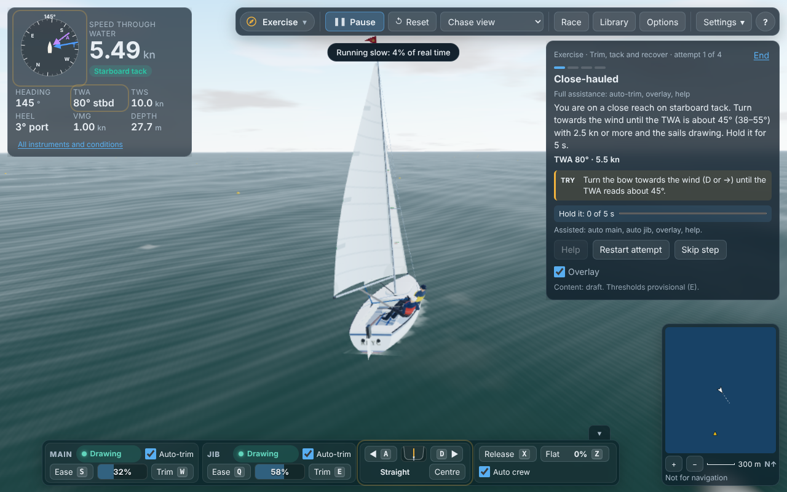 | 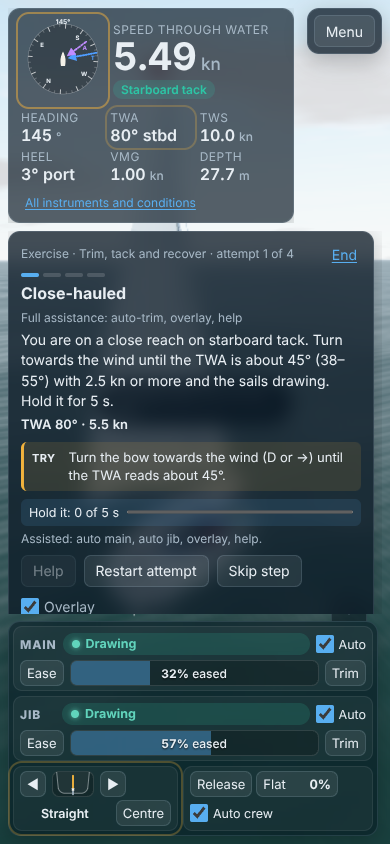 |
| Beginner, overlay off | 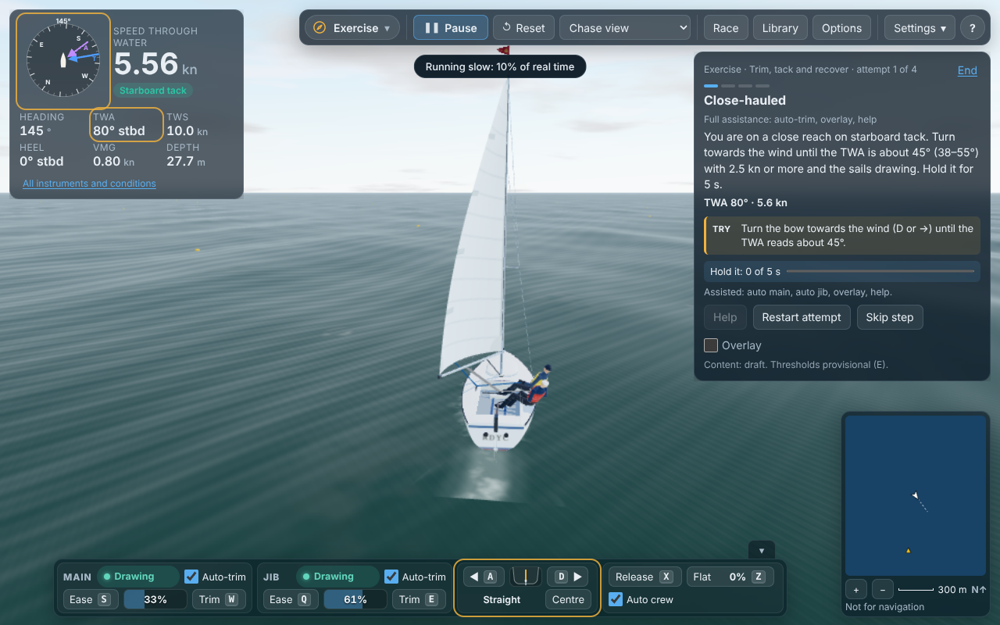 | 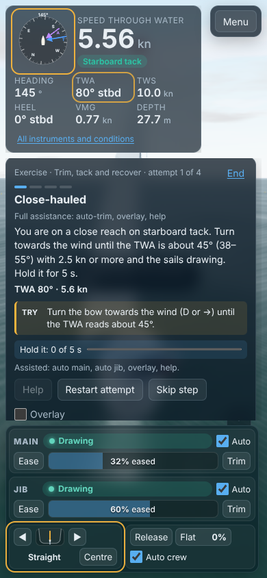 |
| Tactical, into the shift, overlay on | 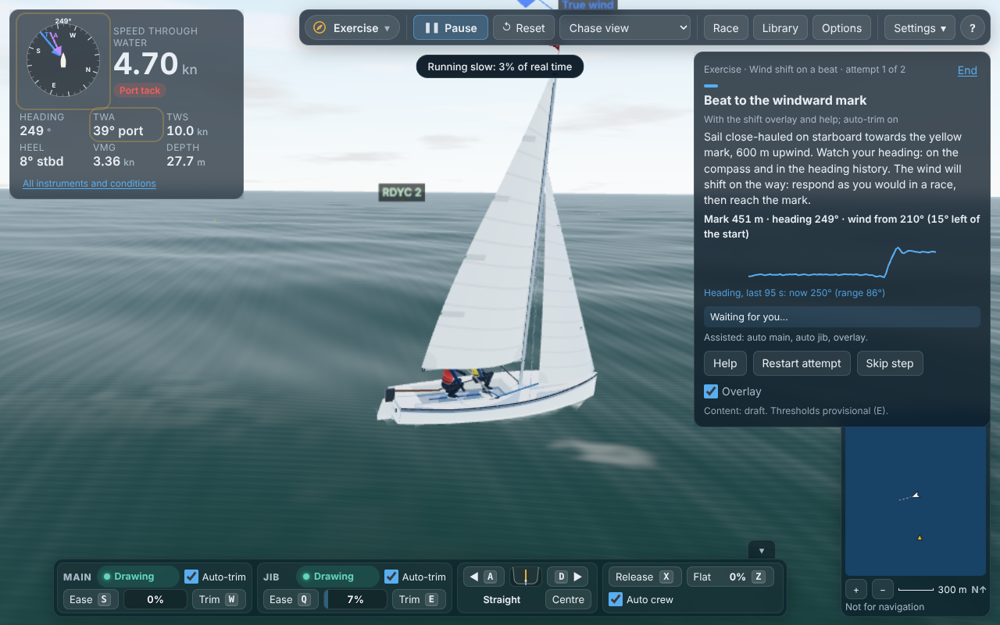 | 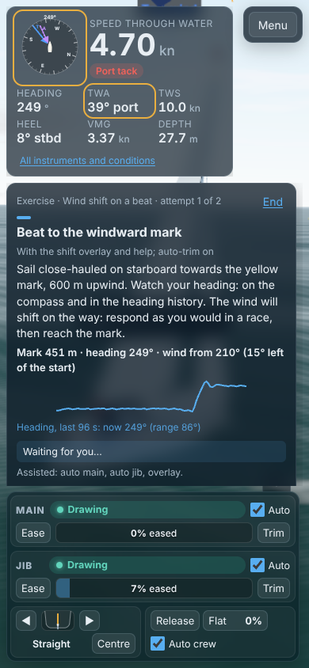 |
| Tactical, overlay off | 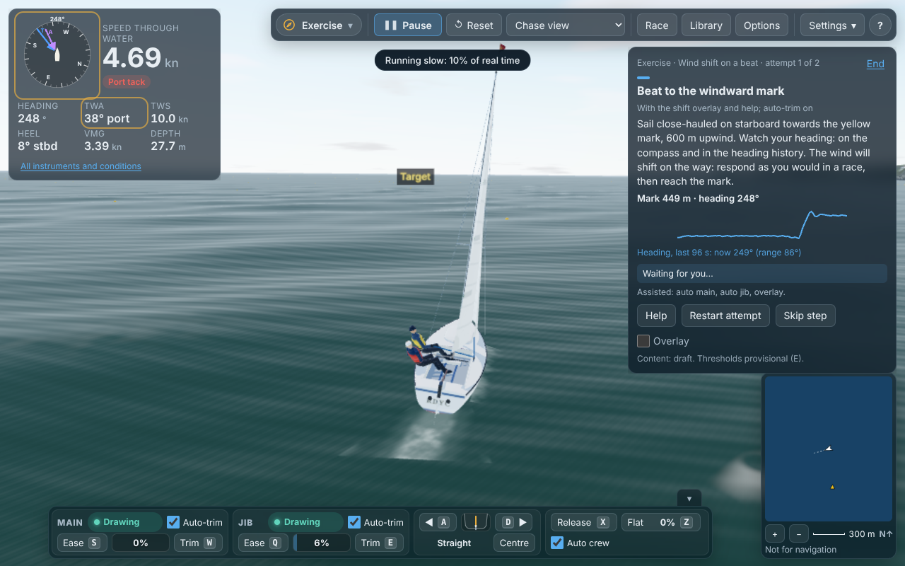 | 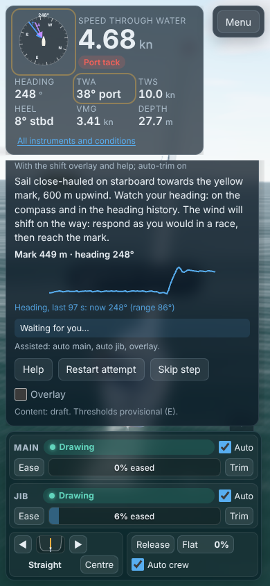 |
| Tactical review (decision, outcome, map) | 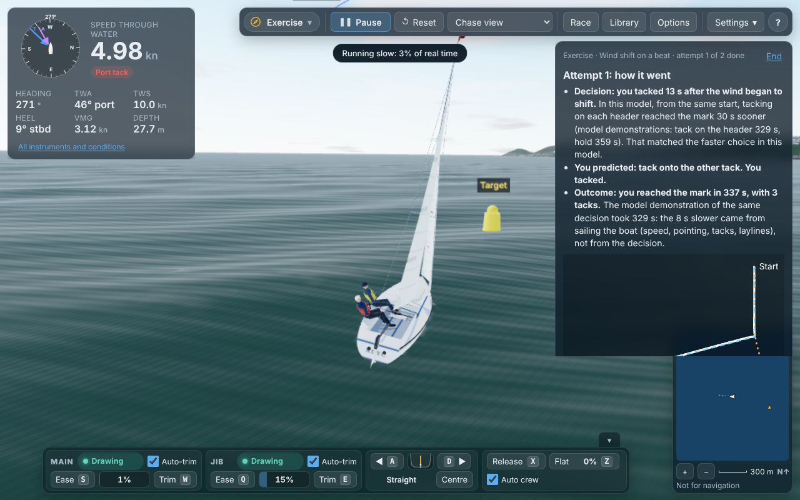 | 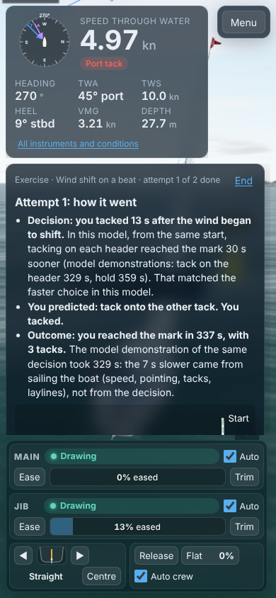 |

The beginner result card after a scripted run: 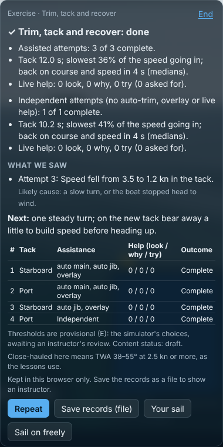. The tactical review card: 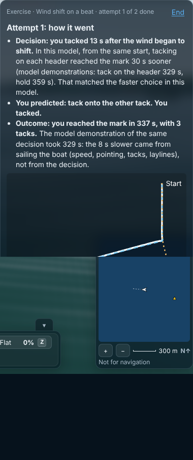.

What the screenshots show and do not: the cards read at both sizes; on a phone the card scrolls above the dock, and on a laptop the review's map continues below the fold (the card scrolls). In the tactical shot the heading history is dominated by the tack's 75° turn, so the 15° header shows as a small step before it. The scripted learner's tacks fall to 36% of the speed going in, so the review flags a "big loss" (threshold 40%, E): a threshold for instructors to judge (T3.6).

**Uncertainty, listed:** every threshold (E); the model's pointing (PH-10) and weather helm (issue 205) under the exercises; the demonstrations' autopilot rules (issue 209); no learner, instructor or sailor has tried any of it; no real GPU or device; no listening test.

## 10. Handover (§13)

**What changed**, kept apart:
- **Physics: none.** No coefficient, force or boat-model change; the hash, envelope and golden traces are unchanged.
- **Environment input:** one scripted wind shift for manual weather, persistent or temporary (`c3bd45d`, `9eb1d8b`). Unchanged when absent.
- **Control input (app layer):** the auto-trim hand-over (`4e0da08`).
- **Presentation and app logic:**
  - the fixes for issues 198, 199, 200 and 203;
  - the exercise engine and both exercises;
  - the debrief notes and instructor tools;
  - the accessibility work (issue 204).
- **Tests and tools:**
  - trust checks;
  - the exploit search;
  - the sensitivity harness;
  - the advice property test;
  - the exercise, sound, debrief and mode tests;
  - six e2e tests.
- **Docs:**
  - this report;
  - validation sheet section T;
  - issues 198–209;
  - the README row.

**O1–O9:**

| | Status |
|---|---|
| O1 | Confirmed and fixed (issue 198) |
| O2 | Confirmed and fixed (199) |
| O3 | Confirmed and fixed (200) |
| O4 | By design, unchanged (the in-app explanation was not extended: lower priority than the exercises) |
| O5 | Out of scope |
| O6 | The tooltip already says what Flat combines |
| O7 | Intended |
| O8 | Not established |
| O9 | Nothing removed |

New findings:
- 201: the auto-trim hand-over, found by the exploit search; fixed.
- 203: sound start-up could stop the controls; fixed.
- 204: label in name, found by axe; fixed.
- 205: weather helm with the helm let go.
- 206: a persistent shift gives no decision to teach.
- 207: no key remapping.
- 208: all exercise content is draft.
- 209: the demonstrations are autopilot rules.

**Left undone or partly done:**
- opponents in the tactical exercise (optional);
- key remapping (documented gap);
- O4's in-app explanation;
- a second reviewer's pass;
- issue 202 (CI flake, not investigated);
- real devices and a listening test.

**Next three improvements, ranked by evidence:**
1. Run validation section T with 3–5 beginners and the two instructors. Every threshold and help text is unvalidated (issue 208), and the scripted run already shows the "big loss" rule firing on a plausible tack (T3.6).
2. Settle PH-10 and issue 205 with Squib sailors (T4.1, T4.4). Both sit directly under the close-hauled band the beginner exercise teaches and under the tactical demonstrations.
3. A persistent-shift variant of the tactical exercise that teaches laylines rather than tacking. The model shows the decision does not matter there (issue 206), which is itself worth teaching against over-generalising "tack on the header" (T5.6).
