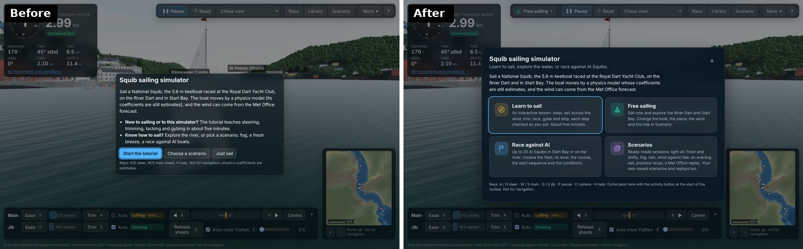
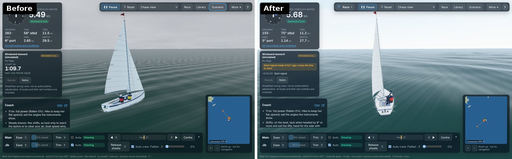
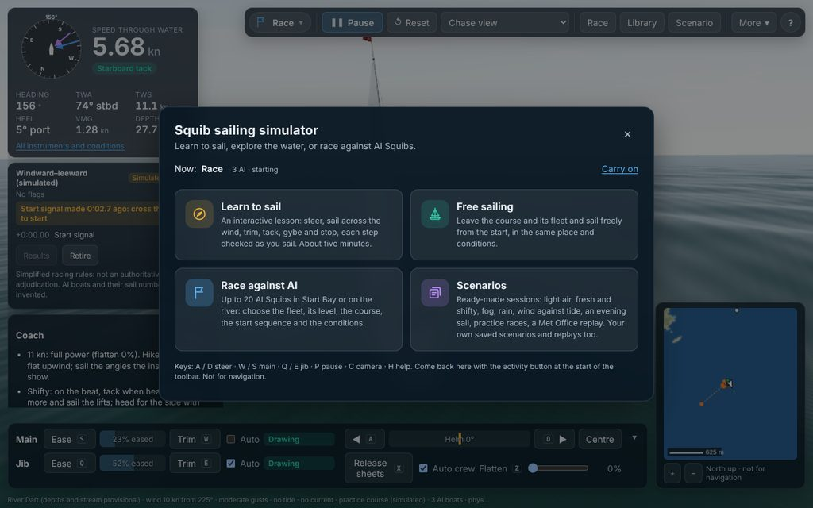
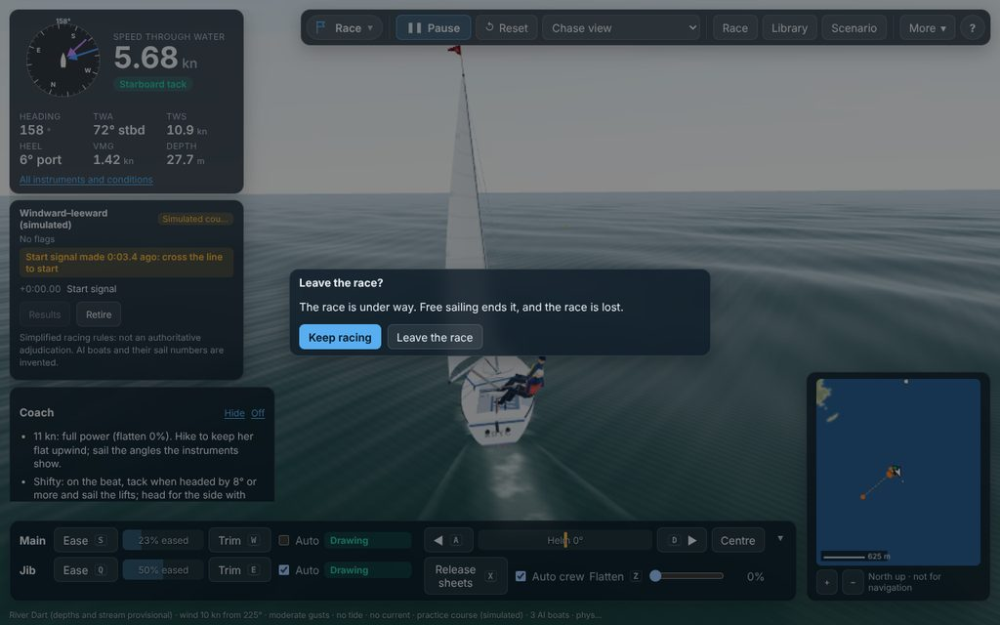
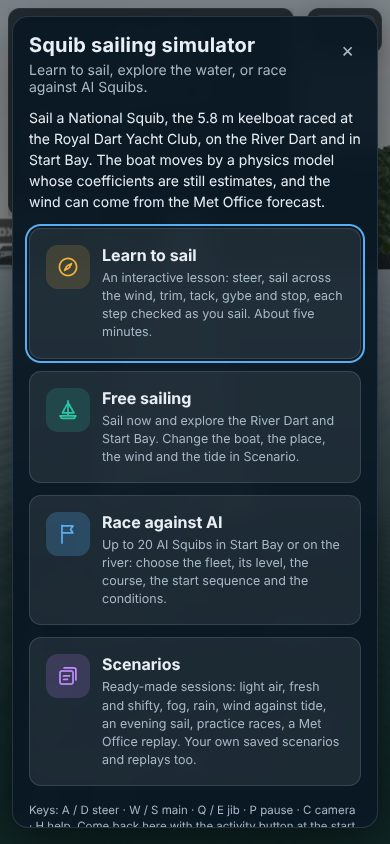

# UI and UX transformation (master prompt v2): audit, plan and stage reports

Started 29 Oct 2026. This document is the implementation contract for the redesign.

- **Phase 0:** the audit, the feature preservation matrix, the journeys, the state transitions and the baseline (§1–§7).
- **Stages:** each stage's report is appended as it completes (§8 onwards).

The rule throughout: **simplify the experience, not the simulator.** Every feature below stays reachable and works as before, unless this document records a deliberate, tested change.

Status words used in the stage reports:
- **Implemented:** in the code.
- **Tested:** by an automated test that ran.
- **Visually reviewed:** screenshot checked by eye.
- **Not tested:** no check has run.
- **Proposed:** for a later stage.

---

## 1. Architecture (as found, commit `f1bb832`)

| Layer | What it is | Where |
|---|---|---|
| Build and language | TypeScript, Vite 8, React 19 (function components, `useSyncExternalStore`), no router, no state library | `package.json`, `src/main.tsx` |
| Simulation | Pure TypeScript, deterministic fixed 10 ms step; boat physics, environment (wind field, gusts, tide, stream, sea state, land effects), course judge, race committee, rules subset, fleet contact, AI skippers | `src/sim/**` (DOM-free; lint and tsconfig enforce it) |
| Session controller | One `SimController` owns the session: scenario, simulation, race session, tutorial, replay, coach, pause, time scale, camera mode, panels' visibility, sound, and publishes a `UiState` snapshot at most 10 times a second | `src/app/controller.ts` |
| Rendering | three.js `SceneView`, driven by the controller's frame loop (requestAnimationFrame), interpolating between physics states | `src/render/**` |
| UI | React components reading `UiState` via `useSyncExternalStore(ctl.subscribe, ctl.getState)`, calling controller methods; panels lazy-loaded | `src/ui/**` |
| Persistence | `localStorage` only (each read and write wrapped in try/catch) | see §2.8 |
| Tests | Vitest unit and simulation tests (349); Playwright browser tests (40+, four CI shards, SwiftShader); golden traces; a determinism hash | `tests/**`, `.github/workflows/ci.yml` |

**What this means for the redesign:**
- **One controller already is the session manager.** The redesign uses it and does not add a second one; new session rules (§4) are methods on it.
- **The UI already receives telemetry at 10 Hz** in one snapshot, not per frame. Components read what they need from it. No component subscribes to the frame loop, so the UI work cannot slow the rendering, except through layout cost.
- **The simulation has no knowledge of the UI.** Every change in this programme is in `src/ui`, `src/app` (session rules only) and `styles.css`.

## 2. Feature inventory and preservation matrix

Each row is protected. **Proposed UI** is where the feature will live after the redesign. Every redesign stage must keep its **Verification** green.

The verification codes name the browser tests that exercise each feature:

| Code | Test file |
|---|---|
| smoke | `tests/e2e/smoke.spec.ts` |
| ux | `tests/e2e/ux.spec.ts` |
| p6 | `tests/e2e/phase6.spec.ts` |
| redteam | `tests/e2e/redteam.spec.ts` |
| hifi | `tests/e2e/hifi.spec.ts` |
| gfx | `tests/e2e/graphics.spec.ts` |
| deploy | `tests/e2e/deploy.spec.ts` |

"Manual" means a UAT check only.

### 2.1 Sailing controls

The controls live in the sailing dock (`Controls.tsx`). The controller samples them once per physics step.

| Feature | Entry point now | Dependencies | Proposed UI | Behaviour that must not change | Verification |
|---|---|---|---|---|---|
| Helm port / starboard (hold; self-centres), hold helm (Shift), centre (Space) | Dock helm row; A D ← → Shift Space | `press`, `sampleInputs` (HELM_RATE 1.4, HELM_RETURN 1.8 per s), `centreHelm` | Dock "Steering" group | Rates, self-centring, key map | smoke "keyboard helm…", "on-screen buttons…" |
| Main sheet trim / ease, % eased bar | Dock; W S ↑ ↓ | SHEET_RATE 0.35/s; trimming turns auto off | Dock "Sail handling" | Rate; independent of the jib | smoke, ux "sail status" |
| Jib sheet trim / ease | Dock; E Q | same | Dock "Sail handling" | same | smoke |
| Auto-trim main / jib | Dock checkboxes; M J | `setInput({autoMain/autoJib})` | Dock (Standard and Advanced), and in Simple the jib stays on auto as now | Never switched by a UI preset (§7 of the brief) | smoke |
| Sail status: drawing, luffing, stalled, with the key to press | Dock status chips | `sailState`, `sailAdvice` | Dock | Wording semantics | ux "sail status in plain words" |
| Release sheets | Dock; X | `releaseSheets` | Dock | | smoke |
| Auto crew, hike slider | Dock; K | `setInput({autoCrew, crewHike})` | Dock "Advanced" | | tutorial step "crew" (unit) |
| Flatten (depower) | Dock slider; Z / Shift+Z (quarters) | `setInput({flatten})` | Dock "Advanced" | Steps of 0.25 by key | redteam "flatten" |
| Hide / show the dock (remembered) | Dock ▾; More → Sailing controls | `squib.controls.hidden` | Same | Keys still work when hidden | ux "sailing controls can be put away" |

### 2.2 Instruments

All from `ui.snapshot` (the physics' own values; nothing invented).

| Feature | Entry point now | Proposed UI | Must not change | Verification |
|---|---|---|---|---|
| Compass, heading-up, true (blue) and apparent (violet) wind arrows, heading | Instruments, top left | Instrument panel | Reference directions | smoke |
| Speed through the water, tack chip | Instruments | same | Units (kn), tack from the main's side | smoke `stw`, hifi "Starboard tack" |
| Heading, TWA, TWS, heel, VMG, depth; water aboard and damage when present | Instruments grid | same (Simple shows fewer, §7) | Signs, units | smoke |
| SOG, COG, AWA, AWS, leeway, rudder, helm balance, current | "All instruments and conditions" (remembered) | Advanced set | | smoke "scenario panel … in the instruments" |
| Conditions: clock, wind source and age, land effect, tide, stream, sky, waves, wind against tide | same | same | Provenance labels | smoke, deploy, hifi |
| Aground chip | Instruments | same | | smoke "Phase 3: sailing at the bank" |

### 2.3 Map and navigation

| Feature | Entry point now | Proposed UI | Verification |
|---|---|---|---|
| Minimap: north up, 3 zoom steps, boat and course over ground, AI fleet, ferries (amber when restricted), navigation marks, course legs and marks, next mark | Bottom right; N toggles; hidden under 900 px wide | Same, with clearer marks (Stage B) | smoke "Phase 3", "Phase 5" |
| Place labels | L; More → Place labels | same | ux "More menu" |
| Layers and sources (data versus provisional, load problems, attribution) | More → Layers and sources; the warning banner's Details | same | smoke "Phase 3 … provisional layers" |
| River Dart load warning, open-water fallback | Banner | same | smoke |

### 2.4 Cameras

| Feature | Entry point now | Proposed UI | Verification |
|---|---|---|---|
| Chase (wheel zoom), Scenic, Helm (drag to look, double-click ahead, wheel zoom), Orbit, Drone (drag, pan, climb; Back to boat B; Follow), Top | Camera select in the toolbar; C cycles; the drone and helm hint strips | Camera control in the top bar (same select, Stage B) | redteam "cameras", gfx "cameras" |

### 2.5 Session, playback and notices

| Feature | Entry point now | Proposed UI | Must not change | Verification |
|---|---|---|---|---|
| Pause / Resume, paused pill | Toolbar; P | Top bar | | smoke, ux |
| Reset, with confirmation once a race has started | Toolbar; R | Top bar | Asks only after the start signal and before you finish | ux "reset during a race asks first" |
| Contact and grounding banner (with damage) | Banner | same | | manual |
| Footer: environment, conditions, disclaimers | Footer badge | same (mode chip adds the activity, §6) | Disclaimers present | manual |
| Replays: save, open, verify (bar), ×1–×8, take over | Library → Replays; the replay bar replaces the dock | Scenarios → Replays | Bit-for-bit verification | p6 "replays", "replay speed" |

### 2.6 Boat, conditions and scenario set-up (the "Scenario" panel)

| Feature | Proposed UI | Verification |
|---|---|---|
| Squib type (Rondar, classic, new sails) with the table of what changes | Set-up → Boat; offered in Free sailing and race set-up (Stage C) | hifi "three Squib types" |
| Helm figure (man / woman, appearance only) | Set-up → Boat | manual |
| Start time (UTC, Now), start position (5 places), heading, speed | Set-up → Start | smoke |
| Wind source (manual, live, replay files) with freshness; TWS, direction | Set-up → Wind | smoke, deploy "live data …" |
| Sky (presets or forecast), gusts and shifts (preset, seed), land effects | Set-up → Wind | deploy, hifi |
| Tide (none, manual HW/LW, live file) | Set-up → Tide | smoke, deploy |
| Current (none, uniform, channel-following, tidal) | Set-up → Tide | smoke |
| Course (none, practice kinds with leg length, library, inline from the editor), laps; start sequence; start signal time | Set-up → Course and start; Race set-up | smoke "Phase 4" |
| Fleet: AI boats 0–20, AI level (club, good, expert), preparatory flag (P, U, black) | Race set-up | smoke "Phase 5" |
| Apply and restart; errors shown | same | smoke |

### 2.7 Racing

| Feature | Entry point now | Proposed UI | Verification |
|---|---|---|---|
| Quick race: competitors 0–20, level, venue (Start Bay; the river when its data is loaded), course (Start Bay), conditions (random with wind band, live, as set), sequence, "same conditions again"; options remembered | Toolbar → Race | "Race against AI" experience (opens this panel; Stage C groups it with every Scenario-panel race option) | redteam "quick race" |
| Race panel: course name and status, flags, attempt, position, disqualification, penalty owed, countdown and next signal, OCS, leg / lap / next mark with distance and bearing, finish time, events, fleet log, course warnings, Results, Retire | Left column during a race | Racing HUD | smoke "Phase 4", "Phase 5" |
| Results (low points; shown at the end) | Race panel; automatic | same | smoke "Phase 5" |
| Race coach: briefing, tips, debrief; on/off (remembered) | Card under the race panel; More → Race coach | same | redteam "quick race … coach" |
| Course editor: marks, lines, legs, live validation, import / export, library courses, save and sail | More → Course editor | Race set-up → Course editor | smoke "Phase 4: course editor" |

### 2.8 Scenarios, learning, settings, tools and persistence

| Feature | Entry point now | Proposed UI | Verification |
|---|---|---|---|
| Built-in scenarios (10: first sail, light air, fresh and shifty, wind against tide, fog, squally rain, evening, practice race, river race, Met Office replay); unavailable ones say why | Toolbar → Library | "Scenarios" experience (the Library) | p6 "scenario library" |
| Your scenarios: save, export, import, delete | Library | same | p6 |
| Welcome (first visit) | Automatic once | Experience hub (§6), reopenable | ux "first visit" |
| Tutorial: 11 steps checked against the simulation; highlights; Back, Next / Skip step, End | Welcome; More → Tutorial; Help | Academy (Learn to sail) | ux, `tests/sim/tutorial.test.ts` |
| Help (keys, how to sail, racing basics) | ? ; H | same | ux "More menu …" |
| Graphics and sound (presets, options, lighting presets, volumes, mute U) | More → Graphics and sound | same | gfx |
| Physics tools: force arrows F, physics panel G, validation dashboard V (charts, table, CSV), polar sweep (worker) | More → Physics tools | same (Advanced) | smoke "validation dashboard", "polar panel" |
| Live data discovery and freshness | Scenario panel, Quick race | same | deploy "live data …" |
| Determinism hooks (`window.__squib`), replays' build id | Code | unchanged | smoke "criterion 11" |

**Remembered in the browser:**
- `squib.welcomed.v1`
- `squib.controls.hidden`
- `squib.instruments.more`
- `squib.coach`
- `squib.quickRace.v1`
- `squib.userScenarios.v1`
- `squib.userCourses.v1`
- `squib.graphics.v1`
- `squib.audio.v1`

Every key keeps its meaning; new keys get new names.

## 3. Core journeys today (clicks from the sailing view)

| Journey | Steps today | Friction |
|---|---|---|
| Free sailing | None: the app opens sailing off RDYC (after the first-visit welcome: "Just sail") | Starts with the main **luffing** and a warning chip: auto-trim is on for the jib only, by design, but a beginner's first message is a problem |
| Choose the Squib type | Scenario → scroll → Boat → choose → Apply and restart (4) | Buried at the top of a long form whose title says "Scenario" |
| Race against AI | Race → Start race (2); full options: Scenario → course, sequence, fleet, flag → Apply (6+) | Two separate set-ups with different subsets: the quick race has no preparatory flag, laps, leg length, boat type or start time; the Scenario panel has no random or live conditions |
| Start and finish a race | Countdown in the race panel; results at the end; Results; Retire | The coach card overflows the left column on a 800 px-high window (baseline screenshot) |
| Open a ready-made scenario | Library → Load (2) | The ready-made scenarios are under **Library**, while **Scenario** is the custom set-up form: the names invite the wrong click |
| Change the conditions | Scenario → Wind / Tide → Apply and restart (3+) | Always restarts; there is no "change on the fly", by design (determinism) |
| Sail and helm | Dock or keys | Fine; dense for beginners (two sails, crew, flatten, release all at once) |
| Change the camera | Toolbar select or C (1) | Fine |
| Advanced instruments | "All instruments and conditions" (1) | Fine |
| Learn to sail | First visit only; afterwards More → Tutorial or Help → Start the tutorial (2) | Hidden after the first visit; one 11-step lesson, not separate lessons |

## 4. State transitions (how the controller handles them today)

| Transition | What happens today | Finding |
|---|---|---|
| `restart(scenario)`: Scenario Apply, Library Load / Import, Quick race, tutorial, lighting preset, course editor "Save and sail", R before a start | Rebuilds the simulation, race (fleet, committee, judges), coach, traffic. Clears results, replay (unless opening one) and the reset question. The input carries over with the helm centred. The camera is kept. The **pause is kept**. The tutorial ends unless the new scenario is the tutorial's own | **T1:** starting another activity *during a race that has started* (Library Load, Quick race, tutorial, lighting preset, Scenario Apply, Save and sail, open a replay) **throws the race away without asking**; only Reset asks. **T2:** a new session started while paused stays paused (Quick race and the tutorial un-pause themselves; Library Load does not) |
| Pause / Resume | Stops the physics and the render time; the frame clock is reset on resume | Fine: a race, the tutorial and replays all pause with it |
| Reset (R) | In a race between its start signal and your finish, asks "Restart the race?" | Fine; the model for T1 |
| Opening panels (Scenario, Library, Race, Settings, Help, Layers, editor, dashboard) | Pure UI; the simulation runs on; nothing resets | Fine. The Scenario panel edits a draft until Apply |
| UI and graphics settings | Visual only; never touch the simulation | Fine (graphics round) |
| Tutorial: Reset | Restarts the tutorial's scenario and **keeps the step**; the step's starting sample is not taken again | **T3:** after a reset mid-step, a "turn 30° from where the step began" goal still measures from the old heading. Minor; Stage E |
| Tutorial: start from a race | Discards the race silently | Part of T1 |
| Replay | Keys and dock disabled, Take over continues from the replayed state | Fine |
| Duplicate AI boats | Impossible: the fleet is rebuilt by `restart` from the scenario, never added to | Fine |
| Leaving the page | No warning | Acceptable (a browser app; replays can be saved) |

## 5. UX problems, by severity

**High**
- **U1 Experiences not named as users think of them.** Learn (More → Tutorial), Free sailing (implicit), Race against AI ("Race"), Scenarios ("Library"), plus a set-up form called "Scenario".
- **U2 No sign of the current activity.** Free sailing, a race, sailing a course alone, the tutorial and a replay look the same at the top. The footer says it in 10 px type.
- **U3 Destructive transitions without asking** (T1).

**Medium**
- **U4 Two race set-ups with different, overlapping options** (§3).
- **U5 Beginners see every control at once.** No interface level; the welcome appears once and cannot be found again.
- **U6 The free-sailing start shows a luffing warning** on the main (auto-trim off) as the first thing a newcomer reads.
- **U7 The coach card overflows** the left column in a race at 800 px height.
- **U8 Colour-only distinctions:**
  - true and apparent wind on the compass (blue and violet; length differs, but there is no label);
  - the port and starboard tack chip (green and red, but its text says the tack).
- **U9 The tutorial is one long lesson,** with no separate steering, wind, trim, waypoint and tacking lessons, and no target to sail to.

**Low**
- **U10 Styling layered over several rounds:** several overriding blocks for `.panel`, `.toolbar`, `.status`, `.instruments`, `.controls`. Some tokens exist (`--s1`–`--s4`, `--radius`), others are hard-coded.
- **U11 Truncated status text in the dock** at 1280 px ("Luffing · trim i…").
- **U12 Phones:** the instruments and the dock cover most of the screen (by design, Phase UX), and the minimap is hidden under 900 px.

## 6. Proposed interface structure

**Choice: no separate home page in front of the simulator.** The water is always live behind the interface. The lowest-friction structure keeps the single screen and adds three things:

1. **An activity chip,** the first item of the top bar. It shows what you are doing:
   - Free sailing;
   - a race (with its fleet and phase);
   - a course sailed alone;
   - the tutorial (with its step);
   - a replay.

   Choosing it opens the experience hub.
2. **The experience hub:** the welcome, grown into four doors.
   - **Learn to sail:** the interactive tutorial, and later the Academy's lessons.
   - **Free sailing:** sail now, in the conditions as set.
   - **Race against AI:** the race set-up.
   - **Scenarios:** the scenario library and replays.

   It opens by itself on the first visit only. Returning users land sailing, with the hub one click away on the chip.
3. **The existing doors stay,** so nothing learned is lost and no test-documented behaviour is broken:
   - the toolbar's Race, Library and Scenario buttons;
   - More;
   - Help;
   - every key.

   Renaming Library to "Scenarios" and Scenario to "Set up" is proposed for Stage C, with the tests updated together.

Later stages (proposed):

| Stage | Work |
|---|---|
| B | The interface level (Simple / Standard / Advanced, independent of the simulation); the dock regrouped as Steering, Sail handling and Advanced; labelled wind arrows; a clearer map; a contextual racing HUD that fits |
| C | One race set-up exposing every race option, in groups: Boats and competitors, Course, Starting procedure, Conditions, Advanced. A scenario browser with descriptions and conditions; boat choice in Free sailing |
| D / E | The Academy: a reusable lesson engine (steps with a condition, completion, hint, recovery) and lessons for steering, the wind, trim, reaching a waypoint (a real marker in the water) and tacking; free-sailing coaching |
| F | Polish, accessibility, phones |

## 7. Baseline (commit `f1bb832`, 29 Oct 2026)

| Check | Result |
|---|---|
| `npm run lint` | clean (run 20:25 UTC) |
| `npm run typecheck` | clean |
| `npx vitest run` | **349 / 349 passed** (44 files) |
| `npm run build` (with the secret check) | passed (graphics round, same commit) |
| Determinism hash (7 boats, 400 s, River Dart) | `11824f89f479d0f4` |
| Browser tests | **CI run 40927400564: all four shards and the checks job green** on this commit. Locally they time out on the software renderer (issue 86): CI is the reference |
| Screenshots | 11 surfaces at 1280 × 800, 1024 × 768 and 390 × 844, no page errors (`scratchpad/ux/before`) |
| Performance | Drawing cost measured in the graphics round (`tools/gfx-bench.mjs`). The UI work is measured by frame time in the same views, and by the UI's publish rate (10 Hz, unchanged) |

## 8. Risks

| Risk | Mitigation |
|---|---|
| Changing labels breaks 40+ browser tests that find controls by name | Keep every existing label in this slice; rename only with the tests, one stage at a time |
| A new session rule changes behaviour the tests rely on | The guard (§9) uses the same condition as Reset (a race between its start signal and your finish). No existing test switches activity in that window: the library's practice race starts at 330 s |
| CSS consolidation shifts layouts | Tokens first, layout untouched; screenshots before and after at three sizes |
| Phones | The hub is a dialog sized for 390 px; the chip folds into the Menu like the rest |
| Performance | The chip and the hub read the 10 Hz snapshot like the other components; the dialog is not mounted when closed |

## 9. First vertical slice (Stage A and the experience entry)

1. **Design tokens** (Stage A).
   - A nautical palette, type scale, spacing, radii, elevation, motion and focus tokens in one block, mapped onto the variables the existing rules already use, so the whole interface takes them without layout changes.
   - `prefers-reduced-motion` for every transition.
2. **Activity chip and experience hub.**
   - The four doors, each calling an existing, working function: the tutorial; free sailing in the current conditions; the quick race set-up; the library.
   - The welcome's first-visit behaviour is kept, and the hub can be reopened.
3. **Leaving a race asks first (T1).**
   - One controller method, `leaveTo(what, start)`, asks "Leave the race?" exactly when Reset would.
   - It is used by every path that starts another activity: hub, Library load / import / replay, quick race, tutorial, lighting presets, Scenario Apply, and the course editor's Save and sail.
4. **A new session starts sailing (T2)** when it is started from the hub or the Library, as the quick race and the tutorial already do.

**Not in this slice:** labels, the dock, the instruments' layout, the race set-up, the Academy.

---

## 10. Stage report: Stage A (tokens) and slice 1 (experience entry, activity, safe transitions), 29 Oct 2026

### Changes made

| Change | Where | Status |
|---|---|---|
| **Design tokens:** one block for the palette, semantic colours, type scale, spacing, radii, elevation and motion. The older variable names are aliases, so every existing rule took the new palette without layout changes. Tints (24 of them) are `color-mix` on the tokens instead of hard-coded rgba. Consistent focus ring; control transitions; a global reduced-motion rule | `src/ui/styles.css` (top and end) | Implemented, visually reviewed |
| **Activity button**, first in the toolbar: Free sailing, Race (fleet and phase), Course, Tutorial (step), Replay (title). Derived from the session's own state; the detail shows on wide screens and is always in its name and tooltip | `src/ui/activity.ts`, `App.tsx` | Implemented, tested (unit, browser), visually reviewed |
| **Experience hub:** Learn to sail, Free sailing, Race against AI, Scenarios. It is the first-visit welcome and can be reopened from the activity button. Each door calls an existing feature: the tutorial, `freeSail`, the quick race panel, the library. "Free sailing" says what it will do in context (leave the course, end the lesson, stop the replay) | `src/ui/Welcome.tsx`, `src/ui/icons.tsx` | Implemented, tested, visually reviewed at 1280, 1024 and 390 px |
| **Leaving a race asks first:** `leaveTo(what, start)`, under the condition Reset already uses. It covers Library Load, Import and Open replay, Quick race, the tutorial (More, Help, hub), the hub's Free sailing, the lighting presets, Scenario Apply and the course editor's Save and sail. "Keep racing" (and Escape) changes nothing; "Leave the race" starts the new activity | `src/app/controller.ts`, the panels | Implemented, tested (unit, browser) |
| **A new session starts sailing:** Library Load and Import, and the hub's Free sailing, un-pause, as the quick race and the tutorial already did (T2) | controller `startSession`, `freeSail` | Implemented, tested |
| **Course editor's error message** reads the current state (it read a value captured when the panel was drawn) | `CourseEditor.tsx` | Implemented, not separately tested |

### Preserved features (verified)

| Verification | Result |
|---|---|
| **Unit tests:** 357 / 357 pass (349 existing and 8 new, `tests/sim/session.test.ts`). The new tests cover the activity naming, the leave rule (asks only during a started race, keeps the race on "Keep racing", same condition as Reset), `startSession` un-pausing, and `freeSail` from a race (place, conditions and boat kept) and from the tutorial (no restart) | Tested |
| **Physics:** determinism hash `11824f89f479d0f4`, unchanged. No file under `src/sim` changed | Tested |
| **Browser tests run locally** (Chromium, SwiftShader): `experience.spec` (2, new), the first-visit tests (2, updated: the first door is "Learn to sail"), Reset in a race, quick race with the coach, the scenario library, the replay round trip, on-screen buttons and the Scenario panel, the course editor, graphics and sound, the toolbar's More menu (button count updated 7 → 8 for the activity button), and the phone layout | **13 passed** |
| **Full browser suite** (all 40+ tests, four shards) | On CI for this commit (the reference: local runs time out on the software renderer, issue 86) |
| Lint, typecheck, production build, secret check | Pass |

Everything in the preservation matrix (§2) keeps its entry point. The toolbar's Race, Library, Scenario, More and Help, every menu item and every key are unchanged; the hub adds ways in and removes none.

### Not tested, limitations

- **No real-GPU check.** Not measured on a real GPU or a touch device: layout was reviewed in screenshots at three sizes only.
- **Frame time not re-measured.** The slice adds no per-frame work: the components read the existing 10 Hz snapshot, and the hub is not mounted when closed.
- **Tutorial content unchanged.** Its engine (`src/app/tutorial.ts`) is untouched; the lessons are Stage D/E.
- **Labels unchanged.** "Library" and "Scenario" keep their labels until Stage C (issue 104).

### Known risks

- The leave question covers paths through the UI. A test or script calling `ctl.restart` directly is not asked, by design: it is the low-level call.
- A pending question is cleared by any restart (tested), so it cannot fire late.

### Next recommended stage: B (core simulator UI)

1. **Interface level** Simple, Standard or Advanced: what the instruments and the dock show, stored separately from the simulation, never touching auto-trim or the physics.
2. **The dock regrouped:** Steering, Sail handling, Advanced. Same controls and keys.
3. **Labelled wind arrows** (issue 105).
4. **Racing HUD that fits the left column** (issue 103).
5. **A fresh free sail that starts trimmed** (issue 102).
6. **A compact top bar** (issue 106).
