# UX review and changes (24 Oct 2026)

A usability review of the simulator, made after the repository went public, and the changes it led to.

## Method

- **Heuristic evaluation** against Nielsen's ten usability heuristics. Each finding is rated on Nielsen's 0–4 severity scale (4 = must fix).
- **Accessibility:** spot checks against WCAG 2.2 AA:
  - keyboard operation, focus, names and roles of controls;
  - contrast of text on the panels;
  - target size;
  - motion.
- **Screen sizes:** desktop 1280 × 800 and 1440 × 900, and a phone at 390 × 844 (touch). Screenshots were taken before and after with Playwright.
- **Reported by the owner:**
  - the sea shows through the bottom of the boat;
  - buildings and crew lack detail;
  - there is no tutorial.

This is an expert review, not a study with users. Nobody new to sailing has tried the tutorial yet (see "Not done").

## Before and after

| Before | After |
|---|---|
| 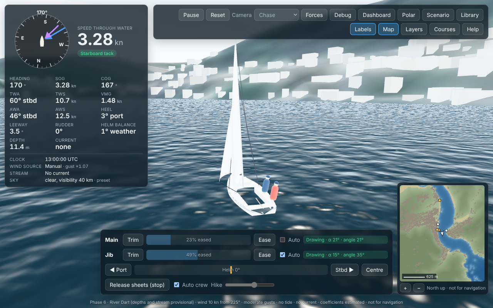 | 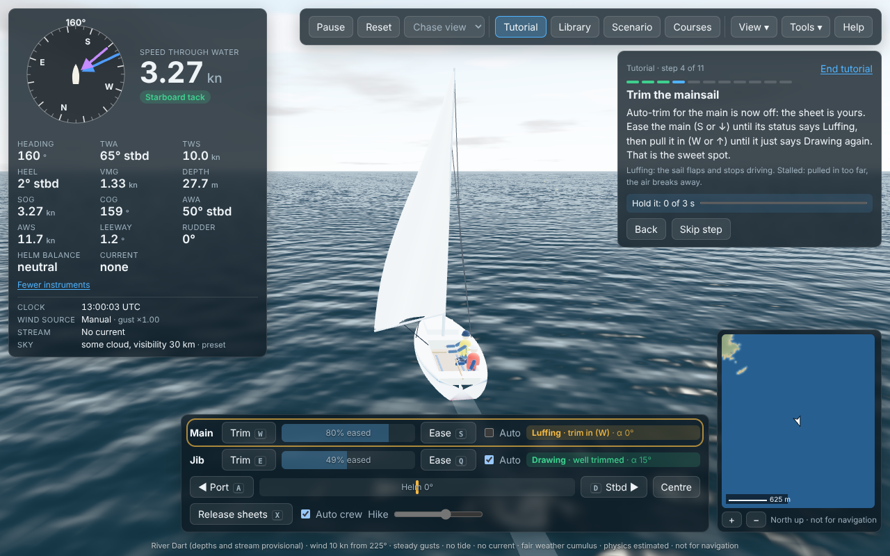 |
| 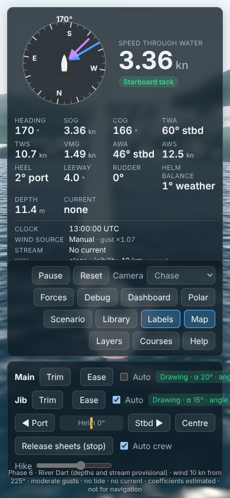 | 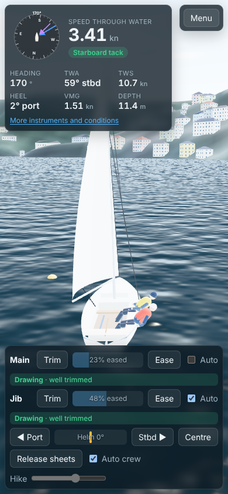 |
| 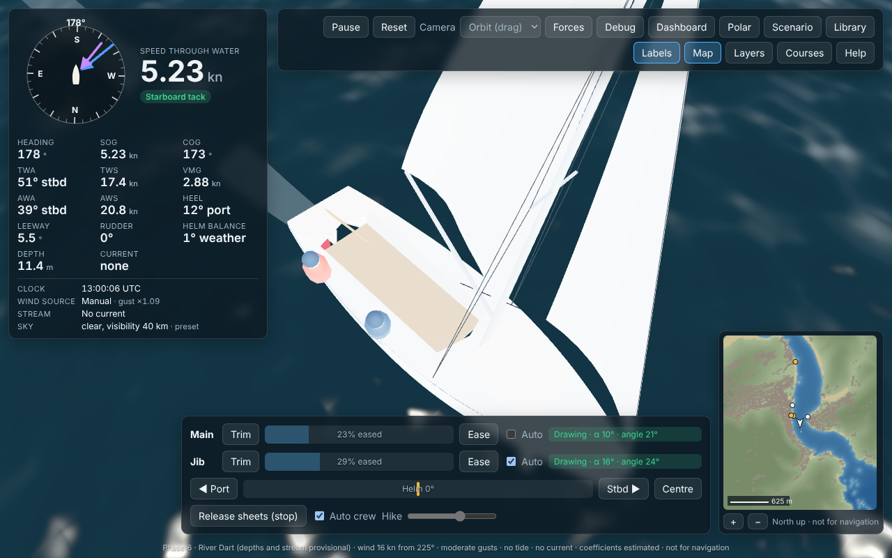 | 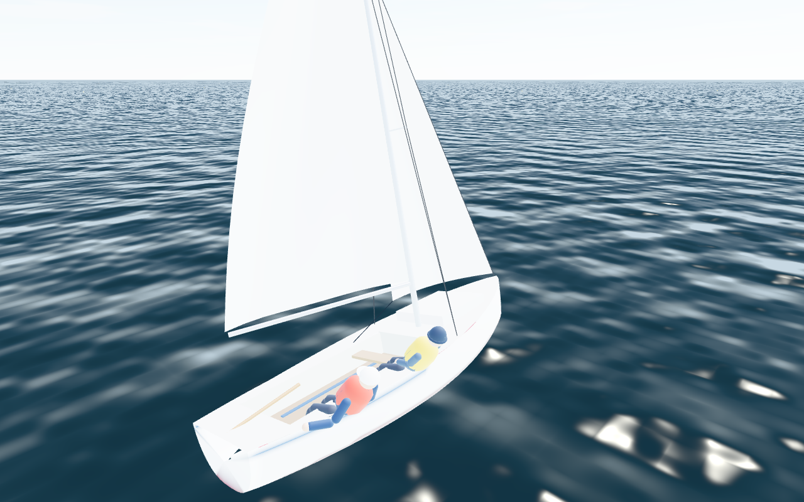 |

| | |
|---|---|
| 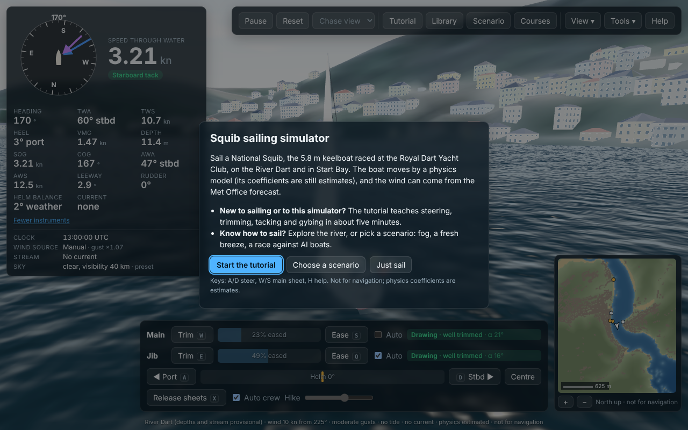 |  |
| First visit: the welcome | Tutorial, step 4 of 11 |
| 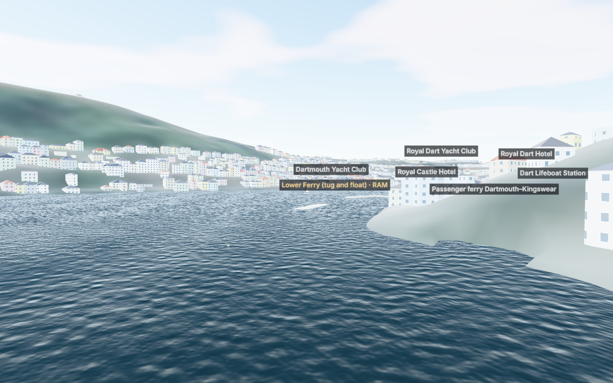 | 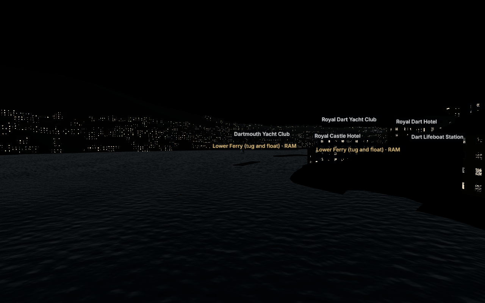 |
| Dartmouth by day | 15 July, 20:40 UTC (sun about 3° below the horizon): lit windows. The scene is drawn darker than real civil twilight (see "Not done") |

## Findings and changes

| # | Finding | Heuristic | Severity | Change | Checked by |
|---|---|---|---|---|---|
| 1 | No onboarding: a first-time visitor sees 22 numbers, 14 toolbar buttons and sailing jargon, with no way to learn | Help and documentation; recognition | 4 | First-visit **welcome** with three choices (tutorial, scenario, just sail). An **interactive tutorial** in 11 steps: steer, beam reach, trim the main, close-hauled, tack, run, gybe, crew weight, stop. Each goal is checked against the simulation, and the tutorial moves on by itself. The parts of the screen each step is about are outlined. It can be restarted from the toolbar or Help | `tests/sim/tutorial.test.ts` (12 tests, including a scripted helmsman completing every step); `tests/e2e/ux.spec.ts` |
| 2 | On a phone the app is unusable: the instruments cover the screen, the toolbar overlaps them, and the controls run off the edge | Flexibility; aesthetic | 4 | **Phone layout:**<ul><li>compact instruments;</li><li>the toolbar behind a Menu button;</li><li>controls that wrap within the width;</li><li>panels open below the instruments;</li><li>the footer is hidden.</li></ul>Key hints are hidden on touch screens | e2e "on a phone" (no horizontal overflow; Menu works) |
| 3 | The sea is visible inside the boat: through the cockpit, and over the leeward deck when heeled | Aesthetic (credibility) | 3 | **Watertight boats:**<ul><li>each boat marks its deck outline in the stencil buffer, and the water is not drawn there;</li><li>the cockpit well is closed with bulkheads;</li><li>wedge-shaped gaps at the ends of the cockpit opening are gone.</li></ul>Applies to every boat in a fleet | e2e "boats are watertight"; before/after screenshots |
| 4 | Toolbar overload: 14 controls in two rows. Developer tools (Forces, Debug, Dashboard, Polar) sit beside everyday ones | Aesthetic and minimalist; consistency | 3 | **Grouped toolbar** on one row at 1280 px:<ul><li>run control (Pause, Reset, Camera);</li><li>activities (Tutorial, Library, Scenario, Courses);</li><li>a **View** menu (labels, minimap, force arrows, layers);</li><li>a **Tools** menu (dashboard, polar, physics panel);</li><li>Help.</li></ul>The menus follow the WAI-ARIA menu-button pattern (arrow keys, Escape) | e2e toolbar test |
| 5 | Sail status in jargon ("Drawing · α 10° · angle 21°"), with no hint of what to do | Match with the real world; help users recognise and recover | 3 | **Plain-language status with the fix and its key:** "Luffing · trim in (W)", "Stalled · ease out (S)", "By the lee · gybe risk: head up". α stays visible as detail, and the sail angle is in the tooltip | e2e "sail status in plain words" |
| 6 | Reset (and the R key) threw away a race in progress without warning | Error prevention | 3 | Once the start signal has gone, Reset asks first, with "Keep racing" focused | `tutorial.test.ts`, e2e reset test |
| 7 | "Release sheets (stop)" does not stop a boat on a run (the wind still pushes the sails), as a scripted test showed | Match with the real world | 2 | Relabelled **Release sheets**. The tooltip, Help and the tutorial teach stopping properly: let the sheets go *and* head into the wind | Tutorial walk-through test |
| 8 | Keys only in Help and tooltips | Recognition rather than recall | 2 | **Key hints on the buttons** (Trim W, Ease S, A Port, D Stbd, Release X) and in the menus | Screenshots |
| 9 | Escape closed only some panels; side panels could stack into a long column under the toolbar | Consistency; user control | 2 | **Escape** closes every panel and menu (and cancels the reset question). **One side panel at a time** (Scenario or Library). Panels open below the toolbar whatever its height | e2e toolbar test |
| 10 | 22 instrument values always shown | Aesthetic and minimalist | 2 | **Essentials first:** speed, tack, heading, TWA, TWS, heel, VMG, depth. "All instruments and conditions" shows the rest. It is open by default on desktop and folded on phones, and the choice is remembered | e2e phone test; existing instrument tests on desktop |
| 11 | Place labels overlapped ("Royal Castle Hotel" under "St Saviour's Church") | Aesthetic | 2 | **Label decluttering** on screen: navigation marks first, then landmarks, then ferries; nearer before farther | Screenshots |
| 12 | Buildings were plain boxes; crew were capsules with a ball for a head | Aesthetic (owner's report) | 2 | **Buildings:**<ul><li>hipped roofs on house-sized footprints;</li><li>windows on every wall, some lit after dark;</li><li>painted-render colours like the Dartmouth and Kingswear waterfronts (illustrative, not data).</li></ul>**Crew:** jointed figures with jackets, lifejackets, a cap or beanie, arms and legs. They sit in or sit out and lean out as the physics hikes them | Screenshots (`docs/img/ux-*.png`) |
| 13 | Instrument abbreviations (TWA, VMG, AWA) unexplained | Match with the real world | 2 | Plain tooltips ("True wind angle: where the wind comes from, relative to the bow …"); the tutorial explains TWA in use | — |
| 14 | Dialog focus: Help and the new dialogs | Accessibility | 2 | The primary action is focused on open. Escape closes. Dialogs are `aria-modal` with a label. Each tutorial step's title takes focus, so screen readers announce it | e2e (focus assertions) |
| 15 | The footer said "Phase 6" (meaningless to users) in 11 px text | Match with the real world | 1 | Removed. The footer keeps the data caveats ("physics estimated · not for navigation"); it is hidden on phones, where Help and the welcome carry the same caveats | — |
| 16 | Motion | Accessibility | 1 | The pulsing tutorial outline stops when the system asks for reduced motion | CSS `prefers-reduced-motion` |

## Redesign: less clutter (27 Oct 2026)

The owner's review: "The UI is too cluttered and needs to be redesigned using UI/UX best practices." On a 1280 × 800 screen the chrome covered about 40% of the view: an 11-button toolbar, a 340 px instrument panel with 14 readouts and five rows of conditions open by default, a four-row control dock, the minimap and a full-width footer.

| Before | After |
|---|---|
| 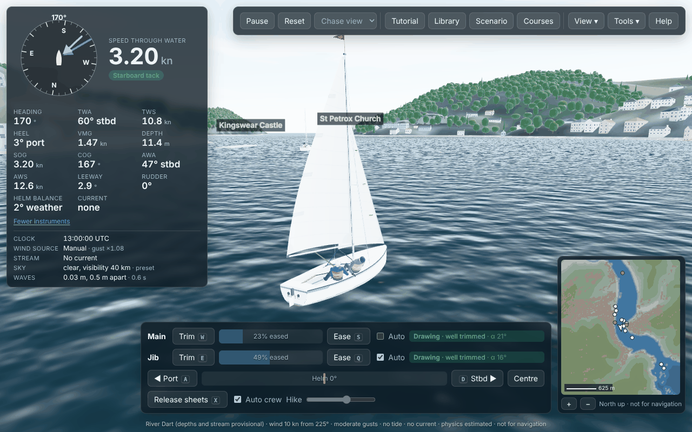 | 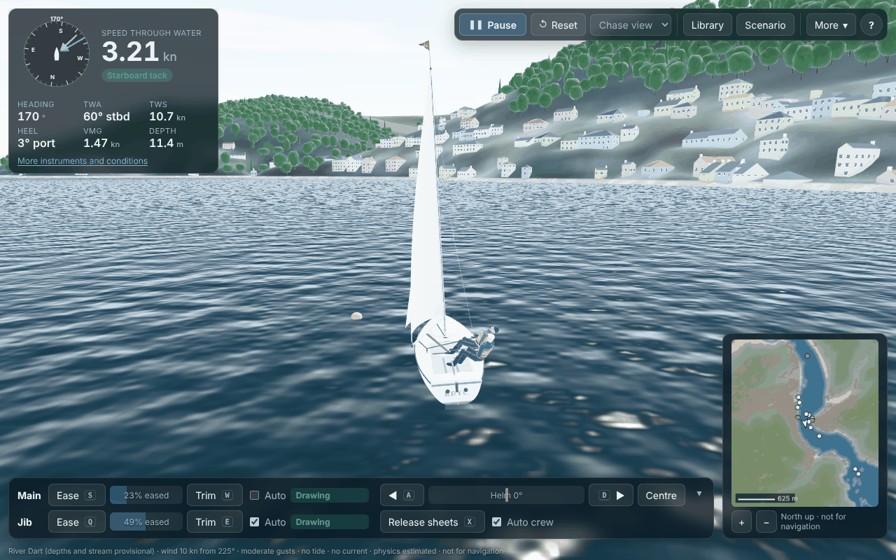 |
| 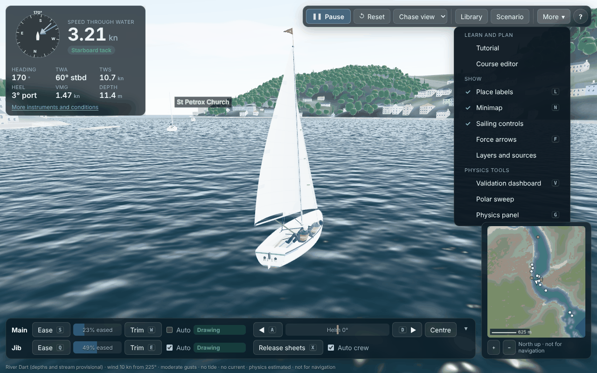 | 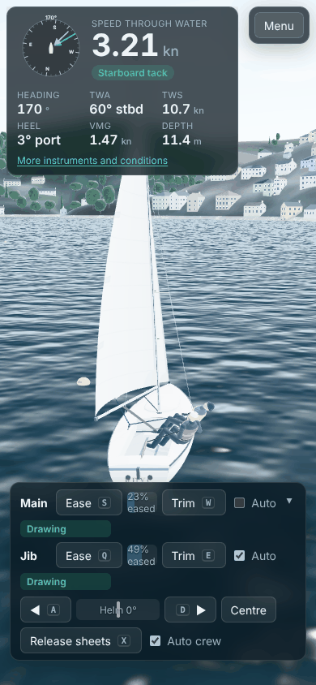 |

| # | Finding | Principle | Change | Checked by |
|---|---|---|---|---|
| R1 | Eleven toolbar buttons of equal weight; Tutorial, Courses and two menus beside the everyday ones | Hick's law (fewer choices, faster decisions); visual hierarchy | **Seven controls:** Pause/Resume as the primary (accented, with an icon), Reset, the camera, Library and Scenario, one **More** menu and Help (?). Tutorial, the course editor, the View items and the physics tools are in More, in three labelled sections | e2e toolbar test (six buttons in the bar; menu sections; Escape) |
| R2 | The instruments and conditions were open by default on desktop: 14 numbers and five rows of provenance | Progressive disclosure; minimalist design | **Compact by default everywhere:** the compass, speed and tack, then heading, TWA, TWS, heel, VMG and depth. "All instruments and conditions" opens the rest (renamed from "More instruments…", which a screen reader's list of buttons confused with the More menu); the choice is remembered | e2e (tests open the conditions where they read them) |
| R3 | A four-row dock (main, jib, helm, crew), 760 px wide, overlapping the minimap's column | Proximity and grouping; screen economy | **Two rows:** the sails on the left (Ease, sheet, Trim, Auto, status), the boat on the right (helm, Centre, Release sheets, crew). It centres in the space beside the minimap, so nothing overlaps. Hike appears only when the crew is manual | Screenshots at 1280, 820 and 390 px |
| R4 | Each sail's status always showed a sentence and an angle ("Drawing · well trimmed · α 21°") | Signal over noise: show what needs attention | A word when all is well ("Drawing"); the advice and its key only when something needs doing ("Luffing · trim in (W)"). The angle is in the tooltip | e2e "sail status in plain words" |
| R5 | Keyboard sailors had no way to clear the dock | User control and freedom | **Hide sailing controls** (▾ on the dock, or More → Sailing controls); a "Show sailing controls" pill brings it back; remembered. The keys keep working | New e2e test |
| R6 | "Paused" sat in the middle of the screen, over the boat | Don't obscure the primary content | A small pill under the app bar | e2e (text unchanged) |
| R7 | The footer ran across the whole bottom edge | Minimalist design | One quiet line at the bottom left, ellipsised, full text on hover; the data caveats are unchanged | e2e (footer text) |
| R8 | The race panel and the dock competed for the bottom left | Consistent placement | The race panel stacks under the instruments in one left-hand column: what the helmsman reads is together | Screenshots |
| R9 | Inconsistent sizes and spacing | Consistency | Spacing tokens (4, 8, 12, 16 px), 12 px panel radius, 32 px minimum targets, one translucent panel style; the camera selector no longer looks disabled | Screenshots |

## Not done (recommended next)

- **Testing with real users:** watch three to five people new to sailing take the tutorial. Their goal times and where they stall would tune the step thresholds, which are estimates (E).
- **Scenario panel:** it is long and dense. Split it into tabs (Wind, Tide, Place, Course, Fleet), and give sensible defaults a "Quick start" view.
- **Course editor:** it is desktop-only and dense. Its touch behaviour has not been designed.
- **Touch steering:** the hold buttons are about 32 px high. That meets WCAG 2.2 AA (24 px minimum), but 44 px would suit phones better. Pinch-zoom of the orbit camera was not tested.
- **Screen readers:** checked by reasoning and automated role and name assertions only. The 3D view itself is not accessible (inherent to a canvas); the instruments are text.
- **Sound:** none (wind, luffing, the start-sequence horns). Sound is useful feedback for trim and for race signals.
- **Language and units:** English only; knots and degrees only.
- **Low-end phones:** frame rate on low-end phones has not been measured (PERFORMANCE.md, issue 43).
- **Twilight is too dark:** the scene's daylight ramp (sun −6° … +10°) dims faster than real civil twilight, so a few degrees below the horizon already looks like night. Retune it against photographs.
